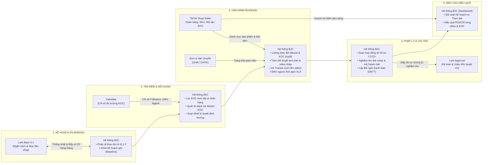

# QUY TRÌNH VẬN HÀNH & QUẢN TRỊ DỮ LIỆU KOC PHÒNG B2C
**Phiên bản:** To-Be v1.0 | **Ngày ban hành:** 12/10/2026 | **Đơn vị chủ quản:** Bộ phận Marketing B2C & Vận hành Booking Upbase

---

## 1. MỤC TIÊU VÀ BÀI TOÁN KINH DOANH
Tài liệu này chuẩn hóa toàn bộ dòng chảy công việc từ khâu nhận chỉ tiêu kế hoạch đến khi thanh toán hoàn tất thù lao cho KOC, nhằm giải quyết triệt để 4 điểm nghẽn lớn trong vận hành:
1. **Kiểm soát hàng mẫu:** Tránh thất thoát mẫu gửi đi bằng việc siết hạn chót bàn giao (SLA 48h) và cam kết ngày lên video (SLA 5 ngày sau nhận mẫu).
2. **Minh bạch hóa dòng tiền:** Kết nối trực tiếp giữa chi phí booking (tiền cast, tiền mẫu, tiền ship) với kết quả kinh doanh thực tế (doanh số GMV, tỷ lệ ra đơn).
3. **Chống trùng liên hệ:** Quản lý tập trung hồ sơ KOC và nhân sự phụ trách (Booking PIC) trên danh bạ gốc (Master Data).
4. **Chuẩn hóa hồ sơ pháp lý & chi trả:** Bóc tách chính xác thông tin CCCD, mã số thuế, tài khoản ngân hàng phục vụ soạn hợp đồng và duyệt chi kế toán.

---

## 2. PHẠM VI VÀ BẢN ĐỒ RANH GIỚI HỆ THỐNG (SYSTEM BOUNDARY MAP)

Quy trình vận hành sử dụng **Hệ thống đệm B2C** làm trung tâm tác nghiệp, kết nối đồng bộ với các hệ thống sẵn có của công ty và đối tác:

---

## 3. NGUỒN SỰ THẬT DỮ LIỆU (SINGLE SOURCE OF TRUTH)

| Nhóm dữ liệu | Dữ liệu cụ thể | Nơi lưu gốc (Source of Truth) | Hệ thống tham chiếu | Cơ chế đồng bộ & Quản lý |
| :--- | :--- | :--- | :--- | :--- |
| **1. Danh mục nền tảng** | Danh sách Nhãn hàng (Brand) | **Lark Base** (Quản trị chung) | Hệ thống đệm B2C | Đồng bộ 1 chiều từ Lark Base sang hệ thống B2C định kỳ hoặc qua webhook khi có nhãn hàng mới. |
| | Danh sách Nhân viên & Phân quyền | **Lark Directory (SSO)** | Hệ thống đệm B2C | Đăng nhập qua Lark SSO. Hệ thống B2C lấy tài khoản để gán vai trò: Booking, Content, Lead, Kế toán. |
| | Danh mục Gian hàng & Sản phẩm (SKU) | **TikTok Shop Seller** | Hệ thống đệm B2C | Kéo tự động danh mục sản phẩm, mã SKU để nhân sự chọn khi gửi mẫu và lên brief. |
| **2. Kế hoạch (Planning)** | Kế hoạch tháng (Ngân sách & Mục tiêu) | **Hệ thống đệm B2C** (Thống nhất Growth & B2C) | Lark Base (Bảng 4.1), Dashboard | Hai bên thống nhất trên hệ thống B2C, tự động đẩy số chốt sang bảng 4.1 vào ngày 25 hàng tháng. |
| | Bản phân rã chi tiết (KL1–7, FOC, Đợt 1–3) | **Hệ thống đệm B2C** (Bản gốc Baseline) | Đội Booking, Đội Content | Khóa cố định (Lock Baseline) làm mốc đối soát cuối kỳ. Mọi thay đổi giữa tháng phải lập bản Version 2. |
| **3. Đối tác KOC** | Chỉ số thị trường (Followers, GMV, Ngành) | **Kalodata** | Hệ thống B2C (Bộ lọc KOC) | Tích hợp dữ liệu để hỗ trợ tìm kiếm và gợi ý KOC phù hợp cho từng nhãn hàng. |
| | Hồ sơ KOC & Lịch sử hợp tác (Giá, TK, PIC) | **Hệ thống đệm B2C** | Toàn bộ phòng B2C | **Hệ thống B2C làm chủ 100%.** Lưu thông tin liên hệ, ngân hàng, CCCD, bảng giá, lịch sử deal và người đang phụ trách. |
| **4. Tác nghiệp Booking** | Định hướng nội dung & Kịch bản | **Hệ thống đệm B2C** | KOC, Nhãn hàng | Quản lý vòng đời kịch bản: Bản nháp ➔ Kiểm tra nội bộ ➔ Nhãn hàng duyệt. |
| | Mẫu sản phẩm & Vận chuyển (Mã đơn) | **TikTok Shop Seller / GHN** | Hệ thống đệm B2C | Lấy mã vận đơn để kích hoạt và giám sát thời hạn gửi hàng mẫu (SLA 48h). |
| | Tiến độ công việc & Trạng thái SLA | **Hệ thống đệm B2C** | Bot Lark (Nhắc việc), Lead B2C | Hệ thống B2C đếm ngược thời gian thực tế; tự động bắn tin nhắc nhở qua Bot Lark khi có nguy cơ trễ hạn. |
| **5. Hợp đồng & Nghiệm thu** | Hợp đồng Booking & Điều khoản | **Hệ thống đệm B2C** | Pháp chế, Kế toán, KOC | Tự động sinh hợp đồng từ hồ sơ KOC và thông tin deal. Lưu trữ bản ký số / scan có chữ ký 2 bên. |
| | Dữ liệu Nghiệm thu (Link air, Mã Spark Ads) | **TikTok Seller** & **Hệ thống B2C** | Đội Media, Kế toán | Ghi nhận link video đã air có gắn giỏ hàng. Chuyển ngay mã Spark Ads cho đội Media chạy quảng cáo. |
| | Phiếu Đề nghị thanh toán (DNTT) | **Lark Approval** (Duyệt chi) & **Hệ thống B2C** (Hồ sơ) | Kế toán, Giám đốc duyệt | Hệ thống B2C đóng gói đủ hồ sơ chứng từ và tạo phiếu sang Lark Approval để Kế toán phê duyệt theo quy chế. |
| **6. Báo cáo & Hiệu quả** | Doanh số bán hàng & Số liệu quảng cáo | **TikTok Shop Seller** & **Media Ads** | Dashboard Hệ thống B2C | Kéo doanh số GMV thực tế để đối chiếu với chi phí thù lao và tiền mẫu đã chi trả. |
| | Báo cáo Đối soát Kế hoạch vs Thực đạt | **Hệ thống đệm B2C (Dashboard)** | Ban Giám Đốc, Lead B2C | Tự động tính tỷ lệ hoàn thành số lượng video và ngân sách giải ngân so với bản kế hoạch gốc ban đầu. |

---

## 4. MA TRẬN BÀN GIAO QUY TRÌNH 5 CHẶNG (E2E HAND-OFF MATRIX)

| Chặng | Mã bước | Tên bước tác nghiệp | Đầu vào bắt buộc (Input) | Người thực hiện (PIC) | Người duyệt (Approver) | Điều kiện hoàn thành (Exit Gate) | Hạn chuẩn (SLA) | Hệ thống hỗ trợ |
| :--- | :--- | :--- | :--- | :--- | :--- | :--- | :--- | :--- |
| **1. Kế hoạch** | **1.1** | Đề xuất mục tiêu tháng | Mục tiêu GMV & Ngân sách dự kiến | Growth PIC | Lead Growth | Đầy đủ chỉ tiêu ngân sách và số lượng video dự kiến theo từng nhãn hàng. | Trước ngày 20/T−1 | Hệ thống B2C |
| | **1.2** | Phân rã kế hoạch tác nghiệp | Kế hoạch tổng từ Bước 1.1 | Booking Lead | Trưởng phòng B2C | Phân rã cụ thể: Số video theo khung lương (KL1–7), video FOC, phân bổ Đợt 1 (trước ngày đôi), Đợt 2, Đợt 3. | Ngày 23/T−1 | Hệ thống B2C |
| | **1.3** | Khóa kế hoạch gốc (Baseline) | Bản phân rã thống nhất | Hệ thống B2C (Tự động) | Trưởng phòng B2C & Lead Growth | **Khóa bản ghi (Lock Baseline).** Tự động đẩy số tổng sang Lark Base (Bảng 4.1). | Ngày 25/T−1 | API Lark Base 4.1 |
| **2. Nội dung** | **2.1** | Lập Brief & Tiêu chí KOC | Kế hoạch tháng + USP sản phẩm | Đội Content | Brand Manager / Lead Content | Đủ Key Message, góc quay mẫu, tiêu chí loại trừ KOC, danh sách SKU trọng tâm. | 2 ngày làm việc | Hệ thống B2C |
| **3. Booking** | **3.1** | Lọc danh sách KOC đề xuất | Brief nội dung + Chỉ số Kalodata | Nhân viên Booking | Lead Booking | Danh sách đề xuất đúng tệp, có dữ liệu GMV tham khảo, không bị trùng người đang chăm sóc. | 2 ngày làm việc | Hệ thống B2C |
| | **3.2** | Nhãn hàng duyệt danh sách | Danh sách KOC đề xuất | Phía Nhãn Hàng (Brand) | Brand Manager | 100% KOC được đánh dấu "Đã duyệt" hoặc "Từ chối" kèm lý do rõ ràng. | Tối đa 48h | Hệ thống B2C |
| | **3.3** | Ký hợp đồng & Điều phối gửi mẫu | Deal đã được nhãn hàng duyệt | Nhân viên Booking | Kế toán / Kho | - Xuất hợp đồng có đủ chữ ký/xác nhận 2 bên. - Tạo đơn xuất kho gửi mẫu, có mã vận đơn. | - Ký HĐ: 24h - Gửi mẫu: 48h | Hệ thống B2C + TikTok Seller |
| | **3.4** | Duyệt kịch bản & Video nháp | Kịch bản / Video demo từ KOC | Booking & Content | Phía Nhãn Hàng | Kịch bản/video đạt yêu cầu về cam kết sản phẩm, chính sách sàn và định hướng nhãn hàng. | - Duyệt kịch bản: 24h - Duyệt demo: 24h | Hệ thống B2C |
| | **3.5** | Đăng video (Air) & Lấy mã quảng cáo | Video demo đã duyệt | Đối tác KOC | Nhân viên Booking | Video đăng công khai gắn đúng giỏ hàng gian hàng; lấy mã Spark Ads hợp lệ bàn giao Media. | Đúng ngày cam kết | Hệ thống B2C |
| **4. Nghiệm thu** | **4.1** | Kiểm tra video & Nghiệm thu | Đường dẫn video đã đăng | Hệ thống B2C (Tự động) | Nhân viên Booking | Kiểm tra đường dẫn video, xác nhận giỏ hàng hoạt động, ghi nhận lượt xem ban đầu. | Trong 2h sau khi air | TikTok Seller API |
| | **4.2** | Lập Đề nghị thanh toán (DNTT) | Hồ sơ: Link video, Mã Ads, File HĐ, CCCD, Số TK | Hệ thống B2C (Tự động) | Lead Booking | Đầy đủ 100% chứng từ hợp lệ. Tự động tính thuế TNCN 10% và số tiền thực nhận. | Trong 24h sau nghiệm thu | Hệ thống B2C |
| | **4.3** | Phê duyệt chi trả thù lao | Phiếu DNTT từ hệ thống B2C | Kế toán viên | Kế toán trưởng / CFO | Kế toán kiểm tra chứng từ trên Lark Approval và thực hiện lệnh chuyển khoản. | Theo kỳ thanh toán | Lark Approval |
| **5. Báo cáo** | **5.1** | Đối soát Kế hoạch vs Thực đạt | Kế hoạch gốc + Dữ liệu nghiệm thu | Hệ thống B2C (Dashboard) | Ban Giám Đốc, Lead B2C | Xuất báo cáo tỷ lệ hoàn thành số lượng video, ngân sách giải ngân thực tế so với kế hoạch gốc. | Cập nhật liên tục | Dashboard B2C |
| | **5.2** | Đánh giá hiệu quả kinh doanh | Chi phí Booking + Doanh số GMV | Hệ thống B2C (Dashboard) | Nhãn hàng, Quản lý khối | Đo lường tỷ suất doanh thu/chi phí (ROI/CIR) của từng video, từng KOC theo từng nhãn hàng. | Định kỳ tuần/tháng | Dashboard B2C |

---

## 5. NGUYÊN TẮC XỬ LÝ NGOẠI LỆ (EXCEPTION HANDLING)

1. **KOC nhận hàng mẫu nhưng không phản hồi / chậm lên video:**
   * Sau 5 ngày làm việc kể từ khi kiện hàng báo "Đã phát thành công" mà KOC không nộp kịch bản/video nháp, hệ thống kích hoạt cảnh báo vi phạm.
   * Nhân sự Booking có quyền thu hồi mẫu hoặc thay thế KOC khác. Hồ sơ KOC trên Master Data bị đánh dấu "Vi phạm tiến độ" để cảnh báo toàn bộ đội ngũ không hợp tác lại.
2. **Kho trễ hạn gửi mẫu (>48h):**
   * Quá 48h từ khi chốt deal mà đơn hàng chưa có mã vận đơn chuyển phát, hệ thống tự động bắn cảnh báo đến nhân sự phụ trách kho và nhãn hàng.
   * Lịch đăng video chính thức được tự động lùi tương ứng với số ngày hàng mẫu bị trễ để không phạt oan KOC.
3. **Phát sinh điều chỉnh ngân sách giữa tháng (Tăng hoặc Giảm):**
   * Tuyệt đối không sửa trực tiếp đè lên Kế hoạch gốc (Baseline).
   * Bộ phận Growth lập phiếu "Đề xuất điều chỉnh kế hoạch" trên hệ thống B2C, ghi rõ lý do. Hệ thống lưu thành bản *Kế hoạch phiên bản 2 (Version 2)* sau khi được Trưởng phòng B2C xác nhận.
4. **Video đăng vi phạm chính sách sàn hoặc sai brief nghiêm trọng:**
   * Hệ thống khóa bước nghiệm thu, không sinh phiếu Đề nghị thanh toán.
   * KOC bắt buộc phải chỉnh sửa nội dung hoặc đăng lại video mới đạt chuẩn mới được giải ngân thù lao.
