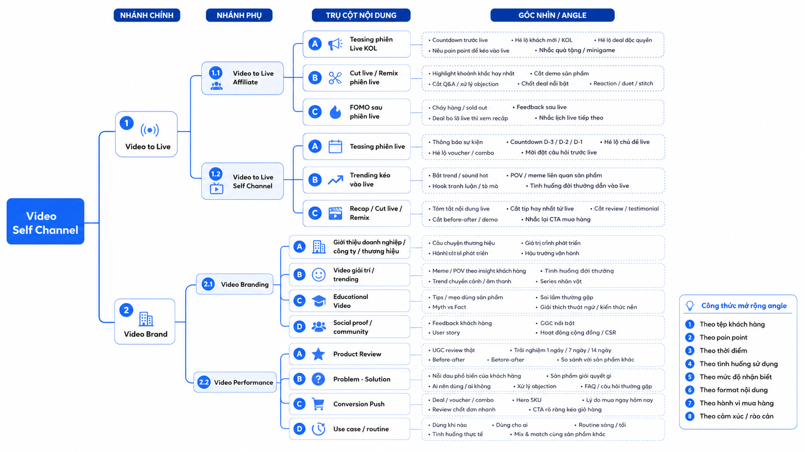

# Quy trình làm Content kênh

# **I\. CHECKLIST VẬN HÀNH CONTENT SELF\-CHANNEL**

* [ ] PLAN VẬN HÀNH 

Plan số growth/booking order hoặc team content tự đề xuất

* [ ] PLAN ĐỊNH HƯỚNG CONTENT KÊNH 

Template tham khảo: [TEMPLATE PLAN CONTENT KÊNH](https://docs.google.com/spreadsheets/d/1DA47Bx-Gn-jxV3jVv7hEBwHABdzllGRGLzKyw36QLBc/edit?usp=sharing)

HOOK: [TÀI LIỆU ĐÀO TẠO: XÂY DỰNG HOOK GIỮ CHÂN NGƯỜI XEM TRÊN TIKTOK](https://upbasevn.sg.larksuite.com/wiki/VYLPwxMNti41qEkm04olgcqugse) 

Các định dạng video/ kênh cần phải hiểu: [OUTLINE SELF CHANNEL SERVICE CATALOG](https://upbasevn.sg.larksuite.com/wiki/B0M4wXywNiUEkckZNSFlDqFqgRg) 

* [ ] NGUỒN LỰC  VJ/ CTV/ Team inhouse của brand : 

# **II\. QUY TRÌNH **

**SLA gửi định hướng tháng \(Bắt đầu từ tháng 8\)**

**B2C gửi định hướng**

- **Lần 1:** Ngày **15 tháng T\-1** → Video triển khai trước campaign doubleday

- **Lần 2:** Ngày **25 tháng T\-1** → Video campaign và video air từ sau doubleday đến ngày 20 tháng T

- **Lần 3 \(bổ sung\):** Trước **05 tháng T** → Các video còn lại hoặc phát sinh

**Brand duyệt định hướng**

- **Lần 1:** Trước **20 tháng T\-1**

- **Lần 2:** Trước **30 tháng T\-1**

- **Lần 3:** Trước **10 tháng T**

**Process gửi hàng cho VJ/ CTV**

***Đối với hàng có sẵn***

- Sau khi Content gửi thông tin đầy đủ → Brand/Kho phải gửi hàng trong **48h**

***Quy định raise vấn đề  khi gặp tình huống ***

- Quá **2 ngày chưa gửi hàng** → Raise Growth/Account

- Quá **3 ngày chưa có mã vận đơn** → Raise Leader B2C

- Quá **5 ngày chưa nhận được hàng** → Cho phép thay KOC/VJ khác hoặc điều chỉnh timeline 

- Brand quá **2 ngày chưa duyệt định hướng** → Raise Growth/Account

- Brand quá **3 ngày chưa duyệt định hướng** → Raise đề xuất tự air theo nhân sự triển khai

**Đối với các trường hợp gấp cần trao đổi air sớm**

Nếu video cần air ngày **20**:

- Chốt list: ngày 10 

- Duyệt: ngày 12 

- Gửi hàng: ngày 15 

- Nhận hàng: ngày 18 

- Demo: ngày 19 

- Air: ngày 20 

=\> **Không nhận làm video kênh mới dưới 5 ngày trước ngày air**, trừ trường hợp KOC/VJ đã có sẵn sản phẩm

Lưu ý đối với Video Teasing thì mọi người sẽ chốt kịch bản \& VJ trước \-\> cần process gửi hàng \-\> đến khi có deal sẽ mapping vào để quay để keep tiến độ

# **III\. CHI TIẾT QUY TRÌNH**

|Stakeholder: |Content |Content|Content|Content \+ VJ |Nội bộ \+ Brand |Content \+ VJ |Brand \+ Content \+ VJ|Content|Content |
|---|---|---|---|---|---|---|---|---|---|
|**Main process **|Prepare |Nhận order |**Lên plan content kênh** |Phân bổ số lượng VJ và gửi cho VJ viết kịch bản|**Duyệt kịch bản** |Tổng hợp ý kiến check sửa kịch bản và gửi VJ quay demo|Gửi brand check duyệt Demo |On air |Nghiệm thu và đo lường |
|Bước|Bước 0|Bước 1\+2|Bước 3|Bước 4\+5|Bước 6|Bước 7\+8|Bước 9|Bước 10\+11|Bước 12|
|Timeline||||||||||
|**Activity ** |- Chuẩn bị nguồn lực     - **Liên hệ VJ \+ Tạo nhóm hợp tác**         - ***Mẫu mail liên hệ VJ*** Dear \+ *\[tên VJ\]*, Mình là Quỳnh Nhi\- Project Manager của UpBase, hiện tại UpBase đang hợp tác cùng *\[Tên nhãn hàng\]*\.  *\[Giới thiệu qua về thương hiệu\]* Ví dụ: Nabizam là thương hiệu bỉm cao cấp đến từ Hàn Quốc, chuyên cung cấp các dòng sản phẩm bỉm cao cấp với thiết kế mỏng nhẹ, thấm hút cao và lớp vách chống tràn mang lại sự thoáng mát và vận động tự nhiên cho bé\.  Nabizam đã đạt 46\.4K lượt bán và đạt đánh giá 4\.9/5 sao cao hơn 96% cửa hàng cùng ngành trên nền tảng TikTok Shop\. Ngoài Nabizam cũng nhận được hơn 58\.2K lượt đánh giá 4\.9 sao trên sàn Shopee  🎯 Đề xuất hợp tác \(SOW\):  - Sản xuất video on air trên kênh của brand - Số lượng: 5\-7 video/tháng  Thông tin sản phẩm: - Brief sản phẩm: *\[gắn link brief\]* Rất mong nhận đc phản hồi sớm từ team ạ |- **Nhận plan order từ growth/booking hoặc tự phân bổ đề xuất**     - **Chú ý số lượng, ngân sách**     - **Định hướng nội dung** |- **Xây dựng mục tiêu, định vị** - **Lên content pillar, content angle** - **Break theo tuần, theo VJ**** ** - **Phân bổ số lượng** |- Sau khi phân bổ và break content theo từng VJ, gửi cho VJ viết kịch bản  |- VJ viết xong gửi nội bộ và brand check  |- Tổng hợp ý kiến feedback từ brand và sửa lại kịch bản cho VJ \(Note yêu cầu đặc biệt hoặc ngoại cảnh nếu có : Trang phục, nối cảnh, v\.v\.\.\.\.\.\) - Gửi lại VJ quay demo  |- Gửi demo cho brand check duyệt và gửi lại VJ sửa demo nếu có  |- Nhận demo sau fix là On air lên kênh brand  |- Nghiệm thu video lên hệ thống lark - Đo lường hiệu quả     - GVM video kênh     - View      |
|**Touchpoint**|- Zalo  |- Plan số vận hành |- Plan content kênh: [TEMPLATE CONTENT PLAN](https://docs.google.com/spreadsheets/d/1DA47Bx-Gn-jxV3jVv7hEBwHABdzllGRGLzKyw36QLBc/edit?usp=sharing) - CLAUDE |- Zalo - Plan content kênh: [TEMPLATE CONTENT PLAN](https://docs.google.com/spreadsheets/d/1DA47Bx-Gn-jxV3jVv7hEBwHABdzllGRGLzKyw36QLBc/edit?usp=sharing)|- Zalo - Chat GPT|- Zalo |- Zalo |- Zalo - Kênh TikTok Brand|- Lark  - Google Sheet|

**III\. CHI TIẾT QUY TRÌNH LÀM VIỆC VỚI PARTNERSHIP KÊNH **

|Stakeholder: |partnership |Content \+partnership|Content \+partnership|Content \+ VJ\+partnership |Content \+ VJ\+partnership|
|---|---|---|---|---|---|
|**Main process **|Prepare |Làm hợp đồng, thanh lý hợp đồng cũ \( nếu có \) |Lên plan content kênh|Phân bổ số lượng VJ và gửi cho VJ viết kịch bản|Duyệt demo, on air |
|Bước|Bước 0|Bước 1\+2|Bước 3|Bước 4\+5|Bước 6|
|Timeline||||||
|**Activity ** |- Deal giá CTV  - Tạo nhóm Khi chốt Job - Lấy địa chỉ gửi hàng, thông tin thanh toán |- Lên hợp đồng với VJ\( nếu có \- Việt Hoàng phụ trách\) |- Break theo tuần, theo VJ  - Phân bổ số lượng theo từng VJ nhận được |- Chốt timeline làm việc với VJ \(Consensus 2 chiều đối với với VJ\) - Lập drive tổng gian hàng yêu cầu Vj up video lên drive chung |- Lập drive tổng gian hàng yêu cầu Vj up video lên drive chung - Nghiệm thu và thanh toán  |
|**Touchpoint**|- Zalo  |- Mail - Zalo|- Zalo  |- Zalo |- Lark  - Google SheetZalo |

# IV\. Hướng dẫn làm video AI

Canva: https://www\.canva\.com/design/DAHMGTogGmc/8\-8gov09fSRJLoMmHr7IVA/edit

# V\. Hướng dẫn Est Timeline kênh

- Cố định: Làm lần 1 Teasing, Sản phẩm key \(3\-6 video\), Concept

- Biến số: Làm lần 2\-3: kênh phụ

Mỗi campaign nên chia thành 4 giai đoạn:

# VI\. Content Tree

# VII\. Cách tạo content vô hạn

[TỔNG QUAN KHÓA HỌC 10f8a9a8227649ad89c981f132f3b384\.pdf](Images_attachments/TỔNG%20QUAN%20KHÓA%20HỌC%2010f8a9a8227649ad89c981f132f3b384.pdf)

[Content TikTok \- Sharing Mindset\.pdf](Images_attachments/Content%20TikTok%20-%20Sharing%20Mindset.pdf)

## Mindset áp dụng cho Video Self Channel

### Mindset 1: Content bắt đầu từ “NGƯỜI”, không bắt đầu từ “sản phẩm”

**Content, Marketing, truyền thông đều xuất phát từ con người; hiểu người thì có content**\. Người làm content cần hiểu hành vi, sản phẩm tác động thế nào đến cuộc sống, mong muốn, nỗi đau, rào cản và những điều phổ biến mà số đông gặp phải\. Đây cũng là bản chất của 3–6–10 giây đầu video\. 

Không bắt đầu bằng câu hỏi:

> Sản phẩm này có gì để nói?
> 
> 

Mà bắt đầu bằng câu hỏi:

> Người xem đang sống trong tình huống nào khiến họ cần sản phẩm này?
> 
> 

Ví dụ với skincare:

Video Self Channel muốn có nhiều content thì phải biến sản phẩm thành **một phần của đời sống người xem**\.

---

### Mindset 2: Câu chuyện sản phẩm khác câu chuyện thường

Trong câu chuyện sản phẩm, **nhân vật chính là sản phẩm**; câu chuyện cần làm nổi bật sản phẩm, còn người dùng là người được hưởng lợi\. Mục đích là để người xem thấy họ cũng sẽ được hưởng lợi nếu có sản phẩm\. 

Áp dụng vào kênh:

Mỗi video nên trả lời được 3 câu:

- Sản phẩm xuất hiện trong tình huống nào? 

- Sản phẩm thay đổi tình huống đó ra sao? 

- Người xem được lợi gì nếu họ mua? 

Công thức:

> **Bối cảnh thật của người xem → Vấn đề phát sinh → Sản phẩm xuất hiện → Kết quả sau dùng → CTA**
> 
> 

Ví dụ:

> “Tối qua thức khuya chạy deadline, sáng dậy da vừa xỉn vừa khô\. Bình thường mình sẽ makeup dày hơn, nhưng hôm nay mình thử cấp cứu da bằng mask trước 15 phút…”
> 
> 

Ở đây sản phẩm không bị nhét vào video\. Sản phẩm trở thành “người giải quyết vấn đề”\.

---

### Mindset 3: Một câu chuyện cần có nhân vật, bối cảnh, tương tác, mạch truyện

Một câu chuyện gồm các yếu tố: **nhân vật, bối cảnh, tương tác, mạch truyện**\. Phần xây dựng nhân vật còn nhấn mạnh tính cách, cảm xúc và hành động; mạch truyện cần trả lời “rồi cuối cùng thế nào” và “tóm lại muốn nói gì”\. 

Áp dụng vào script Video Self Channel:

Ví dụ: 

> “Không phải da yếu thì không được treatment, mà là sau treatment phải biết phục hồi đúng cách\.”
> 
> 

---

## Áp dụng vào Content Tree Video Self Channel

---

### A\. Nhánh Video to Live

Vai trò của Video to Live: Video to Live không chỉ là “đăng video báo live”\. Vai trò đúng là:

> **Kéo người xem ra khỏi trạng thái lướt vô thức và tạo lý do để họ vào live\.**
> 
> 

Câu hỏi: content bán hàng làm sao để kéo người xem ra khỏi sự vô thức; câu trả lời là phải có câu chuyện\. 

Vậy video kéo live phải có 3 lớp:

---

Với Self Channel, brand không có sức hút sẵn như KOL, nên video kéo live phải dùng **bối cảnh và insight** để kéo\.

Tài liệu gợi ý cách tìm insight bằng câu hỏi: sản phẩm này sử dụng trong bối cảnh nào; ví dụ cùng một sản phẩm nhưng ở các bối cảnh khác nhau sẽ kéo ra tệp khách hàng khác nhau\. 

Áp dụng:

---

### B\. Nhánh Video Brand

#### Video Branding: Xây niềm tin trước khi bán

**Brand story không nên kể “chúng tôi là ai”, mà nên kể “vì sao khách hàng nên tin”**

Sai:

> “Baegayul là thương hiệu đến từ Hàn Quốc…”
> 
> 

Đúng hơn:

> “Có những sản phẩm skincare không nổi ồn ào ở Việt Nam, nhưng lại được nhắc nhiều ở Hàn vì người Hàn rất thích những sản phẩm…”
> 
> 

Tư duy ở đây là: **brand story phải được kể từ lợi ích/niềm tin của người xem**, không phải từ hồ sơ công ty\.

---

**Educational video phải đi từ sai lầm, không đi từ kiến thức khô**

Vậy video giáo dục nên mở bằng lỗi/sự thật trái kỳ vọng:

---

**Video giải trí/trending phải có “người xem” bên trong**

Trend không nên bắt máy móc\. Mỗi trend phải trả lời:

> Trend này nói được insight nào của khách hàng?
> 
> Giải trí, đồng cảm,\.\.\.
> 
> 

---

**Video Performance: Không bán tính năng, bán “khoảnh khắc người xem cần sản phẩm”**

Phân loại sản phẩm thành 3 kiểu: **bán công năng, bán phong cách, bán niềm tin**\. Với bán công năng, cần liệt kê tính năng rồi phiên dịch sang lợi ích; với sản phẩm giá trị cao thì cần KOL review hoặc nhiều người review để tạo niềm tin\. 

Áp dụng cho Video Self Channel:

**Nếu sản phẩm là “bán công năng”**

Ví dụ: nước giặt, máy hút bụi, serum, kem chống nắng\.

Cách làm:

> Tính năng → Lợi ích → Bối cảnh → Câu chuyện
> 
> 

---

**Nếu sản phẩm là “bán phong cách”**

Ví dụ: thời trang, nước hoa, đồ lifestyle\.

Cách làm:

> Sản phẩm không chỉ giải quyết vấn đề, mà giúp người dùng trở thành phiên bản họ muốn\.
> 
> 

---

**Nếu sản phẩm là “bán niềm tin”**

Ví dụ: mỹ phẩm cao cấp, sản phẩm giá cao, brand mới, sản phẩm cần trust\.

Cách làm:

> Dùng nhiều bằng chứng để giảm rủi ro trong đầu khách hàng\.
> 
> 

Với các brand lowkey hoặc giá cao, không nên chỉ làm video deal\. Phải có đủ video **niềm tin → bằng chứng → lý do mua**\.

---

## Công thức tạo content vô hạn cho Video Self Channel

Công thức cho team:

> **Sản phẩm × Tệp khách × Bối cảnh × Pain point × Góc nhìn × Format × Twist × CTA**
> 
> 

Ví dụ với một sản phẩm Mask:

Từ 1 sản phẩm, team có thể xoay ra hàng chục video:

- POV: Da treatment nhưng mai vẫn phải makeup

- Sai lầm: Dùng mask phục hồi sai thời điểm\.

- Test thật: 15 phút trước makeup có khác không? 

- Reaction comment: “Mask đắt vậy có đáng không?” 

- Before\-after: Da bong trước và sau 7 ngày\. 

- So sánh: Mask phục hồi khác mask cấp ẩm thường ở đâu? 

- Routine: Tối giản routine khi da yếu\. 

- Deal: Vì sao nên mua combo trong live hôm nay? 

---

## Ma trận triển khai angle cho từng content pillar

### Pillar: Product Review

---

### Pillar: Problem – Solution

---

### Pillar: Educational Video

## Cách dùng “Twist” để tăng stopping power

Twist là cú lật, bất ngờ, không đoán trước; làm twist giúp content mới hơn, tăng stopping power và làm sản phẩm thú vị hơn\. Muốn twist thì cần hiểu Pop Culture và cách số đông đang nghĩ, rồi phá khỏi kỳ vọng đó\. 

Áp dụng cho Self Channel:

4 kiểu twist dễ dùng

Nguyên tắc: Twist không phải làm nhảm\. Twist phải kéo về được sản phẩm hoặc insight\.

