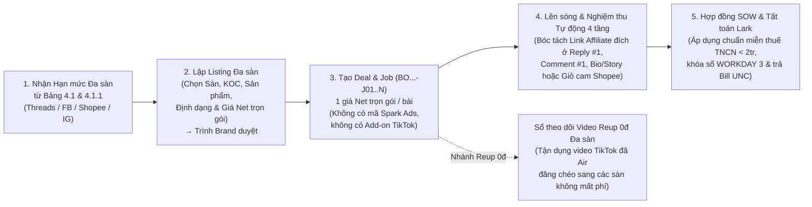
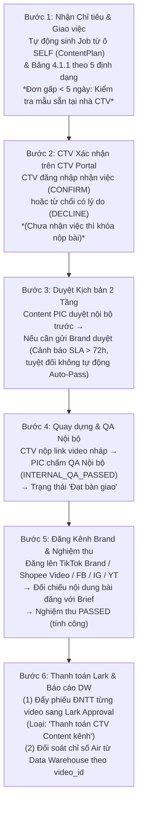

# TÀI LIỆU YÊU CẦU NGHIỆP VỤ & QUY TRÌNH NỀN TẢNG — B2C OPS HUB (BRD)

| Thuộc tính | Giá trị |
| --- | --- |
| Mã tài liệu | HUB-1.7 |
| Dự án | B2C Ops Hub — Hệ thống Quản trị & Điều hành Phòng Marketing B2C |
| Giai đoạn | 1 — Yêu cầu Nghiệp vụ & Quy trình Nền tảng (Đã kiểm chứng thực tế) |
| Trạng thái | **Phiên bản Chính thức v1.0** — Chuẩn hóa toàn diện luồng vận hành 6 chặng của phòng Marketing B2C |
| Owner | Khối Marketing B2C & Team DX |
| Người phê duyệt | Giám đốc Marketing B2C (Đặng Thị Yến Nhi) |
| Cập nhật | 31/10/2026 |

---

## 1. Bối cảnh, Mục tiêu Điều hành & Cơ cấu Tổ chức

### 1.1 Mục tiêu cốt lõi của hệ thống
**B2C Ops Hub** là nền tảng điều hành tập trung cho toàn bộ chu trình làm việc hàng tháng của phòng Marketing B2C tại UpBase — từ bước nhận chỉ tiêu kế hoạch từ Growth, phân rã kế hoạch tuần & lập kế hoạch Brand, lên định hướng nội dung, đề xuất KOC qua Google Sheet cho Nhãn hàng duyệt, ký kết hợp đồng điện tử 3 giai đoạn, nghiệm thu bài đăng đa nền tảng cho tới quyết toán thanh toán với Phòng Kế toán.

Hệ thống giải quyết **4 bài toán quản trị trọng tâm**:
1. **Kiểm soát Tiến độ Giải ngân Ngân sách (Chống tồn đọng ngân sách / Under-spend):**
   - Trong thực tế vận hành B2C, rủi ro lớn nhất không phải là chi vượt trần mà là **không tiêu hết ngân sách được giao (chậm giải ngân / thiếu sản lượng video lên sóng đúng sóng chiến dịch)**.
   - Hệ thống theo dõi sát sao tỷ lệ giải ngân thực tế so với kế hoạch (`Gap chi tiêu = Ngân sách Net kế hoạch − Thực chi Net`), phát cảnh báo sớm cho các gian hàng giải ngân chậm (`< 50%` cảnh báo đỏ, `< 80%` cuối tháng bắt buộc có giải trình) và các gian hàng phát sinh chi phí khi hạn mức bằng `0đ` (*Chi ngoài kế hoạch*).
2. **Liên thông Xuyên suốt 6 Chặng Vận hành (Không đứt gãy dữ liệu giữa các bộ phận):**
   - Kết nối liền mạch dữ liệu giữa **Growth** (Bảng 4.1) $\leftrightarrow$ **Content & Brand** (Plan 1-Sheet, Sản phẩm, Kịch bản) $\leftrightarrow$ **Booking** (Bảng 4.1.1, Listing Google Sheet 57 cột, Deal & Nghiệm thu) $\leftrightarrow$ **Pháp chế** (HĐNT, SOW, BBNT, Google Docs Redline) $\leftrightarrow$ **Kế toán** (Tạm ứng, Khóa sổ ngày làm việc thứ 3, Tất toán ĐNTT & UNC).
3. **Chuẩn hóa Tương tác với Nhãn hàng (Brand) & Kiểm soát SLA:**
   - Giao tiếp chính thức 2 chiều với Nhãn hàng thông qua **Google Sheet chuẩn 57 cột** của từng Brand/Gian hàng (đẩy danh sách KOC đề xuất, link kịch bản, video demo từ hệ thống lên Sheet và kéo kết quả Brand duyệt về hệ thống), tự động đo lường SLA phản hồi 48h của Brand và SLA nghiệm thu/thanh toán nội bộ.
4. **Quản trị Tập trung Tài sản KOC, Pháp lý Đa Pháp nhân & Lịch sử Hiệu quả:**
   - Kết nối trực tiếp với **Data Warehouse của công ty** để đọc và cập nhật dữ liệu gốc của KOC, danh sách kênh mạng xã hội (đa kênh TikTok & đa nền tảng) và Hồ sơ pháp lý `1–N` (`Cá nhân` / `Hộ kinh doanh` / `Công ty`); đồng thời lưu trữ toàn bộ nhận xét chuyên môn, lịch sử đàm phán giá và hiệu quả hợp tác (D14/D30/D60, Video Ads theo tuần) tại B2C Ops Hub.

### 1.2 Phạm vi Quản trị & Phân cấp Thẩm quyền Phòng B2C
- **Phạm vi gian hàng:** Quản lý **69 gian hàng B2C** (các gian hàng có cờ `B2C phụ trách = 1` trên Bảng 4.1) thuộc **42 Thương hiệu (Brand)** trên các sàn `TikTok Shop`, `Shopee`, `Lazada` và các kênh truyền thông đa nền tảng (`Threads`, `Facebook`, `Instagram`, `YouTube`).
- **Cơ cấu vị trí chuyên môn:**
  - **Cấp Brand (`3 vị trí gắn theo từng Thương hiệu`):** (1) `Plan / Strategy` (Hoạch định chiến lược & phân bổ KPI), (2) `Content / Brand main` (Định hướng nội dung, Pillar/Angle & kiểm soát chất lượng kịch bản), (3) `Key Visual / SIS` (Thiết kế chủ đề hình ảnh chiến dịch & gian hàng).
  - **Cấp Gian hàng (`Theo từng Store trên sàn`):** Mỗi gian hàng có **1 Nhân viên chính (Booking PIC chủ trì)** và các **Nhân viên hỗ trợ** phụ trách từng mảng (`Video Cast trả phí`, `Suất gửi mẫu FOC 0đ`, `Video kênh Brand / Self-channel`, `Livestream`).
- **Phân cấp thẩm quyền phê duyệt:**
  1. **Tổng Giám Đốc (CEO — Đỗ Văn Giang):** Phê duyệt định hướng chiến lược và bảo trợ nguồn lực toàn hệ thống.
  2. **Giám Đốc Marketing B2C (Lead B2C — Đặng Thị Yến Nhi):** Quản lý ngân sách và chỉ tiêu toàn bộ 69 gian hàng B2C; xem xét, nhận xét (comment) và phê duyệt kế hoạch tháng (`4.1.1` & `Plan Brand 1-Sheet`); duyệt phiếu đề nghị thanh toán và đại diện ký kết văn bản.
  3. **Trưởng Nhóm (Leader — Nguyễn Thị Ngọc Tâm):** Phụ trách trực tiếp và sơ duyệt kế hoạch/thanh toán cho **nhóm 8 gian hàng trọng điểm** (`ClubClio TikTok/Shopee`, `Cindy Bloom`, `Mine`, `EUPC`, `L'Occitane`, `Bye Bye Blemish`, `Rejuran`).
  4. **Quy tắc đối với 61 gian hàng không có Leader trung gian:** Chuyên viên phụ trách (PIC) lập kế hoạch và trình phê duyệt trực tiếp lên Giám Đốc Marketing B2C (`Đặng Thị Yến Nhi`).

---

## 2. Luồng Quy Trình Nền Tảng 6 Chặng Của Phòng Marketing B2C (End-to-End Workflow)

```mermaid
flowchart TD
    subgraph C1["CHẶNG 1: KẾ HOẠCH THÁNG (Từ ngày 10–30 tháng T-1)"]
        A1["1A. Luồng sớm (10–20/T-1)<br/>Content & Booking lên định hướng<br/>và lập nháp Listing Đợt 1"]
        A2["1B. Luồng chốt số (20–25/T-1)<br/>Growth giao Bảng 4.1 Plan Order Tổng<br/>(NMV, Ngân sách Gross/Net, Số lượng)"]
        A3["Booking PIC phân rã Bảng 4.1.1<br/>theo Tuần (W1–W5) & Bậc KL1–KL7 / FOC / Self"]
        A4["3 vị trí Brand lập Plan Brand 1-Sheet<br/>(01 Định hướng → 05 TikTok/Shopee)<br/>khớp nối 100% số liệu với 4.1.1"]
        A5["Cuối tháng T-1: Nội bộ duyệt<br/>(Leader Ngọc Tâm sơ duyệt 8 gian →<br/>GĐ Yến Nhi comment & duyệt toàn bộ)"]
        A6["Xuất gửi Plan Brand 1-Sheet<br/>cho Nhãn hàng xác nhận định hướng"]
        A1 --> A3
        A1 --> A4
        A2 --> A3
        A3 <--> A4
        A3 --> A5
        A4 --> A5
        A5 --> A6
    end

    subgraph C2["CHẶNG 2: SẢN PHẨM, BRIEF CONTENT & CHUẨN BỊ LISTING"]
        B1["Quản lý Danh mục Sản phẩm & Combo 2 tầng<br/>(Nhóm SP → SKU đơn / Combo, USP, Từ cấm,<br/>Link giỏ hàng & Link Affiliate)"]
        B2["Linh hoạt 2 chiều:<br/>(1) Content lập dòng Brief mẫu (BR-01..N) để Booking gán KOC<br/>(2) Hoặc Booking nhặt KOC theo KL & SP vào Sheet 57 cột,<br/>Content bổ sung góc kịch bản sau"]
        B1 --> B2
    end

    subgraph C3["CHẶNG 3: TRÌNH BRAND QUA GOOGLE SHEET 57 CỘT & CHỐT DEAL"]
        D1["Đẩy danh sách KOC dự kiến (3 đợt 10-20-30)<br/>lên Google Sheet chuẩn của Brand (SLA 48h)<br/>*KOL lớn KL5–7 check giá/lịch trước khi trình*"]
        D2["Kéo kết quả Brand duyệt (Yes / No / Cân nhắc)<br/>tự động đối chiếu 2 bên theo Row ID ẩn<br/>*Đơn FOC 0đ / KOC chỉ định được Chốt thẳng*"]
        D3["Liên hệ KOC chốt job & giá cuối<br/>(Nếu KOC tăng giá/đổi lịch phải trình lại Brand)<br/>→ Chuyển sang Bảng Deal & Nghiệm thu"]
        D1 --> D2 --> D3
    end

    subgraph C4["CHẶNG 4: HỢP ĐỒNG (HĐNT + SOW) & DUYỆT KỊCH BẢN / DEMO"]
        E1["Chọn Hồ sơ pháp lý KOC (1 KOC – N Pháp nhân)<br/>Lập Phụ lục SOW theo Deal/Job (kế thừa HĐNT khung)<br/>*Đàm phán sửa điều khoản qua Google Docs 3 chặng<br/>& Redline Diff → Pháp chế/Kế toán duyệt → Ký WeSign*"]
        E2["Kiểm duyệt Kịch bản & Video Demo 2 vòng:<br/>Vòng 1 Nội bộ duyệt → Vòng 2 Đẩy Sheet Brand duyệt<br/>*(Gửi hàng mẫu nhân viên tạo trực tiếp trên UPS)*"]
    end

    subgraph C5["CHẶNG 5: LÊN SÓNG (AIR), NGHIỆM THU 2 BƯỚC & LẬP BBNT"]
        F1["Bước 1: Nghiệm thu Video/Bài đăng chính<br/>(Quét tự động qua Web hoặc Zalo Bot trên 6 nền tảng:<br/>Giỏ hàng/Link Affiliate, Ngày Air, Phụ đề, Cắt ảnh SP)"]
        F2["Bước 2: Nghiệm thu Dịch vụ đi kèm trong SOW<br/>(Thu Mã Spark Ads bàn giao chạy Ads, File raw,<br/>Độc quyền, Reup Wave 1 — Hủy mục nào tự trừ tiền)"]
        F3["Tự động dựng Bản nháp BBNT kèm ảnh chụp SP<br/>Chốt nghiệm thu trong 7 ngày LV & trước Khóa sổ<br/>(Ngày làm việc thứ 3 của tháng T+1)"]
        F1 --> F2 --> F3
    end

    subgraph C6["CHẶNG 6: TẠM ỨNG, TẤT TOÁN ĐNTT & HẬU KIỂM NGÂN SÁCH"]
        G1["Lập phiếu Tạm ứng (khi SOW chọn 2 đợt & đã ký)<br/>hoặc Tất toán ĐNTT đẩy sang Lark Approval & Bảng 6.1"]
        G2["Portal Kế toán đối chiếu trọn bộ chứng từ<br/>(Deal ↔ HĐNT ↔ SOW ↔ BBNT ↔ CCCD/Hóa đơn)<br/>→ Đi tiền & Đồng bộ mã Bill UNC về Deal"]
        G3["Dashboard theo dõi Tiến độ Giải ngân (Under-spend)<br/>& Thu thập chỉ số D14/D30/D60 từ DW / UpAffiliate"]
        G1 --> G2 --> G3
    end

    A5 --> B2
    B2 --> D1
    D3 --> E1
    D3 --> E2
    E1 --> F1
    E2 --> F1
    F3 --> G1
```

---

### Chặng 1: Khởi tạo & Phê duyệt Kế hoạch Tháng (`Từ ngày 10 đến cuối tháng T-1`)
1. **Chạy song song 2 luồng chuẩn bị:**
   - **Từ ngày `10–20/T-1`:** Để kịp tiến độ sóng đầu tháng, đội ngũ Content và Booking được phép chủ động lên định hướng nội dung và lập nháp danh sách KOC Đợt 1 ngay cả khi bảng `4.1 Plan order tổng` của Growth chưa chốt chính thức.
   - **Từ ngày `20–25/T-1`:** Khi Growth giao số tổng trên **Bảng 4.1** (theo từng gian hàng: Mục tiêu NMV, Ngân sách Gross/Net, Số lượng video Cast trả phí, Suất gửi mẫu FOC 0đ, Video kênh Brand, Livestream, Đa sàn), nhân sự thực hiện khớp nối:
     - **Nhóm Booking (`Bảng 4.1.1`):** Phân rã chỉ tiêu xuống từng tuần (`W1–W5`) và từng bậc lương (`KL1`–`KL7`, `FOC`, 5 loại `Self-channel`, `Livestream`). Hỗ trợ từng chuyên viên phụ trách trong gian hàng (PIC chính Cast, Phụ trách FOC, Phụ trách Self-channel) nhập phần việc của mình và tự động cộng gộp lên toàn gian hàng. Nếu số phân rã lệch với Bảng 4.1 hoặc đơn giá nằm ngoài khung chuẩn Bảng 5.6, nhân sự bắt buộc ghi rõ lý do giải trình mới được gửi duyệt.
     - **Nhóm Brand/Content (`Plan Brand 1-Sheet`):** 3 vị trí cấp Brand (`Plan/Strategy`, `Content Main`, `Key Visual/SIS`) hoàn thiện biểu mẫu kế hoạch tháng của Brand gồm 5 phần (`01. Định hướng tháng`, `02. Kế hoạch KPI 2 sàn`, `03. Key Visual & Lịch lên ảnh KV`, `04. Kế hoạch TikTok Shop`, `05. Kế hoạch Shopee`). Số lượng video và ngân sách trên Plan Brand liên kết và đối soát khớp 100% với bảng phân rã `4.1.1`.
2. **Phê duyệt cuối tháng `T-1`:**
   - **Nội bộ duyệt trước:** Với 8 gian hàng trọng điểm, Trưởng nhóm (`Nguyễn Thị Ngọc Tâm`) kiểm tra và sơ duyệt trước. Sau đó, Giám đốc Marketing B2C (`Đặng Thị Yến Nhi`) trực tiếp xem từng kế hoạch (`4.1.1` và `Plan Brand 1-Sheet`), để lại nhận xét (comment) yêu cầu chỉnh sửa nếu chưa hợp lý, và bấm phê duyệt chốt phiên bản gốc (`v1.0`).
   - **Gửi Nhãn hàng:** Sau khi nội bộ phê duyệt xong, biểu mẫu `Plan Brand 1-Sheet` được xuất chuẩn định dạng để gửi cho Nhãn hàng xác nhận định hướng tháng.
3. **Xử lý điều chỉnh giữa kỳ & Job treo tháng cũ:**
   - Nếu trong tháng Growth cập nhật lại số liệu trên Bảng 4.1, hệ thống giữ nguyên bản kế hoạch đã duyệt đang chạy nhưng bật cờ cảnh báo **`Lệch 4.1 mới`** để Quản lý chủ động xem xét mở khóa và duyệt phiên bản điều chỉnh (`v1.1`, `v1.2`).
   - Các Job của tháng cũ chưa kịp lên sóng hoặc chưa thanh toán xong được phép kéo sang màn hình tháng mới (**Kéo Job còn treo từ tháng cũ**) để nhân sự theo dõi đi Air và làm thanh toán nốt; **ngân sách của các Job này giữ nguyên ở kế hoạch tháng gốc, tuyệt đối không ăn lẹm vào hạn mức ngân sách của tháng mới**.

---

### Chặng 2: Quản lý Sản phẩm, Định hướng Content & Lên Danh sách KOC (Listing)
1. **Danh mục Sản phẩm & Combo xuyên tháng (`Hồ sơ Thương hiệu › Sản phẩm & Kịch bản`):**
   - Mỗi Brand quản lý danh mục sản phẩm 2 tầng: **Nhóm sản phẩm** (chứa điểm bán hàng USP bắt buộc và danh mục từ cấm/Claim cấm) $\rightarrow$ **Sản phẩm & Combo** (gồm 3 loại: `SKU đơn lẻ`, `Combo cố định có link riêng`, `Combo Routine ghép từ nhiều link lẻ`).
   - Lưu trữ sẵn Link giỏ hàng theo từng gian hàng và Link Affiliate hoa hồng để tự động truyền xuống dòng Brief Content, Deal và bước Nghiệm thu bài đăng.
2. **Phối hợp 2 chiều linh hoạt giữa Content và Booking:**
   - **Chiều 1 (Chuẩn):** Content lập các **Dòng Định hướng / Brief mẫu (`BR-01..BR-N`)** trên Lưới Kế hoạch Content theo tuần và bậc lương (mỗi dòng quy định số lượng video mục tiêu, gắn Sản phẩm/Combo, Trụ cột Pillar, Góc tiếp cận Angle, Hook 3s), sau đó Booking chọn KOC gán vào từng dòng Brief.
   - **Chiều 2 (Linh hoạt thực chiến):** Booking có thể chủ động nhặt KOC (từ Danh bạ KOC, Bộ lọc chấm điểm 100đ, Tiện ích Chrome Extension hoặc chia sẻ từ điện thoại qua Zalo Bot) theo đúng bậc lương `KL1–KL7` và Sản phẩm đưa thẳng vào **Bảng Sheet Listing 57 cột**, sau đó Content vào bổ sung góc nội dung (`Content tag` / `Content note`) trước khi gửi Brand.

---

### Chặng 3: Trình Brand Duyệt qua Google Sheet 57 Cột & Đàm phán Chốt Deal
1. **Đẩy danh sách KOC theo 3 đợt chuẩn (Ngày 10 – 20 – 30 theo tỷ lệ 60% – 30% – 10%):**
   - Hệ thống sử dụng **Google Sheet chuẩn 57 cột** của từng Brand/Gian hàng làm kênh giao tiếp chính thức với khách hàng (không bắt khách hàng đăng nhập vào cổng web riêng).
   - **Thứ tự liên hệ KOC vs. Trình Brand:**
     - Với KOC thông thường (`KL1–KL4`): Nhân sự đẩy danh sách KOC dự kiến (kèm giá tham chiếu lịch sử/ratecard) lên Google Sheet cho Brand duyệt trước (SLA phản hồi của Brand: **48 giờ**). Khi Brand chọn **`Yes`**, nhân sự liên hệ KOC chốt job; nếu KOC báo tăng giá vượt khung hoặc đổi lịch lên sóng thì phải báo/trình lại Brand xác nhận trước khi chốt Deal.
     - Với KOL lớn (`KL5–KL7`) hoặc chiến dịch gấp: Nhân sự kiểm tra lịch và giá sơ bộ với KOC/Agency trước rồi mới đưa vào Google Sheet trình Brand duyệt để tránh rủi ro Brand duyệt xong nhưng KOC không nhận bài.
     - Với suất **Gửi mẫu miễn phí (`FOC 0đ`)** hoặc KOC do chính Brand chỉ định: Nhân sự được quyền bấm **`Chốt thẳng`** sang bảng Deal mà không cần chờ vòng duyệt trên Sheet.
2. **Kéo kết quả Brand duyệt & Chuyển sang Bảng Deal:**
   - Mỗi dòng đẩy lên Google Sheet đều gắn một `Mã dòng (Row ID)` ẩn giúp hệ thống đối chiếu chính xác 1–1 kể cả khi khách hàng sắp xếp (Sort) lại thứ tự dòng trên Google Sheet.
   - Khi bấm **Kéo dữ liệu từ Sheet**, hệ thống hiển thị bảng đối soát 2 bên, tự động ghi nhận giờ Brand duyệt để tính **SLA 48h**, cập nhật lại `Giá Net` hoặc `Sản phẩm` nếu Brand sửa trực tiếp trên Sheet, và cho phép tích chọn các KOC đã duyệt `Yes` để **Tạo Deal chuyển sang Bảng Deal & Nghiệm thu**.

---

### Chặng 4: Thực thi Deal Trước Khi Lên Sóng (Hợp đồng 3 Giai đoạn & Duyệt Kịch bản/Demo)
> **Lưu ý phạm vi:** Khâu tạo đơn vận chuyển gửi hàng mẫu cho KOC được nhân viên thao tác trực tiếp trên hệ thống **UPS** của công ty; B2C Ops Hub không quản lý quy trình kho/vận đơn gửi mẫu ở giai đoạn này.

1. **Cấu trúc Deal TikTok vs. Bài đăng Đa sàn:**
   - **Trên TikTok:** Quản lý theo cấu trúc **`1 Deal = N Job (Bảng công việc)`**. Mỗi Job gồm **Hạng mục 1: Video chính** và tùy chọn bật/tắt **Các dịch vụ gia tăng đi kèm** (`Cấp mã quảng cáo Spark Ads`, `Quyền sử dụng hình ảnh/video`, `Độc quyền ngành hàng`, `Đăng chéo/Reup đa kênh Wave 1`, `Gắn giỏ/Link Bio`).
   - **Trên Đa sàn (`Shopee Video`, `Threads`, `Facebook`, `Instagram`):** Mỗi dòng là một bài đăng trọn gói 1 mức giá Net duy nhất trên sàn đó, không kèm các dịch vụ phụ của TikTok.
2. **Hợp đồng Nguyên tắc (HĐNT) & Phụ lục SOW (`1 KOC — N Hồ sơ pháp lý`):**
   - Ngay khi tạo Deal, nhân sự bắt buộc chọn đúng **Hồ sơ pháp lý của KOC** (`Cá nhân khấu trừ 10% TNCN` / `Hộ kinh doanh` / `Công ty xuất hóa đơn VAT`).
   - **Chuỗi văn bản pháp lý 3 bước:**
     1. **Hợp đồng nguyên tắc (`HĐNT`):** Là hợp đồng khung ký 1 lần giữa UpBase và pháp nhân KOC (mã `ddmmyy/HDNT/UPBASE-<ID_KOC>`), **độc lập hoàn toàn với Brand và Deal**, dùng chung cho mọi nhãn hàng và mọi tháng.
     2. **Phụ lục Hợp đồng (`SOW`):** Gắn trực tiếp với từng Deal/Job, khóa cấu hình sản phẩm, ngày dự kiến lên sóng, các hạng mục bàn giao và phương thức thanh toán (**Thanh toán 1 lần 100% sau nghiệm thu** hoặc **Thanh toán 2 đợt có tạm ứng**).
     3. **Biên bản nghiệm thu (`BBNT`):** Lập sau khi bài đăng lên sóng và nghiệm thu xong ở Chặng 5.
   - **Đàm phán điều khoản qua Google Docs 3 chặng & Redline Diff:** Nếu KOC sử dụng mẫu chuẩn UpBase thì được miễn bước duyệt Pháp chế và chuyển thẳng Kế toán. Nếu KOC đề xuất sửa điều khoản hoặc dùng mẫu riêng (áp dụng cho HĐ $\ge 50.000.000\text{đ}$ hoặc ngoại lệ được duyệt), văn bản đi qua luồng **Google Docs 3 chặng (`Trình bản Draft → Đàm phán/Sửa trên Google Docs → Trình bản Final`)**. Hệ thống tự động chụp lịch sử bình luận/chỉnh sửa, bóc tách **So sánh Redline từng từ (Word-level Diff)** và tổng hợp Báo cáo đàm phán để **Ban Pháp chế** (duyệt điều khoản pháp lý) và **Phòng Kế toán** (duyệt điều khoản giá/thuế/thanh toán) phê duyệt độc lập trước khi đẩy ký số qua **MISA AMIS WeSign**.
   - **Ràng buộc chặn cứng:** Bắt buộc phải ký xong HĐNT & Phụ lục SOW (theo ngưỡng `BR-03`: 100% đối với HKD/Công ty; đối với Cá nhân khi tạm ứng $\ge 2.000.000\text{đ}$ hoặc tổng giá trị $\ge 10.000.000\text{đ}$) thì hệ thống mới mở khóa cho phép lập phiếu **Tạm ứng** hoặc **Tất toán ĐNTT**.
3. **Kiểm duyệt Kịch bản & Video Demo 2 vòng:**
   - Mức độ kiểm soát phân theo nhóm KOC: Với `KL1–KL5` và `Self-channel` áp dụng Brief định hướng chi tiết; với KOL lớn (`KL6–KL7`) áp dụng khung tham số kiểm duyệt (Guardrails); với đơn `FOC 0đ` số lượng lớn có thể bỏ qua bước duyệt Demo nếu Brand không yêu cầu.
   - **Luồng duyệt 2 vòng:** *Vòng 1 (Nội bộ)* do Content/Booking kiểm tra trước (loại bỏ từ cấm chính sách sàn/Brand, kiểm tra USP và Hook 3s) $\rightarrow$ Đạt Vòng 1 mới đẩy link kịch bản và link video demo lên **Google Sheet (Chặng 2)** để *Vòng 2 (Brand)* phê duyệt, sau đó kéo kết quả duyệt và ghi chú sửa của Brand về thẳng từng Job.

---

### Chặng 5: Lên Sóng (Air), Nghiệm thu 2 Bước, Thu Mã Spark Ads & Lập BBNT
1. **Nghiệm thu 2 bước tuần tự theo Phụ lục SOW:**
   - **Bước 1 — Nghiệm thu Video / Bài đăng chính:**
     - Nhân sự dán link bài đăng lên Web Admin hoặc gửi link trực tiếp vào nhóm chat Zalo có gắn **Zalo Bot**.
     - Hệ thống tự động quét nghiệm thu trên **6 nền tảng**:
       - *Với TikTok:* Kiểm tra trạng thái hiển thị công khai, đúng `@handle`, ngày giờ đăng thực tế (giờ VN UTC+7), lượt xem/tương tác, kiểm tra **Giỏ hàng TikTok Shop** (hỗ trợ cầu nối IP Việt Nam khi video dính mẫu CapCut hoặc chạy Ads làm ẩn giỏ hàng), đối soát phụ đề WebVTT với từ khóa sản phẩm & từ cấm của Brand, và **tự động cắt khung hình dọc 9:16 lúc KOC cầm sản phẩm** (trả ảnh nghiệm thu vào nhóm Zalo và lưu đính kèm vào trang A4 của BBNT).
       - *Với Đa sàn (`Shopee Video`, `Threads`, `Facebook`, `Instagram`):* Tự động giải mã link rút gọn và kiểm tra link mua hàng Affiliate đặt tại **Comment đầu / Reply đầu** (Facebook, Threads), **Bio / Story** (Instagram) hoặc **Giỏ hàng Cam** (Shopee Video).
   - **Bước 2 — Nghiệm thu Dịch vụ gia tăng & Quyền lợi đi kèm:**
     - Chỉ mở khóa sau khi Video chính ở Bước 1 đã đạt nghiệm thu.
     - Nhân sự nghiệm thu từng hạng mục phụ trong SOW: thu **Mã quảng cáo Spark Ads** (qua lệnh `/ads` trên Zalo Bot hoặc nhập trên Deal, tự động tính thời hạn cấp quyền neo theo ngày nghiệm thu để bàn giao cho bộ phận chạy Ads), kiểm tra link file raw/hình ảnh, thời hạn độc quyền và bài đăng chéo/Reup `Wave 1`.
     - **Khấu trừ tự động hạng mục hủy (`DROPPED`):** Nếu bất kỳ dịch vụ phụ hoặc bài đăng chéo nào không thực hiện (`DROPPED`), hệ thống tự động trừ đúng phần giá trị của hạng mục đó khỏi số tiền quyết toán Deal.
2. **Thời hạn nghiệm thu & Khóa sổ dữ liệu hàng tháng:**
   - Bài đăng phải được hoàn tất nghiệm thu trong vòng **7 ngày làm việc** kể từ ngày lên sóng và trước **Mốc khóa sổ tháng (Ngày làm việc thứ 3 của tháng kế tiếp — `WORKDAY(EOMONTH(Ngày air, 0), 3)`)**.
   - Kỳ nghiệm thu chốt (`thangNghiemThuChot`) được khóa cứng theo đợt nghiệm thu gốc để không bị nhảy tháng khi mua bổ sung mã Spark Ads ở tháng sau.
   - Sau khi đã chốt sổ (`Chốt data`), mọi chỉnh sửa nghiệm thu/chi phí đều bị khóa; nếu cần điều chỉnh bắt buộc phải gửi yêu cầu **Mở khóa sổ theo 2 đợt quy định (`Đợt 1: Ngày làm việc 4–5` hoặc `Đợt 2: Ngày làm việc 10–11`)** có phê duyệt của Giám đốc Marketing B2C và Kế toán.
3. **Lập & Ký Biên bản nghiệm thu (`BBNT`):**
   - Từ kết quả nghiệm thu Bước 1 & Bước 2, hệ thống tự động dựng **Bản nháp BBNT trên trang A4** (bóc tách rõ hạng mục Hoàn thành, hạng mục Hủy/Khấu trừ và nhúng sẵn ảnh chụp KOC cầm sản phẩm).
   - Bắt buộc ký BBNT đối với: (1) Deal có tổng giá trị $\ge 20.000.000\text{đ}$, hoặc (2) Giá trị nghiệm thu thực tế có chênh lệch/khấu trừ so với Phụ lục SOW ban đầu, hoặc (3) Pháp nhân là Hộ kinh doanh / Công ty (`BR-04`).

---

### Chặng 6: Tạm ứng, Tất toán ĐNTT, Đối soát Kế toán & Hậu kiểm Hiệu quả
1. **Luồng Tạm ứng trước (`Đợt 1`):**
   - Hệ thống **chỉ mở khóa nút lập phiếu Tạm ứng khi Phụ lục SOW chọn phương thức `"Thanh toán 2 đợt (Có tạm ứng)"` và Phụ lục SOW đã được ký hoàn tất** (kèm mã Hóa đơn nháp nếu KOC là Hộ kinh doanh / Công ty).
   - Số tiền đã tạm ứng (`soTienTamUngTruoc`) được ghi nhận trực tiếp vào Deal để tự động cấn trừ khi lập phiếu Tất toán.
2. **Luồng Tất toán Đề nghị thanh toán (`ĐNTT`) & Đẩy sang Lark Approval:**
   - Nhân sự lập phiếu ĐNTT cho từng Job/Deal hoặc gom nhiều mã BO của cùng KOC/MCN.
   - Hệ thống kiểm tra chặn cứng 100% bộ hồ sơ: Hợp đồng nguyên tắc, Phụ lục SOW, BBNT (nếu thuộc diện bắt buộc), Số hóa đơn VAT khớp ngày BBNT (đối với Công ty/HKD), CCCD/MST và Tài khoản ngân hàng chính chủ (tự động chuẩn hóa `TÊN CHỦ TÀI KHOẢN IN HOA KHÔNG DẤU`, xóa khoảng trắng STK và sinh mã VietQR). Nếu Hồ sơ pháp lý của KOC đã từng ký hợp đồng và thanh toán khớp 100% CCCD/MST & STK, hệ thống hiển thị nhãn xác thực lịch sử để Kế toán miễn kiểm tra lại giấy tờ gốc.
   - Công thức tính số tiền thực chuyển:
     $$\text{Thực nhận đợt này} = (\text{Giá trị Video} + \text{Dịch vụ đi kèm} - \text{Khấu trừ mục hủy DROPPED}) + \text{VAT (nếu Công ty)} - \text{Thuế TNCN 10\% (nếu Cá nhân/CTV} \ge 2\text{tr)} - \text{Đã tạm ứng}$$
   - Phiếu được đẩy tự động sang **Lark Approval** và **Bảng 6.1 / 3.2 Lark Base** theo tuyến duyệt: *Trưởng nhóm Ngọc Tâm sơ duyệt (với 8 gian có Leader) $\rightarrow$ Giám đốc Yến Nhi duyệt $\rightarrow$ Phòng Kế toán duyệt & giải ngân*.
3. **Portal Đối chiếu Thanh toán của Phòng Kế toán & Đồng bộ Bill UNC:**
   - Trên Web Admin, Phòng Kế toán sử dụng **Portal Đối chiếu Thanh toán** để kiểm tra trên 1 màn hình duy nhất toàn bộ hồ sơ: *Thông tin Deal & Link Air $\leftrightarrow$ HĐNT $\leftrightarrow$ Phụ lục SOW $\leftrightarrow$ BBNT $\leftrightarrow$ Ảnh CCCD 2 mặt / ĐKKD lưu trên Cloudflare R2 $\leftrightarrow$ Hóa đơn & Công nợ tạm ứng*.
   - Khi Kế toán xác nhận đi tiền và nhập **Mã lệnh chi / Bill UNC**, trạng thái `PAID` và mã UNC tự động đồng bộ ngược về Deal để nhân sự B2C gửi chứng từ chuyển khoản cho KOC trong vòng 7 ngày.
4. **Kiểm soát Tiến độ Giải ngân Ngân sách & Hậu kiểm D14 / D30 / D60:**
   - **Trên Dashboard Điều hành & Ngân sách:** Theo dõi trực diện tiến độ giải ngân hạn mức Net của 42 Thương hiệu / 69 Gian hàng, làm nổi bật các gian hàng **Giải ngân chậm / Chưa tiêu hết ngân sách** và **Chi ngoài kế hoạch (Hạn mức 0đ)**.
   - **Hậu kiểm hiệu quả:** Thu thập chỉ số doanh thu và hiệu quả sau lên sóng ở các mốc **D14 / D30 / D60** (từ Data Warehouse, UpAffiliate và Báo cáo Ads tuần theo `videoId`) để tính ROAS/ROI thực tế, cập nhật vào lịch sử hiệu quả của KOC và phục vụ báo cáo tổng kết tháng cho Nhãn hàng.

---

## 3. Luồng Quy Trình Chuyên Biệt 1: Booking Đa Sàn (`Threads`, `Facebook`, `Shopee Video`, `Instagram` & `Video Reup 0đ`)

Bên cạnh luồng Booking TikTok truyền thống, phòng B2C triển khai mạnh mảng **Booking Đa sàn** nhằm phủ sóng điểm chạm thương hiệu và kéo lưu lượng truy cập (Traffic) qua **Link Affiliate (Shopee / TikTok Shop / Lazada)** về gian hàng. Luồng này được thiết kế tối giản riêng biệt tại không gian **Quản lý Deal & Booking $\rightarrow$ Listing & Nghiệm thu Đa sàn (`MultiPlatformListingWorkspace.tsx`)**:

### 3.1 Đặc trưng nghiệp vụ khác biệt so với Booking TikTok
1. **Mô hình "1 Giá Net Trọn Gói / Bài đăng" (Loại bỏ hoàn toàn dịch vụ phụ của TikTok):**
   - Mỗi bài đăng trên `Threads`, `Facebook`, `Shopee Video` hoặc `Instagram` được chốt theo **1 mức giá Net trọn gói duy nhất**.
   - **Không có** các hạng mục dịch vụ đi kèm đặc thù của TikTok (không có Mã ủy quyền quảng cáo Spark Ads, không có theo dõi hạn dùng Ads).
2. **Quản lý thống nhất theo phân cấp `1 Deal (BO...) = N Job (BO...-J01, J02...)`:**
   - Một KOC có thể nhận gói đăng nhiều bài trên một hoặc nhiều nền tảng trong cùng 1 Deal (`MultiPlatformDealJobItem`), sẵn sàng ánh xạ 1–1 sang bảng công việc của **Phụ lục SOW** bất cứ khi nào cần ký hợp đồng.
3. **Cấu hình đặc thù theo từng nền tảng & Tự mở rộng trường dữ liệu:**

| Nền tảng | Khung giá Net tham chiếu | Định dạng bài đăng phổ biến | Vị trí đặt Link mua hàng (Affiliate) | Chỉ số nghiệm thu trọng tâm |
| --- | --- | --- | --- | --- |
| **Threads** | `115.000đ – 450.000đ` / bài | Bài Text + Ảnh chụp thật; Text + Video ngắn; Chuỗi Thread review; Seeding bình luận | Gắn Link Shopee dưới **Reply #1**; Gắn trực tiếp trong bài; Gắn trên Bio | Lượt xem (Views), Lượt Tim, Reply & Repost, Lượt Click Link Shopee |
| **Facebook** | `600.000đ – 3.800.000đ` / bài | Facebook Reels gắn link Cmt #1; Post Ảnh + Caption cá nhân; Fanpage Creator; Bài chia sẻ Group | Ghim Link Shopee ở **Comment #1**; Gắn trong mô tả bài đăng; Link rút gọn kèm voucher | Lượt tiếp cận / Views Reels, Like / Reaction, Bình luận & Chia sẻ, Click Link Shopee |
| **Shopee Video** | `90.000đ – 350.000đ` / video (hoặc `0đ FOC`) | Shopee Video quay mới gắn giỏ cam; Unbox & Test nhanh; FOC 0đ nhận mẫu; Đăng chéo | Gắn **Giỏ hàng Cam Shopee** trực tiếp trên video (kèm Voucher) | Lượt xem Shopee Video, Lượt Thích, Số đơn hàng & GMV Shopee Video |
| **Instagram** | `500.000đ – 2.500.000đ` / bài | Instagram Reels + Story gắn Link; Carousel Ảnh (Photo Dump); Story Review kèm Sticker Link | Gắn **Sticker Link trên Story + Highlight**; Link trên Bio; Gửi tự động qua DM (ManyChat) | Lượt xem Reels / Reach, Tim & Lưu bài (Saves), Lượt Click Sticker Link |

   - Ngoài các cột mặc định, nhân sự có thể bấm **`+ Thêm trường cho sàn này`** để tự bổ sung cột theo dõi mới cho từng nền tảng bất kỳ lúc nào.

### 3.2 Ba chế độ vận hành trong Không gian Đa sàn
1. **Chế độ 1 — Listing & Trình Brand (`LISTING`):**
   - Đối soát trực tiếp chỉ tiêu số lượng và ngân sách Net với Bảng `4.1` & `4.1.1` của từng sàn.
   - Chọn KOC từ Danh bạ (tự động lấy đúng tài khoản kênh tương ứng của KOC trên sàn đó), gắn Sản phẩm/Combo và trình Brand duyệt (`Yes / No / Cân nhắc`).
2. **Chế độ 2 — Nghiệm thu Bài đăng & Thanh toán (`APPROVED_EXECUTION` $\rightarrow$ `ACCEPTED` $\rightarrow$ `PAID`):**
   - Tích hợp **Engine Nghiệm thu Tự động Đa Sàn 4 Tầng**:
     - *Tầng 1 (Giải mã Link Affiliate đích):* Tự động lần theo chuỗi chuyển hướng (HTTP Redirect) của `s.shopee.vn`, `shp.ee`, `s.lazada.vn`, `vt.tiktok.com` để kiểm tra URL đích cuối cùng có đúng `Shop ID`, `Item ID` của gian hàng B2C và có gắn mã tracking hoa hồng (`uls_trackid`, `mmp_pid`, `utm_medium=affiliates`, `sub_id`) hay không.
     - *Tầng 2 (Bóc tách bọc link Meta & Endpoint nhúng công khai):* Tự động giải mã bọc link `l.threads.net/?u=...`, `l.facebook.com/l.php?u=...`, `l.instagram.com/?u=...` và đọc xuyên qua các cổng nhúng công khai (`/embed` của Threads, `/plugins/post.php` của Facebook, `/embed/captioned/` của Instagram, `mediaInfo` của Shopee Video) ngay cả khi bài viết bị chặn tường đăng nhập.
     - *Tầng 3 (Đồng bộ DOM từ Chrome Extension):* Khi nhân sự mở bài đăng Facebook / Threads trên trình duyệt có cài **UpBase Chrome Extension**, tiện ích tự động đọc chính xác **Comment đầu Facebook / Reply đầu Threads** và gửi kết quả nghiệm thu về hệ thống.
     - *Tầng 4 (Hộp thoại Kiểm thử trực tiếp):* Cho phép dán bất kỳ cặp *Link bài đăng + Link Affiliate* nào để kiểm tra kết quả bóc tách tức thì.
   - Sau khi nghiệm thu đạt, bài đăng Đa sàn đi vào cùng luồng **Khóa sổ ngày làm việc thứ 3 (`WORKDAY 3`)**, lập **Hợp đồng/Phụ lục SOW** và đẩy **Phiếu ĐNTT sang Lark Approval** (áp dụng chuẩn miễn khấu trừ thuế TNCN 10% cho các khoản chi Cá nhân dưới ngưỡng $2.000.000\text{đ}$).
3. **Chế độ 3 — Sổ theo dõi Video Reup 0đ Đa sàn (`multi-platform-reups-v1`):**
   - Dành riêng cho việc tận dụng các video gốc đã sản xuất trên TikTok để đăng chéo (Reup `0đ`) sang Shopee Video, Facebook Reels, Instagram Reels hoặc Threads nhằm gia tăng điểm chạm tự nhiên mà không phát sinh thêm chi phí cát-xê.

---

## 4. Luồng Quy Trình Chuyên Biệt 2: Sản Xuất Video Kênh Brand & Điều Phối CTV / VJ (`Self-Channel`)

Chỉ tiêu **Video Kênh Tự Xây của Brand (`Self-channel`)** từ Bảng `4.1.1` và các ô `SELF` trên Lưới Kế hoạch Content (thường chiếm sản lượng lớn từ 500–600 video/tháng trên toàn phòng) được quản trị khép kín qua phân hệ **Video kênh Brand & CTV (`SelfChannelCtvHubView.tsx` & `PlanSelfChannelBoard.tsx`)**:

### 4.1 Năm định dạng sản xuất & Hai phương thức thực hiện
- **5 định dạng Video Kênh Brand chuẩn (`SelfFormatKey`):**
  1. `Review voice` (Quay trải nghiệm thật & lồng tiếng review)
  2. `Video AI / Giọng máy` (Dựng nhanh kết hợp voice đọc tự động)
  3. `Video remix` (Cắt ghép sáng tạo từ kho tư liệu/source có sẵn)
  4. `Video to live` (Video ngắn điều hướng khách hàng vào phòng Livestream của gian hàng)
  5. `Nhạc text` (Video hình ảnh sản phẩm bắt mắt kết hợp nhạc xu hướng và chữ chạy trên màn hình)
- **2 phương thức sản xuất (`SelfProductionMode`):**
  - `Thuê CTV / VJ ngoài (CTV_OUTSOURCE)`: Tính thù lao theo đơn giá từng video, kiểm soát hợp đồng, thuế TNCN và thanh toán qua Lark Approval.
  - `Tự sản xuất nội bộ (INHOUSE)`: Do nhân sự nội bộ tự quay dựng (`0đ` thù lao ngoài), chỉ theo dõi tiến độ sản lượng và hiệu quả lượt xem/GMV.

### 4.2 Quy trình 6 bước kiểm soát chặt chẽ từ Giao việc đến Thanh toán & Báo cáo Air
1. **Bước 1 — Khởi tạo Đề bài (`BRIEF`) & Kiểm soát Hàng mẫu CTV:**
   - Hệ thống tự động kéo các dòng Brief có bậc `SELF` từ `ContentPlanBoard` sang bảng việc Kênh Brand và tự động tạo bù số lượng dòng còn thiếu theo đúng phân rã tuần của Bảng `4.1.1`.
   - **Chốt chặn đơn gấp (`< 5 ngày`):** Nếu giao đơn gấp có hạn lên sóng dưới 5 ngày cho CTV ngoài mà danh sách tồn mẫu tại nhà CTV (`onHandProducts`) chưa có sản phẩm đó (`Chưa có mẫu`), hệ thống tự động cảnh báo và chặn giao việc để tránh trễ lịch Air.
2. **Bước 2 — CTV Nhận việc trên Cổng CTV (`CTV Portal`):**
   - Mỗi CTV/VJ có giao diện **Cổng CTV** riêng để xem danh sách việc mới được giao (`ASSIGNED`), bấm **`Nhận việc (CONFIRM)`** hoặc **`Từ chối (DECLINE)`** (bắt buộc nhập lý do từ chối).
   - **Chốt chặn nộp bài (`selfCtvConfirmBlocker`):** Nếu CTV chưa bấm *Nhận việc* hoặc đã *Từ chối*, hệ thống khóa không cho nộp link kịch bản/video. Khi PIC đổi sang CTV khác, trạng thái tự động đặt lại về `ASSIGNED`.
3. **Bước 3 — Soạn & Duyệt Kịch bản (`SCRIPT`):**
   - CTV nộp kịch bản $\rightarrow$ Chuyên viên Content duyệt nội bộ trước (`APPROVED`).
   - Với các nhãn hàng yêu cầu duyệt kịch bản kênh Brand (`brandScriptStatus`), hệ thống theo dõi thời gian chờ Brand phản hồi và phát cảnh báo khi quá **72 giờ** (`BRAND_SCRIPT_SLA_HOURS = 72`, chỉ cảnh báo để nhân sự đôn đốc, tuyệt đối không tự động chuyển sang Đạt).
4. **Bước 4 — Quay dựng & Kiểm tra Chất lượng Nội bộ (`PRODUCTION`):**
   - CTV quay dựng và nộp link video nháp (`DRAFT_SUBMITTED`).
   - Chuyên viên Content kiểm tra hình ảnh/âm thanh: nếu cần sửa thì trả về `Yêu cầu dựng lại (REVISION)` kèm ghi chú phản hồi hiển thị trực tiếp trên Cổng CTV; nếu đạt thì chuyển sang **`QA nội bộ Đạt (INTERNAL_QA_PASSED)`**.
   - Các video đã đạt QA nội bộ nhưng chưa đăng lên kênh được ghi nhận ở trạng thái **`Đạt bàn giao`** (xác nhận CTV đã hoàn thành sản phẩm bàn giao, nhưng chưa tính vào nghiệm thu thanh toán cho tới khi có link đăng thực tế).
5. **Bước 5 — Đăng lên Kênh Brand (`BRAND_AIR`) & Nghiệm thu Có Đối chiếu Nội dung (`ACCEPTANCE`):**
   - Video được đăng lên một trong 5 nền tảng của Brand (`Kênh TikTok Brand`, `Shopee Video`, `Facebook Page`, `Instagram`, `YouTube Shorts`).
   - **Kiểm tra đối chiếu nội dung bài đăng với Brief (`POST /api/self-channel-board/content-check`):** Khi nhân sự bấm kiểm tra, hệ thống đọc lại bài đã đăng để đối chiếu **Caption, Lời thoại, Sản phẩm, Câu mở đầu (Hook), Điểm bán hàng (USP), Giỏ hàng và Từ cấm** với đề bài gốc.
   - **Chốt chặn nghiệm thu (`selfJobAcceptanceBlocker`):** Chỉ cho phép chuyển sang **`Nghiệm thu Đạt (PASSED)`** khi đã đạt QA nội bộ, có đường dẫn bài đăng (`airLink`), có ngày đăng, và nếu kết quả kiểm tra tự động báo `FAIL / REVIEW` thì người duyệt bắt buộc phải ghi rõ lý do xác nhận vào `acceptanceNote`.
6. **Bước 6 — Thanh toán Thù lao qua Lark Approval (`SETTLEMENT`) & Báo cáo Air từ Data Warehouse:**
   - **Chốt chặn pháp lý thanh toán (`selfJobPaymentBlocker`):** Chặn lập đề nghị thanh toán nếu video chưa đạt nghiệm thu (`PASSED`), thiếu họ tên CTV, thiếu CCCD/MST, thiếu số tài khoản ngân hàng, thiếu **Số Hợp đồng CTV khi tổng giá trị từ $10.000.000\text{đ}$** (`BR-03`) hoặc thiếu **Biên bản nghiệm thu khi từ $20.000.000\text{đ}$** (`BR-04`).
   - **Liên thông trực tiếp luồng Lark Approval với Booking (`Loại thanh toán: Thanh toán CTV Content kênh`):** Hỗ trợ đẩy phiếu ĐNTT theo từng video nghiệm thu đạt (khấu trừ 10% TNCN từ ngưỡng $2.000.000\text{đ}$), đi qua cùng tuyến duyệt (`Leader → GĐ MKT B2C → Kế toán`), chống lập trùng phiếu theo khóa `MãViệc@GianHàng`, và tự động đồng bộ trạng thái `REQUESTED` $\rightarrow$ `PAID` kèm mã `Bill UNC` hiển thị thẳng lên Cổng CTV. (Hệ thống vẫn duy trì song song khả năng tra cứu các đợt gom quyết toán tháng `SelfSettlementBatch`).
   - **Báo cáo Air kết nối trực tiếp Data Warehouse (`/api/self-channel-board/air-report`):** Tự động trích xuất `video_id` từ link bài đăng của tất cả các gian hàng trong tháng để truy vấn trực tiếp bảng `v_b2c_video_performance` trên **Data Warehouse công ty**, trả về lượt xem, đơn hàng, GMV thực tế và hỗ trợ xuất báo cáo CSV (nếu Data Warehouse chưa có số của video mới đăng thì để trống trung thực, tuyệt đối không sinh số giả theo `RULE-DATA-01`).

---

## 5. Kiến Trúc Nguồn Dữ Liệu KOC & Ranh Giới Hệ Thống (System Boundary)

Để tránh trùng lặp dữ liệu và dễ bảo trì dài hạn, ranh giới giữa **B2C Ops Hub** và các hệ thống trong hệ sinh thái UpBase được quy định rõ như sau:

| Miền nghiệp vụ / Dữ liệu | Hệ thống làm chủ (Source of Truth) | Vai trò của B2C Ops Hub |
| --- | --- | --- |
| **1. Danh bạ KOC gốc, Kênh MXH & Hồ sơ pháp lý (`1–N`)** | **Data Warehouse Công ty** *(kết nối trực tiếp đọc/ghi)* | Đọc và cập nhật trực tiếp thông tin định danh KOC (`KOC Đã hợp tác` & `KOC Mới`), danh sách kênh MXH (đa kênh TikTok + đa nền tảng) và `1–N` Hồ sơ pháp lý (`Cá nhân` / `HKD` / `Công ty`) từ Data Warehouse. Lưu trữ riêng tại DB của B2C Ops Hub các thông tin nghiệp vụ nội bộ: nhận xét/đánh giá KOC, lịch sử đàm phán, trạng thái tiếp cận và gắn kết với Plan/Deal. |
| **2. Chỉ tiêu Plan Order Tổng đầu tháng (`Bảng 4.1`)** | **Lark Base (`4.1 Plan order tổng` do Growth quản lý)** | Đồng bộ/nhập chỉ tiêu `4.1` vào hệ thống làm mốc tham chiếu gốc (`reference41`), đối soát với bảng phân rã tuần `4.1.1` và phát hiện lệch khi Growth cập nhật số giữa kỳ. |
| **3. Trình duyệt KOC, Kịch bản & Video Demo với Khách hàng** | **Google Sheets (`Template 57 cột` của từng Brand)** | Đồng bộ 2 chiều qua Google Sheets API: đẩy danh sách KOC đề xuất, link kịch bản, video demo từ App lên Sheet và kéo kết quả Brand duyệt (`Yes / No / Cân nhắc`) kèm thời điểm duyệt SLA 48h về App. *(Không sử dụng cổng đăng nhập Web riêng cho Brand).* |
| **4. Vận đơn gửi hàng mẫu cho KOC** | **Hệ thống UPS (UpBase)** | Nhân viên tạo và theo dõi đơn gửi mẫu trực tiếp trên hệ thống UPS. B2C Ops Hub không quản lý kho và vận đơn gửi mẫu ở giai đoạn hiện tại. |
| **5. Đàm phán Hợp đồng, Ký số & Lưu trữ Giấy tờ Pháp lý** | **B2C Ops Hub + Google Docs + MISA WeSign + Cloudflare R2** | Quản lý bộ mẫu chuẩn, luồng đàm phán Google Docs 3 chặng (Redline Diff), duyệt độc lập Pháp chế/Kế toán, đẩy ký số MISA WeSign và lưu trữ ảnh CCCD 2 mặt / ĐKKD trên Cloudflare R2. |
| **6. Phê duyệt Thanh toán & Giải ngân** | **B2C Ops Hub + Lark Approval (`Bảng 6.1 / 3.2`)** | Kiểm tra chặn cứng chứng từ, tính thuế TNCN/VAT, đẩy phiếu Tạm ứng / ĐNTT sang Lark Approval, cung cấp Portal Đối chiếu Thanh toán cho Kế toán và đồng bộ ngược mã `Bill UNC` về Deal. |
| **7. Đo lường Điểm Workload Nhân sự (`Bảng 1–7`)** | **Giai đoạn sau (Chờ kích hoạt)** | Hiện tại hệ thống chỉ vận hành chức năng **Phân công nhân sự phụ trách Gian hàng (PIC chính/phụ) và 3 vị trí cấp Brand**. Động cơ tính điểm Workload SOW (Bảng 1–7) được giữ ở trạng thái chờ hoàn thiện toàn bộ vận hành thực tế mới đưa vào đo lường chính thức. |

---

## 6. Danh Mục Yêu Cầu Nghiệp Vụ Cốt Lõi (`BR-01` → `BR-14`)

| Mã BR | Tên Yêu cầu Nghiệp vụ | Nội dung & Quy tắc cốt lõi | Trạng thái |
| --- | --- | --- | --- |
| **BR-01** | **Quản trị Kế hoạch Tháng Song hành (`4.1` ↔ `4.1.1` ↔ `Plan Brand 1-Sheet`)** | Cho phép lập nháp Content & Listing Đợt 1 từ ngày `10–20/T-1`; khớp nối bảng `4.1` của Growth với bảng phân rã tuần `4.1.1` và `Plan Brand 1-Sheet (01→05)`; duyệt nội bộ 2 tầng (Leader Ngọc Tâm sơ duyệt 8 gian → GĐ Yến Nhi duyệt toàn bộ) vào cuối tháng `T-1` trước khi gửi Brand. | Đang vận hành (`FR-010`..`FR-017`) |
| **BR-02** | **Kiểm soát Tiến độ Giải ngân Ngân sách (Chống Under-spend) & Cô lập Ngân sách Tháng** | Cảnh báo trọng tâm khi gian hàng **chưa tiêu hết ngân sách / giải ngân chậm** (`< 50%` cảnh báo đỏ, `< 80%` cuối tháng cần giải trình) hoặc **chi khi hạn mức = 0đ**; vượt trần Net không chặn cứng nếu có giải trình/GĐ duyệt; Job treo tháng cũ kéo sang tháng mới chỉ để theo dõi đi Air & thanh toán nốt, không ăn vào ngân sách tháng mới. | Đang vận hành (`FR-003`, `FR-004`, `FR-084`) |
| **BR-03** | **Quản lý Danh mục Sản phẩm & Combo 2 Tầng xuyên tháng** | Tổ chức theo `Brand → Nhóm sản phẩm (USP, Từ cấm) → SKU đơn / Combo cố định / Combo Routine`, gắn sẵn Link giỏ hàng và Link Affiliate hoa hồng để truyền tự động xuống Brief Content, Deal/Job và Nghiệm thu bài đăng. | Đang vận hành (`FR-019`) |
| **BR-04** | **Đề xuất KOC 3 Đợt & Đồng bộ 2 Chiều Google Sheet 57 Cột với Brand** | Phối hợp linh hoạt 2 chiều giữa Content và Booking để lập danh sách KOC; đẩy lên Google Sheet 57 cột trình Brand duyệt (đo SLA 48h), đối chiếu 1–1 theo `Row ID` ẩn khi kéo kết quả về và chuyển các dòng `Yes` sang Bảng Deal & Nghiệm thu. | Đang vận hành (`FR-020`, `FR-021`, `FR-024`) |
| **BR-05** | **Vận hành Deal TikTok (`1 Deal = N Job`) vs. Bài đăng Đa sàn trọn gói** | TikTok quản lý theo Deal chứa nhiều Job (`Video chính + Dịch vụ đi kèm: Mã Spark Ads, Hình ảnh, Độc quyền, Reup Wave 1`), tự động khấu trừ tiền khi hủy hạng mục phụ (`DROPPED`); Đa sàn (`Shopee Video`, `Threads`, `Facebook`, `Instagram`) quản lý theo bài đăng trọn gói 1 giá Net. | Đang vận hành (`FR-022`, `FR-023`) |
| **BR-06** | **Kiểm duyệt Kịch bản & Video Demo 2 Vòng theo Bậc KOC** | Phân hóa theo bậc (`KL1–KL5` & `Self-channel`: Brief chi tiết; `KL6–KL7`: Khung tham số Guardrails; `FOC 0đ`: linh hoạt bỏ qua duyệt Demo); duyệt Vòng 1 nội bộ trước khi đẩy lên Google Sheet cho Brand duyệt Vòng 2. | Đang vận hành (`FR-019`, `FR-021`) |
| **BR-07** | **Hợp đồng 3 Giai đoạn (`HĐNT` → `SOW` → `BBNT`), Đàm phán Google Docs Redline & Ký số WeSign** | `HĐNT` ký 1 lần theo Hồ sơ pháp lý KOC (độc lập với Brand/Deal); `Phụ lục SOW` ký theo từng Deal/Job; áp dụng đúng ngưỡng `2tr / 10tr / 20tr / 50tr` và thuế `TNCN 10% / VAT`; đàm phán sửa điều khoản qua Google Docs 3 chặng có so sánh Redline từng từ để Pháp chế & Kế toán duyệt độc lập trước khi đẩy ký MISA WeSign. | Đang vận hành (`FR-030`..`FR-034`) |
| **BR-08** | **Nghiệm thu Tự động 6 Nền tảng, Zalo Bot Vận hành & Khóa sổ Ngày làm việc thứ 3** | Nghiệm thu 2 bước tuần tự theo SOW (quét qua Web hoặc Zalo Bot: kiểm tra giỏ hàng/link affiliate, phụ đề, cắt ảnh KOC cầm sản phẩm đính vào BBNT, thu mã Spark Ads); chốt nghiệm thu trong 7 ngày LV và khóa sổ vào Ngày LV thứ 3 của tháng T+1 (mở khóa sửa theo 2 đợt LV 4–5 / LV 10–11). | Đang vận hành (`FR-036`, `FR-085`) |
| **BR-09** | **Ba Luồng Thanh toán Lark Approval (`Tạm ứng`, `Khóa sổ`, `Tất toán ĐNTT`) & Portal Đối chiếu Kế toán** | Chỉ cho tạm ứng khi SOW chọn *"Thanh toán 2 đợt"* và đã ký SOW; kiểm tra chặn cứng bộ chứng từ trước khi đẩy Lark Approval; cung cấp Portal cho Kế toán đối chiếu 1 màn hình (`Deal ↔ HĐNT ↔ SOW ↔ BBNT ↔ CCCD/Hóa đơn`), gợi ý miễn kiểm tra lại nếu pháp nhân đã từng ký khớp 100%, và đồng bộ ngược mã `Bill UNC` về Deal. | Đang vận hành (`FR-030`..`FR-033`) |
| **BR-10** | **Sản xuất Video Kênh Brand & Điều phối CTV/VJ (`Self-channel`)** | Nhận chỉ tiêu 5 định dạng từ Plan `4.1.1` & các ô `SELF`; kiểm tra tồn mẫu cầm sẵn tại nhà CTV cho đơn gấp `< 5 ngày`; cung cấp Cổng CTV nộp bài/xem thanh toán; hỗ trợ song song cả lập phiếu ĐNTT theo từng video nghiệm thu đạt và gom đợt quyết toán tháng. | Đang vận hành (`FR-080`) |
| **BR-11** | **Danh bạ KOC 2 Bảng, Đa Kênh, `1 KOC — N Hồ sơ pháp lý` & Tích hợp Data Warehouse** | Tách `KOC Đã hợp tác` và `KOC Mới`; quản lý 1 KOC có nhiều kênh TikTok + đa nền tảng MXH (tách lịch sử đơn kênh vs. đa kênh) và `1–N` Hồ sơ pháp lý; đọc/cập nhật dữ liệu gốc KOC/Kênh/Pháp lý từ **Data Warehouse công ty** và lưu nhận xét/đánh giá nội bộ tại B2C Ops Hub. | Đang vận hành & Nâng cấp kết nối DW (`FR-082`) |
| **BR-12** | **Theo dõi Hiệu quả Sau Lên Sóng (`D14/D30/D60` & Kho Lịch sử Tuần `videoId`)** | Lưu trữ chuỗi lịch sử hiệu quả hàng tuần của Video Ads và KOC theo `videoId` hệ thống, kết hợp số liệu D14/D30/D60 từ Data Warehouse / UpAffiliate để tính ROI thực tế và đánh giá KOC tái book. | Đang vận hành (`FR-005`..`FR-007`, `FR-081`) |
| **BR-13** | **Hồ sơ Thương hiệu Tinh gọn, Nghiên cứu Thị trường & Đào tạo Khảo thí Nội bộ** | Quản lý Hồ sơ định danh tĩnh của 42 Thương hiệu (Định vị, Sản phẩm & Góc kịch bản, Từ cấm, Tài liệu pháp lý); cung cấp công cụ Nghiên cứu Brand/Đối thủ trên mạng và Sổ tay quy trình & Khảo thí sát hạch B2C. | Đang vận hành (`FR-040`, `FR-060`..`FR-065`) |
| **BR-14** | **Phân công Nhân sự theo Gian hàng / Brand & Lộ trình Đo lường Workload** | Quản lý phân công 1 PIC chính + các nhân sự hỗ trợ cho 69 gian hàng và 3 vị trí cấp Brand, kiểm soát phân quyền dữ liệu (RBAC & Data Masking `****5678`). Phần đo lường điểm Workload (Bảng 1–7) giữ ở trạng thái chờ kích hoạt sau khi vận hành ổn định. | Phân công đang chạy (`FR-014`, `FR-070`); Workload chờ kích hoạt (`FR-050`) |
