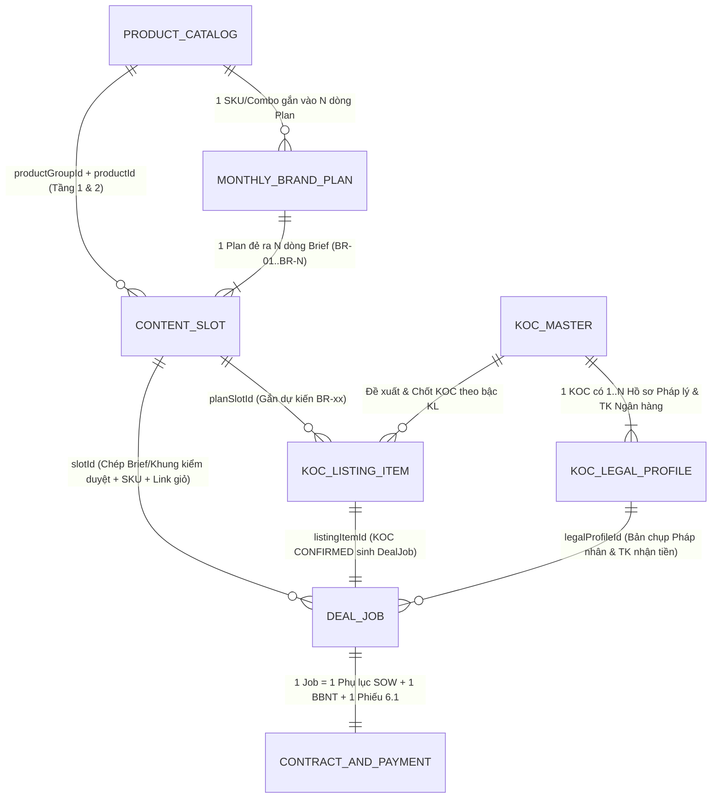

# HUB-2.18 — Sơ Đồ Quy Trình Swimlane BPMN 2.0 & Bản Đồ 7 Thực Thể Dữ Liệu Cốt Lõi B2C

- **Mã tài liệu:** `HUB-2.18`
- **Phiên bản:** `1.1`
- **Ngày cập nhật:** `31/10/2026`
- **Mã nguồn thực thi:**
  - Định nghĩa BPMN 2.0 XML & Metadata Thực thể: [`web-admin/src/lib/b2cBpmnDiagram.ts`](file:///e:/Upbase/B2C/web-admin/src/lib/b2cBpmnDiagram.ts)
  - Giao diện Tương tác `bpmn-js` Swimlane & ERD: [`web-admin/src/components/views/B2cProcessEntityBlueprintView.tsx`](file:///e:/Upbase/B2C/web-admin/src/components/views/B2cProcessEntityBlueprintView.tsx)
  - Lối vào trên hệ thống: **Kịch bản & Video → Sơ đồ Quy trình & Thực thể (BPMN)** ([`ContentView.tsx`](file:///e:/Upbase/B2C/web-admin/src/components/views/ContentView.tsx))

---

## 1. Giải Quyết Bài Toán "Quá Tải Vai Trò & Thực Thể" Theo Chuẩn ITBA (BPMN 2.0)

Quy trình vận hành gian hàng B2C được tách bạch thành **3 lớp độc lập** trên bản vẽ **BPMN 2.0 (`bpmn-io/bpmn-js`)**:

1. **6 Làn Vai trò cố định (Horizontal Swimlanes):**
   - **Làn 1 — Brand / Nhãn hàng (`Lane_Brand`):** Giao chỉ tiêu chiến dịch, Danh mục SKU/Combo & Quota mẫu FOC; Duyệt Plan Brand (`01→05`); Duyệt danh sách KOC và Kịch bản/Video Demo **Vòng 2** trực tiếp trên **File Google Sheet 57 cột** (SLA phản hồi ≤ 48h).
   - **Làn 2 — GĐ MKT / Trưởng nhóm B2C (`Lane_Lead`):** Lập & Duyệt nội bộ Kế hoạch tháng Gian hàng (`4.1.1`) và Plan Brand (`01→05`) trước khi xuất gửi Brand; Kiểm soát tiến độ giải ngân ngân sách (`Under-spend`) & Định mức bậc `KL1–KL7` (8 gian của Trưởng nhóm `Nguyễn Thị Ngọc Tâm` qua bước sơ duyệt; 61 gian còn lại trình thẳng GĐ MKT `Đặng Thị Yến Nhi`).
   - **Làn 3 — Chuyên viên Content (`Lane_Content`):** Quản trị Sản phẩm 2 tầng (`Nhóm SP → SKU/Combo`); Phối hợp linh hoạt 2 chiều với Booking để phân rã Kho Brief Tuần (`BR-01..BR-N`); Tách 2 chế độ làm việc theo bậc KL (`DIRECTIVE` cho `FOC/SELF/KL1–5` vs `VETTING_GUARDRAILS` cho `KL6/KL7`); Duyệt Kịch bản & Video Demo Nội bộ **Vòng 1 (SLA 24h)**.
   - **Làn 4 — Chuyên viên Booking (`Lane_Booking`):** Đề xuất & Chốt KOC (`CONFIRMED` — `KL1–KL4` duyệt Brand trước báo KOC sau; `KL5–KL7` check lịch trước; `FOC 0đ` chốt thẳng); Tạo `PlanDeal` & `DealJob` gắn mã `BR-xx` (tự động kế thừa SKU Tầng 2 + Link giỏ hàng + % Hoa hồng); *(Lưu ý ranh giới `DEC-011`: Nghiệp vụ gửi hàng mẫu thực hiện trên **hệ thống UPS công ty**, không quản lý trên B2C Ops Hub)*; Nghiệm thu Link Air (TikTok 2 bước + Đa sàn 1 giá trọn gói + Bot Zalo) & Lập nháp BBNT theo Phụ lục SOW.
   - **Làn 5 — KOC / KOL / Creator (`Lane_Koc`):** Xác nhận nhận Job & Pháp nhân thụ hưởng (`1 KOC — N Hồ sơ pháp lý` đồng bộ từ Data Warehouse); Nộp kịch bản (hoặc tự lên kịch bản theo 4 tham số kiểm duyệt với `KL6/KL7`); Quay Video Demo, đăng bài lên sóng (`Air Link`) & cấp mã `Spark Ads` qua nhóm Zalo / Web.
   - **Làn 6 — Pháp chế & Kế toán (`Lane_FinanceLegal`):** Kiểm soát ký 3 bước (`1. HĐNT` độc lập Brand/Deal → `2. Phụ lục SOW` theo Deal → `3. BBNT`); Thẩm định độc lập hợp đồng sửa đổi trên **Google Docs 3 chặng (`Draft → Edit → Final`)** kèm đối chiếu **Redline từng từ**; Khóa sổ nghiệm thu ngày làm việc thứ 3 đầu tháng `T+1`; Kế toán đối soát tập trung trên 1 màn hình (`FinanceAdvancePaymentReportView`), giải ngân Phiếu 6.1 Lark & trả mã `Bill UNC` trong ≤ 7 ngày.

2. **13 Bước Tác vụ (`UserTask`) & 2 Cổng Rẽ nhánh / Song song (`Gateway`):**
   - **Cổng Rẽ nhánh `Gateway_KlTierMode` (`Bậc KL?`):**
     - Nhánh `FOC / SELF / KL1–KL5` → **`DIRECTIVE`**: Bắt buộc định hướng kịch bản chi tiết (`Content Pillar`, `Angle`, `Hook 3s`, `Key USP`, `CTA`).
     - Nhánh `KL6 (10–30tr) / KL7 (> 30tr)` → **`VETTING_GUARDRAILS`**: Không áp đặt `Angle`/`Hook 3s` mẫu, chỉ giao & đối soát **4 tham số kiểm duyệt ranh giới** (`Key USP`, `Từ cấm & Ranh giới Brand`, `Khung hình & Hiện diện SP bắt buộc mandatoryShots`, `Điều khoản bản quyền/Spark Ads rightsGuardrails`).
   - **Cổng Song song `Gateway_ParallelSampleAndScript`:**
     - Ngay khi KOC ở cột `Đã chốt (CONFIRMED)` và tạo `DealJob`, hệ thống cho phép chạy song song **Gửi Hàng mẫu (`Bước 07`)** + **Lên & Duyệt Kịch bản 2 vòng (`Bước 08–10`)** + **Ký HĐNT/Phụ lục SOW** để không làm lỡ ngày Air.

3. **7 Thực thể Dữ liệu Cốt lõi (`Data Object / Entity`):**

---

## 2. Bản Đồ Liên Kết 7 Thực Thể Cốt Lõi (ERD Chuỗi `1 → 7`)

---

## 3. Bảng Tra Cứu Nhanh 7 Thực Thể & Khóa Liên Kết (Foreign Keys)

| Thứ tự | Tên Thực thể (Code) | Ý nghĩa Nghiệp vụ | Khóa chính (PK) | Khóa ngoại nối sang bước sau (FK) | Màn hình Quản trị |
| :---: | --- | --- | --- | --- | --- |
| **01** | `ProductGroup` & `CatalogProduct` | Sản phẩm đẩy 2 tầng (Nhóm SP → SKU đơn / Combo / Routine) | `group.id`, `product.id` | `productGroupId`, `productId`, `sku`, `cartUrl`, `commissionPct` | `Kịch bản & Video → Sản phẩm & Combo của Brand` |
| **02** | `MonthlyPlan` & `BrandOneSheet` | Kế hoạch Tháng Gian hàng (`4.1.1`) & Plan Brand (`01→05`) | `plan.id` | `planId`, `brandName`, `storeName`, `month` | `Kế hoạch tháng` & `Plan tháng của Brand` |
| **03** | `ContentSlot` (`BR-01..BR-N`) | Kho Dòng Brief / Khung kiểm duyệt theo Tuần & Bậc KL | `slot.id`, `briefCode` | `slotId`, `briefCode`, `briefMode`, `mandatoryShots`, `rightsGuardrails` | `Kịch bản & Video → Kế hoạch content` |
| **04** | `KocItem` & `KocLegalProfile` | Danh bạ KOC (Cũ/Mới) & `1–N` Hồ sơ Pháp lý thụ hưởng | `koc.id`, `legalProfile.id` | `kocHandle`, `legalProfileId`, `frameworkContractCode` | `Danh bạ KOC` |
| **05** | `KocListingItem` | Danh sách Đề xuất, Brand duyệt & Chốt giá Net KOC | `item.id` | `listingItemId`, `kocHandle`, `planSlotId` | `Kế hoạch tháng → Đợt đề xuất KOC` |
| **06** | `PlanDeal` & `DealJob` | Deal theo KOC & Job theo từng Video + Dịch vụ gia tăng | `deal.id`, `job.id`, `job.code` | `slotId`, `listingItemId`, `legalProfileId`, `appendixNo` | `Kế hoạch tháng → Deal & Job` |
| **07** | `ContractRecord` & `Payment 6.1` | Hợp đồng 3 bước (`HĐNT → SOW → BBNT`) & ĐNTT Lark 6.1 | `contract.id`, `larkSlipCode` | `dealId`, `jobId`, `templateId` (`Ver072026`) | `Hợp đồng & Pháp lý` · `Đề nghị thanh toán` |

---

## 3. Quy Tắc Thực Thể Chuẩn Hóa (2 Thực Thể Content Gốc & Luồng Song Hành)

1. **Chỉ giữ đúng 2 thực thể Content gốc (Không sinh bản sao trung gian):**
   - **Thực thể 1 — Đề bài gốc (`ContentSlot` / `BR-xx`):** Khởi tạo trong `ContentPlanBoard` (SP-02) trước khi gán đích danh KOC.
   - **Thực thể 2 — Bài làm của từng KOC (`DealJob` / `DL-Jxx`):** Sinh ra khi ghép Đề bài `BR-xx` vào KOC đã chốt (`PlanDeal`). Chứa trọn vẹn trạng thái `Kịch bản 2 vòng → Video Demo → Link Air → Nghiệm thu → ĐNTT 6.1`.
   - Các tab trong [`ContentView.tsx`](file:///e:/Upbase/B2C/web-admin/src/components/views/ContentView.tsx) (`Kho nội dung`, `Chờ duyệt kịch bản`, `Video nháp KOC`, `Đối soát bài đăng`) đóng vai trò là **Cửa sổ lọc (Filtered Views)** đọc trực tiếp từ `/api/deal-board` và `/api/content-plan`, đồng thời ghi quyết định duyệt/sửa kịch bản ngược về `DealJob` gốc tại `/api/deal-board`.
2. **`SP-02` (Soạn đề bài `BR-xx`) và `SP-03` (Đề xuất & Chốt KOC) chạy song hành từ `E2` (`MonthlyPlan Final`):** Hai nhánh hội tụ tại bước gán mã `BR-xx` vào KOC để tạo `DealJob`.

