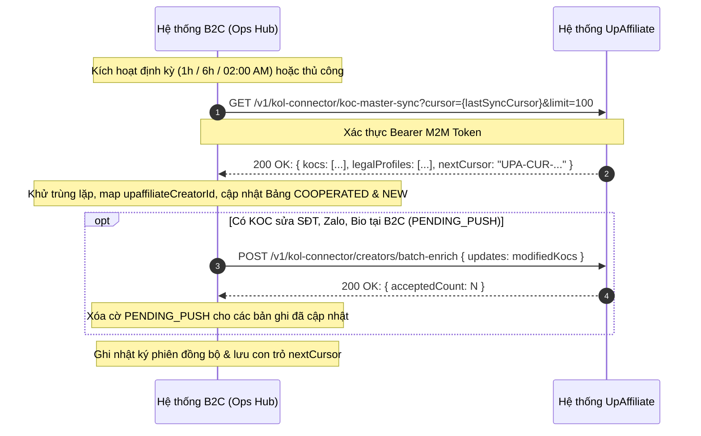
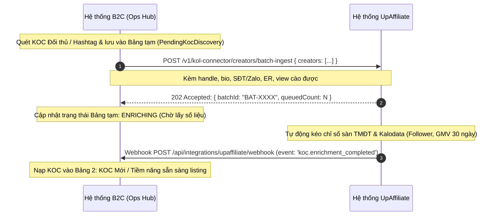
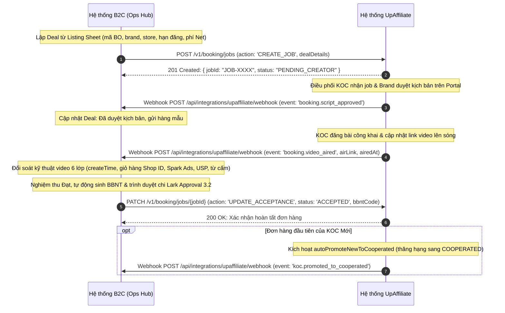
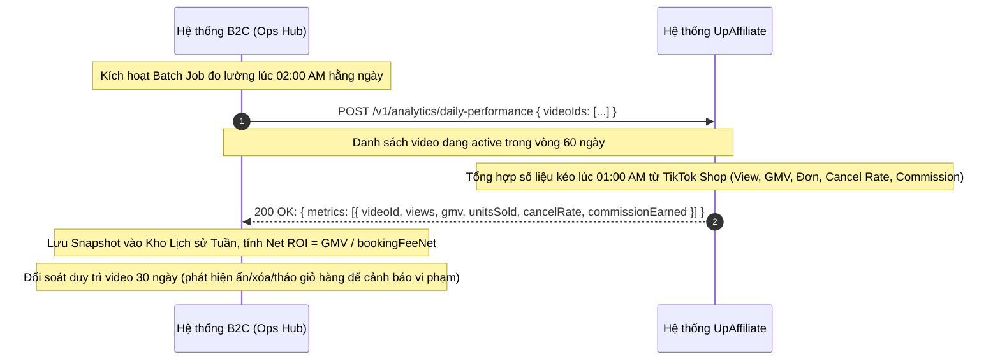

# TÀI LIỆU GIẢI PHÁP TÍCH HỢP KẾT NỐI DỮ LIỆU B2C OPS HUB & UPAFFILIATE
## (UpAffiliate Integration Solution Architecture & Data Contract Specification)

| Thuộc tính | Giá trị |
| --- | --- |
| Mã tài liệu | **HUB-2.19** (chuẩn hóa kỹ thuật từ `DEC-001`, `DEC-005`, `DEC-011`, `HUB-2.5` mục 2.13) |
| Dự án | B2C Ops Hub, Data Warehouse Công ty & UpAffiliate Ecosystem |
| Phiên bản | **1.1** |
| Trạng thái | **Đã chuẩn hóa thiết kế kỹ thuật & Liên thông qua Data Warehouse Công ty (`DEC-011`)** |
| Ngày ban hành | 31/10/2026 |
| Đơn vị chủ trì | Đội ngũ Giải pháp Kỹ thuật DX & Ban Vận hành Marketing B2C |

---

> [!IMPORTANT]
> **Cập nhật Kiến trúc Liên thông (`DEC-011` — 31/10/2026):**
> Bắt đầu từ tuần tới, **Data Warehouse của công ty** đóng vai trò là kho dữ liệu gốc hợp nhất (**Single Source of Truth**) kết nối giữa **B2C Ops Hub**, **KoC Hub / UpAffiliate**, **OMS** và **Ads/Report Service** (xem thêm chi tiết tại [HUB-2.20 Phần II](2.20_CONTRACT_SYSTEM_AND_DATA_FLOW_SPEC.md)):
> - **Đọc & Cập nhật qua Data Warehouse công ty:** Toàn bộ **Danh bạ KOC Master (`COOPERATED` & `NEW`)**, **Các tài khoản MXH liên kết (`TikTok`, `Shopee`, `FB`, `IG`, `Threads`, `YouTube`)**, **`1–N` Hồ sơ pháp lý (`KocLegalProfile`)** và **Chỉ số hiệu quả sau Air (`D14 / D30 / D60`)**.
> - **Lưu trữ tại CSDL của B2C Ops Hub:** Các thông tin vận hành nội bộ của riêng phòng B2C gồm **Đánh giá/ghi chú KOC theo Brand (`koc-channel-reviews`)**, **Lịch sử đàm phán giá/điều khoản**, **Trạng thái tiếp cận** và toàn bộ **Kế hoạch tháng, Listing Google Sheet 57 cột, Deal, Hợp đồng 3 bước, Nghiệm thu & Phiếu ĐNTT**.

---

## 1. Mục tiêu & Bối cảnh Nghiệp vụ

Theo định hướng kiến trúc tại **DEC-001** và **DEC-005**:
- **UpAffiliate (`kol-connector`):** Giữ vai trò là nguồn sự thật gốc (**Single Source of Truth - SSOT**) cho toàn bộ Danh bạ Creator/KOC Master, tài khoản thụ hưởng, cơ chế quản lý Creator App, mạng lưới Affiliate và cổng cộng tác phê duyệt kịch bản với Thương hiệu (Partner Portal).
- **B2C Ops Hub (`web-admin`):** Giữ vai trò là Trung tâm Chỉ huy & Điều hành (**Operations Hub**) cho 69 gian hàng B2C thuộc 42 Thương hiệu: quản trị Kế hoạch tháng (File 4.1 Plan order tổng), Bàn làm việc phân rã Listing theo Brand, Điều phối Deal & Nghiệm thu 2 bước tuần tự, Pháp chế Hợp đồng / Biên bản nghiệm thu và Trình phê duyệt thanh toán sang Lark Approval 3.2.

Tài liệu này chuẩn hóa toàn bộ kiến trúc kết nối dữ liệu giữa hai hệ thống: ranh giới dữ liệu, giao thức API, cơ chế bảo mật, từ điển ánh xạ trường dữ liệu và **4 lưu đồ tuần tự (Sequence Diagrams)** cho các luồng vận hành cốt lõi.

---

## 2. Ranh giới Trách nhiệm & Quyền ghi Dữ liệu (System Boundaries & SSOT Matrix)

| Thực thể dữ liệu | Hệ thống làm chủ quyền ghi (SSOT) | Hệ thống đọc & kế thừa | Cơ chế đồng bộ |
| --- | --- | --- | --- |
| **Danh bạ Master KOC (Bảng 1: `COOPERATED`)** | **UpAffiliate** | B2C Ops Hub | Polling định kỳ qua Cursor vi sai + Webhook khi cập nhật hồ sơ |
| **Hồ sơ Pháp lý `1–N` (CCCD, MST, STK, HĐNT)** | **UpAffiliate** | B2C Ops Hub | Đồng bộ 2 chiều (Ops Hub sửa ➔ đẩy duyệt lên UpAffiliate; UpAffiliate xác thực ➔ kéo về Ops Hub) |
| **Hàng đợi KOC Mới khám phá (`PendingKocDiscovery`)** | **B2C Ops Hub** | UpAffiliate | Đẩy hàng loạt từ Ops Hub sang UpAffiliate để làm giàu số liệu sàn & Kalodata |
| **Kế hoạch tháng PnL & Ngân sách 69 gian hàng** | **B2C Ops Hub** (kế thừa Lark 4.1) | UpAffiliate | Ops Hub phân bổ trần ngân sách Net/Gross và số lượng video theo từng gian hàng |
| **Điều phối Deal / Job Booking** | **B2C Ops Hub** | UpAffiliate | Webhook sự kiện thời gian thực 2 chiều theo trạng thái Job |
| **Nghiệm thu Kỹ thuật & BBNT** | **B2C Ops Hub** | UpAffiliate | Ops Hub đối soát 6 lớp link video TikTok, lưu vết BBNT và đồng bộ kết quả |
| **Hiệu quả Video sau Air (D14/D30/D60, GMV, Click, Order)** | **UpAffiliate** (kéo từ TikTok Shop) | B2C Ops Hub | Batch Job định kỳ ban đêm (02:00 sáng) cập nhật vào Kho Lịch sử Tuần theo `videoId` |
| **Hồ sơ Đề nghị Thanh toán (Bảng 3.2)** | **B2C Ops Hub** ➔ **Lark Approval** | UpAffiliate | Ops Hub tạo mã phiếu ĐNTT, trình ký Lark Approval và cập nhật trạng thái chi trả |

---

## 3. Khóa Định danh Dữ liệu Chung (Common Entity Keys)

| Tên định danh | Định dạng quy chuẩn | Hệ thống sinh mã | Mô tả nghiệp vụ |
| --- | --- | --- | --- |
| `upaffiliateCreatorId` | `UPA-CR-XXXXXXXX` | UpAffiliate | Mã duy nhất định danh KOC trên toàn hệ thống |
| `channelId` / `handle` | Chuỗi ký tự (VD: `@truongthao_99`) | TikTok / Creator | Handle nhận diện kênh công khai |
| `upaffiliateLegalProfileId` | `UPA-LP-XXXXXXXX` | UpAffiliate | Mã định danh từng hồ sơ pháp lý trong quan hệ 1 KOC – N Pháp nhân |
| `masterContractCode` | `HDNT-YYYY/XXX-UPBASE` | B2C Ops Hub / UpAffiliate | Số Hợp đồng nguyên tắc khung đã ký với KOC |
| `bookingOrderCode` / `dealCode` | `BO-YYYYMM-BRAND-XXXX` | B2C Ops Hub | Mã đơn hàng Booking Order của chiến dịch |
| `jobId` | `JOB-YYYYMM-XXXX-N` | B2C Ops Hub | Mã công việc cụ thể (1 Deal có thể gồm nhiều Job) |
| `videoId` | Chuỗi 64-bit Snowflake (VD: `7294819284918294819`) | TikTok Platform | Mã định danh video TikTok dùng chung để đối soát chỉ số |
| `brandCode` | Chuỗi viết hoa (VD: `CLUBCLIO`, `CINDY_BLOOM`) | B2C Danh mục chuẩn | Mã thương hiệu trong 42 Brand B2C |
| `storeId` | Chuỗi ký tự (VD: `clio-tiktok-official`) | B2C Danh mục chuẩn | Mã gian hàng trong 69 gian hàng B2C |

---

## 4. Kiến trúc Giao thức & Bảo mật

1. **Chuẩn kết nối:** RESTful API qua giao thức HTTPS (TLS 1.3), dữ liệu trao đổi định dạng JSON (UTF-8).
2. **Xác thực M2M (Machine-to-Machine):**
   - Header xác thực: `Authorization: Bearer <JWT_SERVICE_TOKEN>` hoặc `X-API-Key: <PROVISIONED_KEY>`.
   - Token có thời hạn 60 phút, cấp phát qua endpoint `/oauth/token` sử dụng Client Credentials Grant.
3. **Bảo mật Webhook:**
   - Header chữ ký số: `X-Upbase-Signature: sha256=<HMAC_HEX>`.
   - Khóa bí mật chung `WEBHOOK_SIGNING_SECRET` được cấu hình độc lập trên từng môi trường.
   - Chặn tấn công Replay Attack bằng việc kiểm tra timestamp trong payload: `Math.abs(Date.now() - eventTimestamp) < 300000` (5 phút).
4. **Bảo vệ Dữ liệu Nhạy cảm (Data Masking):**
   - Số Căn cước công dân (CCCD), Số tài khoản ngân hàng và Số điện thoại chỉ hiển thị 4 số cuối (`****5678`) trên các phản hồi danh sách công cộng; chỉ giải mã đầy đủ khi có quyền Kế toán / Pháp chế truy xuất hồ sơ chi tiết.

---

## 5. Lưu đồ Tuần tự Chi tiết giữa Hệ thống B2C & UpAffiliate (Sequence Diagrams)

### 5.1 Luồng 1: Đồng bộ Định kỳ Master KOC & Hồ sơ Pháp lý `1–N`

Quy trình đồng bộ 2 chiều dữ liệu Creator giữa UpAffiliate và B2C Ops Hub thông qua con trỏ vi sai (`lastSyncCursor`).



---

### 5.2 Luồng 2: Đẩy KOC Mới Khám phá sang UpAffiliate (Staging Queue ➔ Enrichment)

Quy trình khi B2C cào KOC mới từ TikTok / Đối thủ / Hashtag, lưu vào Bảng tạm và đẩy sang UpAffiliate để làm giàu chỉ số sàn & Kalodata.



---

### 5.3 Luồng 3: Vòng đời Booking & Nghiệm thu 2 Bước Tuần tự

Quy trình giao việc, duyệt kịch bản, gửi mẫu, kiểm tra video lên sóng và đối soát hồ sơ nghiệm thu.



---

### 5.4 Luồng 4: Đo lường Hiệu quả Sau Air (D14 / D30 / D60 Daily Metrics)

Quy trình kéo và đối soát số liệu bán hàng, lượt xem và hoa hồng theo định kỳ ban đêm (02:00 AM).


    autonumber
    participant Scheduler as B2C Ops Hub Scheduler (Cron 02:00 AM)
    participant HubServer as B2C Ops Hub Server (/api/integrations/upaffiliate/daily-performance)
    participant HubStore as Kho Lịch sử Tuần (/api/koc-video-history & Snapshot DB)
    participant UpAffiliate as UpAffiliate Performance Service
    participant TikTokShop as TikTok Shop Seller Center API

    Scheduler->>HubServer: Kích hoạt luồng đo lường định kỳ ban đêm (02:00 AM)
    HubServer->>HubStore: Lọc danh sách video đang hoạt động trong vòng 60 ngày (airDate >= Now - 60d)
    HubStore-->>HubServer: Trả về danh sách mảng videoIds[]

    HubServer->>UpAffiliate: POST /v1/analytics/daily-performance { videoIds: [...] }
    UpAffiliate->>TikTokShop: Truy vấn dữ liệu thực tế sàn TMĐT theo kỳ đối soát
    TikTokShop-->>UpAffiliate: Trả về: View, Like, Comment, Click giỏ hàng, Đơn phát sinh, GMV, Tỷ lệ hủy sàn
    UpAffiliate->>UpAffiliate: Tính toán chỉ số tích lũy tại các mốc D1, D7, D14, D30, D60 & Hoa hồng Affiliate thực tế
    UpAffiliate-->>HubServer: 200 OK: { metrics: [{ videoId, views, gmv, unitsSold, cancelRate, commissionEarned, snapshotDate }] }

    HubServer->>HubServer: Tính toán hiệu quả đầu tư: ROI Net = GMV / bookingFeeNet, Đánh giá KOC Winner / Underperforming
    HubServer->>HubStore: Ghi nhận Snapshot vào bảng TikTokVideoPerformanceSnapshot & kocSummaries
    HubStore-->>HubServer: Xác nhận lưu trữ thành công

    HubServer->>HubServer: Kiểm tra cảnh báo bất thường (Video bị ẩn/xóa trước 30 ngày, tháo giỏ hàng)
    opt Phát hiện vi phạm cam kết duy trì video
        HubServer->>HubServer: Gắn nhãn cảnh báo vi phạm hợp đồng (status: SLA_VIOLATED)
        HubServer->>LarkApproval: Gửi thông báo chặn giải ngân đợt 2 qua Webhook Bot Lark
    end
```

---

## 6. Đặc tả Giao diện Lập trình Ứng dụng (API Contracts)

### 6.1 `GET /v1/kol-connector/koc-master-sync` (UpAffiliate cung cấp)
- **Mục đích:** Kéo danh sách Master KOC và 1–N Hồ sơ pháp lý có phát sinh thay đổi sau con trỏ `cursor`.
- **Query Parameters:**
  - `cursor` (string, optional): Mã con trỏ vi sai gần nhất (VD: `UPA-CUR-20261025-0102`).
  - `limit` (integer, default: `100`, max: `250`): Số lượng bản ghi tối đa trên một trang.
- **Phản hồi mẫu (`200 OK`):**
```json
{
  "success": true,
  "data": {
    "nextCursor": "UPA-CUR-20261026-0418",
    "hasMore": false,
    "items": [
      {
        "upaffiliateCreatorId": "UPA-CR-904812",
        "channelId": "@hanguyen_beauty",
        "displayName": "Hà Nguyễn Review",
        "platform": "TIKTOK",
        "category": "BEAUTY",
        "followerCount": 245000,
        "salaryTier": "KL2",
        "priceRangeMin": 3000000,
        "priceRangeMax": 5000000,
        "phone": "098765**** (masked)",
        "zalo": "098765****",
        "email": "hanguyen@example.com",
        "tableType": "COOPERATED",
        "cooperationSummary": {
          "totalCampaigns": 8,
          "totalVideos": 12,
          "avgRoi": 3.4,
          "lastCooperatedAt": "2026-10-15"
        },
        "legalProfiles": [
          {
            "upaffiliateLegalProfileId": "UPA-LP-10294",
            "entityType": "INDIVIDUAL",
            "fullName": "NGUYỄN THỊ THU HÀ",
            "idCardNumber": "001198******",
            "taxCode": "8492019481",
            "bankName": "MBBANK",
            "bankAccountNumber": "999901928****",
            "bankAccountName": "NGUYEN THI THU HA",
            "masterContractCode": "HDNT-2026/042-UPBASE",
            "isDefault": true
          }
        ]
      }
    ]
  }
}
```

### 6.2 `POST /v1/kol-connector/creators/batch-ingest` (UpAffiliate cung cấp)
- **Mục đích:** Nhận danh sách KOC Mới từ Bảng tạm B2C Ops Hub để khởi tạo và đưa vào luồng crawl chỉ số thị trường.
- **Yêu cầu nội dung (`Body`):**
```json
{
  "source": "B2C_OPS_HUB_CRAWLER",
  "batchId": "STG-20261026-001",
  "creators": [
    {
      "channelId": "@lanhuong_skincare",
      "discoverySource": "Đối thủ: @larocheposayvn",
      "followerCount": 85000,
      "avgViews": 42000,
      "engagementRate": 0.048,
      "phone": "0912345678",
      "zalo": "0912345678",
      "suggestedCategory": "BEAUTY"
    }
  ]
}
```
- **Phản hồi mẫu (`202 Accepted`):**
```json
{
  "success": true,
  "batchId": "STG-20261026-001",
  "queuedCount": 1,
  "estimatedEnrichmentTimeSeconds": 120
}
```

### 6.3 `POST /api/integrations/upaffiliate/webhook` (B2C Ops Hub cung cấp)
- **Mục đích:** Hứng các sự kiện thời gian thực từ UpAffiliate (làm giàu dữ liệu KOC mới, duyệt kịch bản, video lên sóng, thăng hạng Master KOC).
- **Yêu cầu Headers:**
  - `X-Upbase-Signature: sha256=<HMAC>`
  - `X-Event-Type: <EVENT_NAME>`
- **Các loại sự kiện (`X-Event-Type`):**
  1. `koc.enrichment_completed`: KOC mới đã được UpAffiliate lấy xong số liệu sàn, sẵn sàng đưa vào Master KOC Bảng 2.
  2. `booking.script_approved`: Nhãn hàng đã phê duyệt kịch bản trên Brand Portal.
  3. `booking.video_aired`: KOC đã gửi link video công khai trên TikTok.
  4. `koc.promoted_to_cooperated`: KOC được thăng hạng từ Bảng Mới sang Bảng Đã Hợp Tác sau khi hoàn thành đơn đầu tiên.

---

## 7. Xử lý Lỗi, Xung đột & Cơ chế Phục hồi (Error Handling & Conflict Resolution)

1. **Nguyên tắc Giải quyết Xung đột (Conflict Policy):**
   - **Thông tin Pháp lý & Tài khoản Thụ hưởng:** *Master System Precedence* — Dữ liệu đã xác minh và đối chiếu CCCD trên UpAffiliate luôn có độ ưu tiên cao nhất. Mọi thay đổi tại Ops Hub chỉ mang tính chất đề xuất (`PENDING_APPROVAL`) và cần được kích hoạt xác nhận trước khi ghi đè bản ghi Master.
   - **Thông tin Kênh & Liên hệ (SĐT, Zalo, Bio):** *Last Write Wins* dựa trên trường thời gian `updatedAt` kèm theo lưu vết định danh người cập nhật (`updatedBy`).
2. **Cơ chế Thử lại (Exponential Backoff):**
   - Đối với Webhook và Batch Job: Khi gặp lỗi mạng (`ECONNRESET`, `ETIMEDOUT`) hoặc mã lỗi HTTP `5xx`, hệ thống tự động thử lại tối đa 5 lần với thời gian chờ giãn cách: $2s \rightarrow 8s \rightarrow 32s \rightarrow 128s \rightarrow 512s$.
   - Khi vượt quá 5 lần thất bại, bản ghi được tự động đưa vào Hàng đợi Chết (**Dead Letter Queue - DLQ**) và gửi thông báo cảnh báo đỏ tới Nhóm Chat Kỹ thuật qua Lark Bot Webhook.
3. **Đảm bảo Tính Bất biến (Idempotency):**
   - Mọi API tạo đơn hoặc gửi trạng thái thanh toán bắt buộc kèm theo Header `Idempotency-Key: <UUID>` để ngăn chặn hoàn toàn rủi ro tạo trùng Deal hoặc sinh trùng phiếu ĐNTT khi mạng bị chập chờn.

---

## 8. Kế hoạch Kiểm thử & Lộ trình Nghiệm thu Tích hợp

| Giai đoạn | Nội dung công việc | Tiêu chí nghiệm thu (Acceptance Criteria) | PIC phụ trách |
| --- | --- | --- | --- |
| **Giai đoạn 1: Sandbox & Mocking** | Thiết lập môi trường Mock Server cho cả 2 bên theo chuẩn API Contract mục 6 | 100% Mock Endpoints phản hồi đúng Schema JSON, kiểm tra thành công luồng bắt tay M2M Auth | Tech Lead 2 bên |
| **Giai đoạn 2: Tích hợp Luồng KOC Master (L1 & L2)** | Chạy thử nghiệm đồng bộ 2 chiều dữ liệu Danh bạ KOC & Bảng tạm KOC Mới trên Staging | Đồng bộ chính xác 100 KOC mẫu, tự động phân tách đúng 1–N Hồ sơ pháp lý, không phát sinh trùng lặp | DX & Booking Lead |
| **Giai đoạn 3: Tích hợp Luồng Booking & Nghiệm thu (L3)** | Thử nghiệm tạo Deal, duyệt kịch bản, bắn webhook link air và chạy nghiệm thu 6 lớp | Webhook gửi nhận < 2 giây, dữ liệu đối soát video khớp hoàn toàn giữa 2 hệ thống | DX & Booking Lead |
| **Giai đoạn 4: Đo lường Hiệu quả & Cắt chuyển (L4 & Cutover)** | Chạy thử nghiệm Batch Job chỉ số D14/D30/D60 và đối chiếu dữ liệu lịch sử với File 4.1.1 | Lệch số liệu GMV/Chi phí 0%, hệ thống tự động cảnh báo chính xác khi video bị ẩn/xóa | Giám Đốc MKT & TCKT |
