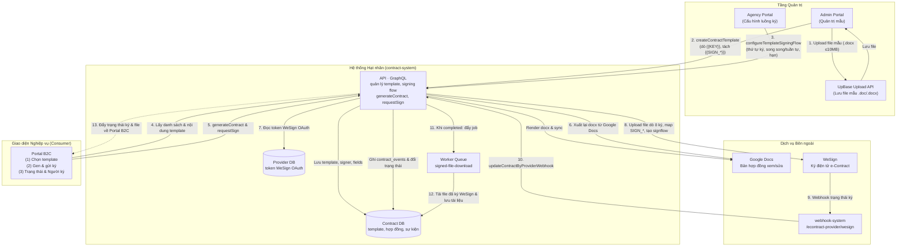
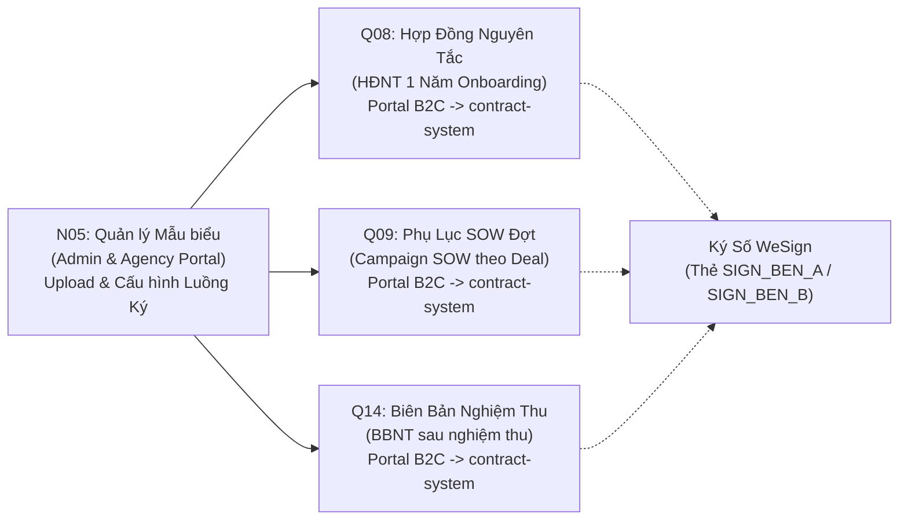
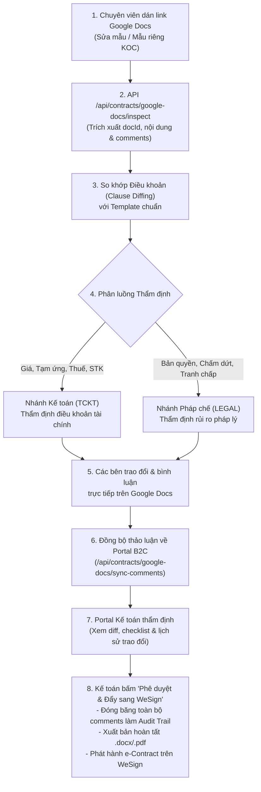

# ĐẶC TẢ KẾT NỐI DỮ LIỆU: HỆ THỐNG QUẢN LÝ HỢP ĐỒNG (CONTRACT-SYSTEM) & KIẾN TRÚC DỮ LIỆU KOC / DATA WAREHOUSE

| Thuộc tính | Giá trị |
| --- | --- |
| Mã tài liệu | **HUB-2.20** (Chuẩn hóa từ Kiến trúc Data Flow & Claude Artifact `Uwf7mn7y6Jzncob7HJpPHB`) |
| Dự án | B2C Ops Hub / Portal B2C — Phân hệ Quản trị Hợp đồng & Trung tâm Dữ liệu KOC |
| Giai đoạn | 2 — Phân tích & Thiết kế kỹ thuật chi tiết |
| Trạng thái | **Đã chốt giải pháp & Sẵn sàng triển khai kết nối (Ready for Integration)** |
| Phiên bản | **1.0** |
| Ngày ban hành | 29/10/2026 |
| Đơn vị chủ trì | Đội ngũ Giải pháp Kỹ thuật DX, IT Platform & Ban Vận hành Marketing B2C |

---

## 1. Bối cảnh & Mục tiêu Kiến trúc

Tài liệu này xác lập cấu trúc kết nối dữ liệu chính thức cho hai trục tích hợp cốt lõi của **Portal B2C**:
1. **Trục Quản lý Hợp đồng (`contract-system`):** Chuẩn hóa toàn bộ vòng đời pháp lý từ khâu tạo mẫu biểu tại `Admin Portal`, cấu hình luồng ký tại `Agency Portal`, sinh tài liệu và gửi ký từ `Portal B2C`, xuất bản sang `Google Docs`, điều phối ký số đa bên qua `WeSign (e-Contract)`, nhận phản hồi trạng thái từ `webhook-system`, đưa vào hàng đợi tải file đã ký và đồng bộ ngược về `Portal B2C`.
2. **Trục Dữ liệu KOC & Hiệu quả Truyền thông (Data Warehouse — DW):** Xác lập luồng thu thập và chuẩn hóa dữ liệu KOC tập trung qua một cửa duy nhất là `KoC Hub`, đồng bộ trực tiếp chỉ số vận hành từ `Report service`, `Ads service` và `OMS` vào `Data Warehouse`, đồng thời cung cấp giao diện truy vấn ổn định cho 3 tính năng trọng yếu của `Portal B2C`: **Tìm kiếm KOC**, **Báo cáo KOC (Report KOC)** và **Quản lý Video / Live**.

---

## 2. PHẦN I — ĐẶC TẢ HỆ THỐNG QUẢN LÝ HỢP ĐỒNG (CONTRACT-SYSTEM)

### 2.1 Sơ đồ Kiến trúc Thành phần & Dòng Dữ liệu

Dịch vụ `contract-system` đóng vai trò là hạt nhân trung tâm điều phối dữ liệu qua cả 3 giai đoạn:

---

### 2.2 13 Bước Vận Hành Qua 3 Giai Đoạn Chi Tiết

#### Giai đoạn 1 · Tạo Template (Pháp chế & Quản trị)
1. **Bước 1 — Upload file mẫu:** `Admin Portal` upload file văn bản `.doc` hoặc `.docx` (dung lượng tối đa 10MB) lên `UpBase upload API` và nhận về đường dẫn URL tệp tĩnh.
2. **Bước 2 — Tạo template (`createContractTemplate`):** `Admin Portal` gọi mutation GraphQL `createContractTemplate` kèm URL file. `contract-system` tự động quét các thẻ biến `{{KEY}}`, bóc tách riêng các thẻ ô ký (`{{SIGN_*}}`) khỏi trường nội dung cần điền, sau đó lưu thông tin template, danh sách người ký dự kiến, các trường động và tài liệu gốc trong một transaction duy nhất. `Admin Portal` chỉ đóng vai trò giao diện hiển thị, không tự lưu trữ dữ liệu template.
3. **Bước 3 — Cấu hình luồng ký (`configureTemplateSigningFlow`):** `Agency Portal` gọi mutation `configureTemplateSigningFlow` để thiết lập thứ tự ký, chế độ ký (song song `PARALLEL` hoặc tuần tự `SEQUENTIAL`), và thời hạn hiệu lực của yêu cầu ký (mặc định 7 ngày).

#### Giai đoạn 2 · Gen và Gửi Ký (Portal B2C Vận Hành)
4. **Bước 4 — Lấy template:** `Portal B2C` gọi query từ `contract-system` để lấy danh mục mẫu biểu hợp lệ và cấu trúc các trường thông tin cần điền.
5. **Bước 5 — Gen và tạo hợp đồng (`generateContract`):** `Portal B2C` gọi `generateContract` truyền vào mã hợp đồng ổn định (`code`), mã template và dữ liệu thực tế (thông tin KOC, thương hiệu, chi phí, danh sách video). `contract-system` render file `.docx` dựa trên dữ liệu điền, lưu bản ghi hợp đồng vào `Contract DB`, đồng bộ sang `Google Docs` và upload file lưu trữ.
6. **Bước 6 — Xuất file hoàn thiện:** Khi người dùng bấm gửi ký, `Portal B2C` gọi `requestSign`. Hệ thống xuất lại file `.docx` mới nhất từ `Google Docs` nhằm đảm bảo mọi chỉnh sửa câu chữ phát sinh trên Google Docs đều được giữ nguyên vẹn trên bản trình ký.
7. **Bước 7 — Lấy Token WeSign:** `contract-system` truy vấn `Provider DB` để lấy `access_token` WeSign đang có hiệu lực (cấp qua giao thức OAuth2).
8. **Bước 8 — Gửi sang WeSign:** `contract-system` tải file lên WeSign, tự động định vị tọa độ ô ký dựa trên các thẻ `{{SIGN_*}}` đã được chuyển đổi sang định danh của WeSign, và khởi tạo luồng trình ký điện tử (`signflow`).

#### Giai đoạn 3 · Đồng bộ Trạng Thái Ký (Phản hồi & Hoàn tất)
9. **Bước 9 — Nhận Webhook:** Khi người ký thực hiện ký hoặc từ chối trên WeSign, WeSign bắn Webhook thông báo tới cổng `webhook-system` tại địa chỉ `/econtract-provider/wesign`.
10. **Bước 10 — Cập nhật trạng thái (`updateContractByProviderWebhook`):** `webhook-system` gọi `contract-system`. Hệ thống cập nhật trạng thái hợp đồng trong `Contract DB` và ghi nhật ký sự kiện vào bảng `contract_events`.
11. **Bước 11 — Đưa vào Queue tải file:** Khi trạng thái chuyển sang hoàn tất (`COMPLETED`), `contract-system` tự động đưa một tác vụ vào hàng đợi `signed-file-download`.
12. **Bước 12 — Lưu file đã ký:** Worker ngầm xử lý hàng đợi, tải bản PDF đã đóng dấu số từ WeSign và lưu trữ vĩnh viễn vào danh mục tài liệu của hợp đồng.
13. **Bước 13 — Đẩy trạng thái về Portal B2C:** `contract-system` gửi thông báo sự kiện (Webhook) hoặc cung cấp dữ liệu qua API để `Portal B2C` cập nhật trạng thái ký (`WAITING` → `PARTIAL` → `COMPLETED`) và nhận link tải file PDF nghiệm thu/hợp đồng đã ký.

---

### 2.3 6 Quyết Định Kiến Trúc & Phương Án Khắc Phục Rủi Ro Kỹ Thuật

| STT | Vấn đề / Rủi ro thực tế | Đánh giá rủi ro | Giải pháp kiến trúc chuẩn hóa trên Portal B2C & contract-system |
| --- | --- | --- | --- |
| **R1** | **Webhook WeSign chưa được xác thực** (`verifyContent` luôn trả `true`, thiếu Auth Guard) | **NGHIÊM TRỌNG**: Bất kỳ ai biết endpoint đều có thể giả mạo webhook đổi trạng thái hợp đồng thành `COMPLETED`. | Bắt buộc kiểm tra chữ ký HMAC-SHA256 (`x-wesign-signature` / `x-contract-system-signature`) hoặc Shared Secret (`x-contract-system-secret`) tại `webhook-system` và endpoint tiếp nhận của Portal B2C (`verifyContractSystemWebhookAuth`). |
| **R2** | **Webhook ghi đè trạng thái vô điều kiện** (Không so sánh timestamp, sự kiện trễ kéo lùi trạng thái, sự kiện trùng tải file lặp) | **TRUNG BÌNH**: Mạng chập chờn khiến sự kiện cũ đến muộn kéo trạng thái từ `COMPLETED` về `WAITING`; tốn tài nguyên worker. | Áp dụng **Máy trạng thái đơn điệu (Monotonic State Machine - `canAdvanceSigningStatus`)**: chỉ chấp nhận chuyển dịch tiến (`DRAFT(0)` → `WAITING(1)` → `PARTIAL(2)` → `COMPLETED(3)`). Xử lý tác vụ tải file đã ký hoàn toàn **Idempotent** (bỏ qua nếu file đã tồn tại). |
| **R3** | **Chưa có bước đẩy trạng thái ký về Portal B2C** (Bước 13 chưa có sẵn trong mã nguồn `contract-system`) | **TRUNG BÌNH**: Nhân sự B2C không biết KOC đã ký xong hay chưa nếu không bấm xem thủ công. | Triển khai mô hình lai (Hybrid Synchronization): 1. **Đẩy chủ động:** `contract-system` gửi webhook tới `POST /api/contracts/integrations/contract-system/webhook` trên Portal B2C. 2. **Đối soát tự động (Reconciliation Cron):** Job chạy định kỳ mỗi 30 phút kiểm tra các hợp đồng đang ở trạng thái `WAITING`/`PARTIAL` quá 6 giờ để kéo trạng thái mới nhất, bù đắp trường hợp thất lạc gói tin webhook. |
| **R4** | **Mã hợp đồng là khóa Idempotent của `requestSign`** | **THẤP - ĐỀ PHÒNG**: Nếu Portal sinh mã hợp đồng ngẫu nhiên, khi bị timeout và gọi lại sẽ tạo ra hợp đồng mới trùng lặp trên WeSign. | Portal B2C bắt buộc tạo mã hợp đồng xác định bằng hàm `buildStableContractCode`: `${DDMMYY}/${DOC_TYPE}/UPBASE-${BRAND}-${KOC_REF}`. Gọi lại nhiều lần với cùng một Deal/Job đảm bảo chỉ trỏ về đúng 1 hợp đồng duy nhất. |
| **R5** | **Token WeSign trong Provider DB hết hạn** | **TRUNG BÌNH**: `contract-system` chỉ đọc token từ Provider DB và không tự refresh. Khi hết hạn, API gửi ký báo lỗi nhà cung cấp không sẵn sàng. | Bổ sung module kiểm tra hạn mức OAuth token trong `Provider DB`; tự động kích hoạt refresh token trước thời điểm hết hạn 15 phút, đồng thời bắn cảnh báo kênh kỹ thuật nếu refresh thất bại. |
| **R6** | **Phiên bản Template bị thay đổi sau khi đã gen** | **TRUNG BÌNH**: Sửa câu chữ template trên Admin Portal có thể làm sai lệch nội dung pháp lý của các hợp đồng đã phát hành trước đó. | Bổ sung cơ chế **Template Snapshot / Version Locking**: Mỗi khi gọi `generateContract`, hệ thống gắn chặt `templateVersionId` và lưu bản chụp nội dung template tại thời điểm gen, đảm bảo hợp đồng cũ không bị ảnh hưởng khi template nâng cấp. |

---

### 2.4 Ánh Xạ với Các Bước Nghiệp Vụ B2C (N05, Q08, Q09, Q14)

1. **Quy trình N05 (Legal Templates):** Quản lý tập trung 3 mẫu biểu chuẩn hóa tại `Admin Portal`:
   - Mẫu HĐNT Khung 1 năm (`BM.HDNT.KOC.01`).
   - Mẫu Phụ lục SOW hợp tác đợt (`BM.SOW.CAMPAIGN.01`).
   - Mẫu Biên bản nghiệm thu & thanh lý (`BM.BBNT.VID.01`).
2. **Quy trình Q08 (Ký Hợp Đồng Nguyên Tắc - KOC Onboarding):** Khi hoàn tất đàm phán KOC mới tại Q07, Portal B2C gọi `generateContract` và `requestSign` cho hợp đồng nguyên tắc khung 1 năm.
3. **Quy trình Q09 (Ký Phụ Lục Hợp Tác Theo Đợt - Campaign SOW):** Sau khi chốt danh sách Listing và hạn mức ngân sách gian hàng, Portal B2C sinh phụ lục SOW tương ứng với Job/Deal.
4. **Quy trình Q14 (Lập & Ký Biên Bản Nghiệm Thu - BBNT):** Sau khi hoàn tất nghiệm thu kỹ thuật video (Q12) và các tài sản truyền thông khác (Q13), Portal B2C tự động trích xuất bằng chứng (link air, chỉ số, ảnh khung hình sản phẩm) để gen BBNT trình ký 2 bên làm căn cứ chi trả tại Q16.

---

### 2.5 Luồng Hợp Đồng Sửa Đổi & Mẫu Riêng KOC Trên Google Docs (Google Docs Modified Contract Flow)

Nhằm đáp ứng trường hợp KOC không ký theo mẫu chuẩn có sẵn (sửa đổi điều khoản hoặc sử dụng mẫu riêng của KOC), hệ thống thiết lập luồng xử lý độc lập qua Google Docs API & Google Drive API:

#### Các quy tắc kỹ thuật của luồng Google Docs:
1. **Phân quyền truy cập tài liệu:** KOC hoặc chuyên viên chia sẻ quyền *Người nhận xét (Commenter)* hoặc *Người xem (Viewer)* cho Service Account hệ thống (`bot-contract@upbase.vn`), hoặc bật chế độ *Bất kỳ ai có liên kết đều có thể nhận xét*.
2. **Thuật toán phân tích điều khoản (Semantic Clause Diffing):** Bóc tách văn bản thành từng khối điều khoản (`Điều 1`, `Điều 2`...), phát hiện thay đổi (`MODIFIED`), bổ sung mới (`ADDED`) hoặc lược bỏ (`REMOVED`), phân luồng chính xác cho Kế toán và Pháp chế.
3. **Lưu vết trao đổi (Audit Trail):** Toàn bộ bình luận, giải trình và phản hồi giữa các bên trên Google Docs được lưu trữ vĩnh viễn vào trường `googleDocsComments` và `contract_events` của hợp đồng, bảo toàn bằng chứng kiểm toán kể cả khi người dùng xóa comment trên file gốc.
4. **Cơ chế Phê duyệt & Đẩy WeSign (Kế toán là FINAL):** Kế toán (`FINANCE`) là người phê duyệt cuối cùng (Final Approver & Gatekeeper), toàn quyền quyết định chốt hợp đồng và kích hoạt lệnh xuất bản đẩy sang WeSign. Ban Pháp chế (`LEGAL`) đóng vai trò tham vấn chuyên môn, nhận xét và comment tùy chỗ theo từng điều khoản liên quan trên Google Docs mà không chặn cứng (non-blocking) quyền chốt duyệt của Kế toán.
5. **Bàn làm việc chuyên biệt cho Pháp chế & Kế toán (`ContractApprovalPortalView.tsx`):**
   - **Portal Pháp chế (`LEGAL_PORTAL`):** Tự động mở khi đăng nhập bằng tài khoản Pháp chế (`LEGAL`), hiển thị hàng đợi SLA 24h, bộ lọc hồ sơ sửa điều khoản / Google Docs, kiểm tra ngưỡng mẫu riêng KOC `BR-01` ($\ge 50.000.000\text{đ}$), đối chiếu Clause Diffs trực tiếp và cho phép duyệt kèm lưu thành Mẫu KOC đã chuẩn hóa (`KOC_CUSTOM` — miễn duyệt lại cho các đợt Booking sau).
   - **Portal Kế toán (`FINANCE_PORTAL`):** Tự động mở khi đăng nhập bằng tài khoản Kế toán (`FINANCE`), hiển thị hàng đợi SLA 48h, bảng đối soát **Giá trị Gross · Thuế khấu trừ (TNCN 10% cá nhân $\ge 2\text{tr}$ / VAT 8–10% Công ty) · Thực nhận Net · Tạm ứng & Tất toán còn lại**, cảnh báo vượt trần ngân sách Deal hoặc thiếu số tài khoản, che mờ dữ liệu nhạy cảm (`****5678`) kèm nút mở xem chi tiết cho Kế toán/Pháp chế, và nút **Phê duyệt Chốt (FINAL) & Đẩy sang WeSign**.
6. **Tải lên & Đính kèm CCCD / Giấy phép ĐKKD vào Hồ sơ Pháp lý lưu trên Cloudflare R2 (`/api/contracts/legal-docs` & `LegalAttachmentsPanel.tsx`):**
   - Hỗ trợ đính kèm tệp **CCCD Mặt trước (`CCCD_FRONT`)**, **CCCD Mặt sau (`CCCD_BACK`)**, **Bản scan CCCD (`CCCD_SCAN`)**, **Giấy phép ĐKKD / Hộ kinh doanh (`DKKD`)** và **Giấy ủy quyền (`AUTHORIZATION`)** trực tiếp vào thực thể `KocLegalProfile` (`KocLegalProfilesSection.tsx`) và `ContractRecord` (`ContractForm.tsx`, `ContractDetail.tsx`, `ContractApprovalPortalView.tsx`).
   - Tệp tải lên được ký xác thực AWS Signature V4 lưu trên **Cloudflare R2** theo khóa chuẩn `legal-docs/<slug>/<yyyy-mm>/<uuid>-<safeName>` (`uploadLegalDocFile`, `readLegalDocFile`, `deleteLegalDocFile` trong `src/lib/brands/r2.ts`), đồng thời tự động có nhánh dự phòng lưu cục bộ (`.brand-data/files/legal-docs/...`) khi môi trường dev chưa cấu hình biến môi trường R2.
   - Pháp chế và Kế toán có thể bấm **Xem** để mở hộp thoại đối chiếu trực tiếp hình ảnh/PDF CCCD & ĐKKD từ Cloudflare R2 ngay trên Portal phê duyệt trước khi ký duyệt hợp đồng.
7. **Zero-Crash Standalone Fallback:** Khi chưa cấu hình biến môi trường `GOOGLE_SERVICE_ACCOUNT_JSON` hoặc `R2_*` trên môi trường local dev hoặc kiểm thử, hệ thống tự động kích hoạt chế độ mô phỏng độc lập, đảm bảo 100% kiểm thử và bản dựng Next.js chạy mượt mà không văng lỗi 500/503.

---

## 3. PHẦN II — ĐẶC TẢ LUỒNG DỮ LIỆU KOC & DATA WAREHOUSE (DW)

### 3.1 Sơ đồ Phân Làn Dữ Liệu 4 Tầng

```mermaid
flowchart TD
    subgraph Sources["Tầng 1: Nguồn Dữ Liệu"]
        LARK["Lark\nDanh sách & hồ sơ KOC"]
        KOLO["Kolodata\nNguồn KOC mới (sắp có)"]
        REPORT_SVC["Report service\nCrawl video / live performance"]
        ADS_SVC["Ads service\nReporting chiến dịch"]
        OMS["OMS\nĐơn hàng, tỷ lệ hoàn hủy"]
    end

    subgraph Integration["Tầng 2: Tích Hợp"]
        KOC_HUB["KoC Hub\nGom & chuẩn hoá nguồn\n(Cửa ngõ duy nhất của hồ sơ KOC)"]
    end

    subgraph DW["Tầng 3: Data Warehouse (DW)"]
        DW_PROFILE["Hồ sơ KoC\n(profile, kênh, follower)\nNguồn: KoC Hub"]
        DW_PERF["Performance video / live\n(chỉ số từng video & phiên live)\nNguồn: Report & Ads service"]
        DW_ORDERS["Đơn hàng\n(đơn hàng, tỷ lệ hoàn hủy)\nNguồn: OMS"]
        DW_JOIN["Báo cáo tổng hợp\n(Gắn theo KoC / Video ID)"]
    end

    subgraph Portal["Tầng 4: Khai Thác (Portal B2C)"]
        FEAT_SEARCH["Tìm kiếm KoC\n(Lọc tiêu chí, xem hồ sơ)"]
        FEAT_REPORT["Báo cáo KoC (Report KoC)\n(Hiệu quả tổng hợp theo Creator)"]
        FEAT_VIDEO["Video / Live\n(Hiệu quả chi tiết từng sản phẩm)"]
    end

    %% Dữ liệu KOC
    LARK -->|"Đồng bộ hồ sơ"| KOC_HUB
    KOLO -.->|"Đồng bộ hồ sơ (sắp có)"| KOC_HUB
    KOC_HUB -->|"Chuẩn hoá & loại trùng"| DW_PROFILE

    %% Performance & Đơn hàng
    REPORT_SVC -->|"Crawl số liệu video/live"| DW_PERF
    ADS_SVC -->|"Reporting chiến dịch"| DW_PERF
    OMS -->|"Đồng bộ đơn hàng & hoàn hủy"| DW_ORDERS

    %% Giao thoa trong DW
    DW_PROFILE --> DW_JOIN
    DW_PERF --> DW_JOIN
    DW_ORDERS --> DW_JOIN

    %% Truy vấn từ Portal B2C
    DW_PROFILE -->|"Query trực tiếp"| FEAT_SEARCH
    DW_JOIN -->|"Query trực tiếp"| FEAT_REPORT
    DW_PERF -->|"Query trực tiếp"| FEAT_VIDEO
```

---

### 3.2 Ba Luồng Dữ Liệu Chính

1. **Luồng Hồ sơ KOC:** `Lark` đồng bộ dữ liệu KOC về `KoC Hub`; nguồn dữ liệu `Kolodata` (khi tích hợp) cũng đẩy về `KoC Hub` theo cùng chuẩn. `KoC Hub` thực hiện chuẩn hóa, khử trùng lặp và làm giàu dữ liệu trước khi đẩy vào Data Warehouse. **Data Warehouse tuyệt đối không nhận dữ liệu KOC trực tiếp từ Lark hay Kolodata mà chỉ qua một cửa duy nhất là `KoC Hub`**.
2. **Luồng Hiệu quả Truyền thông (Performance) & Đơn hàng:** `Report service` (cào dữ liệu video/live) và `Ads service` (số liệu quảng cáo Spark Ads/GMV) đẩy dữ liệu thẳng vào Data Warehouse. `OMS` đẩy dữ liệu đơn hàng và tỷ lệ hoàn hủy thực tế thẳng vào Data Warehouse. Các luồng này hoàn toàn độc lập với `KoC Hub`, giúp `KoC Hub` không bị quá tải bởi khối lượng bản ghi chỉ số liên tục.
3. **Luồng Khai thác Nghiệp vụ (Portal B2C):** `Portal B2C` truy vấn trực tiếp vào Data Warehouse phục vụ 3 năng lực vận hành:
   - **Tìm kiếm KOC (Q04):** Lọc theo ngành hàng, khoảng thù lao, tỷ lệ tương tác, số người theo dõi.
   - **Báo cáo KOC (Q18):** Đánh giá hiệu quả tổng hợp của KOC (nơi hội tụ giữa Hồ sơ KOC và Performance/Đơn hàng).
   - **Quản trị Video / Live (Q12, Q13):** Theo dõi chi tiết chỉ số View, Like, Bình luận, GMV và trạng thái duy trì của từng video.

---

### 3.3 4 Quyết Định Kiến Trúc & Khuyến Nghị Kỹ Thuật Data Warehouse

| STT | Vấn đề / Quyết định | Phân tích kỹ thuật | Giải pháp chuẩn hóa |
| --- | --- | --- | --- |
| **D1** | **KoC Hub là cửa duy nhất nạp hồ sơ vào DW** | Tránh tình trạng xung đột dữ liệu khi nhiều nguồn (Lark, Kolodata) cùng đẩy dữ liệu KOC vào DW với cấu trúc và định danh khác nhau. | `KoC Hub` chịu trách nhiệm phân giải định danh (Entity Resolution), hợp nhất dữ liệu và loại trùng trước khi ghi vào bảng `dim_koc_profile` của DW. |
| **D2** | **Khóa nối KOC chung giữa Hồ sơ và Performance** | **RỦI RO LỚN NHẤT**: Hồ sơ đến từ `KoC Hub`, trong khi Performance đến từ crawler và ads. Nếu không có khóa nối thống nhất, chức năng Report KOC không thể kết nối (`JOIN`) dữ liệu. | Chuẩn hóa khóa kết nối định danh: **`platform` + `channel_id`** (Ví dụ: `TIKTOK:@truongthao_99` hoặc TikTok Snowflake SecUID). Mọi hệ thống crawler và reporting bắt buộc trích xuất và lưu kèm khóa này. |
| **D3** | **Xử lý xung đột chỉ số Video giữa Crawl và Ads** | Một video lên sóng có thể có cả số liệu từ crawler tự động và số liệu báo cáo từ Ads service, dễ dẫn đến hiện tượng Portal B2C hiển thị 2 con số mâu thuẫn cho cùng 1 video. | Định danh video bằng khóa chung **`video_id` (Snowflake 64-bit của TikTok)**. Xác lập quy tắc nguồn ưu tiên (Source Precedence Rule): - Chỉ số tương tác cộng đồng (View, Like, Bình luận, Chia sẻ) ➔ Ưu tiên `Report service` (Crawl). - Chỉ số thương mại (Doanh thu GMV, Chi phí Ads, Click giỏ hàng) ➔ Ưu tiên `Ads service` & `OMS`. |
| **D4** | **Schema DW là hợp đồng dữ liệu giữa các bên (Data Contract)** | Nhiều dịch vụ truy vấn trực tiếp vào DW mà không qua tầng trung gian API nội bộ. | 1. Cấp tài khoản riêng cho từng Consumer với quyền chỉ đọc (`Read-only`), giới hạn thời gian thực thi (Statement Timeout: 15s) và hạn mức tài nguyên (Connection Pool: 20). 2. Xây dựng các khung nhìn dữ liệu ổn định (**Stable Views / Semantic Layer: `v_b2c_koc_catalog`, `v_b2c_video_performance`**) làm ranh giới giao tiếp, không để Portal query trực tiếp vào bảng thô (`raw_*`). 3. Bổ sung index chuyên biệt cho các trường lọc thường xuyên của tính năng Tìm kiếm KOC. |
| **D5** | **Quản lý độ trễ tích lũy 2 chặng (Latency Management)** | Dữ liệu KOC đi qua 2 bước (`Lark` ➔ `KoC Hub` ➔ `DW`) dẫn đến độ trễ hiển thị. | Thiết lập chu kỳ đồng bộ rõ ràng (Sync Interval) cho từng chặng, đồng thời lưu trường `dw_synced_at` và hiển thị nhãn **"Cập nhật lúc: DD/MM/YYYY HH:mm"** trên giao diện Portal B2C để nhân sự vận hành nắm rõ độ tươi của dữ liệu. |

---

## 4. TỔNG KẾT MA TRẬN TÍCH HỢP HỆ THỐNG PHÒNG B2C

| Phân hệ nghiệp vụ | Nguồn sự thật (SSOT) | Kênh kết nối | Điểm chạm trên Portal B2C |
| --- | --- | --- | --- |
| **Master Data KOC - Performance (N02)** | `KoC Hub` qua Data Warehouse | DW Stable Views (`v_b2c_koc_catalog`) | `KocMasterDataView.tsx` |
| **Master Data Marketing B2C (N04)** | Data Warehouse (Từ điển chuẩn) | DW Stable Views / Config API | `MasterDataView.tsx` / `ProductCatalogView.tsx` |
| **Mẫu biểu pháp lý (N05)** | Admin Portal / `contract-system` (Dài hạn: Data Warehouse) | GraphQL Query / DW Semantic View | `ContractCatalogView.tsx` |
| **HĐNT Khung 1 năm (Q08)** | `contract-system` & WeSign | GraphQL Mutation `generateContract`, `requestSign` | `ContractManagementView.tsx` / `ContractForm.tsx` |
| **Phụ lục SOW theo Job (Q09)** | `contract-system` & WeSign | GraphQL Mutation `generateContract`, `requestSign` | `PlanDealBoard.tsx` (Job Detail) |
| **Biên bản nghiệm thu (Q14)** | `contract-system` & WeSign | GraphQL Mutation `generateContract`, `requestSign` | `ContractDocumentViewer.tsx` / BBNT View |
| **Đồng bộ trạng thái ký (Bước 13)** | `contract-system` | Webhook `POST /api/contracts/integrations/contract-system/webhook` | Cập nhật tự động trên Deal/Job và Hợp đồng |
| **Hồ sơ Creator / KOC (Q04)** | `KoC Hub` qua Data Warehouse | DW Stable Views (`v_b2c_koc_catalog`) | `KocMasterDataView.tsx` / `TikTokCrawlerHubView.tsx` |
| **Hiệu quả Video / Live (Q12, Q13)** | Report Service / Ads Service qua DW | DW Stable Views (`v_b2c_video_performance`) | `ExecutiveDashboardReportsView.tsx` / Air Report |
| **Đề nghị thanh toán (Q16)** | Portal B2C ➔ Lark Approval 3.2 | Lark Open API (`/open-apis/approval/v4/instances`) | `PlanDealBoard.tsx` / `larkPaymentRequestEngine.ts` |
| **Chứng từ CCCD & ĐKKD & Đối soát Lịch sử ký HSPL** | Cloudflare R2 (`legal-docs/...`) & `legalProfileHistory.ts` | `/api/contracts/legal-docs` (`GET`/`POST`/`DELETE`) & `evaluateLegalProfileSigningHistory` | `LegalAttachmentsPanel.tsx`, `ContractApprovalPortalView.tsx`, `ContractDetail.tsx` |
| **Đàm phán Google Docs 3 Mốc & Báo cáo Lưu vết Hợp đồng** | Google Drive API v3 (`comments`, `revisions`, `export`) & `googleDocsServer.ts` | `/api/contracts/google-docs/sync-comments`, `/api/contracts/google-docs/summarize-report`, `/api/contracts/google-docs/approve-and-push-wesign` | `GoogleDocsReviewPanel.tsx` (Lưu `initialSnapshot`, `initialToFinalDiffs`, `negotiationReport`, xuất `.docx`/`.pdf` & đẩy WeSign) |
