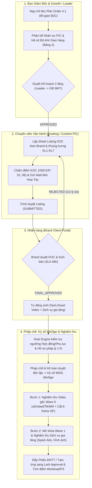
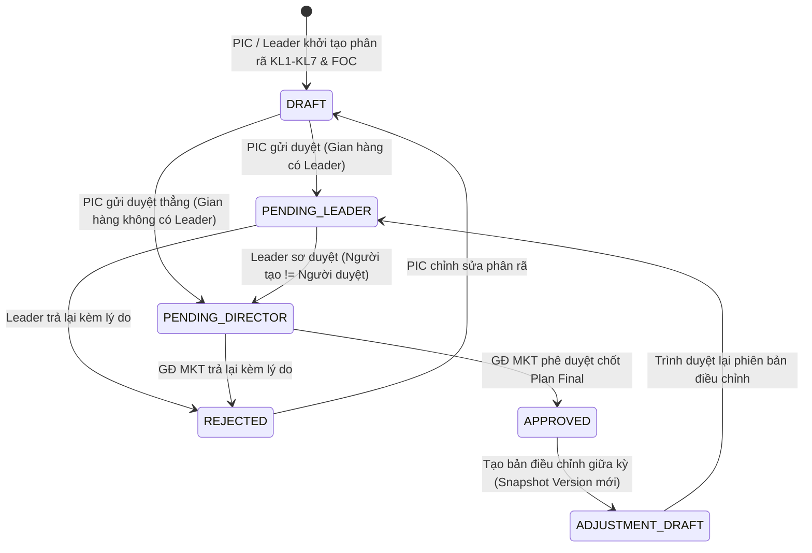
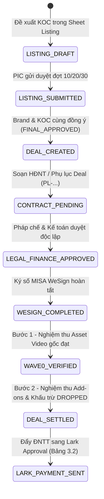

# USER STORIES, LUỒNG TRẠNG THÁI & TIÊU CHÍ NGHIỆM THU — B2C OPS HUB

| Thuộc tính | Giá trị |
| --- | --- |
| Mã tài liệu | HUB-2.2 |
| Dự án | B2C Ops Hub |
| Giai đoạn | 2 — Phân tích & Thiết kế kỹ thuật (Cổng G2) |
| Trạng thái | Đã hoàn thành — đồng bộ 100% với `HUB-2.1` (SRS v1.6) & `HUB-2.8` (Test Strategy v0.2) |
| Owner | IT Business Analyst (`@it-business-analyst`) & Team DX |
| Người duyệt | Giám đốc khối Marketing B2C · Tech Lead |
| Cập nhật | 24/10/2026 |
| Phiên bản | 1.0 |

Tài liệu này đặc tả chi tiết **User Stories (`US-001` → `US-024`)**, **Tiêu chí nghiệm thu Gherkin (Given/When/Then)**, **Mô hình trạng thái (`stateDiagram-v2`)**, **Lưu đồ liên phòng ban (`flowchart`)** và **Bảng quyết định (Decision Tables)** cho toàn bộ yêu cầu chức năng (`FR-001` → `FR-083`) của **B2C Ops Hub**.

Tham chiếu chuẩn:
- Đặc tả yêu cầu phần mềm: [HUB-2.1 SRS B2C Ops Hub](2.1_SRS_B2C_OPS_HUB.md)
- Phân quyền & Bảo mật RBAC: [HUB-2.6 Auth & RBAC Spec](2.6_AUTH_AND_RBAC_SPEC.md)
- Chiến lược kiểm thử: [HUB-2.8 Test Strategy](2.8_TEST_STRATEGY.md)
- Ma trận truy vết: [HUB-GOV-03 Traceability Matrix](../governance/TRACEABILITY.md)
- Thuật ngữ chuẩn: [SDLC-01 Glossary](../../../sdlc/01_GLOSSARY.md)

---

## 1. Mô Hình Hóa Quy Trình & Vòng Đời Trạng Thái Cốt Lõi (`@ba-process-modeling`)

### 1.1. Lưu đồ Liên Phòng Ban (Swimlane): Kế Hoạch Tháng → Listing → Deal → Nghiệm Thu 2 Bước

---

### 1.2. Vòng đời Trạng thái Kế hoạch Tháng (`MonthlyPlan` State Machine)

| Trạng thái nguồn | Sự kiện (Trigger) | Điều kiện tiên quyết (Guard Condition) | Trạng thái đích | Vai trò thực hiện | Tác dụng phụ (Side Effects) |
| --- | --- | --- | --- | --- | --- |
| `DRAFT` | `SUBMIT_PLAN` | Tổng phân rã `KL1–KL7 + FOC` khớp chỉ tiêu; không vượt trần ngân sách Net | `PENDING_LEADER` / `PENDING_DIRECTOR` | `SPECIALIST` / `LEADER` | Ghi nhận timestamp bắt đầu SLA duyệt |
| `PENDING_LEADER` | `APPROVE_STEP_1` | `actor.id !== plan.createdById` (Chống tự duyệt) | `PENDING_DIRECTOR` | `LEADER` | Gửi thông báo cho `MKT_DIRECTOR` |
| `PENDING_DIRECTOR` | `FINAL_APPROVE` | Đủ thông tin định biên PIC và hệ số độ khó gian hàng | `APPROVED` | `MKT_DIRECTOR` / `CEO` | Khóa hệ số gian hàng Bảng 2 (`FR-015`); sinh Snapshot lịch sử |
| `APPROVED` | `CREATE_REVISION` | Có lý do điều chỉnh kế hoạch giữa kỳ | `ADJUSTMENT_DRAFT` | `LEADER` / `SPECIALIST` | Giữ nguyên bản `APPROVED` cũ trong `MonthlyPlanVersionSnapshot` |

---

### 1.3. Vòng đời Trạng thái Deal & Nghiệm thu 2 Bước (`BookingDeal` & `ContractHubRecord`)

---

### 1.4. Bảng Quyết Định Nghiệp Vụ (Business Rule Decision Tables)

#### Bảng A — Quy tắc Pháp lý, Thuế & Luồng Duyệt Hợp Đồng (`FR-031`, `FR-032`, `FR-082`)
| # | Tư cách pháp nhân (`legalType`) | Giá trị Deal / Ngưỡng | Khấu trừ Thuế / Hóa đơn | Văn bản bắt buộc | Điều kiện mở khóa Trình ký WeSign / ĐNTT |
| --- | --- | --- | --- | --- | --- |
| **R1** | Cá nhân (`INDIVIDUAL`) | `< 2.000.000đ` / lần chi | Không khấu trừ TNCN 10% | HĐNT + Phụ lục Deal (`IND-VID-SOW`) | Đủ CCCD 12 số + STK chính chủ khớp tên chủ thể ký |
| **R2** | Cá nhân (`INDIVIDUAL`) | `>= 2.000.000đ` | Khấu trừ **10% TNCN** (`Gross = Net / 0.9`) | HĐNT + Phụ lục Deal + BBNT (`IND-VID-BBNT`) | Pháp chế duyệt + Kế toán duyệt độc lập; nếu sửa trường tiền/pháp lý sau duyệt → Reset trạng thái duyệt về `PENDING` |
| **R3** | Hộ kinh doanh (`HOUSEHOLD`) | Mọi mệnh giá | Thuế theo biểu HKD + Giấy ĐKKD | Mẫu HKD (`HKD-VID-SOW`, `HKD-VID-BBNT`) | Khớp MST Hộ kinh doanh + Giấy phép ĐKKD + STK thụ hưởng |
| **R4** | Công ty / Agency (`COMPANY`) | Mọi mệnh giá (Đặc biệt `>= 50.000.000đ`) | Xuất hóa đơn **VAT 8% / 10%** | Hợp đồng dịch vụ / Phụ lục (`COM-VID-SOW`, `COM-VID-BBNT`) | Bắt buộc duyệt Pháp chế + Kế toán + Kiểm tra hạn mức công nợ & Hóa đơn GTGT |

---

## 2. Danh Mục User Stories & Tiêu Chí Nghiệm Thu Gherkin (`US-001` → `US-024`)

### Phân hệ 1: Cockpit Điều Hành & Giám Sát SLA (`FR-001`, `FR-002`, `FR-035`)

#### `US-001` — Cockpit công việc chờ xử lý theo phạm vi phân quyền
- **User Story**: Là **Chuyên viên (Specialist) / Quản lý (Leader)**, tôi muốn **nhìn thấy danh sách công việc đang chờ tôi xử lý trên màn hình Cockpit đúng theo phạm vi Gian hàng/Brand được giao**, để **xử lý ngay các nút thắt mà không bị lộ dữ liệu của nhóm khác**.
- **Truy vết**: `FR-001`, `BR-02`, `BR-06` · **Kiểm thử**: `TC-017`
- **Tiêu chí nghiệm thu (Gherkin AC)**:
  - **Given** người dùng đăng nhập với vai trò `SPECIALIST` được gán phụ trách Gian hàng `Store_A`
  - **When** truy cập màn hình Cockpit (`/`)
  - **Then** hệ thống chỉ hiển thị các đầu việc (Listing chờ sửa, Hợp đồng chờ bổ sung, Deal sắp đến hạn air) thuộc `Store_A` và mỗi dòng có link điều hướng trực tiếp tới bản ghi gốc.
  - **Given** có đầu việc thuộc `Store_B` (do nhân sự khác phụ trách và người dùng không phải Co-PIC)
  - **When** gọi API lấy danh sách việc chờ xử lý
  - **Then** hệ thống lọc bỏ hoàn toàn bản ghi của `Store_B` ngay tại tầng máy chủ (`Data Scoping Engine`).

#### `US-002` — Cảnh báo sớm 50% SLA, Quá hạn SLA & Theo dõi Hàng mẫu / Spark Ads
- **User Story**: Là **Leader / Giám đốc Khối**, tôi muốn **hệ thống tự động đếm và gắn nhãn cảnh báo các đầu việc chạm ngưỡng 50% SLA (Vàng) hoặc vượt 100% SLA (Đỏ) kèm trạng thái giao hàng mẫu và mã Spark Ads**, để **biết chính xác việc đang tắc ở khâu nào (PIC, Brand, KOC, Kho hay Pháp chế)**.
- **Truy vết**: `FR-002`, `FR-035`, `BR-01`, `BR-02` · **Kiểm thử**: `TC-011`, `TC-016`, `TC-017`
- **Tiêu chí nghiệm thu (Gherkin AC)**:
  - **Given** một đề xuất KOC gửi Brand duyệt có hạn SLA chuẩn là `48 giờ`
  - **When** thời gian chờ đạt từ `24h00m` đến dưới `48h00m`
  - **Then** hệ thống gắn huy hiệu `Sắp chạm hạn SLA (>=50%)` và cộng vào bộ đếm cảnh báo sớm trên Cockpit.
  - **When** thời gian chờ vượt quá `48h00m` mà Brand chưa phản hồi
  - **Then** hệ thống chuyển sang trạng thái `Quá hạn SLA (BREACHED)`, ghi rõ bên đang giữ việc là `Brand` và số giờ trễ thực tế.

---

### Phân hệ 2: Hệ Thống 5 Dashboard Điều Hành & Đối Soát (`FR-003` → `FR-008`, `FR-018`)

#### `US-003` — Dashboard Ngân sách Net/Gross & Cảnh báo Vượt trần (Overbudget / Unbudgeted)
- **User Story**: Là **Giám đốc Marketing / Leader**, tôi muốn **theo dõi giải ngân thực tế (Net & Gross) đối chiếu với trần ngân sách Plan 4.1 của 69 gian hàng B2C**, để **chặn kịp thời các gian hàng chi vượt hạn mức (Overbudget) hoặc phát sinh chi phí khi hạn mức bằng 0đ (Unbudgeted Spend)**.
- **Truy vết**: `FR-003`, `FR-004`, `BR-03`, `BR-07`, `DEC-006` · **Kiểm thử**: `TC-010`, `TC-011`
- **Tiêu chí nghiệm thu (Gherkin AC)**:
  - **Given** gian hàng có hạn mức ngân sách Net tháng 10/2026 là `100.000.000đ`
  - **When** tổng giá trị Net các Deal đã duyệt của gian hàng đạt `105.000.000đ`
  - **Then** Dashboard Ngân sách gắn cờ đỏ `OVERBUDGET (+5.000.000đ)` và tính đúng chi phí Gross tương ứng theo công thức `DEC-006`.
  - **Given** gian hàng có hạn mức ngân sách = `0đ` nhưng phát sinh Deal có chi phí Net `> 0đ`
  - **When** hệ thống tổng hợp số liệu
  - **Then** gian hàng bị gắn cảnh báo `UNBUDGETED SPEND`.

#### `US-004` — Đối soát Lịch Air Tuần (Plan vs Cam kết vs Thực tế) & Hiệu quả Video
- **User Story**: Là **Leader / Chuyên viên**, tôi muốn **đối soát ma trận số lượng video Kế hoạch vs Cam kết vs Thực tế đã Air theo từng tuần (W1–W4), tách biệt Paid vs FOC và Affiliate vs Self-channel vs Live**, để **không bị cộng trùng đơn 14 ngày / 30 ngày và truy vết được từng mã video tạo nên con số**.
- **Truy vết**: `FR-005`, `FR-006`, `FR-007`, `BR-02`, `BR-03`, `BR-07` · **Kiểm thử**: `TC-018`
- **Tiêu chí nghiệm thu (Gherkin AC)**:
  - **Given** bảng báo cáo đối soát Kế hoạch & Air Video theo Gian hàng và Khung lương `KL1–KL7`
  - **When** người dùng bấm vào bất kỳ ô số lượng nào trên ma trận
  - **Then** hệ thống mở danh sách chi tiết các bản ghi Deal/Video cấu thành con số đó (khớp 100% tổng số).

#### `US-005` — Theo dõi Tiến độ Phễu 69 Gian hàng B2C (Quy trình Bước 0 → 18)
- **User Story**: Là **Giám đốc Marketing / Leader**, tôi muốn **quan sát toàn cảnh 69 gian hàng B2C đang nằm ở chặng nào trong 7 chặng phễu vận hành (từ Bước 0 Nhận Plan đến Bước 18 Quyết toán)**, để **phát hiện ngay điểm nghẽn theo từng đội và điều hướng 1 chạm tới phân hệ xử lý**.
- **Truy vết**: `FR-008`, `FR-018`, `BR-03`, `BR-05`, `BR-06` · **Kiểm thử**: `TC-010`
- **Tiêu chí nghiệm thu (Gherkin AC)**:
  - **Given** người dùng có vai trò `LEADER` truy cập màn hình Tiến độ phễu 69 gian hàng
  - **When** chọn bộ lọc theo Team hoặc trạng thái nghẽn SLA
  - **Then** hệ thống hiển thị chính xác số gian hàng ở từng chặng phễu và cho phép bấm 1 chạm để chuyển thẳng tới màn hình Kế hoạch / Listing / Hợp đồng của gian hàng đó.

---

### Phân hệ 3: Kế Hoạch Tháng, Định Biên Nhân Sự & Hệ Số Gian Hàng (`FR-010` → `FR-017`)

#### `US-006` — Lập Kế hoạch Tháng phân rã KL1–KL7 / FOC & Lưu Phiên bản (Version Snapshot)
- **User Story**: Là **Leader / Chuyên viên Content & Booking**, tôi muốn **lập kế hoạch tháng cho gian hàng với phân rã chi tiết theo bậc lương `KL1–KL7`, `FOC` và kênh triển khai**, để **mọi chỉnh sửa sau khi duyệt đều tạo phiên bản (Snapshot) mới mà không làm mất lịch sử kế hoạch gốc**.
- **Truy vết**: `FR-010`, `FR-011`, `FR-016`, `BR-05`, `BR-07` · **Kiểm thử**: `TC-011`, `TC-012`
- **Tiêu chí nghiệm thu (Gherkin AC)**:
  - **Given** kế hoạch tháng của gian hàng đang ở trạng thái `APPROVED` (Phiên bản `v1`)
  - **When** người dùng tạo bản điều chỉnh chỉ tiêu giữa kỳ và lưu lại
  - **Then** hệ thống sinh bản ghi `MonthlyPlanVersionSnapshot` lưu nguyên vẹn `v1`, tăng số phiên bản và cho phép xuất biểu mẫu 1-Sheet trình Brand định dạng `.xlsx` (`FR-016`).

#### `US-007` — Phê duyệt Kế hoạch 2 tầng & Kiểm soát Chống tự duyệt
- **User Story**: Là **Giám đốc Marketing / Leader**, tôi muốn **kế hoạch tháng đi qua luồng duyệt 2 tầng (Leader sơ duyệt → GĐ MKT phê duyệt cuối; gian không có Leader trình thẳng GĐ MKT)**, để **đảm bảo tính minh bạch và không ai được tự phê duyệt kế hoạch do chính mình tạo**.
- **Truy vết**: `FR-012`, `FR-013`, `FR-017`, `BR-06` · **Kiểm thử**: `TC-011`
- **Tiêu chí nghiệm thu (Gherkin AC)**:
  - **Given** một Kế hoạch tháng do `Leader_A` trực tiếp tạo
  - **When** `Leader_A` bấm nút duyệt ở bước sơ duyệt
  - **Then** hệ thống từ chối thao tác với thông báo *"Người tạo kế hoạch không được tự phê duyệt"* (`Self-approval blocked`).
  - **Given** dòng Content trong Plan Brand đã được gán cho `PIC_1`
  - **When** `PIC_2` (cùng cấp `SPECIALIST`) cố tình sửa dòng của `PIC_1`
  - **Then** hệ thống chặn chỉnh sửa (`FR-017`), chỉ cho phép `PIC_1`, `LEADER` hoặc `MKT_DIRECTOR` cập nhật.

#### `US-008` — Phân bổ Nhân sự theo Gian hàng & Khóa Hệ số Độ khó Bảng 2
- **User Story**: Là **Giám đốc Marketing**, tôi muốn **phân công Owner/Backup cho từng gian hàng và chốt Hệ số độ khó gian hàng (Bảng 2: `1.0` → `1.6`) ngay đầu tháng**, để **khóa cứng hệ số sau khi đã có kết quả nghiệm thu, ngăn chặn việc tự ý nâng hệ số giữa kỳ làm sai lệch quỹ thưởng P3**.
- **Truy vết**: `FR-014`, `FR-015`, `BR-05`, `BR-06` · **Kiểm thử**: `TC-019`
- **Tiêu chí nghiệm thu (Gherkin AC)**:
  - **Given** gian hàng đã phát sinh kết quả nghiệm thu trong kỳ và không có mã `Plan điều chỉnh` được GĐ MKT duyệt
  - **When** người dùng gửi yêu cầu thay đổi `storeCoefficient` từ `1.2` lên `1.5`
  - **Then** hệ thống chặn thao tác (`403 / Validation Error`) và giữ nguyên hệ số đã khóa đầu kỳ.

---

### Phân hệ 4: Listing KOC, Chấm Điểm Đề Xuất 100đ, Outreach & Tạo Deal (`FR-020` → `FR-024`, `FR-063`)

#### `US-009` — Sheet Listing KOC 48 cột theo Brand, Chấm điểm 100đ & Lọc cứng `HF-01..06`
- **User Story**: Là **Chuyên viên Booking**, tôi muốn **lập danh sách đề xuất KOC trên Sheet Listing gắn trực tiếp với dòng Plan Final và dùng Động cơ chấm điểm 100đ để tự động gợi ý KOC theo đúng số lượng bậc lương `KL` còn thiếu**, để **loại bỏ 100% KOC từng bị Brand từ chối và tiết kiệm thời gian tìm kiếm**.
- **Truy vết**: `FR-020`, `FR-063`, `BR-02`, `BR-05` · **Kiểm thử**: `TC-011`, `TC-013`
- **Tiêu chí nghiệm thu (Gherkin AC)**:
  - **Given** dòng Plan yêu cầu `5 KOC bậc KL3` cho Brand `Brand_X`, hiện đã nhặt `2 KOC`
  - **When** kích hoạt tính năng Tự động đề xuất KOC (`kocRecommendationEngine`)
  - **Then** hệ thống áp dụng 6 bộ lọc cứng (`HF-01..06`), loại trừ toàn bộ KOC có lịch sử bị `Brand_X` từ chối, chấm điểm theo thang 100 và trả về đúng `3 KOC bậc KL3` có điểm cao nhất.

#### `US-010` — Gửi Mail Mời Hợp Tác KOC Hàng Loạt & Quản lý Mẫu Thư Chuẩn
- **User Story**: Là **Chuyên viên Booking / Trưởng phòng**, tôi muốn **trộn tự động 16 biến từ dòng Sheet Listing vào 5 mẫu thư mời hợp tác chuẩn đã được Trưởng phòng duyệt/khóa**, để **gửi mail hàng loạt hoặc mở nhanh Gmail soạn sẵn và tự động chuyển trạng thái dòng sang `Đang liên hệ`**.
- **Truy vết**: `FR-024`, `BR-02`, `BR-06` · **Kiểm thử**: `TC-011`
- **Tiêu chí nghiệm thu (Gherkin AC)**:
  - **Given** mẫu thư chuẩn đang ở trạng thái `LOCKED` (do Leader khóa)
  - **When** `SPECIALIST` chọn 10 KOC trong Sheet Listing và bấm Gửi thư mời
  - **Then** hệ thống không cho phép sửa cấu trúc mẫu gốc, tự động điền đúng tên KOC, tên Brand, SKU, mức cát-xê dự kiến và cập nhật cột trạng thái tiếp cận thành `Đang liên hệ`.

#### `US-011` — Chuyển đổi Listing `FINAL_APPROVED` thành Deal, Khóa Wave 1 & Phân bổ P&L
- **User Story**: Là **Chuyên viên Booking**, tôi muốn **hệ thống chỉ sinh Deal khi cả Brand và KOC cùng đồng ý (`FINAL_APPROVED`), tự động khóa các hạng mục đăng chéo Wave 1 cho tới khi Video gốc Wave 0 nghiệm thu đạt, và tự động khấu trừ tiền các hạng mục `DROPPED`**, để **không xảy ra rủi ro thanh toán nhầm cho hạng mục chưa hoàn thành**.
- **Truy vết**: `FR-021`, `FR-022`, `FR-023`, `BR-02`, `BR-03` · **Kiểm thử**: `TC-010`, `TC-011`, `TC-023`
- **Tiêu chí nghiệm thu (Gherkin AC)**:
  - **Given** một Deal gồm Video gốc (`Wave 0`: `5.000.000đ`) và Dịch vụ Reup/Ads (`Wave 1`: `1.000.000đ`)
  - **When** Video gốc `Wave 0` chưa ở trạng thái `VERIFIED`
  - **Then** hạng mục `Wave 1` bị khóa ở trạng thái `LOCKED_BY_WAVE_0`, không cho phép bấm nghiệm thu.
  - **When** hạng mục `Wave 1` bị đánh dấu hủy (`DROPPED`)
  - **Then** `finalAmount` của Deal tự động giảm đúng `1.000.000đ` còn `5.000.000đ`.

---

### Phân hệ 5: Hợp Đồng Pháp Lý, Duyệt Độc Lập, WeSign & Nghiệm Thu BBNT (`FR-030` → `FR-034`, `FR-036`)

#### `US-012` — Soạn Hợp đồng / Phụ lục từ Mẫu chuẩn & Rule Engine Kiểm tra Ngưỡng Thuế/Pháp lý
- **User Story**: Là **Chuyên viên Pháp chế / Booking**, tôi muốn **hệ thống tự động chọn mẫu Hợp đồng/Phụ lục Word chuẩn theo tư cách pháp nhân (`Cá nhân`, `HKD`, `Công ty`) và chạy Rule Engine kiểm tra ngưỡng `2tr / 10tr / 20tr / 50tr`, thuế TNCN 10% và VAT**, để **xuất file `.docx` giữ nguyên 100% điều khoản pháp chế chuẩn**.
- **Truy vết**: `FR-030`, `FR-031`, `FR-034` · **Kiểm thử**: `TC-001`, `TC-002`, `TC-003`, `TC-023`
- **Tiêu chí nghiệm thu (Gherkin AC)**:
  - **Given** Deal của KOC Cá nhân có giá trị thanh toán `>= 2.000.000đ`
  - **When** Rule Engine kiểm tra điều kiện hợp đồng
  - **Then** hệ thống bắt buộc áp thuế TNCN 10%, yêu cầu đủ số CCCD và tài khoản ngân hàng chính chủ trước khi cho phép chuyển sang bước duyệt.

#### `US-013` — Phê duyệt Độc lập Pháp chế / Kế toán & Đồng bộ Ký số MISA WeSign
- **User Story**: Là **Chuyên viên Pháp chế (`LEGAL`) / Kế toán (`FINANCE`)**, tôi muốn **duyệt độc lập từng hồ sơ hợp đồng và tự động thu hồi trạng thái duyệt nếu bản ghi bị chỉnh sửa sau khi duyệt**, để **chỉ những hợp đồng đã được cả 2 bên duyệt mới được đẩy sang trình ký số MISA WeSign**.
- **Truy vết**: `FR-032`, `FR-033`, `NFR-03`, `NFR-07` · **Kiểm thử**: `TC-003`, `TC-004`, `TC-005`
- **Tiêu chí nghiệm thu (Gherkin AC)**:
  - **Given** hợp đồng đã được `LEGAL` duyệt (`APPROVED`), đang chờ `FINANCE` duyệt
  - **When** PIC chỉnh sửa số tiền hoặc thông tin pháp nhân trên hợp đồng
  - **Then** hệ thống tự động hủy trạng thái duyệt của `LEGAL` về `PENDING`, ghi Audit Log và khóa nút Trình ký WeSign.

#### `US-014` — Tự động Bóc tách Link Air TikTok, Cắt 8 Frame Sản phẩm & Sinh Bản nháp BBNT theo SOW
- **User Story**: Là **Chuyên viên Vận hành / Pháp chế**, tôi muốn **dán link video TikTok để hệ thống tự động lấy chỉ số tương tác (Views, Likes, Comments, Shares, Saves, ER%), đối soát phụ đề WebVTT với từ khóa cấm, cắt 8 khung hình KOC cầm sản phẩm và dựng Bản nháp Biên bản nghiệm thu (BBNT) tách bạch Video chính vs Dịch vụ đi kèm**, để **hoàn tất hồ sơ nghiệm thu trong vài giây thay vì chụp màn hình và gõ Word thủ công**.
- **Truy vết**: `FR-036`, `BR-04`, `BR-07` · **Kiểm thử**: `TC-003`, `TC-016`
- **Tiêu chí nghiệm thu (Gherkin AC)**:
  - **Given** người dùng nhập URL video TikTok hợp lệ của Deal đã ký Phụ lục SOW
  - **When** bấm "Kiểm tra Link Air & Tạo BBNT"
  - **Then** hệ thống truy vấn dữ liệu bài đăng, phân tích phụ đề tìm từ hạn chế (`ĐẠT` / `CẦN_KIỂM_TRA` / `CẢNH_BÁO_VI_PHẠM`), trích xuất 8 khung hình tại các mốc giây ưu tiên (`HOLDING_SHOWCASE` > `TEXTURE_DEMO` > `VERBAL_MENTION`) và điền tự động vào mẫu BBNT (`IND-VID-BBNT` / `HKD-VID-BBNT` / `COM-VID-BBNT`).

---

### Phân hệ 6: Hồ Sơ Brand, Cổng Đối Tác (Brand Client Hub) & Bảo Mật RBAC (`FR-040` → `FR-042`, `FR-070`)

#### `US-015` — Quản lý Hồ sơ Brand có Kiểm soát Phiên bản (Optimistic Concurrency Revision)
- **User Story**: Là **Brand Manager / Leader**, tôi muốn **cập nhật Hồ sơ Brand (Brand DNA, Pháp lý, Hero SKUs, Blacklist) với cơ chế kiểm tra `revision`**, để **ngăn chặn lỗi 2 người cùng mở sửa và ghi đè làm mất dữ liệu của nhau**.
- **Truy vết**: `FR-040`, `NFR-07` · **Kiểm thử**: `TC-007`
- **Tiêu chí nghiệm thu (Gherkin AC)**:
  - **Given** bản ghi `BrandProfileRecord` hiện tại ở máy chủ có `revision = 5`
  - **When** một trình duyệt cũ gửi yêu cầu lưu với `expectedRevision = 4`
  - **Then** API trả về lỗi xung đột `409 Conflict` và yêu cầu tải lại bản mới nhất trước khi lưu.

#### `US-016` — Cổng Đối Tác Nhãn Hàng (Brand Partner Hub) Cô lập Dữ liệu & Duyệt KOC/Kịch bản
- **User Story**: Là **Đối tác Nhãn hàng (`EXTERNAL_PARTNER`)**, tôi muốn **đăng nhập vào Cổng đối tác để xem tiến độ Plan vs Report, duyệt danh sách KOC và duyệt kịch bản chỉ trong phạm vi Brand của tôi**, để **phản hồi nhanh cho Upbase mà không nhìn thấy chi phí giá gốc nội bộ hay dữ liệu của các nhãn hàng khác**.
- **Truy vết**: `FR-041`, `FR-042`, `FR-070`, `NFR-03`, `NFR-04` · **Kiểm thử**: `TC-008`, `TC-009`, `TC-014`
- **Tiêu chí nghiệm thu (Gherkin AC)**:
  - **Given** tài khoản đối tác chỉ được gán `allowedBrandIds = ["BRAND_A"]`
  - **When** đối tác truy cập API hoặc giao diện Cổng đối tác, hoặc cố tình truyền `brandId=BRAND_B` trên URL
  - **Then** hệ thống chặn truy cập (`403 Forbidden`) đối với `BRAND_B` và che hoàn toàn các trường giá Net nội bộ, CCCD, STK của KOC trên `BRAND_A`.
  - **When** đối tác bấm "Từ chối" một KOC hoặc Kịch bản mà để trống ô lý do
  - **Then** hệ thống chặn gửi và yêu cầu nhập lý do từ chối bắt buộc.

#### `US-017` — Đăng nhập Lark SSO, Phân quyền 8 Vai trò & Khóa tài khoản tức thời
- **User Story**: Là **Quản trị viên Hệ thống / Ban Giám Đốc**, tôi muốn **xác thực người dùng qua Lark SSO, áp dụng ma trận phân quyền 8 vai trò kèm Data Scoping ở cả UI và API Route, và thu hồi quyền ngay ở request kế tiếp khi tài khoản bị khóa**, để **bảo vệ tuyệt đối an toàn dữ liệu doanh nghiệp**.
- **Truy vết**: `FR-070`, `NFR-03`, `NFR-04`, `BR-06` · **Kiểm thử**: `TC-005`, `TC-014`, `TC-015`
- **Tiêu chí nghiệm thu (Gherkin AC)**:
  - **Given** một nhân sự có tên trùng với một Leader nhưng email/Lark ID thuộc vai trò `SPECIALIST` có `assignedBrands = []`
  - **When** đăng nhập vào hệ thống
  - **Then** hệ thống định danh chính xác theo ID/Email (tuyệt đối không gán nhầm quyền theo tên trùng) và mảng phạm vi rỗng `[]` nghĩa là không được xem gian hàng nào (không được mở rộng thành xem tất cả).

---

### Phân hệ 7: Tính Điểm Tải Công Việc (Workload 33 Đầu Việc), 4P & Nghiên Cứu AI (`FR-050`, `FR-051`, `FR-060` → `FR-062`)

#### `US-018` — Tính điểm Workload theo 7 Bảng Chính sách (33 đầu việc SOW) & Mô phỏng Thưởng P3
- **User Story**: Là **Giám đốc Marketing / Leader**, tôi muốn **hệ thống tự động tính điểm tải công việc (Workload) và Capacity (%) của từng nhân sự dựa trên 33 đầu việc SOW và hệ số độ khó gian hàng**, để **phát hiện nhân sự quá tải (`> 85%` / `> 115%`) và tính thưởng P3 công bằng, minh bạch**.
- **Truy vết**: `FR-050`, `FR-051`, `BR-04`, `BR-05`, `BR-08` · **Kiểm thử**: `TC-019`
- **Tiêu chí nghiệm thu (Gherkin AC)**:
  - **Given** dữ liệu đầu việc thực hiện trong kỳ của nhân sự và hệ số gian hàng đã khóa ở Bảng 2
  - **When** hệ thống chạy động cơ `computeUnifiedB2cStaffWorkloads`
  - **Then** điểm tải hiển thị rõ công thức cấu thành, gắn màu cảnh báo đúng ngưỡng (`< 85%` Xanh, `85%–115%` Vàng, `> 115%` Đỏ).

#### `US-019` — Nghiên cứu Brand/Đối thủ có Dẫn chứng (`EV-`), Đánh giá Rủi ro KOC & Quản trị Prompt AI
- **User Story**: Là **Leader / Chuyên viên Chiến lược**, tôi muốn **lưu trữ kết quả nghiên cứu Brand/Đối thủ kèm mã dẫn chứng `EV-`, xem điểm rủi ro lịch sử KOC (0–100) và chỉ cho phép Quản trị viên cấu hình Prompt AI 8 phân hệ**, để **mọi nhận định đều có bằng chứng kiểm chứng được và không làm rò rỉ PII sang nhà cung cấp LLM**.
- **Truy vết**: `FR-060`, `FR-061`, `FR-062`, `NFR-04` · **Kiểm thử**: `TC-014`
- **Tiêu chí nghiệm thu (Gherkin AC)**:
  - **Given** người dùng không có quyền Quản trị cấu hình AI
  - **When** gọi API sửa đổi Prompt hệ thống
  - **Then** máy chủ từ chối với mã `403 Forbidden`.

---

### Phân hệ 8: Video Kênh Brand (CTV/VJ), Lịch Sử Tuần `videoId`, Danh Bạ KOC 2 Bảng (`1–N` Pháp Lý) & Bộ Công Cụ Tiện Ích (`FR-080` → `FR-083`)

#### `US-020` — Quản lý Video Kênh Brand (Self-Channel), Điều phối CTV/VJ & Quyết toán Tồn kho SKU tại nhà
- **User Story**: Là **Leader Content / Điều phối viên Self-Channel**, tôi muốn **nhận chỉ tiêu Plan Final của kênh Brand, điều phối kịch bản theo SOP 6 bước cho CTV/VJ, theo dõi tồn kho sản phẩm mẫu đang giữ tại nhà CTV và kiểm tra đủ CCCD/Hợp đồng trước khi lập ĐNTT (khấu trừ 10% TNCN)**, để **kiểm soát chặt sản lượng 500–600 video kênh Brand mỗi tháng và không thất thoát hàng mẫu**.
- **Truy vết**: `FR-080`, `BR-03`, `BR-05`, `BR-06` · **Kiểm thử**: `TC-020`
- **Tiêu chí nghiệm thu (Gherkin AC)**:
  - **Given** đơn đặt hàng sản xuất video có thời gian yêu cầu lên sóng `< 5 ngày` nhưng trạng thái hàng mẫu của CTV là `Chưa có mẫu`
  - **When** điều phối viên bấm giao việc gấp
  - **Then** hệ thống chặn thao tác và yêu cầu xác nhận hàng mẫu trước.
  - **Given** hồ sơ CTV chưa có CCCD hoặc Hợp đồng nguyên tắc hợp lệ
  - **When** lập Đề nghị thanh toán (ĐNTT) cho CTV
  - **Then** hệ thống khóa nút tạo ĐNTT cho tới khi bổ sung đủ hồ sơ pháp lý.

#### `US-021` — Kho Lịch sử Tuần KOC & Video Ads định danh theo `videoId` hệ thống
- **User Story**: Là **Chuyên viên Vận hành / Phân tích dữ liệu**, tôi muốn **lưu trữ và nạp dữ liệu hiệu quả hàng tuần (GMV, Views, Chi phí Ads) đối soát chính xác theo khóa `videoId` duy nhất của hệ thống**, để **cộng dồn chính xác hiệu suất lũy kế của từng KOC qua nhiều tuần mà không bị lệch hay trùng lặp bản ghi**.
- **Truy vết**: `FR-081`, `BR-03`, `BR-07` · **Kiểm thử**: `TC-021`
- **Tiêu chí nghiệm thu (Gherkin AC)**:
  - **Given** tệp dữ liệu hiệu quả tuần mới được nạp qua `INGEST_WEEKLY_DATA`
  - **When** bản ghi có `videoId` đã tồn tại trong hệ thống
  - **Then** hệ thống cập nhật đúng chuỗi thời gian tuần của `videoId` đó và tính lại tổng GMV/ROI lũy kế của KOC sở hữu video.

#### `US-022` — Quản lý Danh bạ KOC 2 Bảng (`COOPERATED` vs `NEW`) & Mô hình `1 KOC — N Hồ sơ Pháp lý`
- **User Story**: Là **Chuyên viên Booking / Pháp chế / Kế toán**, tôi muốn **tách biệt Danh bạ KOC thành Bảng 1 (4.820 KOC đã hợp tác kèm lịch sử GMV/ROI) và Bảng 2 (KOC Mới/Tiềm năng kèm trạng thái liên hệ), đồng thời quản lý `1–N` Hồ sơ pháp lý & Thụ hưởng cho mỗi KOC**, để **khi một KOC chuyển từ Cá nhân sang Hộ kinh doanh hoặc Công ty MCN, chỉ cần đổi pháp nhân mặc định là đồng bộ tức thời sang các đơn Booking/Hợp đồng mới mà không làm hỏng lịch sử cũ**.
- **Truy vết**: `FR-082`, `NFR-04`, `BR-02`, `BR-06` · **Kiểm thử**: `TC-022`
- **Tiêu chí nghiệm thu (Gherkin AC)**:
  - **Given** một KOC trên Bảng 1 có 2 hồ sơ pháp lý: `LP-1` (Cá nhân — Mặc định) và `LP-2` (Công ty MCN)
  - **When** Pháp chế/PIC bấm `Đặt làm mặc định` trên `LP-2`
  - **Then** các trường pháp lý gốc của KOC (`legalType`, `holderName`, `taxCode`, `bankAccount`, `frameworkContractCode`) tự động đồng bộ 100% theo `LP-2` (`RULE-SYNC-01`), và dữ liệu nhạy cảm (`CCCD`, `STK`, `SĐT`) vẫn được che (mask) đối với vai trò không có quyền.

#### `US-023` — Bộ Công Cụ Tiện Ích Nghiệp Vụ 12 Công Cụ (`WorkToolkitHubView`)
- **User Story**: Là **Nhân sự Vận hành B2C / Quản lý**, tôi muốn **sử dụng 12 công cụ tính toán nhanh ngay trên một màn hình (Quy đổi Gross ↔ Net & bóc tách báo giá hàng loạt, tính ROAS/CIR/Hòa vốn, chia KPI tuần W1–W4, bóc tách link TikTok/Shopee, tạo VietQR chuẩn Bảng 3.2, gắn UTM, quét 29 từ cấm TikTok Shop, đếm thời lượng đọc kịch bản, đối soát mã BO, mô phỏng P3 và tra cứu mốc SLA T-7 → T+7)**, để **xử lý các tác vụ hàng ngày tức thì mà không cần dùng các file Excel cá nhân rời rạc (Shadow IT)**.
- **Truy vết**: `FR-083`, `BR-01`, `BR-02`, `BR-06` · **Kiểm thử**: `TC-023`
- **Tiêu chí nghiệm thu (Gherkin AC)**:
  - **Given** người dùng nội bộ nhập danh sách báo giá thô hoặc kịch bản KOC vào Bộ công cụ tiện ích
  - **When** thực thi công cụ quy đổi Gross ↔ Net hoặc kiểm tra từ hạn chế TikTok Shop
  - **Then** hệ thống trả về kết quả chính xác tức thì (100% deterministic theo `workToolkitRules.ts`) và cho phép xuất CSV/sao chép; đồng thời ẩn hoàn toàn phân hệ này đối với tài khoản Đối tác ngoài (`EXTERNAL_PARTNER`).

#### `US-024` — Chốt chặn An toàn Tài chính & Chống Gian lận Luồng Booking E2E (`BUG-042` Guardrails)
- **User Story**: Là **Giám đốc Khối / Kế toán / Pháp chế**, tôi muốn **hệ thống khóa cứng các chốt chặn an toàn trên toàn luồng Listing → Deal → Hợp đồng → Thanh toán (chặn số tiền âm/NaN, chặn tạo trùng Deal từ cùng 1 dòng Listing, chặn vượt trần ngân sách Plan, kiểm tra khớp chủ tài khoản ngân hàng với pháp nhân ký hợp đồng)**, để **đảm bảo 0% sai sót tiền tệ và pháp lý khi vận hành thực tế**.
- **Truy vết**: `FR-021`, `FR-023`, `FR-031`, `FR-070`, `NFR-03` · **Kiểm thử**: `TC-023`
- **Tiêu chí nghiệm thu (Gherkin AC)**:
  - **Given** một dòng Listing đã được chuyển thành Deal (`DEAL-001`)
  - **When** người dùng hoặc request API cố tình gọi tạo Deal lần thứ 2 từ cùng dòng Listing đó
  - **Then** hệ thống từ chối tạo trùng (`Idempotency / Duplicate Guard`) và trả về mã lỗi rõ ràng.

---

## 3. Lịch sử thay đổi

| Phiên bản | Ngày | Người sửa | Nội dung |
| --- | --- | --- | --- |
| 1.0 | 24/10/2026 | `@it-business-analyst` | Khởi tạo hoàn chỉnh tài liệu `HUB-2.2` theo chuẩn BABOK v3 & Upbase SDLC Gate G2: 4 mô hình quy trình/trạng thái/bảng quyết định và 24 User Stories (`US-001` → `US-024`) phủ 100% các yêu cầu chức năng `FR-001` → `FR-083`. |
