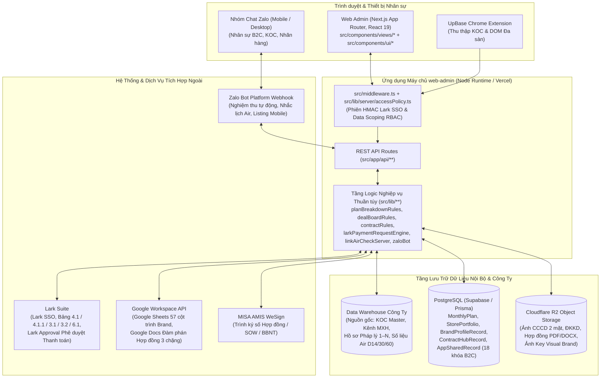

# KIẾN TRÚC TỔNG THỂ & BẢN ĐỒ BẢO TRÌ MÃ NGUỒN — B2C OPS HUB

| Thuộc tính | Giá trị |
| --- | --- |
| Mã tài liệu | HUB-2.3 |
| Dự án | B2C Ops Hub — Hệ thống Quản trị & Điều hành Phòng Marketing B2C |
| Giai đoạn | 2 — Phân tích & Thiết kế kỹ thuật (Tài liệu chuẩn dành cho Developer bảo trì) |
| Trạng thái | **Phiên bản Chính thức v1.0** — Đồng bộ 100% với cấu trúc `web-admin` và định hướng Data Warehouse |
| Owner | Team DX |
| Cập nhật | 31/10/2026 |

---

## 1. Sơ Đồ Kiến Trúc Tổng Thể & Ranh Giới Dữ Liệu

---

## 2. Nguyên Tắc Lưu Trữ & Phân Định Nguồn Dữ Liệu (Data Ownership)

Khi bảo trì hoặc mở rộng tính năng, Developer bắt buộc tuân thủ phân vùng lưu trữ sau:

### 2.1 Dữ liệu thuộc Data Warehouse Công ty (Source of Truth từ tuần tới)
- **Phạm vi:**
  1. Thông tin định danh **KOC Master** (`KOC Đã hợp tác` & `KOC Mới`).
  2. Danh sách **Kênh mạng xã hội** của KOC (`1 KOC — Nhiều kênh TikTok + Đa nền tảng Shopee/FB/IG/Threads/YouTube`).
  3. **Hồ sơ pháp lý & Thụ hưởng (`1 KOC — N Hồ sơ pháp lý`):** `Cá nhân`, `Hộ kinh doanh`, `Công ty/MCN` (CCCD/MST, Số GP ĐKKD, Tài khoản ngân hàng, Hợp đồng nguyên tắc gắn kèm).
  4. Số liệu hiệu quả sau lên sóng (`Views`, `GMV`, `Orders` ở các mốc `D14`, `D30`, `D60` và theo `videoId`).
- **Nguyên tắc tích hợp:** `web-admin` đọc và cập nhật các thực thể gốc này trực tiếp qua tầng kết nối Data Warehouse. Các thông tin vận hành chuyên biệt của phòng B2C (nhận xét/đánh giá KOC nội bộ, lịch sử đàm phán giá, trạng thái tiếp cận, gắn kết KOC vào Plan/Brief/Deal) được lưu tại PostgreSQL của B2C Ops Hub và liên kết qua khóa định danh KOC/Pháp nhân.

### 2.2 Dữ liệu lưu tại PostgreSQL của B2C Ops Hub (Supabase + Prisma)
1. **Bảng quan hệ (`schema.prisma`):**
   - `MonthlyPlan` & `MonthlyPlanDiscussion`: Kế hoạch tháng cấp gian hàng (`4.1` & phân rã tuần `4.1.1`), trạng thái phê duyệt, phiên bản (`v1.0`, `v1.1`).
   - `StorePortfolio`: Danh mục 69 gian hàng B2C, phân công `PIC chính`, `Nhân viên hỗ trợ`, `Leader` và hệ số độ khó gian hàng.
2. **Bảng tài liệu có kiểm soát phiên bản `revision` & Hợp nhất cấp độ thực thể (Entity-Level Concurrency Merge):**
   - `BrandProfileRecord`: Hồ sơ định danh tĩnh của 42 Thương hiệu.
   - `ContractHubRecord` & `ContractTemplateSnapshot`: Hồ sơ hợp đồng (`HĐNT`, `Phụ lục SOW`, `BBNT`), lịch sử đàm phán Google Docs 3 chặng và bộ biểu mẫu chuẩn `.docx`.
   - `AppSharedRecord` (Đồng bộ 2 chiều qua `/api/shared-state` & `src/lib/sharedStateClient.ts`): Lưu trữ các bảng dữ liệu vận hành theo khóa (`product-catalog-<brand>`, `brand-monthly-plans-v1`, `staff-brand-listing-sheets-v1`, `approved-booking-list-v2`, `listing-board-<planId>`, `content-plan-<planId>`, `deal-board-<planId>`, `self-channel-board-<planId>`, `multi-platform-listings-v1`...).
   - **Chống ghi đè đồng thời (`mergeSharedStateData`) & Bộ nhớ đệm Lai (`In-Memory + IndexedDB + localStorage`):** Khi nhiều PIC cùng lưu Deal/Listing đồng thời, `/api/shared-state` thực hiện hợp nhất theo định danh thực thể (`id` / `sourceSheetRowId` / `maBooking`) và dấu thời gian `updatedAt` kết hợp danh sách `deletedIds`, bảo toàn 100% các bản ghi mới do đồng nghiệp vừa thêm. Phía trình duyệt (`sharedStateClient.ts`) lưu trữ song song trên `In-Memory` + `IndexedDB` (`upbase_b2c_shared_state_idb`) và tự động thu hồi khóa cũ trên `localStorage` để vượt qua giới hạn 5MB của trình duyệt mà không bao giờ làm đứt sự kiện cập nhật giao diện.
3. **Cơ chế Fallback độc lập (Zero-Crash Standalone):**
   - Mọi API route đọc Database hoặc File nhị phân đều có nhánh dự phòng đọc từ Snapshot tĩnh / bộ nhớ đệm khi chạy ở môi trường local dev chưa cấu hình `DATABASE_URL`.

---

## 3. Bản Đồ Ánh Xạ Mã Nguồn Theo Menu 3 Tầng — 7 Nhóm Chức Năng Chuẩn (0 → 18)

Hệ thống điều hướng trên [`Sidebar.tsx`](../../web-admin/src/components/Sidebar.tsx) được tổ chức theo cấu trúc **Menu 3 tầng (`Level 1: 7 Nhóm phân hệ` → `Level 2: Menu cha` → `Level 3: Menu con xổ xuống`)**, đồng bộ trực tiếp vào các `subView` nội bộ qua sự kiện `upbase-sidebar-subview`. Bảng dưới đây giúp Developer tra cứu trong 30 giây: **Màn hình trên giao diện nằm ở file nào, dùng file logic nào, gọi API nào và lưu ở đâu**.

### Nhóm 1 — Tổng quan & Báo cáo (`1.1` – `1.2`)
| Màn hình / Tab UI | File View Chính (`src/components/views/`) | File Logic & Rules (`src/lib/`) | API Route (`src/app/api/`) | Nơi Lưu Trữ Chính |
| --- | --- | --- | --- | --- |
| **1.1 Việc của tôi (`cockpit`)** | `CockpitView.tsx` | `rbacScope.ts`, `taskDelegationData.ts` | `/api/monthly-plans`, `/api/shared-state` | Tổng hợp từ Plan, Deal, Hợp đồng, Task |
| **1.2 Báo cáo & Dashboard (`dashboard-bi`)** | `ExecutiveDashboardReportsView.tsx` - `DashboardSummaryView.tsx` - `DashboardBudgetReport.tsx` - `PlanActualReportView.tsx` - `StorePipelineFunnelOverview.tsx` - `DashboardVideoReport.tsx` - `DashboardScheduleReport.tsx` - `DashboardStaffReport.tsx` - `WeeklyAdsReportHubView.tsx` (`ads-report`) | `planActualReport.ts`, `b2cAnalyticsDataset.ts`, `b2cWeeklyAirSyncDataset.ts`, `realB2cPlanData.ts`, `kocVideoWeeklyHistory.ts` | `/api/plan-actual-report` `/api/integrations/tiktok-seller` `/api/ads-reports` `/api/koc-video-history` | `MonthlyPlan`, `StorePortfolio`, `approved-booking-list-v2`, `deal-board-*`, `ads-reports-metadata-v1`, Data Warehouse |

### Nhóm 2 — Hồ sơ thương hiệu (`2.1` – `2.4`)
| Màn hình / Tab UI | File View Chính (`src/components/views/`) | File Logic & Rules (`src/lib/`) | API Route (`src/app/api/`) | Nơi Lưu Trữ Chính |
| --- | --- | --- | --- | --- |
| **2.1 Thông tin thương hiệu (`brand-knowledge`)** | `BrandProfilesView.tsx` - `src/components/brands/BrandProfileDetail.tsx` - `ContentAngleSetupView.tsx` | `src/lib/brands/schema.ts`, `src/lib/brands/store.ts`, `contentAngleData.ts` | `/api/brands` `/api/brands/[id]` `/api/brands/r2-upload` | `BrandProfileRecord` + Cloudflare R2 |
| **2.2 Sản phẩm trọng tâm (`PRODUCTS`)** | `ProductCatalogView.tsx` | `productCatalog.ts` | `/api/product-catalog` | `product-catalog-<brand>` (`AppSharedRecord`) |
| **2.3 Quản trị Content (`content`)** | `ContentView.tsx` - `ContentPlanBoard.tsx` | `contentPlanRules.ts`, `contentPillars.ts`, `creatorMatching.ts`, `aiScriptAnalyzer.ts` | `/api/content-plan` `/api/integrations/llm` | `content-plan-<planId>` |
| **2.4 Nghiên cứu Brand & Đối thủ (`market-research`)** | `BrandMarketResearchHubView.tsx` | `liveBrandWebScraper.ts` | `/api/integrations/llm` | `AppSharedRecord`, Cache |

### Nhóm 3 — Kế hoạch (`3.1` – `3.2`)
| Màn hình / Tab UI | File View Chính (`src/components/views/`) | File Logic & Rules (`src/lib/`) | API Route (`src/app/api/`) | Nơi Lưu Trữ Chính |
| --- | --- | --- | --- | --- |
| **3.1 Kế hoạch tháng (`input-plan`)** | `MonthlyPlanHub.tsx` - `InputPlanBreakdownView.tsx` - `PlanWeeklyBreakdown.tsx` - `PlanApprovalStepper.tsx` - `PlanOrderUploadModal.tsx` - `BrandOneSheetPlanView.tsx` | `planBreakdownRules.ts`, `planOrderUpload.ts`, `oneSheetPlanBuilder.ts`, `monthlyPlanData.ts`, `useMonthlyPlanSync.ts` | `/api/monthly-plans` `/api/monthly-plans/upload` `/api/integrations/larkbase/sync` | Bảng `MonthlyPlan` (PostgreSQL) & `brand-monthly-plans-v1` |
| **3.2 Điều phối & Giao việc (`manager`)** | `ManagerView.tsx` - `ManagerDelegationHub.tsx` - `TaskDelegationView.tsx` | `rbacScope.ts`, `taskDelegationData.ts` | `/api/stores` `/api/shared-state` | `StorePortfolio`, `store-overrides-v1`, `sla-tasks-v1` |

### Nhóm 4 — Booking (`4.1` – `4.2`)
| Màn hình / Tab UI | File View Chính (`src/components/views/`) | File Logic & Rules (`src/lib/`) | API Route (`src/app/api/`) | Nơi Lưu Trữ Chính |
| --- | --- | --- | --- | --- |
| **4.1 Tìm kiếm & Gợi ý KOC (`tiktok-crawler`)** | `TikTokCrawlerHubView.tsx` | `tiktokKocScraper.ts`, `kocRecommendationEngine.ts` | `/api/integrations/tiktok-koc/scrape` `/api/integrations/llm` | `AppSharedRecord`, Data Warehouse |
| **4.2.1 Booking TikTok (`koc-listing`)** | `KocListingBatchHubView.tsx` (`bookingMode="TIKTOK"`) - `StaffBrandListingSheetWorkspace.tsx` (Sheet 57 cột) - `PlanListingBoard.tsx` - `ApprovedBookingListView.tsx` (`bookingScope="TIKTOK_VIDEO"`) - `DealDetailDrawer.tsx` - `PlanDealBoard.tsx` - `PullHangingJobsModal.tsx` | `staffBrandListingSheet.ts`, `listingBoardRules.ts`, `approvedBookingList.ts`, `dealBoardRules.ts`, `planDealLink.ts`, `larkPaymentRequestEngine.ts`, `googleSheets.ts` | `/api/booking-list/push-sheet` `/api/booking-list/pull-sheet` `/api/deal-board` `/api/integrations/larkbase/payment-requests` | `staff-brand-listing-sheets-v1`, `approved-booking-list-v2`, `deal-board-<planId>` |
| **4.2.2 Booking đa sàn (`multi-platform-booking`)** | `KocListingBatchHubView.tsx` (`bookingMode="MULTI_PLATFORM"`) - `MultiPlatformListingWorkspace.tsx` | `multiPlatformListing.ts`, `linkAirCheckServer.ts` | `/api/integrations/link-air-check` `/api/shared-state` | `multi-platform-listings-v1`, `multi-platform-reups-v1` |
| **4.2.3 Livestream Affiliate (`livestream-booking`)** | `KocListingBatchHubView.tsx` (`bookingMode="LIVESTREAM"`, 2 bước `3.1` ↔ `3.2`) - `src/components/shortlist/LivestreamListingWorkspace.tsx` (`1. Listing Livestream 3.1` + Danh bạ `7.1 KOL livestream`) - `ApprovedBookingListView.tsx` (`bookingScope="LIVESTREAM"` + Modal Nghiệm thu Phiên Live 3 khối `3.2 → 6.1`) - `DealDetailDrawer.tsx` (Phiếu xác nhận hợp tác Livestream Affiliate 30 trường) | `approvedBookingList.ts` (`isLivestreamBookingItem`, `computeLivestreamDurationEvaluation`, `isValidLivestreamProofUrl`, `formatLivestreamConfirmationSheet`, `buildDefaultLivestreamApprovedDeals`), `larkPaymentRequestEngine.ts` (`BR-LIVE-02`, `BR-LIVE-07`) | `/api/integrations/larkbase/payment-requests` `/api/contracts` | `approved-booking-list-v2`, `ContractHubRecord` |
| **4.2.4 Video Self-channel (`self-channel-hub`)** | `SelfChannelCtvHubView.tsx` - `PlanSelfChannelBoard.tsx` | `selfChannelBoardRules.ts`, `selfChannelData.ts`, `selfChannelContentCheck.ts`, `selfChannelAirReport.ts` | `/api/self-channel-board` `/api/self-channel-portal` `/api/self-channel-board/air-report` | `self-channel-board-<planId>` |

### Nhóm 5 — Hợp đồng, phụ lục & Quyết toán (`5.1` – `5.2`)
| Màn hình / Tab UI | File View Chính (`src/components/views/`) | File Logic & Rules (`src/lib/`) | API Route (`src/app/api/`) | Nơi Lưu Trữ Chính |
| --- | --- | --- | --- | --- |
| **5.1 Quản lý Hợp đồng (`contracts`)** | `ContractManagementView.tsx` - `ContractForm.tsx` - `ContractDetail.tsx` - `ContractApprovalPortalView.tsx` - `FinanceAdvancePaymentReportView.tsx` - `FinanceReminderInboxView.tsx` - `DraftBbntPreviewModal.tsx` | `src/lib/contracts/rules.ts`, `src/lib/contracts/templates.ts`, `src/lib/contracts/wesign.ts`, `src/lib/contracts/contractSystemRules.ts`, `src/lib/contracts/googleDocsDiff.ts` | `/api/contracts` `/api/contracts/google-docs/*` `/api/contracts/integrations/wesign/sync` `/api/contracts/integrations/contract-system/webhook` `/api/contracts/legal-docs` | `ContractHubRecord`, `ContractTemplateSnapshot`, Cloudflare R2 |
| **5.2 Nghiệm thu & Đẩy ĐNTT Lark (`lark-settlement`)** | `LarkAcceptancePaymentHubView.tsx` - `LarkPaymentRequestModal.tsx` - `FinanceAdvancePaymentReportView.tsx` | `larkPaymentRequestEngine.ts`, `selfChannelPaymentSlip.ts`, `src/lib/server/slipJobSync.ts`, `approvedBookingList.ts`, `multiPlatformListing.ts` | `/api/integrations/larkbase/payment-requests` (`CREATE_SLIP`, `ADVANCE_STEP`, `REJECT_SLIP`, `SYNC_LARK_STATUS`, `SYNC_LARK_32_BOOKING_LIST`) | `lark-payment-slips-v1`, `approved-booking-list-v2`, `multi-platform-listings-v1`, `self-channel-board-<planId>`, `deal-board-<planId>` |

### Nhóm 6 — Danh bạ (`6.1` – `6.2`)
| Màn hình / Tab UI | File View Chính (`src/components/views/`) | File Logic & Rules (`src/lib/`) | API Route (`src/app/api/`) | Nơi Lưu Trữ Chính |
| --- | --- | --- | --- | --- |
| **6.1 Danh bạ KOC / KOL (`koc-master`)** | `KocMasterDataView.tsx` - `src/components/KocProfile.tsx` - `src/components/koc/KocLegalProfilesSection.tsx` | `kocUtils.ts`, `kocRecommendationEngine.ts`, `kocHistoryEvaluator.ts` | `/api/koc-framework` `/api/extension/koc-sync` `/api/integrations/upaffiliate/sync` | **Data Warehouse Công ty** (KOC, Kênh, Pháp lý `1–N`) + DB B2C (Nhận xét/Đánh giá) |
| **6.2 Danh bạ VJ / CTV (`self-channel-hub` subView)** | `SelfChannelCtvHubView.tsx` | `selfChannelData.ts`, `selfChannelBoardRules.ts` | `/api/self-channel-portal` `/api/self-channel-board` | `self-channel-board-<planId>`, `AppSharedRecord` |

### Nhóm 7 — Hệ thống & Tiện ích chân Sidebar (`7.1` – `7.2` & `FOOTER_ITEMS`)
| Màn hình / Tab UI | File View Chính (`src/components/views/`) | File Logic & Rules (`src/lib/`) | API Route (`src/app/api/`) | Nơi Lưu Trữ Chính |
| --- | --- | --- | --- | --- |
| **7.1 Dữ liệu gốc (`master-data`)** | `MasterDataHubView.tsx` - `StoreStaffSheetSetupView.tsx` | `masterDataStore.ts`, `realB2cPlanData.ts` | `/api/stores` `/api/booking-list/setup-appscript` | `StorePortfolio`, `AppSharedRecord` |
| **7.2 Phân quyền & Định mức (`partner-access`)** | `CentralizedRbacHubView.tsx` | `rbacData.ts`, `rbacScope.ts`, `src/lib/server/accessPolicy.ts` | `/api/auth/lark/*` `/api/admin/rbac` | `AppSharedRecord` (`access-policy`, `task-difficulty-configs-v1`, `sow-point-policies-v1`) |
| **Footer 1 — Học tập, Sổ tay & Kiểm tra (`knowledge-qa`)** | `MarketingKnowledgeQaView.tsx` - `MarketingAcademySection.tsx` | `marketingKnowledgeBase.ts`, `marketingLearningEngine.ts` | `/api/integrations/llm` | `custom-knowledge-articles-v1` |
| **Footer 2 — Tích hợp & Cấu hình API / R2 / Zalo Bot (`api-settings`)** | `ApiKeySetupView.tsx` - `ZaloBotManagerView.tsx` | `apiKeyConfig.ts`, `src/lib/brands/r2.ts`, `zaloBot.ts`, `zaloMobileListing.ts` | `/api/integrations/llm` `/api/shared-state` `/api/integrations/zalo-bot/*` | `api-workspace-config-v2`, `cloudflare-r2-config-v1`, `AppSharedRecord` (`zalo-bot-*`) |

---

## 4. Danh Sách Màn Hình & Phân Hệ Cũ Đã Ngưng Sử Dụng (Không Bảo Trì)

Để tránh sửa nhầm vào các file prototype cũ đã ngưng dùng, Developer lưu ý các mã `TabKey` sau đã được đóng và chuyển hướng tự động trong `TAB_ALIASES` (`src/lib/navGroups.ts`):

| Mã Tab Cũ | Trạng thái | Lý do đóng & Nơi tiếp nhận hiện tại |
| --- | --- | --- |
| `booking` (`BookingView.tsx`) | **Đã đóng** | Prototype Kanban cũ; toàn bộ nghiệp vụ Deal & Nghiệm thu đã chuyển về `koc-listing` (`ApprovedBookingListView.tsx` & `PlanDealBoard.tsx`). |
| `sample-tracker` (`SampleTrackerView.tsx`) | **Đã đóng** | Nhân viên tạo đơn gửi hàng mẫu trực tiếp trên hệ thống **UPS**; không quản lý vận đơn gửi mẫu trên B2C Ops Hub. |
| `brand-hub` (`BrandPartnerHubView.tsx`) | **Đã đóng** | Không dùng cổng đăng nhập Web riêng cho khách hàng Brand; giao tiếp 100% qua **Google Sheet 57 cột** (`StaffBrandListingSheetWorkspace.tsx`). |
| `workload-3d` (`Workload3dMapView.tsx`) | **Đã đóng** | Đồ họa 3D WebGL không phục vụ thao tác hàng ngày; đã ẩn hoàn toàn khỏi hệ thống. |
| `performance-p3` (`PerformanceP3View.tsx`) | **Đã đóng** | Chưa áp dụng chấm thưởng P2/P3 tự động; phần đo lường Workload đang chờ hoàn thiện vận hành mới kích hoạt. |
| `work-toolkit` (`WorkToolkitHubView.tsx`) | **Đã đóng** | Màn hình công cụ rời thừa thãi; các hàm tính thuế/SLA đã tích hợp thẳng vào luồng Deal & Hợp đồng (`workToolkitRules.ts`). |
| `store-air-plan-report` (`AirBookingReportHubView.tsx`) | **Đã đóng** | Đã hợp nhất vào tab **Kế hoạch & Thực thi tuần (`PlanActualReportView.tsx`)** trong `dashboard-bi`. |
| `push-products`, `stores`, `ctv-master`, `cloudflare-admin`, `audit-trail` | **Đã hợp nhất** | Đã gộp vào `ProductCatalogView.tsx`, `MasterDataHubView.tsx`, `SelfChannelCtvHubView.tsx`, `ApiKeySetupView.tsx` và `CentralizedRbacHubView.tsx`. |

---

## 5. Quy Trình Kiểm Tra Bắt Buộc Khi Bảo Trì (Maintenance Checklist)

Mọi thay đổi mã nguồn trong `web-admin/` trước khi commit/deploy bắt buộc thỏa mãn 4 cổng kiểm tra:
1. **Kiểm tra kiểu dữ liệu TypeScript:** `npm run typecheck` (`tsc --noEmit` — 0 lỗi).
2. **Kiểm tra quy chuẩn giao diện Design System:** `npm run ui:check` (Tuân thủ nghiêm ngặt `web-admin/DESIGN_SYSTEM.md`: chỉ dùng component từ `@/components/ui`, dùng token màu ngữ nghĩa, không dùng dòng chữ phụ đề xám giải thích thừa dưới tiêu đề).
3. **Kiểm tra Build Production:** `npm run build` (Đảm bảo ranh giới Server/Client Next.js sạch sẽ, không import module server vào Client Component).
4. **Đối chiếu Sổ đăng ký lỗi (`blueprint/governance/KNOWN_BUGS_AND_LESSONS.md`):** Đảm bảo không vi phạm `RULE-DATA-01` (cấm sinh trạng thái giả), `RULE-SYNC-01` (đồng bộ 100% giữa bảng danh sách và màn chi tiết), `RULE-PERF-01` (dùng `Map` $O(1)$ / `useMemo` cho tập dữ liệu lớn) và `RULE-API-02` (cấm tự động gọi API mô hình/crawler trong `useEffect` khi mở hộp thoại).
