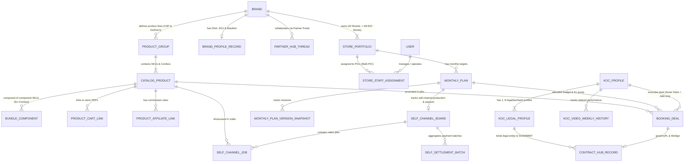

# MÔ HÌNH DỮ LIỆU — B2C OPS HUB

| Thuộc tính | Giá trị |
| --- | --- |
| Mã tài liệu | HUB-2.4 |
| Dự án | B2C Ops Hub |
| Giai đoạn | 2 — Phân tích & Thiết kế kỹ thuật |
| Trạng thái | Đã hoàn thiện ERD, Data Dictionary & Quy tắc PII — chờ tech lead + owner nghiệp vụ duyệt G2 |
| Owner | Team DX & `@it-business-analyst` |
| Người duyệt | _Chưa gán_ |
| Cập nhật | 25/10/2026 |
| Phiên bản | 0.6 |

Nguồn sự thật của cấu trúc bảng là `web-admin/prisma/schema.prisma` (36 model, 15 enum). Tài liệu này ghi **bảng nào đang dùng thật**, cách lưu, dữ liệu nhạy cảm và khoảng trống cần quyết trước G2. Kiến trúc lưu trữ: [HUB-2.3 §3](2.3_ARCHITECTURE.md).

---

## 1. Kiểm kê model

Cột **Mã nguồn dùng** đếm số file trong `web-admin/src` đọc/ghi model (kiểm tra 20/10/2026). Cột **Migration** cho biết bảng có được tạo bằng file trong `prisma/migrations/` hay không.

### 1.1. Đang dùng

| Model | Kiểu lưu | Phân hệ (SRS) | Mã nguồn dùng | Migration |
| --- | --- | --- | --- | --- |
| `MonthlyPlan`, `MonthlyPlanVersionSnapshot`, `MonthlyPlanDiscussion` | Quan hệ (+ `data` JSON) | 2.3 Kế hoạch tháng | `lib/server/monthlyPlanStore.ts`, `masterCatalogStore.ts` | **Không** — tạo bằng `db push` |
| `LarkbaseBookingPlanRecord` | Quan hệ | 2.3, HUB-1.9 | `lib/server/larkbaseBookingPlanSync.ts` | **Không** |
| `StorePortfolio` | Quan hệ | 2.6 Gian hàng | 1 file | **Không** |
| `KocProfile` | Quan hệ | 2.4, Kalodata | `api/integrations/kalodata/sync` | **Không** |
| `TikTokShopConnection`, `TikTokSellerDailyMetric`, `TikTokAdsCampaignReport`, `TikTokVideoPerformanceSnapshot` | Quan hệ | 2.2 Dashboard gian hàng | `lib/server/tiktokSellerStore.ts` | Có file `.sql` rời ngoài thư mục migration chuẩn |
| `BrandProfileRecord` | JSON + `revision` | 2.6 Hồ sơ Brand | `lib/brands/store.ts` | Có (`20261013_brand_profile`) |
| `ContractHubRecord`, `ContractWeSignBinding`, `ContractTemplateSnapshot` | JSON + `revision` / nhị phân | 2.10 Hợp đồng | `lib/contracts/store.ts` | Có (`20261013_contract_hub`) |
| `PartnerHubThread` | JSON | 2.6 Cổng đối tác | `lib/partnerHub/store.ts` | Có (`20261014_partner_hub`) |
| `AppSharedRecord` | JSON + `revision` | Danh mục dùng chung, chính sách quyền, Bảng Video Self-channel (`SelfChannelBoardData` qua khóa `self-channel-board-<planId>`), Danh mục Sản phẩm & Combo theo Brand (`BrandProductCatalog` qua khóa `product-catalog-<brand>`) | `lib/server/sharedRecords.ts`, `api/self-channel-board`, `api/product-catalog`, `lib/productCatalog.ts` | Có (`20261014_shared_admin_data`) |
| `PendingKocDiscovery` | Quan hệ / `AppSharedRecord` | 2.4 Quản lý KOC (Bảng tạm khám phá KOC mới chưa có trên Upaffiliate) | `lib/kocStagingService.ts`, `api/integrations/upaffiliate/staging` | Tạo trong schema |

### 1.2. Khai báo nhưng chưa dùng (20 model)

`User`, `StoreStaffAssignment`, `StoreDifficultyConfig`, `Campaign`, `ContentPlan`, `GrowthDemand`, `GrowthDemandTierBreakdown`, `SelfChannelPlanDb`, `LivestreamPlanDb`, `PlanFourStageTrackingDb`, `WeeklyStorePlan411`, `KocCandidate`, `BookingDeal`, `ContentItem`, `Publication`, `Contract`, `SampleShipment`, `SlaLog`, `LeaderboardRecord`, `StaffP3Record`.

Các thực thể tương ứng (deal, listing KOC, hàng mẫu, SLA, nhân sự, phân công) hiện chạy bằng **dữ liệu tĩnh trong `src/lib/*.ts`** hoặc trạng thái phía client. Hệ quả: dữ liệu không bền vững, không phân quyền được ở máy chủ, không có audit.

## 2. Thực thể nghiệp vụ chính và nơi lưu hiện tại

| Thực thể | Định nghĩa | Nơi lưu hiện tại | Đề xuất |
| --- | --- | --- | --- |
| Brand | 42 thương hiệu B2C | `realB2cBrandsData.ts` + `BrandProfileRecord` | Một bảng `Brand` làm khóa cho mọi phân hệ |
| Gian hàng (Store) | 69 gian `B2C phụ trách = 1` (DEC-006) | `liveStoresData.ts`, `StorePortfolio` | Giữ `StorePortfolio`, nối khóa ngoại tới Brand |
| Kế hoạch tháng | Theo gian hàng, có phiên bản | `MonthlyPlan` | Giữ |
| Chiến dịch | 1–3 tháng, gắn Brand | Client state | Dùng `Campaign` |
| Listing KOC / Deal | Đợt 10/20/30 → Brand duyệt → Tạo Deal (Asset Video + Dịch vụ gia tăng) → Phụ lục Hợp đồng theo Deal (`PL-...`) → Nghiệm thu 2 bước tuần tự → Kế toán thanh toán theo Deal | Client state, dữ liệu tĩnh (`approvedBookingList.ts`, `types.ts`) | Dùng `KocCandidate`, `BookingDeal` |
| Video Self-channel & Đợt quyết toán CTV | Quản lý quy trình 6 bước làm video kênh Brand (`SelfChannelJob`) và các đợt lập ĐNTT gom theo CTV (`SelfSettlementBatch`) gắn với từng Kế hoạch tháng | `AppSharedRecord` (khóa `self-channel-board-<planId>`) qua `sharedRecords.ts` và `/api/self-channel-board` | Giữ `AppSharedRecord` kèm kiểm soát `revision` và server blockers (`selfJobAcceptanceBlocker`, `selfJobPaymentBlocker`) |
| KOC master (2 bảng: KOC Cũ kèm lịch sử & KOC Mới) + Hồ sơ pháp lý 1–N (`KocLegalProfile` / `creator_legal_profile`) | **Bảng 1 (`COOPERATED`):** 4.820 KOC đã hợp tác kèm lịch sử Deal/BO, Brand, PIC, Rate Min–Max, GMV/ROI và `1–N` Hồ sơ pháp lý (`INDIVIDUAL`, `HOUSEHOLD`, `COMPANY`, mỗi hồ sơ ràng buộc `Chủ thể ký ≡ CCCD/MST ≡ STK thụ hưởng ≡ HĐNT`). **Bảng 2 (`NEW`):** KOC mới/tiềm năng (`totalPastDeals = 0`) từ `Master_KOC_UpAffiliate_ERD_Template.xlsx` (`KOC_Tiem_Nang`) kèm độ sẵn sàng booking (`bookingReadiness`) và nhật ký tiếp cận (`contactStatus`, `contactHistory`). | `kocMasterDataset.ts`, `realKocMasterData.ts`, `realPotentialKocData.ts`, `KocProfile` | Chuyển hết vào `KocProfile` + bảng con `CreatorLegalProfile` |
| Danh mục Sản phẩm & Combo (`BrandProductCatalog`, `ProductGroup`, `CatalogProduct`, `BundleComponentItem`) | Quản lý chiều Sản phẩm độc lập xuyên tháng theo Brand: Nhóm sản phẩm (USP, Claim cấm) → Sản phẩm / Combo (`SINGLE` SKU đơn lẻ, `HARD_BUNDLE` Combo có link sàn, `ROUTINE_COMBO` Combo Routine ghép link lẻ) → Thành phần Combo (`bundleComponents`: số lượng, vai trò MAIN/SUB/GIFT, tỷ trọng phân bổ %) → Link giỏ hàng theo gian hàng & Link affiliate hoa hồng riêng; kèm tồn mẫu khả dụng, SKU thay thế khi hết hàng và từ khóa dò phụ đề BBNT. | `AppSharedRecord` (khóa `product-catalog-<brand>`) qua `/api/product-catalog` và `productCatalog.ts` | Giữ `AppSharedRecord` kèm kiểm soát `revision` và các hàm nghiệp vụ liên thông (`resolveEffectiveSampleQuota`, `resolveEffectiveProductLinks`, `resolveEffectiveProductGuidelines`); chuẩn bị chuyển thành bảng quan hệ khi tách microservice |
| Hợp đồng | Hồ sơ + duyệt + ký | `ContractHubRecord` (JSON) | Chốt cấu trúc JSON hoặc dùng `Contract` |
| Người dùng & quyền | 8 vai trò | `mockData.ts` (`USERS`), `AppSharedRecord` | Dùng `User`; bỏ `USERS` khỏi luồng production |

Ranh giới dữ liệu với Lark và UpAffiliate: [DEC-005](../governance/DECISION_LOG.md), `sdlc/02_SYSTEM_BOUNDARY.md`.

## 2.1. Sơ Đồ Quan Hệ Thực Thể Logic (Logical ERD — `@ba-data-integration`)

## 2.2. Từ Điển Dữ Liệu Chuẩn & Ánh Xạ Trường Cốt Lõi (Canonical Data Dictionary)

### A. Thực thể `KocProfile` & `KocLegalProfile` (`1 KOC — N Hồ sơ Pháp lý`, `FR-082`)
| Tên trường (Field) | Nhãn hiển thị UI | Kiểu dữ liệu (DB/TypeScript) | Bắt buộc? | Khóa / Duy nhất | Nguồn làm chủ (Master) | Quy tắc hợp lệ (Validation / Business Rule) | Nhạy cảm (PII - `NFR-04`) |
| --- | --- | --- | --- | --- | --- | --- | --- |
| `id` | Mã KOC nội bộ | `String` | Có | PK | Ops Hub / UpAffiliate | Định dạng bất biến | Không |
| `upaffiliateCreatorId` | Mã đồng bộ UpAffiliate | `String` | Không | Unique | UpAffiliate (`IF-03`) | `UPA-CR-...` hoặc `UPA-NEW-...` | Không |
| `tableCategory` | Phân nhóm Bảng KOC | `Enum ('COOPERATED' \| 'NEW')` | Có | Index | Ops Hub | `totalPastDeals > 0` → `COOPERATED`; ngược lại `NEW` | Không |
| `salaryGrade` | Bậc khung lương (KL) | `Enum ('TAP' \| 'KL1'..'KL7')` | Có | Index | Lark 3.1 / UpAffiliate | 9 bậc chuẩn theo `SDLC-01 §3` | Không |
| `legalProfiles[]` | Danh sách Hồ sơ pháp lý (1–N) | `KocLegalProfile[]` | Có ($\ge 1$ với Bảng 1) | FK `kocId` | UpAffiliate / Pháp chế | Ràng buộc bộ 4: `Chủ thể ký ≡ CCCD/MST ≡ STK ≡ HĐNT` | Có (Chứa PII) |
| `legalProfiles.legalType` | Tư cách pháp nhân | `'INDIVIDUAL' \| 'HOUSEHOLD' \| 'COMPANY'` | Có | — | Pháp chế | Quyết định mẫu hợp đồng (`IND-*`, `HKD-*`, `COM-*`) & thuế | Không |
| `legalProfiles.cccd` | Số CCCD chủ thể | `String (12 digits)` | Có (nếu Cá nhân) | — | Pháp chế / OCR | Regex `^\d{12}$` | **Có — Mask `********1234` trên danh sách** |
| `legalProfiles.taxCode` | Mã số thuế (MST) | `String (10-13 digits)` | Có (nếu HKD/Công ty) | — | Pháp chế | Kiểm tra định dạng MST 10 hoặc 13 số | **Có — Phân quyền xem** |
| `legalProfiles.bankAccount` | Số tài khoản thụ hưởng | `String` | Có | — | Kế toán / Pháp chế | Chủ TK phải khớp `holderName`; cấm TK trung gian | **Có — Mask trên danh sách** |

### B. Thực thể `BookingDeal` & `ContractHubRecord` (Giao dịch Deal, Hợp đồng & Nghiệm thu 2 Bước)
| Tên trường (Field) | Nhãn hiển thị UI | Kiểu dữ liệu (DB/TypeScript) | Bắt buộc? | Khóa / Duy nhất | Nguồn làm chủ (Master) | Quy tắc hợp lệ (Validation / Business Rule) | Nhạy cảm (PII - `NFR-04`) |
| --- | --- | --- | --- | --- | --- | --- | --- |
| `dealCode` | Mã Deal / BO | `String` | Có | Unique Business Key | UpAffiliate / Ops Hub | Sinh khi Listing đạt `FINAL_APPROVED` (`FR-021`) | Không |
| `sourcePlanId` | Mã dòng Kế hoạch tháng | `String` | Có | FK `MonthlyPlan` | Ops Hub | Bắt buộc truy vết về dòng Plan Final (`FR-020`) | Không |
| `netAmount` | Giá trị Net (Chưa thuế) | `Number (VND)` | Có | — | Booking PIC | `>= 0`, không vượt trần ngân sách Net của Plan (`FR-004`) | **Ẩn với `EXTERNAL_PARTNER`** |
| `grossAmount` | Giá trị Gross (Gồm thuế) | `Number (VND)` | Có | — | Rule Engine (`DEC-006`) | Cá nhân $\ge 2\text{tr}$: tính TNCN 10%; Công ty: cộng VAT 8%/10% | **Ẩn với `EXTERNAL_PARTNER`** |
| `wave0Status` | Trạng thái Video gốc (Bước 1) | `Enum` | Có | — | Nghiệm thu (`FR-036`) | Phải có `videoId`, link air sống và ảnh chụp SP trước khi đạt `VERIFIED` | Không |
| `addonItems[]` | Dịch vụ gia tăng (Bước 2) | `DealAddonItem[]` | Không | — | Phụ lục Deal (`PL-...`) | Khóa ở `LOCKED_BY_WAVE_0` cho tới khi `wave0Status === 'VERIFIED'` (`FR-022`) | Không |
| `finalAmount` | Giá trị quyết toán cuối | `Number (VND)` | Có | — | Rule Engine (`FR-023`) | `= Tổng giá trị Deal - Σ(Giá trị hạng mục DROPPED)` | **Ẩn với `EXTERNAL_PARTNER`** |
| `legalApprovalStatus` | Trạng thái Pháp chế duyệt | `'PENDING' \| 'APPROVED' \| 'REJECTED'` | Có | — | Vai trò `LEGAL` (`FR-032`) | Tự động reset về `PENDING` nếu sửa trường tiền/pháp nhân sau duyệt | Không |
| `financeApprovalStatus` | Trạng thái Kế toán duyệt | `'PENDING' \| 'APPROVED' \| 'REJECTED'` | Có | — | Vai trò `FINANCE` (`FR-032`) | Độc lập với `LEGAL`; đủ cả 2 mới mở khóa Trình ký WeSign | Không |

### C. Thực thể Bảng Quản trị Sản xuất Video Kênh Brand (`SelfChannelBoardData`, `SelfChannelJob` & `SelfSettlementBatch` — khóa `self-channel-board-<planId>`)

Cấu trúc bao gói `SelfChannelBoardData`:
- `jobs: SelfChannelJob[]`: Danh sách công việc sản xuất video kênh Brand qua 6 bước (`SelfJobStage`: `BRIEF` → `SCRIPT` → `PRODUCTION` → `BRAND_AIR` → `ACCEPTANCE` → `SETTLEMENT`).
- `settlementBatches: SelfSettlementBatch[]`: Danh sách đợt quyết toán thù lao gom theo CTV/VJ (`DNTT-SC-...`).

#### C.1. Chi tiết thực thể `SelfChannelJob` (Công việc sản xuất video kênh Brand)
| Tên trường (Field) | Nhãn hiển thị UI | Kiểu dữ liệu (DB/TypeScript) | Bắt buộc? | Khóa / Duy nhất | Nguồn làm chủ (Master) | Quy tắc hợp lệ (Validation / Business Rule) | Nhạy cảm (PII - `NFR-04`) |
| --- | --- | --- | --- | --- | --- | --- | --- |
| `id` | Mã định danh công việc | `String` | Có | PK (trong Board) | Ops Hub | Bất biến, sinh tự động dạng `sc-job-N` hoặc UUID | Không |
| `code` | Mã công việc video | `String` | Có | Unique trong Plan | Ops Hub / Rule Engine | Không để trống, không trùng lặp mã trong cùng Plan (`SC-01`, `SC-02`...) | Không |
| `week` | Tuần kế hoạch | `String` | Có | Index | Kế hoạch tháng (4.1.1) | Tuần thực thi (`W1`..`W5` hoặc ISO week) | Không |
| `formatKey` | Định dạng video | `Enum ('reviewVoice' \| 'videoAi' \| 'videoRemix' \| 'videoToLive' \| 'nhacText')` | Có | — | Plan Breakdown | 5 định dạng chuẩn Video Self-channel | Không |
| `productionMode` | Hình thức sản xuất | `Enum ('CTV_OUTSOURCE' \| 'INHOUSE')` | Có | — | Kế hoạch sản xuất | `INHOUSE`: thù lao 0đ / `NOT_APPLICABLE`; `CTV_OUTSOURCE`: thuê ngoài có phí | Không |
| `briefSlotId` | Mã dòng đề bài Brief | `String` | Không | FK `ContentSlot` | Kế hoạch Content | Liên kết dòng Brief `row === 'SELF'` | Không |
| `briefCode` | Mã hiển thị đề bài | `String` | Không | — | Kế hoạch Content | Hiển thị mã đề bài (VD: `BR-01`) | Không |
| `pillar` | Trụ cột nội dung | `String` | Có | — | Content Plan | Bám sát Brand Guideline | Không |
| `angle` | Góc tiếp cận kịch bản | `String` | Có | — | Content Plan | Góc nội dung triển khai | Không |
| `productName` | Tên sản phẩm | `String` | Có | — | Product Catalog | Khớp danh mục sản phẩm của Brand | Không |
| `skuCode` | Mã SKU sản phẩm | `String` | Không | — | Product Catalog | SKU sản phẩm thúc đẩy | Không |
| `hook` | Câu mở đầu 3s đầu | `String` | Không | — | Content / VJ | Khớp kịch bản được duyệt | Không |
| `usp` | Điểm bán hàng chính | `String` | Không | — | Content / Product | USP bắt buộc thể hiện | Không |
| `cta` | Kêu gọi hành động | `String` | Không | — | Content / VJ | CTA hướng giỏ hàng/thương hiệu | Không |
| `contentPic` | Chuyên viên Content phụ trách | `String` | Có | — | User / Staff | Nhân sự B2C chịu trách nhiệm nội dung | Không |
| `contributorId` | Mã CTV / VJ | `String` | Không | FK `Contributor` | Danh bạ CTV | Mã định danh CTV trong hệ thống | Không |
| `contributorName` | Họ tên CTV / VJ | `String` | Có | — | Danh bạ CTV | Bắt buộc có tên nhân sự thực hiện | Không |
| `channelOrPhone` | Kênh MXH hoặc SĐT CTV | `String` | Không | — | CTV Profile | Kênh MXH / Hotline liên hệ | **Có — Che trên danh sách** |
| `contractNo` | Số hợp đồng CTV | `String` | Không | — | Pháp chế | Bắt buộc khi CTV có thù lao (`CTV-HDNT` / `CTV-HD`) | Không |
| `legalId` | Số CCCD / MST của CTV | `String` | Không | — | CTV Profile | Bắt buộc khi lập ĐNTT có phí; kiểm tra tính hợp lệ | **Có — Mask trên danh sách** |
| `bankName` / `bankAccount` / `bankHolder` | Thông tin ngân hàng thụ hưởng | `String` | Không | — | CTV Profile | Bắt buộc khi chi trả; chủ tài khoản phải khớp tên CTV | **Có — Mask số tài khoản** |
| `sampleStatus` | Trạng thái gửi nhận hàng mẫu | `Enum ('NOT_NEEDED' \| 'ON_HAND' \| 'PENDING_SHIP' \| 'SHIPPING' \| 'RECEIVED')` | Có | — | Vận chuyển hàng mẫu | SLA gửi mẫu 48h; kiểm tra tồn kho VJ trước khi gửi | Không |
| `trackingCode` | Mã vận đơn hàng mẫu | `String` | Không | — | Đơn vị vận chuyển | Mã tra cứu hành trình giao hàng | Không |
| `scriptStatus` | Trạng thái duyệt kịch bản | `Enum ('NOT_NEEDED' \| 'DRAFT' \| 'SUBMITTED' \| 'REVISION' \| 'APPROVED')` | Có | — | Content Specialist | SLA phản hồi duyệt 24h | Không |
| `scriptUrl` | Đường dẫn kịch bản | `String` | Không | — | VJ / Content | Link Google Docs / Lark Doc kịch bản chi tiết | Không |
| `videoQaStatus` | Trạng thái QA video | `Enum ('WAITING_DRAFT' \| 'DRAFT_SUBMITTED' \| 'REVISION' \| 'INTERNAL_QA_PASSED' \| 'BRAND_APPROVED')` | Có | — | Content QA | Bắt buộc qua `INTERNAL_QA_PASSED` mới mở nghiệm thu | Không |
| `draftVideoUrl` | Link video nháp demo | `String` | Có khi nộp nháp | — | VJ / Editor | Link video bản dựng để kiểm tra QA | Không |
| `finalDriveUrl` | Link Drive video chính thức | `String` | Không | — | Content Specialist | Lưu trữ Drive gian hàng sau khi QA đạt | Không |
| `qaChecklist` | Bộ tiêu chí kiểm tra QA | `Object { hookOk, productOk, audioVisualOk, guidelineOk }` | Có | — | Content QA | Đạt đồng thời cả 4 tiêu chuẩn kỹ thuật & chính sách | Không |
| `publishPlatform` | Nền tảng đăng video | `Enum ('TIKTOK_BRAND' \| 'SHOPEE_VIDEO' \| 'FACEBOOK_PAGE' \| 'INSTAGRAM' \| 'YOUTUBE_SHORTS')` | Có | — | Kế hoạch phát hành | Nền tảng kênh thương hiệu phát sóng | Không |
| `airLink` | Đường dẫn video lên sóng | `String` | Có khi nghiệm thu | — | Kênh Brand | Bắt buộc có link air hợp lệ mới duyệt Nghiệm thu Đạt | Không |
| `airedAt` | Ngày lên sóng thực tế | `String (YYYY-MM-DD)` | Có khi nghiệm thu | — | Kênh Brand | Đối soát đúng hạn SLA deadline | Không |
| `deadline` | Hạn chót hoàn thành | `String (YYYY-MM-DD)` | Có | — | Content Specialist | Mốc cam kết hoàn thành công việc | Không |
| `sparkAdsCode` | Mã ủy quyền Spark Ads | `String` | Không | — | TikTok Brand | Mã cấp quyền chạy quảng cáo nếu có | Không |
| `acceptanceStatus` | Trạng thái nghiệm thu | `Enum ('PENDING' \| 'PASSED' \| 'REVISION' \| 'REJECTED')` | Có | — | Chuyên viên Content | Kiểm soát chặn cứng bởi `selfJobAcceptanceBlocker` | Không |
| `bbntCode` / `bbntUrl` | Số biên bản nghiệm thu & link file | `String` | Không | — | Pháp chế / Kế toán | Bắt buộc khi thuê CTV ngoài có thù lao | Không |
| `feeGross` | Thù lao Gross (trước thuế) | `Number (VND)` | Có | — | Thỏa thuận CTV | `>= 0`; Inhouse = 0đ | **Ẩn với đối tác ngoài** |
| `withholdPit10` | Cờ khấu trừ thuế TNCN 10% | `Boolean` | Có | — | Quy định thuế | Áp dụng cho CTV cá nhân chi trả $\ge 2.000.000\text{đ}$ | Không |
| `pitTaxAmount` | Tiền thuế TNCN 10% khấu trừ | `Number (VND)` | Có | — | Rule Engine | `= Math.round(feeGross * 0.1)` nếu `withholdPit10` | **Ẩn với đối tác ngoài** |
| `netPayout` | Thù lao Net thực nhận | `Number (VND)` | Có | — | Rule Engine | `= feeGross - pitTaxAmount` | **Ẩn với đối tác ngoài** |
| `paymentStatus` | Trạng thái thanh toán | `Enum ('NONE' \| 'NOT_APPLICABLE' \| 'REQUESTED' \| 'PAID')` | Có | — | Kế toán chi trả | Kiểm soát chặn cứng bởi `selfJobPaymentBlocker` | Không |
| `dnttSlipCode` | Mã phiếu đề nghị thanh toán | `String` | Không | FK `SelfSettlementBatch` | Kế toán B2C | Gắn mã phiếu khi gom vào đợt quyết toán | Không |
| `uncRef` | Số tham chiếu Ủy nhiệm chi | `String` | Không | — | Kế toán TCKT | Mã chứng từ giải ngân ngân hàng | Không |

#### C.2. Chi tiết thực thể `SelfSettlementBatch` (Đợt quyết toán & Chi trả thù lao CTV)
| Tên trường (Field) | Nhãn hiển thị UI | Kiểu dữ liệu (DB/TypeScript) | Bắt buộc? | Khóa / Duy nhất | Nguồn làm chủ (Master) | Quy tắc hợp lệ (Validation / Business Rule) | Nhạy cảm (PII - `NFR-04`) |
| --- | --- | --- | --- | --- | --- | --- | --- |
| `id` | Mã đợt quyết toán | `String` | Có | PK (trong Board) | Ops Hub | Sinh tự động dạng `sc-batch-TIMESTAMP` | Không |
| `slipCode` | Mã phiếu ĐNTT | `String` | Có | Unique Business Key | Ops Hub / Kế toán | Định dạng `DNTT-SC-YYYYMM-NNN` | Không |
| `contributorName` | Họ tên CTV thụ hưởng | `String` | Có | — | Danh bạ CTV | Một đợt chỉ gom cho 1 CTV duy nhất | Không |
| `contributorId` | Mã định danh CTV | `String` | Không | FK `Contributor` | Danh bạ CTV | Khóa ngoại tới hồ sơ CTV | Không |
| `jobIds` | Danh sách mã ID công việc | `String[]` | Có | — | Ops Hub | Tối thiểu 1 job đạt nghiệm thu (`PASSED`) | Không |
| `jobCodes` | Danh sách mã hiển thị công việc | `String[]` | Có | — | Ops Hub | Mảng các mã video (VD: `['SC-01', 'SC-02']`) | Không |
| `grossTotal` | Tổng thù lao Gross đợt | `Number (VND)` | Có | — | Rule Engine | `= Σ(job.feeGross)` | **Ẩn với đối tác ngoài** |
| `pitTaxTotal` | Tổng thuế TNCN 10% khấu trừ | `Number (VND)` | Có | — | Rule Engine | `= Σ(job.pitTaxAmount)` | **Ẩn với đối tác ngoài** |
| `netTotal` | Tổng tiền Net thực nhận | `Number (VND)` | Có | — | Rule Engine | `= grossTotal - pitTaxTotal` | **Ẩn với đối tác ngoài** |
| `status` | Trạng thái phiếu ĐNTT | `Enum ('REQUESTED' \| 'PAID')` | Có | — | Kế toán | `REQUESTED`: Đã lập ĐNTT; `PAID`: Đã giải ngân | Không |
| `requestedAt` | Thời điểm lập đề nghị | `String (ISO)` | Có | — | Hệ thống | Ghi nhận thời gian tạo phiếu | Không |
| `requestedBy` | Người lập đề nghị | `String` | Có | — | User / Staff | Tên chuyên viên tạo đợt quyết toán | Không |
| `paidAt` | Thời điểm giải ngân | `String (ISO)` | Không | — | Kế toán TCKT | Ngày giờ hoàn tất chi trả | Không |
| `uncRef` | Số tham chiếu UNC | `String` | Không | — | Kế toán TCKT | Số chứng từ ủy nhiệm chi ngân hàng | Không |
| `note` | Ghi chú quyết toán | `String` | Không | — | Kế toán / Specialist | Diễn giải nội dung thanh toán | Không |

### D. Thực thể Danh mục Sản phẩm & Combo (`BrandProductCatalog`, `ProductGroup`, `CatalogProduct` & `BundleComponentItem` — lưu qua khóa `product-catalog-<brand>`)

Cấu trúc bao gói `BrandProductCatalog`:
- `groups: ProductGroup[]`: Danh sách nhóm sản phẩm theo Brand (chứa USP bắt buộc, Claim cấm Do & Don't và danh sách các sản phẩm/combo).
- Lưu trữ bền vững qua `AppSharedRecord` với khóa `product-catalog-<brand>` (API `GET|PUT /api/product-catalog?brand=...`).

#### D.1. Chi tiết thực thể `ProductGroup` (Nhóm sản phẩm của Brand)
| Tên trường (Field) | Nhãn hiển thị UI | Kiểu dữ liệu (DB/TypeScript) | Bắt buộc? | Khóa / Duy nhất | Nguồn làm chủ (Master) | Quy tắc hợp lệ (Validation / Business Rule) | Nhạy cảm (PII - `NFR-04`) |
| --- | --- | --- | --- | --- | --- | --- | --- |
| `id` | Mã nhóm sản phẩm | `String` | Có | PK (trong Catalog) | Ops Hub | Định dạng bất biến (VD: `PG-...` hoặc `grp-...`) | Không |
| `name` | Tên nhóm sản phẩm | `String (max 120)` | Có | Tên duy nhất trong Brand | Brand / Ops Hub | Không để trống; không trùng tên với nhóm khác trong cùng Brand | Không |
| `usp` | Điểm nhấn sản phẩm (USP) | `String (max 1000)` | Không | — | Brand Guideline | Thông điệp bắt buộc thể hiện khi làm Brief, SOW và Kịch bản video | Không |
| `forbiddenClaims` | Claim cấm (Do & Don't) | `String (max 1000)` | Không | — | Brand Guideline / Sàn | Từ khóa cấm, hạn chế nội dung, vi phạm chính sách sàn TMĐT | Không |
| `products[]` | Danh sách sản phẩm / Combo | `CatalogProduct[]` | Có | — | Ops Hub | Tối đa 500 sản phẩm trong một nhóm | Không |

#### D.2. Chi tiết thực thể `CatalogProduct` (Sản phẩm & Combo xuyên tháng)
| Tên trường (Field) | Nhãn hiển thị UI | Kiểu dữ liệu (DB/TypeScript) | Bắt buộc? | Khóa / Duy nhất | Nguồn làm chủ (Master) | Quy tắc hợp lệ (Validation / Business Rule) | Nhạy cảm (PII - `NFR-04`) |
| --- | --- | --- | --- | --- | --- | --- | --- |
| `id` | Mã định danh sản phẩm | `String` | Có | PK (trong Catalog) | Ops Hub | Định dạng bất biến (VD: `PR-...` hoặc `prd-...`) | Không |
| `name` | Tên sản phẩm / Combo | `String (max 200)` | Có | — | Brand / PDP | Không để trống tên sản phẩm | Không |
| `sku` | Mã SKU sản phẩm | `String (max 80)` | Không | Unique trong Brand | Brand ERP / Kho | Mã SKU nội bộ; không được trùng lặp với sản phẩm khác trong Brand | Không |
| `status` | Trạng thái kinh doanh | `Enum ('ACTIVE' \| 'OUT_OF_STOCK' \| 'STOPPED')` | Có | — | Brand / Ops Hub | `ACTIVE`: Đang bán; `OUT_OF_STOCK`: Tạm hết hàng (tự động kích hoạt cảnh báo tạm dừng SLA gửi mẫu và thông báo SKU thay thế); `STOPPED`: Ngừng bán | Không |
| `productType` | Phân loại sản phẩm | `Enum ('SINGLE' \| 'HARD_BUNDLE' \| 'ROUTINE_COMBO')` | Có | — | Ops Hub | `SINGLE`: SKU đơn lẻ; `HARD_BUNDLE`: Combo đóng gói có link riêng trên sàn; `ROUTINE_COMBO`: Combo Routine ghép nhiều link lẻ | Không |
| `role` | Vai trò thúc đẩy doanh số | `Enum ('HERO' \| 'ENTRY' \| 'ADDON' \| 'GIFT')` | Có | — | Chiến lược Brand | `HERO`: Chủ lực; `ENTRY`: Phễu dẫn; `ADDON`: Bán chéo; `GIFT`: Quà tặng kèm GWP | Không |
| `originalPrice` | Giá niêm yết | `Number (VND)` | Không | — | Brand / Sàn | Số nguyên $\ge 0$ | Không |
| `promoPrice` | Giá khuyến mại / Deal | `Number (VND)` | Không | — | Brand / Sàn | Số nguyên $\ge 0$; thường $\le$ `originalPrice` | Không |
| `monthlySampleQuota` | Hạn mức gửi mẫu tháng | `Number (Suất)` | Không | — | Brand Quota | Số nguyên $\ge 0$; định mức gửi KOC tối đa trong kỳ tháng | Không |
| `substituteProductId` | Mã SKU thay thế khi hết hàng | `String` | Không | FK `CatalogProduct` | Ops Hub | Trỏ tới SKU dự phòng cùng Brand khi sản phẩm chính ở trạng thái `OUT_OF_STOCK` | Không |
| `detectKeywords` | Từ khóa nhận diện BBNT | `String (max 500)` | Không | — | Content / Legal | Danh sách từ khóa ngăn cách bởi dấu phẩy/chấm phẩy dùng đối soát phụ đề WebVTT khi nghiệm thu video BBNT | Không |
| `bundleComponents[]` | Thành phần cấu thành Combo | `BundleComponentItem[]` | Không | — | Ops Hub | Bắt buộc đối với `HARD_BUNDLE` và `ROUTINE_COMBO`; tối đa 30 món thành phần | Không |
| `cartLinks[]` | Link giỏ hàng theo Gian hàng | `CartLink[]` | Có (nếu `ACTIVE`) | — | Sàn TMĐT | Danh sách link PDP theo gian hàng (`platform`, `storeName`, `url`, `note`); URL hợp lệ `http(s)` | Không |
| `affiliateLinks[]` | Link tiếp thị liên kết | `AffiliateLink[]` | Không | — | Sàn / UpAffiliate | Link affiliate (`platform`, `url`, `commissionPct` 0–100%, `type` OPEN/DESIGNATED, `designatedKoc`, `validFrom`, `validTo`, `note`) | Không |

#### D.3. Chi tiết thực thể `BundleComponentItem` (Thành phần cấu thành Combo)
| Tên trường (Field) | Nhãn hiển thị UI | Kiểu dữ liệu (DB/TypeScript) | Bắt buộc? | Khóa / Duy nhất | Nguồn làm chủ (Master) | Quy tắc hợp lệ (Validation / Business Rule) | Nhạy cảm (PII - `NFR-04`) |
| --- | --- | --- | --- | --- | --- | --- | --- |
| `id` | Mã thành phần | `String` | Có | PK (trong Combo) | Ops Hub | Sinh tự động `BC-...` | Không |
| `productId` | Mã SKU đơn thành phần | `String` | Có | FK `CatalogProduct` | Product Catalog | Bắt buộc trỏ tới SKU đơn lẻ hợp lệ trong cùng Brand | Không |
| `quantity` | Số lượng trong Combo | `Number` | Có | — | Ops Hub | Số nguyên $\ge 1$ (mặc định = 1) | Không |
| `componentRole` | Vai trò thành phần | `Enum ('MAIN' \| 'SUB' \| 'GIFT')` | Có | — | Ops Hub | `MAIN`: Sản phẩm chính; `SUB`: Sản phẩm kết hợp; `GIFT`: Quà tặng kèm (cố định `allocationPct = 0%`) | Không |
| `allocationPct` | Tỷ trọng phân bổ báo cáo | `Number (%)` | Không | — | Rule Engine | `0–100%`; `GIFT = 0%`; hỗ trợ tính tự động qua `autoAllocateBundleWeights` theo Giá niêm yết $\times$ Số lượng | Không |

#### D.4. Các hàm Logic Nghiệp vụ Liên thông Chiều Sản phẩm & Combo (`productCatalog.ts`)
1. **`resolveEffectiveSampleQuota(catalog, product, sentCounts)`:**
   - **Mục đích:** Tính toán chính xác số lượng hàng mẫu khả dụng thực tế của SKU hoặc Combo.
   - **Cơ chế Combo:** Đối với `HARD_BUNDLE` và `ROUTINE_COMBO`, hạn mức tồn mẫu khả dụng không tính độc lập mà bị giới hạn bởi món thành phần có tồn thấp nhất:
     $$\text{remainingSets} = \min_{c \in \text{components}} \left\lfloor \frac{\max(0, \text{quota}_c - \text{sent}_c)}{\text{quantity}_c} \right\rfloor$$
   - **Đầu ra:** `{ quota, sent, remaining, bottleneckProductName, hasOutOfStockComponent, outOfStockComponentNames }`. Nếu có thành phần ở trạng thái `OUT_OF_STOCK` hoặc `STOPPED`, hệ thống lập tức cảnh báo nghẽn tồn mẫu và tạm dừng cam kết SLA giao mẫu cho KOC.
2. **`resolveEffectiveProductLinks(catalog, product)`:**
   - **Mục đích:** Gom tự động danh sách Link giỏ hàng và Link Affiliate khả dụng cho KOC/Specialist.
   - **Cơ chế Routine:** Đối với `ROUTINE_COMBO`, hệ thống tự động kế thừa toàn bộ link giỏ hàng và link affiliate của các SKU thành phần cấu thành, tự động khử trùng URL trùng lặp và gắn tiền tố `[Tên SKU]` vào ghi chú giỏ hàng và nhãn affiliate. Hỗ trợ bổ sung thêm link giỏ hàng riêng của Combo nếu sàn có link gộp.
3. **`resolveEffectiveProductGuidelines(catalog, groupId, product)`:**
   - **Mục đích:** Hợp nhất toàn bộ yêu cầu nội dung phục vụ Brief, Kịch bản và Soát xét nghiệm thu video.
   - **Đầu ra:** `{ usp, forbiddenClaims, detectKeywords }`. Gộp USP của nhóm sản phẩm cùng toàn bộ USP của các SKU thành phần; gộp danh sách Claim cấm (Do & Don't) của tất cả món thành phần; và hợp nhất từ khóa nhận diện sản phẩm trong phụ đề WebVTT khi đối soát BBNT.
4. **`autoAllocateBundleWeights(catalog, components)`:**
   - **Mục đích:** Tự động tính toán tỷ trọng phân bổ chi phí & GMV (`allocationPct`) cho các món trong Combo dựa trên công thức Giá niêm yết $\times$ Số lượng, loại trừ quà tặng (`GIFT = 0%`) và làm tròn số dư lớn nhất để tổng đạt chính xác 100%.
5. **Báo cáo Hiệu quả Đầu tư Sản phẩm & Combo (`ExecutiveDashboardReportsView.tsx`):**
   - **Nguyên tắc bảo toàn tài chính:** Tách bạch 2 nhóm phân tích riêng biệt: **SKU đơn lẻ** vs **Combo / Routine**. Khi một video lên sóng mang sản phẩm hay combo, tổng chi phí booking và tổng GMV Seller được phân bổ đúng quy tắc, đảm bảo $\sum \text{Cost}_{\text{product}} = \text{TotalCost}_{\text{videos}}$ và $\sum \text{GMV}_{\text{product}} = \text{TotalGMV}_{\text{seller}}$, tuyệt đối không nhân đôi số liệu trên báo cáo quản trị.

## 3. Dữ liệu nhạy cảm

| Trường | Model / nơi lưu | Yêu cầu (NFR-04) |
| --- | --- | --- |
| `cccd`, `taxCode`, `bankName`, `bankAccount`, `phone` | `KocProfile` | Chỉ vai trò Pháp chế/Kế toán/PIC được xem; che khi hiển thị danh sách |
| `kocPhone` và thông tin Bên B | `BookingDeal`, `ContractHubRecord.data` | Như trên; không gửi tới LLM khi chưa có DEC (OI-014) |
| `legalId`, `bankAccount`, `bankHolder`, `channelOrPhone` | `SelfChannelJob` (khóa `self-channel-board-<planId>`) | Chỉ vai trò Pháp chế/Kế toán/Content Specialist được xem; che/mask thông tin trên danh sách |
| Ảnh giấy tờ (OCR) | Xử lý tại `api/ocr/extract-legal-doc` | Không lưu ảnh gốc sau khi đọc, trừ khi có quyết định lưu |
| Tệp thương hiệu | R2 / `.brand-data/` | Link ký có hạn |

## 4. Khoảng trống cần quyết trước G2

1. **Migration không đủ:** chỉ 6 bảng có migration; các bảng khác tạo bằng `db push`. Cần `prisma migrate diff` để sinh migration nền cho toàn bộ schema đang chạy production.
2. **20 model không dùng:** quyết giữ (và nối mã) hay xóa.
3. **Dữ liệu thật trong mã nguồn:** đưa vào DB + seed có kiểm soát (RSK-A1).
4. **Cấu trúc JSON** của `ContractHubRecord`, `BrandProfileRecord`, `AppSharedRecord` cần mô tả kiểu (đang nằm ở `lib/*/types.ts`) và được người duyệt theo SDLC-00 §6.1.

## Lịch sử thay đổi

| Phiên bản | Ngày | Người sửa | Nội dung |
| --- | --- | --- | --- |
| 0.1 | 20/10/2026 | Team DX | Kiểm kê 36 model theo mã nguồn; ghi khoảng trống migration và dữ liệu nhạy cảm. |
| 0.2 | 22/10/2026 | Team DX | Bổ sung thực thể PendingKocDiscovery (Bảng tạm lưu KOC mới từ tìm kiếm/đối thủ/hashtag chưa có trên Upaffiliate). |
| 0.3 | 23/10/2026 | Team DX | Chuẩn hóa mô hình KOC 2 bảng (`COOPERATED` vs `NEW`) và quan hệ `1 KOC — N Hồ sơ pháp lý & Thụ hưởng` (`KocLegalProfile` / `creator_legal_profile`) theo ERD UpAffiliate. |
| 0.4 | 24/10/2026 | `@it-business-analyst` | Bổ sung Sơ đồ quan hệ thực thể Logic (`erDiagram`) và Bảng Từ điển dữ liệu chuẩn (Data Dictionary & UI-API-DB Mapping) cho các thực thể cốt lõi theo chuẩn `@ba-data-integration`. |
| 0.5 | 24/10/2026 | Team DX | Bổ sung mô hình dữ liệu Video Self-channel (`SelfChannelBoardData`, `SelfChannelJob`, `SelfSettlementBatch`) lưu trữ theo kế hoạch tháng qua `AppSharedRecord` (khóa `self-channel-board-<planId>`). |
| 0.6 | 25/10/2026 | Team DX & `@it-business-analyst` | Bổ sung mô hình Chiều Sản phẩm & Combo xuyên tháng (`BrandProductCatalog`, `ProductGroup`, `CatalogProduct`, `BundleComponentItem`), cập nhật ERD Logic, Từ điển dữ liệu chuẩn Mục D và đặc tả các hàm nghiệp vụ liên thông (`resolveEffectiveSampleQuota`, `resolveEffectiveProductLinks`, `resolveEffectiveProductGuidelines`, `autoAllocateBundleWeights`). |
| 0.7 | 25/10/2026 | Team DX | Bổ sung trường `affiliateUrl` trên `ContentSlot` (`contentPlanRules.ts`), truyền đầy đủ bộ trường sản phẩm (`productName`, `cartUrl`, `affiliateUrl`, `commissionPct`, `usp`, `forbiddenClaims`, `detectKeywords`) từ `ContentSlot` sang `DealJob` (`dealBoardRules.ts`) và đối soát tự động khi nghiệm thu video. |
