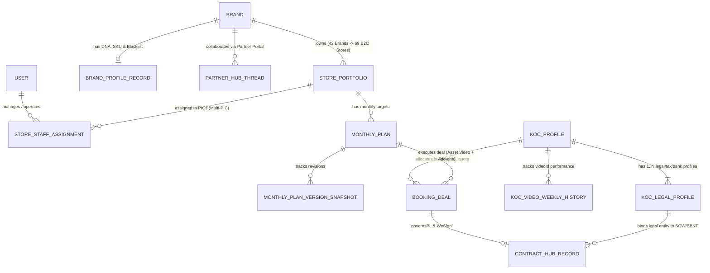

# MÔ HÌNH DỮ LIỆU — B2C OPS HUB

| Thuộc tính | Giá trị |
| --- | --- |
| Mã tài liệu | HUB-2.4 |
| Dự án | B2C Ops Hub |
| Giai đoạn | 2 — Phân tích & Thiết kế kỹ thuật |
| Trạng thái | Đã hoàn thiện ERD, Data Dictionary & Quy tắc PII — chờ tech lead + owner nghiệp vụ duyệt G2 |
| Owner | Team DX & `@it-business-analyst` |
| Người duyệt | _Chưa gán_ |
| Cập nhật | 24/10/2026 |
| Phiên bản | 0.4 |

Nguồn sự thật của cấu trúc bảng là `web-admin/prisma/schema.prisma` (36 model, 15 enum). Tài liệu này ghi **bảng nào đang dùng thật**, cách lưu, dữ liệu nhạy cảm và khoảng trống cần quyết trước G2. Kiến trúc lưu trữ: [HUB-2.3 §3](2.3_ARCHITECTURE.md).

---

## 1. Kiểm kê model

Cột **Mã nguồn dùng** đếm số file trong `web-admin/src` đọc/ghi model (kiểm tra 20/10/2026). Cột **Migration** cho biết bảng có được tạo bằng file trong `prisma/migrations/` hay không.

### 1.1. Đang dùng

| Model | Kiểu lưu | Phân hệ (SRS) | Mã nguồn dùng | Migration |
| --- | --- | --- | --- | --- |
| `MonthlyPlan`, `MonthlyPlanVersionSnapshot`, `MonthlyPlanDiscussion` | Quan hệ (+ `data` JSON) | 2.3 Kế hoạch tháng | `lib/server/monthlyPlanStore.ts`, `masterCatalogStore.ts` | **Không** — tạo bằng `db push` |
| `LarkbaseBookingPlanRecord` | Quan hệ | 2.3, HUB-1.9 | `lib/server/larkbaseBookingPlanSync.ts` | **Không** |
| `StorePortfolio` | Quan hệ | 2.6 Gian hàng | 1 file | **Không** |
| `KocProfile` | Quan hệ | 2.4, Kalodata | `api/integrations/kalodata/sync` | **Không** |
| `TikTokShopConnection`, `TikTokSellerDailyMetric`, `TikTokAdsCampaignReport`, `TikTokVideoPerformanceSnapshot` | Quan hệ | 2.2 Dashboard gian hàng | `lib/server/tiktokSellerStore.ts` | Có file `.sql` rời ngoài thư mục migration chuẩn |
| `BrandProfileRecord` | JSON + `revision` | 2.6 Hồ sơ Brand | `lib/brands/store.ts` | Có (`20261013_brand_profile`) |
| `ContractHubRecord`, `ContractWeSignBinding`, `ContractTemplateSnapshot` | JSON + `revision` / nhị phân | 2.10 Hợp đồng | `lib/contracts/store.ts` | Có (`20261013_contract_hub`) |
| `PartnerHubThread` | JSON | 2.6 Cổng đối tác | `lib/partnerHub/store.ts` | Có (`20261014_partner_hub`) |
| `AppSharedRecord` | JSON + `revision` | Danh mục dùng chung, chính sách quyền | `lib/server/sharedRecords.ts` | Có (`20261014_shared_admin_data`) |
| `PendingKocDiscovery` | Quan hệ / `AppSharedRecord` | 2.4 Quản lý KOC (Bảng tạm khám phá KOC mới chưa có trên Upaffiliate) | `lib/kocStagingService.ts`, `api/integrations/upaffiliate/staging` | Tạo trong schema |

### 1.2. Khai báo nhưng chưa dùng (20 model)

`User`, `StoreStaffAssignment`, `StoreDifficultyConfig`, `Campaign`, `ContentPlan`, `GrowthDemand`, `GrowthDemandTierBreakdown`, `SelfChannelPlanDb`, `LivestreamPlanDb`, `PlanFourStageTrackingDb`, `WeeklyStorePlan411`, `KocCandidate`, `BookingDeal`, `ContentItem`, `Publication`, `Contract`, `SampleShipment`, `SlaLog`, `LeaderboardRecord`, `StaffP3Record`.

Các thực thể tương ứng (deal, listing KOC, hàng mẫu, SLA, nhân sự, phân công) hiện chạy bằng **dữ liệu tĩnh trong `src/lib/*.ts`** hoặc trạng thái phía client. Hệ quả: dữ liệu không bền vững, không phân quyền được ở máy chủ, không có audit.

## 2. Thực thể nghiệp vụ chính và nơi lưu hiện tại

| Thực thể | Định nghĩa | Nơi lưu hiện tại | Đề xuất |
| --- | --- | --- | --- |
| Brand | 42 thương hiệu B2C | `realB2cBrandsData.ts` + `BrandProfileRecord` | Một bảng `Brand` làm khóa cho mọi phân hệ |
| Gian hàng (Store) | 69 gian `B2C phụ trách = 1` (DEC-006) | `liveStoresData.ts`, `StorePortfolio` | Giữ `StorePortfolio`, nối khóa ngoại tới Brand |
| Kế hoạch tháng | Theo gian hàng, có phiên bản | `MonthlyPlan` | Giữ |
| Chiến dịch | 1–3 tháng, gắn Brand | Client state | Dùng `Campaign` |
| Listing KOC / Deal | Đợt 10/20/30 → Brand duyệt → Tạo Deal (Asset Video + Dịch vụ gia tăng) → Phụ lục Hợp đồng theo Deal (`PL-...`) → Nghiệm thu 2 bước tuần tự → Kế toán thanh toán theo Deal | Client state, dữ liệu tĩnh (`approvedBookingList.ts`, `types.ts`) | Dùng `KocCandidate`, `BookingDeal` |
| KOC master (2 bảng: KOC Cũ kèm lịch sử & KOC Mới) + Hồ sơ pháp lý 1–N (`KocLegalProfile` / `creator_legal_profile`) | **Bảng 1 (`COOPERATED`):** 4.820 KOC đã hợp tác kèm lịch sử Deal/BO, Brand, PIC, Rate Min–Max, GMV/ROI và `1–N` Hồ sơ pháp lý (`INDIVIDUAL`, `HOUSEHOLD`, `COMPANY`, mỗi hồ sơ ràng buộc `Chủ thể ký ≡ CCCD/MST ≡ STK thụ hưởng ≡ HĐNT`). **Bảng 2 (`NEW`):** KOC mới/tiềm năng (`totalPastDeals = 0`) từ `Master_KOC_UpAffiliate_ERD_Template.xlsx` (`KOC_Tiem_Nang`) kèm độ sẵn sàng booking (`bookingReadiness`) và nhật ký tiếp cận (`contactStatus`, `contactHistory`). | `kocMasterDataset.ts`, `realKocMasterData.ts`, `realPotentialKocData.ts`, `KocProfile` | Chuyển hết vào `KocProfile` + bảng con `CreatorLegalProfile` |
| Hợp đồng | Hồ sơ + duyệt + ký | `ContractHubRecord` (JSON) | Chốt cấu trúc JSON hoặc dùng `Contract` |
| Người dùng & quyền | 8 vai trò | `mockData.ts` (`USERS`), `AppSharedRecord` | Dùng `User`; bỏ `USERS` khỏi luồng production |

Ranh giới dữ liệu với Lark và UpAffiliate: [DEC-005](../governance/DECISION_LOG.md), `sdlc/02_SYSTEM_BOUNDARY.md`.

## 2.1. Sơ Đồ Quan Hệ Thực Thể Logic (Logical ERD — `@ba-data-integration`)

## 2.2. Từ Điển Dữ Liệu Chuẩn & Ánh Xạ Trường Cốt Lõi (Canonical Data Dictionary)

### A. Thực thể `KocProfile` & `KocLegalProfile` (`1 KOC — N Hồ sơ Pháp lý`, `FR-082`)
| Tên trường (Field) | Nhãn hiển thị UI | Kiểu dữ liệu (DB/TypeScript) | Bắt buộc? | Khóa / Duy nhất | Nguồn làm chủ (Master) | Quy tắc hợp lệ (Validation / Business Rule) | Nhạy cảm (PII - `NFR-04`) |
| --- | --- | --- | --- | --- | --- | --- | --- |
| `id` | Mã KOC nội bộ | `String` | Có | PK | Ops Hub / UpAffiliate | Định dạng bất biến | Không |
| `upaffiliateCreatorId` | Mã đồng bộ UpAffiliate | `String` | Không | Unique | UpAffiliate (`IF-03`) | `UPA-CR-...` hoặc `UPA-NEW-...` | Không |
| `tableCategory` | Phân nhóm Bảng KOC | `Enum ('COOPERATED' \| 'NEW')` | Có | Index | Ops Hub | `totalPastDeals > 0` → `COOPERATED`; ngược lại `NEW` | Không |
| `salaryGrade` | Bậc khung lương (KL) | `Enum ('TAP' \| 'KL1'..'KL7')` | Có | Index | Lark 3.1 / UpAffiliate | 9 bậc chuẩn theo `SDLC-01 §3` | Không |
| `legalProfiles[]` | Danh sách Hồ sơ pháp lý (1–N) | `KocLegalProfile[]` | Có ($\ge 1$ với Bảng 1) | FK `kocId` | UpAffiliate / Pháp chế | Ràng buộc bộ 4: `Chủ thể ký ≡ CCCD/MST ≡ STK ≡ HĐNT` | Có (Chứa PII) |
| `legalProfiles.legalType` | Tư cách pháp nhân | `'INDIVIDUAL' \| 'HOUSEHOLD' \| 'COMPANY'` | Có | — | Pháp chế | Quyết định mẫu hợp đồng (`IND-*`, `HKD-*`, `COM-*`) & thuế | Không |
| `legalProfiles.cccd` | Số CCCD chủ thể | `String (12 digits)` | Có (nếu Cá nhân) | — | Pháp chế / OCR | Regex `^\d{12}$` | **Có — Mask `********1234` trên danh sách** |
| `legalProfiles.taxCode` | Mã số thuế (MST) | `String (10-13 digits)` | Có (nếu HKD/Công ty) | — | Pháp chế | Kiểm tra định dạng MST 10 hoặc 13 số | **Có — Phân quyền xem** |
| `legalProfiles.bankAccount` | Số tài khoản thụ hưởng | `String` | Có | — | Kế toán / Pháp chế | Chủ TK phải khớp `holderName`; cấm TK trung gian | **Có — Mask trên danh sách** |

### B. Thực thể `BookingDeal` & `ContractHubRecord` (Giao dịch Deal, Hợp đồng & Nghiệm thu 2 Bước)
| Tên trường (Field) | Nhãn hiển thị UI | Kiểu dữ liệu (DB/TypeScript) | Bắt buộc? | Khóa / Duy nhất | Nguồn làm chủ (Master) | Quy tắc hợp lệ (Validation / Business Rule) | Nhạy cảm (PII - `NFR-04`) |
| --- | --- | --- | --- | --- | --- | --- | --- |
| `dealCode` | Mã Deal / BO | `String` | Có | Unique Business Key | UpAffiliate / Ops Hub | Sinh khi Listing đạt `FINAL_APPROVED` (`FR-021`) | Không |
| `sourcePlanId` | Mã dòng Kế hoạch tháng | `String` | Có | FK `MonthlyPlan` | Ops Hub | Bắt buộc truy vết về dòng Plan Final (`FR-020`) | Không |
| `netAmount` | Giá trị Net (Chưa thuế) | `Number (VND)` | Có | — | Booking PIC | `>= 0`, không vượt trần ngân sách Net của Plan (`FR-004`) | **Ẩn với `EXTERNAL_PARTNER`** |
| `grossAmount` | Giá trị Gross (Gồm thuế) | `Number (VND)` | Có | — | Rule Engine (`DEC-006`) | Cá nhân $\ge 2\text{tr}$: tính TNCN 10%; Công ty: cộng VAT 8%/10% | **Ẩn với `EXTERNAL_PARTNER`** |
| `wave0Status` | Trạng thái Video gốc (Bước 1) | `Enum` | Có | — | Nghiệm thu (`FR-036`) | Phải có `videoId`, link air sống và ảnh chụp SP trước khi đạt `VERIFIED` | Không |
| `addonItems[]` | Dịch vụ gia tăng (Bước 2) | `DealAddonItem[]` | Không | — | Phụ lục Deal (`PL-...`) | Khóa ở `LOCKED_BY_WAVE_0` cho tới khi `wave0Status === 'VERIFIED'` (`FR-022`) | Không |
| `finalAmount` | Giá trị quyết toán cuối | `Number (VND)` | Có | — | Rule Engine (`FR-023`) | `= Tổng giá trị Deal - Σ(Giá trị hạng mục DROPPED)` | **Ẩn với `EXTERNAL_PARTNER`** |
| `legalApprovalStatus` | Trạng thái Pháp chế duyệt | `'PENDING' \| 'APPROVED' \| 'REJECTED'` | Có | — | Vai trò `LEGAL` (`FR-032`) | Tự động reset về `PENDING` nếu sửa trường tiền/pháp nhân sau duyệt | Không |
| `financeApprovalStatus` | Trạng thái Kế toán duyệt | `'PENDING' \| 'APPROVED' \| 'REJECTED'` | Có | — | Vai trò `FINANCE` (`FR-032`) | Độc lập với `LEGAL`; đủ cả 2 mới mở khóa Trình ký WeSign | Không |

## 3. Dữ liệu nhạy cảm

| Trường | Model / nơi lưu | Yêu cầu (NFR-04) |
| --- | --- | --- |
| `cccd`, `taxCode`, `bankName`, `bankAccount`, `phone` | `KocProfile` | Chỉ vai trò Pháp chế/Kế toán/PIC được xem; che khi hiển thị danh sách |
| `kocPhone` và thông tin Bên B | `BookingDeal`, `ContractHubRecord.data` | Như trên; không gửi tới LLM khi chưa có DEC (OI-014) |
| Ảnh giấy tờ (OCR) | Xử lý tại `api/ocr/extract-legal-doc` | Không lưu ảnh gốc sau khi đọc, trừ khi có quyết định lưu |
| Tệp thương hiệu | R2 / `.brand-data/` | Link ký có hạn |

## 4. Khoảng trống cần quyết trước G2

1. **Migration không đủ:** chỉ 6 bảng có migration; các bảng khác tạo bằng `db push`. Cần `prisma migrate diff` để sinh migration nền cho toàn bộ schema đang chạy production.
2. **20 model không dùng:** quyết giữ (và nối mã) hay xóa.
3. **Dữ liệu thật trong mã nguồn:** đưa vào DB + seed có kiểm soát (RSK-A1).
4. **Cấu trúc JSON** của `ContractHubRecord`, `BrandProfileRecord`, `AppSharedRecord` cần mô tả kiểu (đang nằm ở `lib/*/types.ts`) và được người duyệt theo SDLC-00 §6.1.

## Lịch sử thay đổi

| Phiên bản | Ngày | Người sửa | Nội dung |
| --- | --- | --- | --- |
| 0.1 | 20/10/2026 | Team DX | Kiểm kê 36 model theo mã nguồn; ghi khoảng trống migration và dữ liệu nhạy cảm. |
| 0.2 | 22/10/2026 | Team DX | Bổ sung thực thể PendingKocDiscovery (Bảng tạm lưu KOC mới từ tìm kiếm/đối thủ/hashtag chưa có trên Upaffiliate). |
| 0.3 | 23/10/2026 | Team DX | Chuẩn hóa mô hình KOC 2 bảng (`COOPERATED` vs `NEW`) và quan hệ `1 KOC — N Hồ sơ pháp lý & Thụ hưởng` (`KocLegalProfile` / `creator_legal_profile`) theo ERD UpAffiliate. |
| 0.4 | 24/10/2026 | `@it-business-analyst` | Bổ sung Sơ đồ quan hệ thực thể Logic (`erDiagram`) và Bảng Từ điển dữ liệu chuẩn (Data Dictionary & UI-API-DB Mapping) cho các thực thể cốt lõi theo chuẩn `@ba-data-integration`. |
