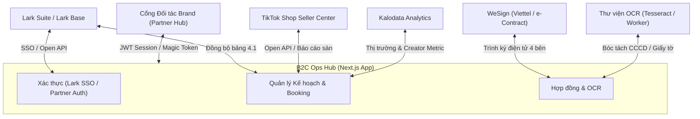

# ĐẶC TẢ TÍCH HỢP HỆ THỐNG & API (INTEGRATION SPEC) — B2C OPS HUB

| Thuộc tính | Giá trị |
| --- | --- |
| Mã tài liệu | HUB-2.5 |
| Dự án | B2C Ops Hub — Hệ thống điều hành & quản trị phòng Marketing B2C |
| Giai đoạn | 2 — Phân tích & Thiết kế kỹ thuật |
| Trạng thái | **Đã chuẩn hóa theo mã nguồn thực tế** |
| Phiên bản | 1.0 |
| Cập nhật | 20/10/2026 |

---

## 1. Danh sách các cổng tích hợp chính

Hệ thống B2C Ops Hub giao tiếp với các hệ thống bên ngoài và dịch vụ nội bộ qua các cổng API chuẩn hóa sau:

---

## 2. Chi tiết các điểm tích hợp (Endpoints & Data Contracts)

### 2.1 Tích hợp Lark Suite, Larkbase & Lark Approval (Lark Open API)
- **Mục đích:** Xác thực người dùng nội bộ (Lark SSO), đồng bộ kế hoạch tháng từ File 4.1 Plan order tổng và đẩy phiếu đề nghị thanh toán (ĐNTT / Tạm ứng) từ Bảng 3.2 sang Lark Approval & Larkbase.
- **Cấu hình môi trường:**
  - `LARK_APP_ID`: App ID được cấp từ Lark Developer Console.
  - `LARK_APP_SECRET`: App Secret để lấy `tenant_access_token`.
  - `LARK_BASE_APP_TOKEN`: Token của Base chứa dữ liệu kế hoạch và thanh toán.
  - `LARK_BOOKING_PLAN_TABLE_ID`: Table ID chứa dữ liệu kế hoạch tháng.
  - `LARK_PAYMENT_TABLE_ID`: Table ID chứa dữ liệu đề nghị thanh toán Bảng 3.2.
  - `LARK_APPROVAL_DEFINITION_CODE`: Mã quy trình phê duyệt thanh toán trên Lark Approval.
  - `ANYCROSS_PAYMENT_WEBHOOK_URL`: Đường dẫn Webhook AnyCross nhận dữ liệu phiếu ĐNTT.
- **Endpoints triển khai:**
  - `GET /api/auth/lark/login`: Chuyển hướng người dùng sang trang xác thực Lark OAuth2.
  - `GET /api/auth/lark/callback`: Nhận mã ủy quyền (code), đổi lấy `user_access_token` và thiết lập cookie phiên `upbase_auth_session`.
  - `POST /api/integrations/larkbase/booking-plans`: Kéo dữ liệu kế hoạch phân rã từ Lark Base về bảng lưu trữ B2C Ops Hub.
  - `GET / POST / PATCH /api/integrations/larkbase/payment-requests`: Kiểm tra chặn cứng 100% điều kiện hồ sơ Đối soát Thanh toán theo Deal (`larkPaymentRequestEngine.ts` — hỗ trợ đơn lẻ từng Deal hoặc gom nhiều Deal của cùng KOC/MCN, tách biệt Phiếu Tạm ứng đợt 1 và Phiếu ĐNTT tất toán đợt 2/100%, kiểm tra nghiệm thu 2 bước tuần tự `STAGE1_VIDEO` → `STAGE2_ADDONS_NOT_VERIFIED`, tự động bóc tách `Asset Video` + `Dịch vụ gia tăng` - `Khấu trừ hạng mục hủy DROPPED` theo Phụ lục Deal `PL-...` và HĐNT `masterContractCode`, tính thuế TNCN 10% / VAT theo BR-09, kiểm tra Hợp đồng theo BR-03 & BBNT theo BR-04, tạo mã VietQR), khởi tạo **Luồng phê duyệt thanh toán trên Lark Approval API (`/open-apis/approval/v4/instances`)** theo đúng phân cấp gian hàng (`Chuyên viên đối soát Deal` → `Trưởng nhóm Nguyễn Thị Ngọc Tâm sơ duyệt` nếu gian có Leader → `Giám đốc MKT Đặng Thị Yến Nhi duyệt trần Order Net` → `Phòng TCKT đối soát Phụ lục & giải ngân`) cùng bảng Larkbase 3.2 / AnyCross Webhook, và hỗ trợ `PATCH` để cập nhật/đồng bộ bước phê duyệt (`PENDING_LEADER` → `PENDING_DIRECTOR` → `PENDING_FINANCE` → `APPROVED` → `PAID`) trực tiếp trên `ApprovedBookingListView.tsx` và `BookingView.tsx`.

### 2.2 Tích hợp TikTok Seller Center, Thu thập dữ liệu KOC & Nghiệm thu Link Video TikTok
- **Mục đích:**
  - Cập nhật doanh thu sàn, chỉ số GMV, số lượng đơn hàng thực tế của 69 gian hàng TikTok Shop do B2C phụ trách.
  - Thu thập dữ liệu kênh KOC trực tiếp từ TikTok (thông tin kênh cơ bản, tiểu sử Bio, tự động bóc tách SĐT/Zalo/Email trong Bio, Follower, Tổng lượt thích, Tổng số video, chỉ số tương tác các video gần nhất View/Tim/Bình luận/Chia sẻ/ER%, và danh sách video kèm caption/hashtag/nhạc nền/ngày đăng).
  - Kiểm tra và nghiệm thu link video TikTok do KOC gửi (hỗ trợ cả đơn lẻ và hàng loạt tới 100+ link): giải mã ngày giờ đăng chính xác từ TikTok `createTime` và Snowflake Video ID (64-bit), đối chiếu hạn đăng SLA, kiểm tra đúng kênh cam kết, bóc tách phụ đề lời thoại WebVTT (`claInfo.captionInfos`) & chữ cứng CapCut (`stickersOnItem`), kiểm tra khung hình sản phẩm 3 giây đầu / chữ bao bì bị ngược gương / sản phẩm đối thủ, đối soát giỏ hàng gắn đúng `Shop ID` và `Product ID` gian hàng chính hãng do UpBase vận hành, xác thực mã ủy quyền quảng cáo Spark Ads (thời hạn ≥ 60 ngày), đối soát hashtag + thông điệp USP bắt buộc, quét từ cấm sàn TikTok Shop / Y tế và kiểm tra trạng thái duy trì video 30 ngày sau đăng (phát hiện ẩn/xóa/tháo giỏ hàng trước khi thanh toán).
- **Endpoints triển khai:**
  - `POST /api/tiktok-seller/sync`: Thực hiện đồng bộ số liệu bán hàng, tỷ lệ chuyển đổi và doanh số đóng góp từ video KOC theo kỳ đối soát.
  - `GET /api/integrations/tiktok-koc/scrape`: Thu thập dữ liệu 1 kênh KOC TikTok theo `@handle` hoặc đường dẫn kênh/video (`?handle=...&period=30d&videoLimit=24`), tìm kiếm KOC theo Hashtag / Từ khóa (`?hashtag=kemchongnang&period=30d`), quét danh sách KOC đang làm việc cho Kênh/Thương hiệu Đối thủ (`?competitor=larocheposayvn&period=30d`), cào bình luận thực tế của video (`?videoUrl=...`) hoặc lấy danh sách Creator đang thịnh hành (`?trending=1`). Khi quét theo kênh, hệ thống trích xuất `secUid` thực tế của kênh từ `fetchLiveTikTokPublicProfile` (hoặc từ video đầu tiên của kênh) để gọi trực tiếp `fetchTikTokCreatorVideoListBySecUid` (`/api/creator/item_list/?type=1&count=15` phân trang theo `cursor` thời gian giảm dần), lấy chính xác và đầy đủ các video mới đăng nhất liên tiếp theo thời gian (kèm toàn bộ chỉ số View/Tim/Bình luận/Chia sẻ/Hashtag/Nhạc nền và giỏ hàng TikTok Shop `extractTikTokShopAnchorInfo`), và dùng `discoverTikTokChannelVideoUrls` + `inspectVideoCandidatesInBatches` làm phương án dự phòng khi cần.
  - `POST /api/integrations/tiktok-koc/scrape`: Hỗ trợ 5 chế độ thu thập hàng loạt miễn phí (0đ) bằng bộ giải mã TikTok SSR WAF cô lập theo từng URL (`solveTikTokWafHtml` + `inspectLiveTikTokVideoPage` giải PoW SHA-256 độc lập cho từng đường dẫn mà không dùng chung cookie WAF giữa trang hồ sơ `/@handle` và trang video `/@handle/video/id`), bộ lấy danh sách video mới đăng liên tiếp của kênh (`fetchTikTokCreatorVideoListBySecUid` qua `/api/creator/item_list/?type=1`), bộ bóc tách thẻ video Bing (`extractUrlsFromHtml` tách theo từng khối `mc_vtvc_con_rc` và loại bỏ chuỗi `relatedvideo?q=...` nhại lại câu truy vấn), bộ tách từ khóa ghép tiếng Việt (`buildTargetKeywordProfile` tách các hashtag/tên thương hiệu nhiều từ như `#nousvietnam`, `La Roche Posay` thành cụm từ khóa truy vấn chính xác, hỗ trợ chế độ quét theo bộ từ khóa ngành hàng `categoryMatchTokens` & `catalogKeys`) và bộ kiểm chứng khớp nội dung video thuộc thị trường Việt Nam sau khi đọc trang TikTok (`doesInspectedVideoMatchTarget` đối chiếu trực tiếp caption, mảng hashtag và tiêu đề giỏ hàng TikTok Shop, đồng thời xác thực ngữ cảnh tiếng Việt cho mọi thương hiệu để loại bỏ 100% video gợi ý ngoài lề hoặc video quốc tế như La Roche-Posay Brasil), kết hợp native fetch tới `/api/comment/list/` và `/node/share/discover`, tự động ưu tiên video mới air lên đầu danh sách (`compareVideoAirDateDesc`), kèm cơ chế **tự động chia nhỏ đợt quét (Batch Splitting)** khi người dùng yêu cầu số lượng lớn (`1–1000 KOC` hoặc `1–1000 bình luận`) qua các tham số `excludeHandles`, `pageOffset`, `skipProfileFetch`, `cursor` và `resolvedVideoId`: (1) Cào bình luận thực tế của Video & lọc bình luận hỏi mua hàng theo từng đợt (`{ videoUrl: "https://...", limit, cursor, resolvedVideoId }`); (2) Lấy danh sách kênh Creator đang thịnh hành theo 7 ngành hàng B2C (`{ trendingCreators: true, category, limit, pageOffset, excludeHandles }` kết hợp quét trực tiếp video xu hướng theo bộ từ khóa ngành hàng `TRENDING_CATEGORY_CATALOG`, tệp KOC Việt Nam đầu bảng và đối chiếu bổ sung từ Danh bạ KOC thực tế UpBase `getUpbaseMasterKocsForTrendingCategory` với kích thước đợt lên tới 25 KOC/lượt); (3) Quét KOC làm việc cho đối thủ chia theo từng đợt (`{ competitor: "@larocheposayvn", limit, excludeHandles, pageOffset, skipProfileFetch }`); (4) Quét danh sách KOC theo `#hashtag` / từ khóa ngách chia theo từng đợt (`{ hashtag: "kemchongnang", limit, excludeHandles, pageOffset }`); (5) Thu thập hàng loạt kênh theo `@handle` hoặc link video (tối đa 30 kênh/lần, mặc định 24 video hoạt động gần nhất/kênh và tùy chỉnh `videoLimit` theo các mốc `24, 48, 72, 100` video/kênh kèm nút tải thêm video trực tiếp trên modal) và xuất CSV. Khi số lượng KOC / bình luận / video trả về (hoặc còn lại sau bộ lọc) ít hơn số lượng người dùng yêu cầu trên bất kỳ tính năng nào (`TikTokCrawlerHubView`, `TikTokKocScraperModal`, `KocChannelBriefMatcherModal`, `StoreShortlistFilterModal`), giao diện tự động hiển thị nhãn cảnh báo (`<Status tone="warning">`) nêu rõ số lượng tìm thấy trên tổng số yêu cầu và số lượng còn thiếu. Đối với các KOC đã có thông tin trong Danh bạ KOC (`existingByHandle`), người dùng có thể bấm trực tiếp vào nhãn `Đã có · Danh bạ` trên dòng `@handle` của bảng kết quả `TikTokCrawlerHubView` hoặc trên hộp thoại `TikTokKocScraperModal` để chuyển thẳng sang hồ sơ chi tiết (`KocProfile`) tại trang `Danh bạ KOC` (`KocMasterDataView`), đồng thời trạng thái phiên quét của `TikTokCrawlerHubView` được giữ nguyên qua `KeepAliveTab`.
  - `GET / POST / DELETE /api/integrations/tiktok-koc/history`: Lưu trữ và đồng bộ **Lịch sử crawl KOC theo tuần — 7 ngày gần nhất (`tiktok-crawler-daily-history`)** giữa tất cả nhân sự B2C thông qua `sharedRecords` (tự động lọc cửa sổ 7 ngày `YYYY-MM-DD` múi giờ `Asia/Ho_Chi_Minh`, tối đa 100 phiên quét trong tuần cho cả 5 tab `COMPETITOR_KOCS`, `HASHTAG_DISCOVERY`, `COMMENTS_AND_TRENDING`, `CHANNEL_AND_VIDEO_TOOLS`, `LINK_AIR_CHECK` và `HANDLE_SCRAPE`, gộp cập nhật theo `tab + queryKey` kèm tên nhân sự quét, ngày và thời điểm `HH:mm`). Mọi chuyên viên có thể xem thanh lịch sử nhanh và bảng lịch sử tuần ngay bên trong mỗi tab của `TikTokCrawlerHubView`, lọc theo ngày (`Tất cả 7 ngày`, `Hôm nay`, `Hôm qua`, `Trong tuần`), bấm `Xem kết quả` để nạp lại dữ liệu đã quét hoặc `Quét lại` để làm mới số liệu.
  - `GET / POST / DELETE /api/integrations/tiktok-koc/channel-reviews`: Lưu trữ và đồng bộ **Lịch sử đánh giá kênh KOC theo Brand (`koc-channel-reviews`)** xuyên suốt giữa các nhân sự thông qua `sharedRecords` (`kocChannelReviewService.ts` & `KocChannelReviewModal.tsx`). Cho phép nhân viên tại mọi màn hình tìm kiếm KOC (`TikTokCrawlerHubView` — Quét KOC Đối thủ / Tìm theo `#Hashtag` / KOC Xu hướng, `TikTokKocScraperModal` — Tra cứu `@handle`, `KocMasterDataView` & `KocProfile` — Danh bạ & Hồ sơ KOC, `StoreShortlistFilterModal` — Bộ lọc đề xuất KOC cho gian hàng) chọn nhanh kết luận **`Phù hợp` (`SUITABLE`)**, **`Cân nhắc / Lưu ý` (`CAUTION`)** hoặc **`Không phù hợp` (`NOT_SUITABLE`)** gắn với từng **Brand (Nhãn hàng) cụ thể (`brandScope`)**, bắt buộc ghi **Ý kiến nhân viên (`note`)**, chọn **Lý do mẫu theo từng loại kết luận (`reasonTags`)** và lưu **Người đánh giá (`reviewerName`, `reviewerRole`)** cùng **Thời gian đánh giá (`createdAt`, `dateLabel`, `timeLabel`)**. Hệ thống hiển thị trực tiếp **Cột `Đánh giá & Brand`** trên bảng kết quả tìm kiếm KOC và bảng tổng hợp theo từng Brand (`byBrand`) để các nhân viên khác tra cứu tức thì kênh đó phù hợp hay không phù hợp với Brand nào.
  - `POST /api/integrations/tiktok-koc/inspect-video`: Kiểm tra và nghiệm thu 1 hoặc hàng loạt đường link video TikTok của KOC gửi (hỗ trợ cả link đầy đủ và link rút gọn `vt.tiktok.com` với cơ chế chạy song song chia luồng 5 link/lần), trả về kết quả đối soát 6 lớp (ngày đăng & SLA, khung hình & phụ đề lời thoại WebVTT, định danh Shop ID & SKU giỏ hàng chính hãng, mã Spark Ads, từ khóa USP & từ cấm sàn, và trạng thái lưu giữ 30 ngày sau đăng) kèm xuất báo cáo CSV. Hỗ trợ thêm chế độ `mode = 'EXTRACT_SCRIPT'` (`extractCompetitorVideoScriptAndHook`) để bóc tách lời thoại theo từng mốc giây (`parseWebVttToSegments` từ `claInfo.captionInfos`), chữ chèn trên khung hình (`stickersOnItem`), phân loại công thức Câu mở đầu 3 giây đầu (Hook), tách khung kịch bản 4 bước (Mở bài → Vấn đề → Trải nghiệm USP → Chốt giỏ hàng), kết hợp bình luận hỏi mua dưới video và sinh văn bản Brief mẫu gửi KOC UpBase.
  - `POST /api/integrations/tiktok-koc/social-discovery`: Dò tìm và xác thực trực tiếp đường dẫn kênh **Shopee, Facebook, Instagram, Threads** của KOC (`discoverKocSocialChannels` trong `src/lib/kocSocialDiscovery.ts`) qua 5 lớp: (1) Bóc tách trực tiếp tiểu sử (`signature` gồm cả các từ viết lách như *"phở bò"*, *"ig/ins"*, *"sóp pi"*, *"thờ rét"*) và liên kết gắn trên hồ sơ TikTok (`bioLink.link`), tự động đọc trang Bio tổng hợp (`linktr.ee`, `beacons.ai`, `bio.link`, `instabio.cc`, `passio.eco`) và giải mã link rút gọn Shopee (`s.shopee.vn`, `shp.ee` qua biến `CONFIG.httpUrl`); (2) Tự động tìm kênh YouTube chính thức của KOC (`/@handle/about`) và truy vấn chỉ mục tìm kiếm Web (`discoverFromWebSearchEngines` trên DuckDuckGo/Bing); (3) **Phân tích ngữ cảnh & tìm kiếm qua Mô hình ngôn ngữ (`discoverSocialChannelsViaLlm`)** kết nối trực tiếp với Google Gemini (hỗ trợ công cụ `google_search` grounding), OpenAI (ChatGPT) và Anthropic (Claude) theo cấu hình `llmConfig` để đọc hiểu tiểu sử/kết quả tìm kiếm và trích xuất tài khoản chính xác; (4) Đối chiếu biến thể `@handle` và đồng bộ tài khoản Instagram sang Threads; (5) **Xác thực tồn tại trực tiếp (Live Profile Verification)** bằng OpenGraph SSR metadata (`facebookexternalhit/1.1` cho Facebook, Instagram, Threads) và Shopee Shop API (`/api/v4/shop/get_shop_detail` cho Shopee) để loại bỏ hoàn toàn các link chết/404 hoặc tài khoản rác ít người theo dõi, trích xuất tên hiển thị thật (`displayName`) cùng số người theo dõi/bài viết (`evidence`), giúp người dùng kiểm tra và bấm xác nhận lưu vào hồ sơ KOC. Trong bảng Danh bạ KOC (`KocMasterDataView.tsx`), hàm `hasKocPlatform` chỉ hiển thị dấu tích (`✓`) khi KOC thực sự có dữ liệu kênh đã xác nhận (`shopeeChannel`, `facebookChannel`, `instagramChannel`, `threadsChannel`).
  - `POST /api/integrations/link-air-check`: Kiểm tra trạng thái hiển thị công khai (LIVE / UNAVAILABLE / INVALID_LINK) và nghiệm thu điều kiện bài đăng (`handle`, `airFrom`, `airTo`, `requiredHashtags`, `requiredKeywords`, `requireProductLink`, `minViews`) cho tối đa 100 link trên 4 nền tảng (TikTok, Shopee Video, Facebook, Instagram); ưu tiên chuyển tiếp tới `crawler-worker` nếu đã cấu hình `CRAWLER_WORKER_URL`, và tự động chuyển sang bộ kiểm tra tích hợp sẵn (`checkSingleLinkServerless` trong `src/lib/linkAirCheckServer.ts`) khi chưa cấu hình worker riêng.

### 2.3 Tích hợp Kalodata (Creator & Video Intelligence)
- **Mục đích:** Tra cứu chỉ số doanh thu creator, đánh giá hiệu quả video gắn giỏ hàng và đề xuất KOC phù hợp với từng ngành hàng thương hiệu.
- **Endpoints triển khai:**
  - `GET /api/integrations/kalodata/status`: Kiểm tra trạng thái kết nối và hạn mức API Kalodata.
  - `POST /api/integrations/kalodata/discover`: Tìm kiếm KOC tiềm năng theo bộ lọc (ngành hàng, GMV trung bình/video, lượt theo dõi, tỷ lệ tương tác).
  - `GET /api/integrations/kalodata/creator`: Lấy báo cáo chi tiết về lịch sử bán hàng và livestream của một Creator cụ thể.

### 2.4 Tích hợp Hợp đồng điện tử WeSign (e-Contract)
- **Mục đích:** Tự động tạo phụ lục booking, thiết lập luồng trình ký điện tử 4 bên (UpBase - Brand - KOC - Quản lý) và theo dõi trạng thái hoàn tất ký kết.
- **Endpoints triển khai:**
  - `POST /api/contracts/integrations/wesign/sync`: Đồng bộ trạng thái ký từ hệ thống WeSign về trạng thái hợp đồng trong Ops Hub (Chờ ký → Đang ký → Đã ký hoàn tất / Bị từ chối).

### 2.5 Module Đọc ảnh giấy tờ & CCCD (OCR Service)
- **Mục đích:** Tải ảnh hai mặt Căn cước công dân hoặc giấy tờ pháp lý của KOC, bóc tách các trường: Họ tên, Số CCCD, Ngày sinh, Địa chỉ thường trú, Ngày cấp để tự động điền vào phụ lục hợp đồng.
- **Endpoints triển khai:**
  - `POST /api/ocr/extract-legal-doc`: Nhận dữ liệu ảnh (`multipart/form-data` hoặc `base64`), xử lý qua Tesseract OCR với tập dữ liệu tiếng Việt (`vie.traineddata`), chuẩn hóa cấu trúc JSON trả về client.

### 2.6 Cổng cộng tác đối tác (Partner Hub)
- **Mục đích:** Cho phép đại diện thương hiệu (Brand) đăng nhập qua token an toàn để xem kịch bản, duyệt video và theo dõi ngân sách.
- **Endpoints triển khai:**
  - `POST /api/auth/partner/login`: Xác thực thông tin đối tác thương hiệu qua mã truy cập hoặc đường dẫn định danh.
  - `GET /api/partner-hub`: Lấy dữ liệu tổng quan chiến dịch, kịch bản chờ duyệt và phản hồi từ thương hiệu.

### 2.7 Động cơ Nghiên cứu Thị trường, Thương hiệu & Đối thủ Tự động Đa nguồn (`Brand & Market Research API` — 8 Mô-đun kèm Sổ Dẫn chứng `[EV]`)
- **Mục đích:** Cung cấp dịch vụ phân tích chuyên sâu 8 mô-đun cho toàn bộ 42 thương hiệu B2C (69 gian hàng thuộc 13 phân ngành chuyên biệt) và **bất kỳ thương hiệu / đối thủ nào trên thị trường** do người dùng nhập vào, kết hợp đối soát dữ liệu thực tế nội bộ B2C (`File 4.1`, `File 4.1.1`, `File 3.2`, `File 3.5`) với bộ cào tự động thời gian thực đa nguồn (`src/lib/liveBrandWebScraper.ts`), gắn mã dẫn chứng xác thực (`[EV-01]`..`[EV-N]`) cho từng nhận định và số liệu.
- **Cơ chế Cào Tự động Đa nguồn Thời gian thực (`scrapeLiveBrandWebIntelligence`):**
  1. **Tự động dò tìm & cào Danh mục Sản phẩm JSON trên Website chính hãng tại Việt Nam:** Tự động dò các tên miền thương hiệu (`www.<slug>.vn`, `<slug>.vn`, `<slug>.com.vn`, `<slug>vietnam.com`, `<slug>.com`) và bóc tách trực tiếp JSON danh mục sản phẩm công khai trên nền tảng Haravan / Shopify (`/collections/all/products.json`, `/products.json`), Sapo và WordPress WooCommerce (`/wp-json/wc/store/products`), kết hợp đọc DOM trang chủ (`<title>`, `meta description`, `H1–H3`, giá bán VND) để lấy tên SKU, giá bán thực tế, giá gốc, thành phần/chất liệu và chương trình khuyến mãi.
  2. **Tự động cào Danh mục & Giá bán thực tế trên Sàn TMĐT (`Tiki Public Catalog API`):** Truy vấn trực tiếp `https://tiki.vn/api/v2/products` lọc nghiêm ngặt theo đúng tên thương hiệu (`brand_name` / tiêu đề khớp thương hiệu) để thu thập danh sách SKU đang mở bán, giá niêm yết thực tế, mức giảm giá, điểm đánh giá sao (`rating_average`), số lượt nhận xét (`review_count`) và sản lượng đã bán (`quantity_sold`).
  3. **Tự động quét Video KOC TikTok & Cào Bình luận Người mua (`discoverCompetitorKocs` + `scrapeTikTokVideoComments`):** Quét trực tiếp các video KOC đang review hoặc gắn giỏ hàng của thương hiệu/đối thủ trên TikTok, đồng thời tự động bóc tách bình luận thực tế dưới video dẫn đầu để gom cụm tiếng nói khách hàng (khen ngợi, băn khoăn, hỏi mua/giá) và chuyển hóa thành câu mở đầu kịch bản 3 giây đầu.
  4. **Phân loại Phân ngành Chính xác bằng Ranh giới Từ Tiếng Việt Unicode (`hasVnKeywords` & `detectSubIndustryForAnyBrand`):** Sử dụng biểu thức chính quy Unicode (`\p{L}\p{N}`) thay cho `\b` ASCII để đối chiếu từ khóa tiếng Việt có dấu trên toàn bộ dữ liệu thu thập (tên thương hiệu, tiêu đề trang, thẻ `H1–H3`, danh mục sản phẩm vừa cào và hồ sơ cấu hình đối thủ như `Rhys Man`, `Nerman`, `Romano`, `Nous`, `Cocoon`, `La Roche-Posay`...), ngăn chặn hoàn toàn lỗi khớp nhầm chuỗi con (như chữ `hăm` trong `Chăm sóc` hoặc `men` trong `lên men`).
### 2.8 Cổng Kết nối Mô hình Ngôn ngữ (LLM Gateway), Báo cáo Thẩm định Lịch sử & Rủi ro KOC và Cấu hình Câu lệnh (Prompt) Đa Phân hệ
- **Mục đích:**
  - Cung cấp cổng kết nối thống nhất (`/api/integrations/llm`) tới **Google Gemini**, **OpenAI ChatGPT**, **Anthropic Claude** và **Bộ xử lý nội bộ UpBase (`INTERNAL`)** kèm cơ chế tự động chuyển đổi dự phòng (Fallback) và đo lường chi phí Token/USD/VNĐ theo từng nghiệp vụ.
  - Tổng hợp **Báo cáo Đánh giá Lịch sử Hợp tác, Mức độ Phù hợp & Rủi ro KOC (`KOC_HISTORY_EVALUATION`)** từ dữ liệu danh bạ KOC (`KocItem`) và lịch sử các chiến dịch đã chạy (`BookingDealItem[]`), chấm điểm phù hợp (0–100), phân loại kết luận (`Phù hợp tái ký` / `Phù hợp có điều kiện` / `Rủi ro cao hạn chế book`), phát hiện cảnh báo rủi ro đa chiều (`Tiến độ & Kỷ luật SLA`, `Pháp lý, Thuế & Thanh toán qua MCN / Người nhận hộ`, `Hiệu quả Thương mại & Báo giá vượt trần lịch sử`, `Nội dung & Lịch sử bị Nhãn hàng từ chối`) và đưa ra khuyến nghị đàm phán.
  - Cho phép **Thiết lập nhà cung cấp, chọn mô hình, nhập khóa API, kiểm tra kết nối và tùy chỉnh câu lệnh chỉ dẫn (`systemInstruction` / Prompt)** trực tiếp tại từng phân hệ nghiệp vụ thông qua `<InlinePurposeApiSetup />` (`OperationalReportDrawer`, `BrandMarketResearchHubView`, `KocHistoryEvaluationModal`, `KocChannelBriefMatcherModal`, `KocSocialChannelsModal`, `ScriptReviewModal`, `AiStaffReviewModal`, `MarketingKnowledgeQaView`, `LegalOcrModal`) cũng như quản trị tập trung tại màn **Cấu hình API (`ApiKeySetupView`)** cho toàn bộ 9 mục đích nghiệp vụ (`LEGAL_OCR`, `SCRIPT_REVIEW`, `CONTRACT_DRAFTING`, `STAFF_REVIEW`, `PLAN_ADS_ANALYSIS`, `KOC_MATCHING`, `KOC_HISTORY_EVALUATION`, `KNOWLEDGE_QA`, `BRAND_MARKET_RESEARCH`).
- **Endpoints & Dịch vụ triển khai:**
  - `POST /api/integrations/llm`: Hỗ trợ `action = 'TEST_CONNECTION'` và `action = 'EXECUTE_PURPOSE'` theo chuẩn kết nối mới nhất của từng nhà cung cấp:
    - **Google Gemini (`v1beta`):** Xác thực kép qua header `x-goog-api-key` + query `key`, truyền `system_instruction` gốc của API và danh mục model mới nhất (`gemini-3.8-flash`, `gemini-4-argon`, `gemini-3.6-flash`, `gemini-3.5-flash-lite`, `gemini-3.5-flash`, `gemini-3.1-pro-preview`, `gemini-2.5-pro`, `gemini-2.5-flash`, `gemini-2.0-flash`).
    - **OpenAI (`v1/chat/completions` & `v1/responses`):** Hỗ trợ đồng thời chuẩn **Responses API (`/v1/responses`)** và **Chat Completions API (`/v1/chat/completions`)** với tham số `max_completion_tokens` cho các dòng suy luận và danh mục model mới nhất (`gpt-6.1-sol`, `gpt-6-astra`, `gpt-6-luna`, `gpt-5.6-sol`, `gpt-5.6-terra`, `gpt-5.6-luna`, `gpt-5.5`, `gpt-5`, `gpt-5-mini`, `gpt-5-nano`, `o3`, `o4-mini`, `gpt-4.1`, `gpt-4.1-mini`).
    - **Anthropic Claude (`v1/messages` & `v1/models`):** Xác thực qua `x-api-key` + `anthropic-version: 2023-06-01`, tự động dò danh sách `/v1/models` và cập nhật danh mục model mới nhất (`claude-sonnet-5-5`, `claude-opus-5-5`, `claude-haiku-5-5`, `claude-fable-5-1`, `claude-opus-4-8`, `claude-sonnet-4-6`, `claude-sonnet-4-5`, `claude-opus-4-5`, `claude-haiku-4-5`).
  - `evaluateKocCollaborationHistory` (`src/lib/kocHistoryEvaluator.ts`) & `KocHistoryEvaluationModal` (`src/components/koc/KocHistoryEvaluationModal.tsx`): Tích hợp trực tiếp tại trang chi tiết **Hồ sơ KOC (`KocProfile.tsx`)** và bảng **Danh bạ KOC (`KocMasterDataView.tsx`)**.
  - `updatePurposeSystemInstruction` & `resetPurposeSystemInstruction` (`src/lib/apiKeyConfig.ts`): Lưu trữ đồng bộ câu lệnh Prompt của từng phân hệ và phát sự kiện cập nhật thời gian thực (`upbase-api-config-updated`) trên toàn bộ ứng dụng.

### 2.9 Kho lưu trữ tệp đính kèm & Phân hệ Quản lý Cloudflare R2 (`src/lib/brands/r2.ts`, `/api/integrations/cloudflare-r2` & `CloudflareAdminView.tsx`)
- **Mục đích:**
  - Lưu trữ các tệp tài liệu thương hiệu, hồ sơ pháp lý và chứng từ đính kèm (PDF, Word, Excel, PowerPoint, Ảnh, ZIP, TXT tối đa 25MB/tệp) trên **Cloudflare R2 Object Storage** sử dụng chuẩn ký xác thực **AWS Signature V4 (`signR2Request` hỗ trợ cả canonical query string)**.
  - Trang bị phân hệ độc lập **Quản lý Cloudflare R2 (`cloudflare-admin` / `CloudflareAdminView.tsx`)** trong mục **Hệ thống** trên thanh menu trái dành cho Quản trị viên & Giám đốc Marketing:
    1. **Kho Tệp & Đối Tượng R2 (`FILES_MANAGER`):** Quản lý toàn bộ tài liệu gắn với 42 thương hiệu B2C và duyệt trực tiếp danh sách đối tượng vật lý trên Bucket R2 (`ListObjectsV2` qua `listStoredObjects`), lọc theo Thương hiệu, Vị trí lưu trữ (`Cloudflare R2`, `Kho cục bộ`, `Liên kết CDN/Drive`), Phân loại tài liệu, tải tệp mới cho bất kỳ thương hiệu nào, xem trước, tải xuống và xóa tệp.
    2. **Dung lượng theo Thương hiệu (`BRAND_STORAGE`):** Bảng thống kê số lượng tệp R2, tệp cục bộ, liên kết quy chuẩn, hồ sơ công bố pháp lý và tổng dung lượng lưu trữ của từng thương hiệu trong 42 nhãn B2C.
    3. **Cấu hình Kết nối & Khóa S3 (`R2_CONFIG`):** Nhập thông số kết nối R2 trực tiếp trên giao diện mà không cần khởi động lại máy chủ, tự động dự phòng sang `.brand-data/files` khi chưa cấu hình khóa R2, và đồng bộ toàn bộ tệp cục bộ lên R2 bucket.
- **Endpoints triển khai:**
  - `GET / POST / DELETE /api/brands/files`: Tải lên, xem trực tiếp (inline), tải xuống (attachment) và xóa tệp thương hiệu theo phân quyền RBAC.
  - `GET / POST /api/integrations/cloudflare-r2`: Kiểm tra trạng thái cấu hình R2 (`RUNTIME_FILE` / `ENV` / `NONE`) kèm danh sách đối tượng (`?includeObjects=1` hoặc `LIST_OBJECTS`), lưu thông tin kết nối (`SAVE_CONFIG`), kiểm tra thực tế 3 bước `PUT` → `GET` → `DELETE` trên R2 bucket (`TEST_CONNECTION`), đồng bộ tệp cục bộ lên R2 (`MIGRATE_LOCAL_FILES`), xóa đối tượng trực tiếp (`DELETE_OBJECT`) và gỡ cấu hình (`CLEAR_CONFIG`).

### 2.10 Dịch vụ Gửi Mail Mời Hợp Tác KOC & Quản Lý Mẫu Thư Chuẩn (`src/lib/kocOutreachEmailService.ts`, `/api/integrations/koc-outreach-email` & `KocOutreachEmailModal.tsx`)
- **Mục đích:**
  - Cung cấp bộ công cụ soạn thảo, trộn biến cá nhân hóa và gửi thư mời hợp tác KOC trực tiếp từ **Bàn làm việc Sheet Listing Cá nhân theo Brand (`StaffBrandListingSheetWorkspace.tsx`)**.
  - Trang bị kho **5 mẫu thư chuẩn B2C UpBase** (`TPL-PAID-01` Booking có cát-xê KL1–KL7, `TPL-FOC-01` Gửi mẫu trải nghiệm & Affiliate Freecast, `TPL-REBOOK-01` Tái hợp tác KOC Winner, `TPL-LIVE-01` Mời phiên Livestream nhãn hàng, `TPL-FOLLOWUP-01` Nhắc xác nhận gửi mẫu sau 48h) kèm cơ chế tự động gợi ý mẫu khớp với phân khúc của từng KOC (`recommendTemplateForRow`).
  - Cho phép **Trưởng phòng / Quản lý** (`ADMIN`, `MANAGER`, `GROWTH_MANAGER`, `MEDIA_MANAGER`, `LEADER`) thêm/sửa/nhân bản mẫu thư, phê duyệt (`APPROVED`) và **Khóa cấu trúc mẫu chuẩn (`isLockedByManager`)** để đảm bảo quy chuẩn thương hiệu.
- **Endpoints triển khai:**
  - `GET / PUT /api/integrations/koc-outreach-email`: Đồng bộ kho mẫu thư chuẩn (`templates`), cấu hình đầu mối máy chủ gửi mail (`serverConfig`) và nhật ký gửi thư (`logs`) qua `sharedRecords` (`koc-outreach-email-state-v1`).
  - `POST /api/integrations/koc-outreach-email`: Thực thi kiểm tra kết nối máy chủ mail (`action: 'TEST_CONNECTION'`) và gửi thư mời hợp tác hàng loạt (`action: 'SEND_BATCH'`) hỗ trợ đầy đủ **Lark Mail SMTP (`LARK_SMTP` — `smtp.larksuite.com:465` SSL/TLS với Mật khẩu ứng dụng Lark Mail)**, **Lark Open Platform Mail API & Lark AnyCross Webhook (`LARK_OPEN_API` qua `fetchLarkAppAccessToken`)**, **Webhook Bot Nhóm Chat Lark B2C (`larkNotifyBotWebhookUrl`)**, Webhook Google Apps Script (`KOC_OUTREACH_WEBHOOK_URL`), Resend API (`RESEND_API_KEY`) hoặc ghi nhận nhật ký kết hợp Mở nhanh Lark Mail Web (`https://mail.larksuite.com/`) / Gmail Web (`buildGmailComposeUrl`) / `mailto:`.

### 2.11 Lưu trữ Danh bạ KOC & Lịch sử Đánh giá KOC lên Cơ sở dữ liệu (`/api/kocs` & `/api/integrations/tiktok-koc/channel-reviews`)
- **Mục đích:**
  - Đảm bảo mọi thao tác bấm **Lưu KOC** / **Cập nhật KOC** từ **Crawler KOC & Đối thủ (`TikTokCrawlerHubView`)**, **Nghiên cứu Thị trường (`BrandMarketResearchHubView`)** hoặc thêm/sửa trực tiếp tại **Danh bạ KOC (`KocMasterDataView`)** đều được lưu bền vững vào Cơ sở dữ liệu máy chủ (`AppSharedRecord` khóa `'koc-directory-changes'` + đồng bộ bảng `KocProfile` trên PostgreSQL qua Prisma) và dùng chung cho toàn bộ nhân sự.
  - Lưu trữ lịch sử đánh giá mức độ phù hợp KOC theo từng Brand (`Phù hợp`, `Cân nhắc`, `Không phù hợp`), ý kiến nhân viên, người đánh giá và thời gian đánh giá để hiển thị đồng bộ trên mọi màn hình tìm kiếm và đề xuất KOC.
- **Endpoints triển khai:**
  - `GET / POST /api/kocs`: Đọc và ghi bản ghi KOC mới hoặc cập nhật (`created`, `updated`, `koc`) vào `sharedRecords` (`koc-directory-changes`) kèm `prisma.kocProfile.upsert`.
  - `GET / POST / DELETE /api/integrations/tiktok-koc/channel-reviews`: Quản lý lịch sử đánh giá KOC theo Brand, hỗ trợ xem nhanh trực tiếp tại bảng Crawler KOC và lọc theo trạng thái đánh giá.

### 2.12 Kho Lịch sử Tuần KOC & Video Ads và Cổng API Phát sinh KOC / Video Mới (`/api/koc-video-history` & `/api/ads-reports`)
- **Mục đích:**
  - Hứng và quản lý dữ liệu lịch sử hiệu quả hàng tuần của **KOC** và **Video Ads**, đối chiếu trực tiếp theo **`videoId` của hệ thống** (`SystemRegisteredVideo` trong `src/lib/kocVideoWeeklyHistory.ts`).
  - Cho phép nạp dữ liệu hàng tuần qua tệp Excel/CSV (`.xlsx`, `.xls`, `.csv`) tại màn hình **Báo cáo Ads TikTok (`/ads-report`)** / **Hồ sơ KOC (`KocProfile.tsx`)** hoặc đẩy trực tiếp qua REST API JSON.
  - Cung cấp cổng API chuẩn hóa khi phát sinh **KOC mới** hoặc **Video mới (`videoId`)** để ghi nhận ngay vào Sổ đăng ký Video hệ thống, Danh bạ KOC gốc (`koc-directory-changes`) và bảng `TikTokVideoPerformanceSnapshot` trên PostgreSQL.
- **Endpoints triển khai:**
  - `GET /api/koc-video-history`: Truy vấn sổ đăng ký `videoId` hệ thống (`registeredVideos`), lịch sử chỉ số Video Ads theo từng kỳ tuần (`videoSnapshots`), bảng tổng hợp lũy kế theo KOC (`kocSummaries`) và nhật ký các đợt nạp tuần (`batches`), hỗ trợ lọc theo `?weekKey=2026-W43`, `?videoId=...`, `?channelId=...`, `?kocId=...`, `?brandName=...`.
  - `POST /api/koc-video-history`: Hỗ trợ 3 phương thức (`action`):
    1. `REGISTER_NEW_VIDEO`: Đăng ký 1 hoặc danh sách `videoId` mới phát sinh gắn với KOC (`channelId`, `kocName`, `kocId`), Mã Booking Order (`bookingOrderCode`), Thương hiệu (`brandName`), Gian hàng (`storeName`), Cát-xê Net (`bookingFeeNet`) và tùy chọn kèm luôn số liệu tuần đầu tiên (`initialWeeklyMetrics`).
    2. `REGISTER_NEW_KOC`: Đăng ký KOC mới phát sinh vào Danh bạ KOC gốc (`koc-directory-changes`) và tùy chọn đăng ký đồng thời `videoId` đầu tiên của KOC đó (`initialVideo`).
    3. `INGEST_WEEKLY_DATA`: Nạp mảng dữ liệu hiệu quả Video Ads hàng tuần (`weekKey`, `rows[]`), tự động tách và đối chiếu `videoId` với Sổ đăng ký Video hệ thống (`MATCHED_SYSTEM_VIDEO` / `AUTO_REGISTERED_VIDEO` / `UNREGISTERED_VIDEO_ID`), tính toán ROI/ROAS và đồng bộ xuống `AppSharedRecord` (`koc-video-weekly-history-store-v1`) cùng `prisma.tikTokVideoPerformanceSnapshot`.
  - `POST /api/ads-reports`: Khi người dùng tải lên tệp báo cáo Excel/CSV hàng tuần (`action: 'UPLOAD'` hoặc `PARSE`), hệ thống tự động gọi `syncParsedReportToWeeklyHistoryStore` để ghi nhận dữ liệu tuần theo `videoId` vào Kho lịch sử Tuần chung.

### 2.13 Tích hợp Upaffiliate & Quản lý Bảng Tạm KOC Mới Khám Phá (`/api/integrations/upaffiliate/staging`, `src/lib/kocStagingService.ts` & `PendingKocStagingModal.tsx`)
- **Mục đích:**
  - Định hình **Upaffiliate** là nguồn sự thật duy nhất (**Single Source of Truth**) cho dữ liệu Master KOC/KOL phòng B2C.
  - Khi chuyên viên sử dụng tính năng **Tìm kiếm KOC Đối thủ (`COMPETITOR_KOCS`)** hoặc **Tìm kiếm theo Hashtag (`HASHTAG_DISCOVERY`)** trên hệ thống:
    1. Hệ thống tự động kích hoạt **Bộ kiểm tra đối soát (Check Engine)** đối chiếu `@handle` KOC với cơ sở dữ liệu Master của Upaffiliate.
    2. Nếu **ĐÃ CÓ TRÊN UPAFFILIATE**: Gắn huy hiệu `✓ Upaffiliate Master`, hiển thị đầy đủ thông tin định mức Khung lương net (KL1–KL7), PIC hợp tác gần nhất, số hợp đồng đã từng làm việc và cho phép mở trực tiếp hồ sơ Master; không lưu trùng vào bảng tạm.
    3. Nếu **CHƯA CÓ TRÊN UPAFFILIATE**: Tự động lưu ngay bản ghi vào **Bảng Tạm riêng biệt (`PendingKocDiscovery`)** kèm theo nguồn gốc phát hiện (`Đối thủ: @...` hoặc `Hashtag: #...`), lượt view, tỷ lệ tương tác (ER), số điện thoại/zalo nếu cào được từ bio, và gắn nhãn `+ Chưa có · Đã lưu bảng tạm`.
    4. Trang bị màn hình hộp thoại **Bảng Tạm KOC Mới Chờ Đẩy Sang Upaffiliate (`PendingKocStagingModal.tsx`)** cho phép lọc theo nguồn, tìm kiếm, xóa bản ghi, xuất file CSV theo chuẩn mẫu `Master_KOC_UpAffiliate_ERD_Template.xlsx` và kích hoạt luồng xuất dữ liệu sang Upaffiliate để tạo Master Creator mới.
- **Endpoints triển khai:**
  - `GET /api/integrations/upaffiliate/staging`: Truy vấn danh sách toàn bộ KOC đang nằm trong bảng tạm chờ đẩy sang Upaffiliate.
  - `POST /api/integrations/upaffiliate/staging`: Thêm mới hoặc cập nhật hàng loạt KOC khám phá từ tìm kiếm đối thủ/hashtag vào bảng tạm với kiểm tra chống trùng lặp theo `channelId`.
  - `DELETE /api/integrations/upaffiliate/staging?channelId=...`: Xóa từng bản ghi hoặc dọn sạch bảng tạm sau khi đã đẩy thành công sang Upaffiliate.

