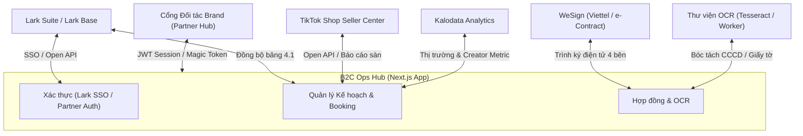

# ĐẶC TẢ TÍCH HỢP HỆ THỐNG & API (INTEGRATION SPEC) — B2C OPS HUB

| Thuộc tính | Giá trị |
| --- | --- |
| Mã tài liệu | HUB-2.5 |
| Dự án | B2C Ops Hub — Hệ thống điều hành & quản trị phòng Marketing B2C |
| Giai đoạn | 2 — Phân tích & Thiết kế kỹ thuật |
| Trạng thái | **Đã chuẩn hóa theo mã nguồn thực tế** |
| Phiên bản | 1.0 |
| Cập nhật | 14/10/2026 |

---

## 1. Danh sách các cổng tích hợp chính

Hệ thống B2C Ops Hub giao tiếp với các hệ thống bên ngoài và dịch vụ nội bộ qua các cổng API chuẩn hóa sau:

---

## 2. Chi tiết các điểm tích hợp (Endpoints & Data Contracts)

### 2.1 Tích hợp Lark Suite & Larkbase (Lark Open API)
- **Mục đích:** Xác thực người dùng nội bộ (Lark SSO) và đồng bộ kế hoạch tháng từ File 4.1 Plan order tổng.
- **Cấu hình môi trường:**
  - `LARK_APP_ID`: App ID được cấp từ Lark Developer Console.
  - `LARK_APP_SECRET`: App Secret để lấy `tenant_access_token`.
  - `LARK_BASE_APP_TOKEN`: Token của Base chứa dữ liệu kế hoạch.
  - `LARK_BOOKING_PLAN_TABLE_ID`: Table ID chứa dữ liệu kế hoạch tháng.
- **Endpoints triển khai:**
  - `GET /api/auth/lark/login`: Chuyển hướng người dùng sang trang xác thực Lark OAuth2.
  - `GET /api/auth/lark/callback`: Nhận mã ủy quyền (code), đổi lấy `user_access_token` và thiết lập cookie phiên `upbase_auth_session`.
  - `POST /api/integrations/larkbase/booking-plans`: Kéo dữ liệu kế hoạch phân rã từ Lark Base về bảng lưu trữ B2C Ops Hub.

### 2.2 Tích hợp TikTok Seller Center, Thu thập dữ liệu KOC & Nghiệm thu Link Video TikTok
- **Mục đích:**
  - Cập nhật doanh thu sàn, chỉ số GMV, số lượng đơn hàng thực tế của 69 gian hàng TikTok Shop do B2C phụ trách.
  - Thu thập dữ liệu kênh KOC trực tiếp từ TikTok (thông tin kênh cơ bản, tiểu sử Bio, tự động bóc tách SĐT/Zalo/Email trong Bio, Follower, Tổng lượt thích, Tổng số video, chỉ số tương tác các video gần nhất View/Tim/Bình luận/Chia sẻ/ER%, và danh sách video kèm caption/hashtag/nhạc nền/ngày đăng).
  - Kiểm tra và nghiệm thu link video TikTok do KOC gửi (hỗ trợ cả đơn lẻ và hàng loạt tới 100+ link): giải mã ngày giờ đăng chính xác từ TikTok `createTime` và Snowflake Video ID (64-bit), đối chiếu hạn đăng SLA, kiểm tra đúng kênh cam kết, bóc tách phụ đề lời thoại WebVTT (`claInfo.captionInfos`) & chữ cứng CapCut (`stickersOnItem`), kiểm tra khung hình sản phẩm 3 giây đầu / chữ bao bì bị ngược gương / sản phẩm đối thủ, đối soát giỏ hàng gắn đúng `Shop ID` và `Product ID` gian hàng chính hãng do UpBase vận hành, xác thực mã ủy quyền quảng cáo Spark Ads (thời hạn ≥ 60 ngày), đối soát hashtag + thông điệp USP bắt buộc, quét từ cấm sàn TikTok Shop / Y tế và kiểm tra trạng thái duy trì video 30 ngày sau đăng (phát hiện ẩn/xóa/tháo giỏ hàng trước khi thanh toán).
- **Endpoints triển khai:**
  - `POST /api/tiktok-seller/sync`: Thực hiện đồng bộ số liệu bán hàng, tỷ lệ chuyển đổi và doanh số đóng góp từ video KOC theo kỳ đối soát.
  - `GET /api/integrations/tiktok-koc/scrape`: Thu thập dữ liệu 1 kênh KOC TikTok theo `@handle` hoặc đường dẫn kênh/video (`?handle=...&period=30d&videoLimit=24`), tìm kiếm KOC theo Hashtag / Từ khóa (`?hashtag=kemchongnang&period=30d`), quét danh sách KOC đang làm việc cho Kênh/Thương hiệu Đối thủ (`?competitor=larocheposayvn&period=30d`), cào bình luận thực tế của video (`?videoUrl=...`) hoặc lấy danh sách Creator đang thịnh hành (`?trending=1`). Khi quét theo kênh, hệ thống dùng `discoverTikTokChannelVideoUrls` kết hợp đồng thời đa trang Bing Video Search (`first=0, 35`), Bing Web Search (`site:tiktok.com/@handle/video`, `first=1, 51`) và DuckDuckGo HTML Search để phát hiện tới 50–80+ URL video thực tế của kênh, lọc nghiêm ngặt theo đúng `@handle`, sắp xếp theo **ngày air mới nhất lên trước** (giải mã mốc thời gian Unix 32-bit cao của Snowflake `videoId` 64-bit), kiểm tra theo lô 10 video/lần (`inspectVideoCandidatesInBatches`, mặc định 24 video/kênh và tùy chỉnh tối đa 80 video/kênh) để loại bỏ video đã ẩn/xóa và bóc tách chính xác tên sản phẩm gắn giỏ hàng TikTok Shop (`extractTikTokShopAnchorInfo`).
  - `POST /api/integrations/tiktok-koc/scrape`: Hỗ trợ 5 chế độ thu thập hàng loạt miễn phí (0đ) bằng bộ giải mã TikTok SSR WAF cô lập theo từng URL (`solveTikTokWafHtml` + `inspectLiveTikTokVideoPage` giải PoW SHA-256 độc lập cho từng đường dẫn mà không dùng chung cookie WAF giữa trang hồ sơ `/@handle` và trang video `/@handle/video/id`), bộ bóc tách thẻ video Bing (`extractUrlsFromHtml` tách theo từng khối `mc_vtvc_con_rc` và loại bỏ chuỗi `relatedvideo?q=...` nhại lại câu truy vấn), bộ tách từ khóa ghép tiếng Việt (`buildTargetKeywordProfile` tách các hashtag/tên thương hiệu nhiều từ như `#nousvietnam`, `La Roche Posay` thành cụm từ khóa truy vấn chính xác) và bộ kiểm chứng khớp nội dung video thuộc thị trường Việt Nam sau khi đọc trang TikTok (`doesInspectedVideoMatchTarget` đối chiếu trực tiếp caption, mảng hashtag và tiêu đề giỏ hàng TikTok Shop, đồng thời xác thực ngữ cảnh tiếng Việt cho mọi thương hiệu để loại bỏ 100% video gợi ý ngoài lề hoặc video quốc tế như La Roche-Posay Brasil), kết hợp native fetch tới `/api/comment/list/` và `/node/share/discover`, tự động ưu tiên video mới air lên đầu danh sách (`compareVideoAirDateDesc`), kèm cơ chế **tự động chia nhỏ đợt quét (Batch Splitting)** khi người dùng yêu cầu số lượng lớn (`1–1000 KOC` hoặc `1–1000 bình luận`) qua các tham số `excludeHandles`, `pageOffset`, `skipProfileFetch`, `cursor` và `resolvedVideoId`: (1) Cào bình luận thực tế của Video & lọc bình luận hỏi mua hàng theo từng đợt (`{ videoUrl: "https://...", limit, cursor, resolvedVideoId }`); (2) Lấy 30 kênh Creator đang thịnh hành thực tế trên TikTok (`{ trendingCreators: true }`); (3) Quét KOC làm việc cho đối thủ chia theo từng đợt 12 KOC/lần (`{ competitor: "@larocheposayvn", limit, excludeHandles, pageOffset, skipProfileFetch }`); (4) Quét danh sách KOC theo `#hashtag` / từ khóa ngách chia theo từng đợt 12 KOC/lần (`{ hashtag: "kemchongnang", limit, excludeHandles, pageOffset }`); (5) Thu thập hàng loạt kênh theo `@handle` hoặc link video (tối đa 30 kênh/lần, mặc định 24 video hoạt động gần nhất/kênh và tùy chỉnh `videoLimit` lên tới 80 video/kênh kèm nút tải thêm video trực tiếp trên modal) và xuất CSV. Màn hình `TikTokCrawlerHubView` luôn khởi tạo mới khi truy cập từ menu trái (không lưu giữ kết quả từ lần quét trước) và chỉ hiển thị bảng kết quả sau khi người dùng nhấn nút quét.
  - `POST /api/integrations/tiktok-koc/inspect-video`: Kiểm tra và nghiệm thu 1 hoặc hàng loạt đường link video TikTok của KOC gửi (hỗ trợ cả link đầy đủ và link rút gọn `vt.tiktok.com` với cơ chế chạy song song chia luồng 5 link/lần), trả về kết quả đối soát 6 lớp (ngày đăng & SLA, khung hình & phụ đề lời thoại WebVTT, định danh Shop ID & SKU giỏ hàng chính hãng, mã Spark Ads, từ khóa USP & từ cấm sàn, và trạng thái lưu giữ 30 ngày sau đăng) kèm xuất báo cáo CSV.
  - `POST /api/integrations/link-air-check`: Kiểm tra trạng thái hiển thị công khai (LIVE / UNAVAILABLE / INVALID_LINK) và nghiệm thu điều kiện bài đăng (`handle`, `airFrom`, `airTo`, `requiredHashtags`, `requiredKeywords`, `requireProductLink`, `minViews`) cho tối đa 100 link trên 4 nền tảng (TikTok, Shopee Video, Facebook, Instagram); ưu tiên chuyển tiếp tới `crawler-worker` nếu đã cấu hình `CRAWLER_WORKER_URL`, và tự động chuyển sang bộ kiểm tra tích hợp sẵn (`checkSingleLinkServerless` trong `src/lib/linkAirCheckServer.ts`) khi chưa cấu hình worker riêng.

### 2.3 Tích hợp Kalodata (Creator & Video Intelligence)
- **Mục đích:** Tra cứu chỉ số doanh thu creator, đánh giá hiệu quả video gắn giỏ hàng và đề xuất KOC phù hợp với từng ngành hàng thương hiệu.
- **Endpoints triển khai:**
  - `GET /api/integrations/kalodata/status`: Kiểm tra trạng thái kết nối và hạn mức API Kalodata.
  - `POST /api/integrations/kalodata/discover`: Tìm kiếm KOC tiềm năng theo bộ lọc (ngành hàng, GMV trung bình/video, lượt theo dõi, tỷ lệ tương tác).
  - `GET /api/integrations/kalodata/creator`: Lấy báo cáo chi tiết về lịch sử bán hàng và livestream của một Creator cụ thể.

### 2.4 Tích hợp Hợp đồng điện tử WeSign (e-Contract)
- **Mục đích:** Tự động tạo phụ lục booking, thiết lập luồng trình ký điện tử 4 bên (UpBase - Brand - KOC - Quản lý) và theo dõi trạng thái hoàn tất ký kết.
- **Endpoints triển khai:**
  - `POST /api/contracts/integrations/wesign/sync`: Đồng bộ trạng thái ký từ hệ thống WeSign về trạng thái hợp đồng trong Ops Hub (Chờ ký → Đang ký → Đã ký hoàn tất / Bị từ chối).

### 2.5 Module Đọc ảnh giấy tờ & CCCD (OCR Service)
- **Mục đích:** Tải ảnh hai mặt Căn cước công dân hoặc giấy tờ pháp lý của KOC, bóc tách các trường: Họ tên, Số CCCD, Ngày sinh, Địa chỉ thường trú, Ngày cấp để tự động điền vào phụ lục hợp đồng.
- **Endpoints triển khai:**
  - `POST /api/ocr/extract-legal-doc`: Nhận dữ liệu ảnh (`multipart/form-data` hoặc `base64`), xử lý qua Tesseract OCR với tập dữ liệu tiếng Việt (`vie.traineddata`), chuẩn hóa cấu trúc JSON trả về client.

### 2.6 Cổng cộng tác đối tác (Partner Hub)
- **Mục đích:** Cho phép đại diện thương hiệu (Brand) đăng nhập qua token an toàn để xem kịch bản, duyệt video và theo dõi ngân sách.
- **Endpoints triển khai:**
  - `POST /api/auth/partner/login`: Xác thực thông tin đối tác thương hiệu qua mã truy cập hoặc đường dẫn định danh.
  - `GET /api/partner-hub`: Lấy dữ liệu tổng quan chiến dịch, kịch bản chờ duyệt và phản hồi từ thương hiệu.

### 2.7 Động cơ Nghiên cứu Thị trường, Thương hiệu & Đối thủ Tự động Đa nguồn (`Brand & Market Research API` — 8 Mô-đun kèm Sổ Dẫn chứng `[EV]`)
- **Mục đích:** Cung cấp dịch vụ phân tích chuyên sâu 8 mô-đun cho toàn bộ 42 thương hiệu B2C (69 gian hàng thuộc 13 phân ngành chuyên biệt) và **bất kỳ thương hiệu / đối thủ nào trên thị trường** do người dùng nhập vào, kết hợp đối soát dữ liệu thực tế nội bộ B2C (`File 4.1`, `File 4.1.1`, `File 3.2`, `File 3.5`) với bộ cào tự động thời gian thực đa nguồn (`src/lib/liveBrandWebScraper.ts`), gắn mã dẫn chứng xác thực (`[EV-01]`..`[EV-N]`) cho từng nhận định và số liệu.
- **Cơ chế Cào Tự động Đa nguồn Thời gian thực (`scrapeLiveBrandWebIntelligence`):**
  1. **Tự động dò tìm & cào Danh mục Sản phẩm JSON trên Website chính hãng tại Việt Nam:** Tự động dò các tên miền thương hiệu (`www.<slug>.vn`, `<slug>.vn`, `<slug>.com.vn`, `<slug>vietnam.com`, `<slug>.com`) và bóc tách trực tiếp JSON danh mục sản phẩm công khai trên nền tảng Haravan / Shopify (`/collections/all/products.json`, `/products.json`), Sapo và WordPress WooCommerce (`/wp-json/wc/store/products`), kết hợp đọc DOM trang chủ (`<title>`, `meta description`, `H1–H3`, giá bán VND) để lấy tên SKU, giá bán thực tế, giá gốc, thành phần/chất liệu và chương trình khuyến mãi.
  2. **Tự động cào Danh mục & Giá bán thực tế trên Sàn TMĐT (`Tiki Public Catalog API`):** Truy vấn trực tiếp `https://tiki.vn/api/v2/products` lọc nghiêm ngặt theo đúng tên thương hiệu (`brand_name` / tiêu đề khớp thương hiệu) để thu thập danh sách SKU đang mở bán, giá niêm yết thực tế, mức giảm giá, điểm đánh giá sao (`rating_average`), số lượt nhận xét (`review_count`) và sản lượng đã bán (`quantity_sold`).
  3. **Tự động quét Video KOC TikTok & Cào Bình luận Người mua (`discoverCompetitorKocs` + `scrapeTikTokVideoComments`):** Quét trực tiếp các video KOC đang review hoặc gắn giỏ hàng của thương hiệu/đối thủ trên TikTok, đồng thời tự động bóc tách bình luận thực tế dưới video dẫn đầu để gom cụm tiếng nói khách hàng (khen ngợi, băn khoăn, hỏi mua/giá) và chuyển hóa thành câu mở đầu kịch bản 3 giây đầu.
- **Endpoints triển khai:**
  - `GET /api/integrations/market-research/analyze?q=<brand_or_competitor>`: Chạy đồng thời bộ cào tự động đa nguồn (`scrapeLiveBrandWebIntelligence`), bộ đọc bề mặt Website (`scrapeWebsiteSurface`), bộ quét KOC TikTok (`discoverCompetitorKocs`) và bộ cào bình luận video TikTok (`scrapeTikTokVideoComments`) để trả về hồ sơ `BrandMarketResearchDossier` 8 mô-đun kèm danh sách KOC thực tế (`liveKocs`).
  - `POST /api/integrations/market-research/analyze`: Nhận `{ brandQuery, websiteUrl, categoryHint, targetAudienceHint, priceRangeHint, customCompetitorNames, liveMinedCommentTexts, maxVideos }`, thực thi đồng thời các luồng cào tự động thời gian thực (Website JSON catalog + Sàn TMĐT + TikTok KOC & Bình luận) kết hợp dữ liệu nội bộ B2C (nếu là gian hàng thuộc UpBase B2C) và trả về hồ sơ nghiên cứu toàn diện kèm sổ dẫn chứng `[EV]`.

