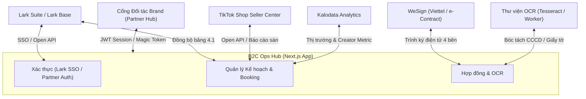

# ĐẶC TẢ TÍCH HỢP HỆ THỐNG & API (INTEGRATION SPEC) — B2C OPS HUB

| Thuộc tính | Giá trị |
| --- | --- |
| Mã tài liệu | HUB-2.5 |
| Dự án | B2C Ops Hub — Hệ thống điều hành & quản trị phòng Marketing B2C |
| Giai đoạn | 2 — Phân tích & Thiết kế kỹ thuật |
| Trạng thái | **Đã chuẩn hóa theo mã nguồn thực tế** |
| Phiên bản | 1.0 |
| Cập nhật | 14/10/2026 |

---

## 1. Danh sách các cổng tích hợp chính

Hệ thống B2C Ops Hub giao tiếp với các hệ thống bên ngoài và dịch vụ nội bộ qua các cổng API chuẩn hóa sau:

---

## 2. Chi tiết các điểm tích hợp (Endpoints & Data Contracts)

### 2.1 Tích hợp Lark Suite & Larkbase (Lark Open API)
- **Mục đích:** Xác thực người dùng nội bộ (Lark SSO) và đồng bộ kế hoạch tháng từ File 4.1 Plan order tổng.
- **Cấu hình môi trường:**
  - `LARK_APP_ID`: App ID được cấp từ Lark Developer Console.
  - `LARK_APP_SECRET`: App Secret để lấy `tenant_access_token`.
  - `LARK_BASE_APP_TOKEN`: Token của Base chứa dữ liệu kế hoạch.
  - `LARK_BOOKING_PLAN_TABLE_ID`: Table ID chứa dữ liệu kế hoạch tháng.
- **Endpoints triển khai:**
  - `GET /api/auth/lark/login`: Chuyển hướng người dùng sang trang xác thực Lark OAuth2.
  - `GET /api/auth/lark/callback`: Nhận mã ủy quyền (code), đổi lấy `user_access_token` và thiết lập cookie phiên `upbase_auth_session`.
  - `POST /api/integrations/larkbase/booking-plans`: Kéo dữ liệu kế hoạch phân rã từ Lark Base về bảng lưu trữ B2C Ops Hub.

### 2.2 Tích hợp TikTok Seller Center, Thu thập dữ liệu KOC & Nghiệm thu Link Video TikTok
- **Mục đích:**
  - Cập nhật doanh thu sàn, chỉ số GMV, số lượng đơn hàng thực tế của 69 gian hàng TikTok Shop do B2C phụ trách.
  - Thu thập dữ liệu kênh KOC trực tiếp từ TikTok (thông tin kênh cơ bản, tiểu sử Bio, tự động bóc tách SĐT/Zalo/Email trong Bio, Follower, Tổng lượt thích, Tổng số video, chỉ số tương tác các video gần nhất View/Tim/Bình luận/Chia sẻ/ER%, và danh sách video kèm caption/hashtag/nhạc nền/ngày đăng).
  - Kiểm tra và nghiệm thu link video TikTok do KOC gửi (hỗ trợ cả đơn lẻ và hàng loạt tới 100+ link): giải mã ngày giờ đăng chính xác từ TikTok `createTime` và Snowflake Video ID (64-bit), đối chiếu hạn đăng SLA, kiểm tra đúng kênh cam kết, bóc tách phụ đề lời thoại WebVTT (`claInfo.captionInfos`) & chữ cứng CapCut (`stickersOnItem`), kiểm tra khung hình sản phẩm 3 giây đầu / chữ bao bì bị ngược gương / sản phẩm đối thủ, đối soát giỏ hàng gắn đúng `Shop ID` và `Product ID` gian hàng chính hãng do UpBase vận hành, xác thực mã ủy quyền quảng cáo Spark Ads (thời hạn ≥ 60 ngày), đối soát hashtag + thông điệp USP bắt buộc, quét từ cấm sàn TikTok Shop / Y tế và kiểm tra trạng thái duy trì video 30 ngày sau đăng (phát hiện ẩn/xóa/tháo giỏ hàng trước khi thanh toán).
- **Endpoints triển khai:**
  - `POST /api/tiktok-seller/sync`: Thực hiện đồng bộ số liệu bán hàng, tỷ lệ chuyển đổi và doanh số đóng góp từ video KOC theo kỳ đối soát.
  - `GET /api/integrations/tiktok-koc/scrape`: Thu thập dữ liệu 1 kênh KOC TikTok theo `@handle` (`?handle=...&period=30d`), tìm kiếm KOC theo Hashtag / Từ khóa (`?hashtag=kemchongnang&period=30d`), quét danh sách KOC đang làm việc cho Kênh/Thương hiệu Đối thủ (`?competitor=larocheposayvn&period=30d`), cào bình luận thực tế của video (`?videoUrl=...`) hoặc lấy danh sách Creator đang thịnh hành (`?trending=1`).
  - `POST /api/integrations/tiktok-koc/scrape`: Hỗ trợ 5 chế độ thu thập hàng loạt miễn phí (0đ), tích hợp trực tiếp thư viện `@tobyg74/tiktok-api-dl` (`Downloader v1 Aweme API`, `GetVideoComments /api/comment/list/`, `TrendingCreators /node/share/discover`) và hỗ trợ kết nối microservice `Evil0ctal/Douyin_TikTok_Download_API` (`docker-compose.tiktok-crawler.yml`): (1) Cào bình luận thực tế của Video & lọc bình luận hỏi mua hàng (`{ videoUrl: "https://..." }`); (2) Lấy 30 kênh Creator đang thịnh hành thực tế trên TikTok (`{ trendingCreators: true }`); (3) Quét KOC làm việc cho đối thủ (`{ competitor: "@larocheposayvn" }`); (4) Quét danh sách KOC theo `#hashtag` / từ khóa ngách (`{ hashtag: "kemchongnang" }`); (5) Thu thập hàng loạt kênh theo `@handle` (tối đa 30 kênh/lần) kèm xuất CSV.
  - `POST /api/integrations/tiktok-koc/inspect-video`: Kiểm tra và nghiệm thu 1 hoặc hàng loạt đường link video TikTok của KOC gửi (hỗ trợ cả link đầy đủ và link rút gọn `vt.tiktok.com` với cơ chế chạy song song chia luồng 5 link/lần), trả về kết quả đối soát 6 lớp (ngày đăng & SLA, khung hình & phụ đề lời thoại WebVTT, định danh Shop ID & SKU giỏ hàng chính hãng, mã Spark Ads, từ khóa USP & từ cấm sàn, và trạng thái lưu giữ 30 ngày sau đăng) kèm xuất báo cáo CSV.

### 2.3 Tích hợp Kalodata (Creator & Video Intelligence)
- **Mục đích:** Tra cứu chỉ số doanh thu creator, đánh giá hiệu quả video gắn giỏ hàng và đề xuất KOC phù hợp với từng ngành hàng thương hiệu.
- **Endpoints triển khai:**
  - `GET /api/integrations/kalodata/status`: Kiểm tra trạng thái kết nối và hạn mức API Kalodata.
  - `POST /api/integrations/kalodata/discover`: Tìm kiếm KOC tiềm năng theo bộ lọc (ngành hàng, GMV trung bình/video, lượt theo dõi, tỷ lệ tương tác).
  - `GET /api/integrations/kalodata/creator`: Lấy báo cáo chi tiết về lịch sử bán hàng và livestream của một Creator cụ thể.

### 2.4 Tích hợp Hợp đồng điện tử WeSign (e-Contract)
- **Mục đích:** Tự động tạo phụ lục booking, thiết lập luồng trình ký điện tử 4 bên (UpBase - Brand - KOC - Quản lý) và theo dõi trạng thái hoàn tất ký kết.
- **Endpoints triển khai:**
  - `POST /api/contracts/integrations/wesign/sync`: Đồng bộ trạng thái ký từ hệ thống WeSign về trạng thái hợp đồng trong Ops Hub (Chờ ký → Đang ký → Đã ký hoàn tất / Bị từ chối).

### 2.5 Module Đọc ảnh giấy tờ & CCCD (OCR Service)
- **Mục đích:** Tải ảnh hai mặt Căn cước công dân hoặc giấy tờ pháp lý của KOC, bóc tách các trường: Họ tên, Số CCCD, Ngày sinh, Địa chỉ thường trú, Ngày cấp để tự động điền vào phụ lục hợp đồng.
- **Endpoints triển khai:**
  - `POST /api/ocr/extract-legal-doc`: Nhận dữ liệu ảnh (`multipart/form-data` hoặc `base64`), xử lý qua Tesseract OCR với tập dữ liệu tiếng Việt (`vie.traineddata`), chuẩn hóa cấu trúc JSON trả về client.

### 2.6 Cổng cộng tác đối tác (Partner Hub)
- **Mục đích:** Cho phép đại diện thương hiệu (Brand) đăng nhập qua token an toàn để xem kịch bản, duyệt video và theo dõi ngân sách.
- **Endpoints triển khai:**
  - `POST /api/auth/partner/login`: Xác thực thông tin đối tác thương hiệu qua mã truy cập hoặc đường dẫn định danh.
  - `GET /api/partner-hub`: Lấy dữ liệu tổng quan chiến dịch, kịch bản chờ duyệt và phản hồi từ thương hiệu.
