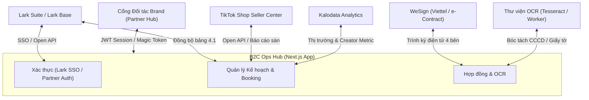

# ĐẶC TẢ TÍCH HỢP HỆ THỐNG & API (INTEGRATION SPEC) — B2C OPS HUB

| Thuộc tính | Giá trị |
| --- | --- |
| Mã tài liệu | HUB-2.5 |
| Dự án | B2C Ops Hub — Hệ thống điều hành & quản trị phòng Marketing B2C |
| Giai đoạn | 2 — Phân tích & Thiết kế kỹ thuật |
| Trạng thái | **Đã chuẩn hóa theo mã nguồn thực tế** |
| Phiên bản | 1.0 |
| Cập nhật | 14/10/2026 |

---

## 1. Danh sách các cổng tích hợp chính

Hệ thống B2C Ops Hub giao tiếp với các hệ thống bên ngoài và dịch vụ nội bộ qua các cổng API chuẩn hóa sau:

---

## 2. Chi tiết các điểm tích hợp (Endpoints & Data Contracts)

### 2.1 Tích hợp Lark Suite & Larkbase (Lark Open API)
- **Mục đích:** Xác thực người dùng nội bộ (Lark SSO) và đồng bộ kế hoạch tháng từ File 4.1 Plan order tổng.
- **Cấu hình môi trường:**
  - `LARK_APP_ID`: App ID được cấp từ Lark Developer Console.
  - `LARK_APP_SECRET`: App Secret để lấy `tenant_access_token`.
  - `LARK_BASE_APP_TOKEN`: Token của Base chứa dữ liệu kế hoạch.
  - `LARK_BOOKING_PLAN_TABLE_ID`: Table ID chứa dữ liệu kế hoạch tháng.
- **Endpoints triển khai:**
  - `GET /api/auth/lark/login`: Chuyển hướng người dùng sang trang xác thực Lark OAuth2.
  - `GET /api/auth/lark/callback`: Nhận mã ủy quyền (code), đổi lấy `user_access_token` và thiết lập cookie phiên `upbase_auth_session`.
  - `POST /api/integrations/larkbase/booking-plans`: Kéo dữ liệu kế hoạch phân rã từ Lark Base về bảng lưu trữ B2C Ops Hub.

### 2.2 Tích hợp TikTok Seller Center (TikTok Open API)
- **Mục đích:** Cập nhật doanh thu sàn, chỉ số GMV, số lượng đơn hàng thực tế của 69 gian hàng TikTok Shop do B2C phụ trách.
- **Endpoints triển khai:**
  - `POST /api/tiktok-seller/sync`: Thực hiện đồng bộ số liệu bán hàng, tỷ lệ chuyển đổi và doanh số đóng góp từ video KOC theo kỳ đối soát.

### 2.3 Tích hợp Kalodata (Creator & Video Intelligence)
- **Mục đích:** Tra cứu chỉ số doanh thu creator, đánh giá hiệu quả video gắn giỏ hàng và đề xuất KOC phù hợp với từng ngành hàng thương hiệu.
- **Endpoints triển khai:**
  - `GET /api/integrations/kalodata/status`: Kiểm tra trạng thái kết nối và hạn mức API Kalodata.
  - `POST /api/integrations/kalodata/discover`: Tìm kiếm KOC tiềm năng theo bộ lọc (ngành hàng, GMV trung bình/video, lượt theo dõi, tỷ lệ tương tác).
  - `GET /api/integrations/kalodata/creator`: Lấy báo cáo chi tiết về lịch sử bán hàng và livestream của một Creator cụ thể.

### 2.4 Tích hợp Hợp đồng điện tử WeSign (e-Contract)
- **Mục đích:** Tự động tạo phụ lục booking, thiết lập luồng trình ký điện tử 4 bên (UpBase - Brand - KOC - Quản lý) và theo dõi trạng thái hoàn tất ký kết.
- **Endpoints triển khai:**
  - `POST /api/contracts/integrations/wesign/sync`: Đồng bộ trạng thái ký từ hệ thống WeSign về trạng thái hợp đồng trong Ops Hub (Chờ ký → Đang ký → Đã ký hoàn tất / Bị từ chối).

### 2.5 Module Đọc ảnh giấy tờ & CCCD (OCR Service)
- **Mục đích:** Tải ảnh hai mặt Căn cước công dân hoặc giấy tờ pháp lý của KOC, bóc tách các trường: Họ tên, Số CCCD, Ngày sinh, Địa chỉ thường trú, Ngày cấp để tự động điền vào phụ lục hợp đồng.
- **Endpoints triển khai:**
  - `POST /api/ocr/extract-legal-doc`: Nhận dữ liệu ảnh (`multipart/form-data` hoặc `base64`), xử lý qua Tesseract OCR với tập dữ liệu tiếng Việt (`vie.traineddata`), chuẩn hóa cấu trúc JSON trả về client.

### 2.6 Cổng cộng tác đối tác (Partner Hub)
- **Mục đích:** Cho phép đại diện thương hiệu (Brand) đăng nhập qua token an toàn để xem kịch bản, duyệt video và theo dõi ngân sách.
- **Endpoints triển khai:**
  - `POST /api/auth/partner/login`: Xác thực thông tin đối tác thương hiệu qua mã truy cập hoặc đường dẫn định danh.
  - `GET /api/partner-hub`: Lấy dữ liệu tổng quan chiến dịch, kịch bản chờ duyệt và phản hồi từ thương hiệu.
