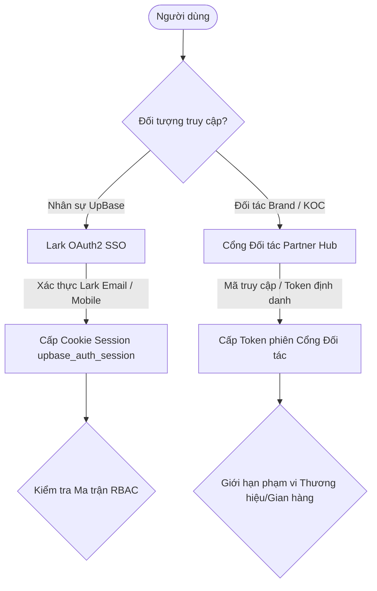

# ĐẶC TẢ XÁC THỰC & PHÂN QUYỀN TRUY CẬP (AUTH & RBAC SPEC) — B2C OPS HUB

| Thuộc tính | Giá trị |
| --- | --- |
| Mã tài liệu | HUB-2.6 |
| Dự án | B2C Ops Hub — Hệ thống điều hành & quản trị phòng Marketing B2C |
| Giai đoạn | 2 — Phân tích & Thiết kế kỹ thuật |
| Trạng thái | **Đã chuẩn hóa theo mã nguồn thực tế** |
| Phiên bản | 1.2 |
| Cập nhật | 20/10/2026 |

---

## 1. Cơ chế xác thực (Authentication Architecture)

Hệ thống hỗ trợ 2 kênh đăng nhập chuyên biệt tách biệt giữa nhân sự nội bộ và đối tác bên ngoài:

### 1.1 Xác thực nội bộ qua Lark Suite (Lark SSO)
- Nhân viên công ty đăng nhập tập trung qua hệ thống Lark OAuth2.
- Sau khi xác thực thành công, hệ thống đối chiếu `open_id`, địa chỉ Email Lark hoặc họ tên nhân sự nội bộ với cơ sở dữ liệu nhân sự (`USERS` và `UPBASE_STAFF_MASTER`) để định danh mã nhân viên, phòng ban (`MARKETING_B2C`, `GROWTH`, `MEDIA`, `Operation`) và vai trò hệ thống (tuyệt đối không cho phép khớp theo tên vào tài khoản Tổng Giám Đốc `user-admin-giang`).
- Cookie phiên `b2c_ops_session` được ký HMAC-SHA256 và lưu trữ an toàn (`HttpOnly`, `SameSite=Lax`). Khi trình duyệt đã có cookie phiên xác thực thực tế từ Lark SSO (`larkOpenId` hợp lệ), client tuyệt đối không dùng giá trị `upbase_selected_user_id` cũ trong `localStorage` để ghi đè ngược lại phiên.

### 1.2 Xác thực Đối tác bên ngoài (Partner Hub Auth)
- Đại diện thương hiệu và KOC đăng nhập qua mã liên kết an toàn hoặc tài khoản định danh được cấp riêng.
- Cơ chế bảo mật giới hạn tuyệt đối: Mỗi đối tác chỉ được xem dữ liệu thuộc phạm vi Thương hiệu hoặc Gian hàng được ủy quyền, không thể truy cập bất kỳ dữ liệu nội bộ hay nhãn hàng khác.

---

## 2. Ma trận vai trò người dùng (Role-Based Access Control - RBAC)

Cơ cấu quản trị và phân quyền của hệ thống phản ánh đúng tổ chức thực tế của phòng Marketing B2C và các phòng ban liên quan. Thanh điều hướng trái (`Sidebar.tsx`) sử dụng một cấu trúc danh mục chuẩn `INTERNAL_NAV_SECTIONS` duy nhất tự động lọc theo `getAllowedTabsForRole(role)` kết hợp gộp nhóm `NAV_GROUPS` (`src/lib/navGroups.ts`). Danh mục màn hình phân quyền (`ALL_SYSTEM_SCREENS` trong `src/lib/rbacData.ts`) tự động phát hiện bất kỳ `TabKey` mới nào được khai báo trong `TAB_LABELS` (`src/lib/navGroups.ts`), và bộ cơ chế `reconcileAccessPolicy` (`src/lib/server/accessPolicy.ts`) tự động hợp nhất các màn hình mới, quyền mới trong `INITIAL_PERMISSION_MATRIX`, nhân sự mới và quy tắc phòng ban mới vào cấu hình đã lưu trên đĩa mà không làm mất các thiết lập tùy chỉnh của Quản trị viên. Quyền cấu hình tích hợp hệ thống (`api-settings`) chỉ cấp cho cấp Quản lý (`ADMIN`, `MANAGER`, `GROWTH_MANAGER`, `MEDIA_MANAGER`), không hiển thị cho Trưởng nhóm (`LEADER`) và Chuyên viên (`MEMBER`).

| Nhóm vai trò | Mã vai trò | Đối tượng tiêu biểu | Phạm vi quyền hạn | Màn hình mặc định |
| :--- | :--- | :--- | :--- | :--- |
| **Tổng Giám Đốc (CEO) & Quản Trị Vận Hành** | `ADMIN` | Đỗ Văn Giang (CEO), Trần Hữu Chiến (`HN979` / `user-huu-chien` — Business Operation Leader) | Toàn quyền xem, vận hành và phê duyệt toàn hệ thống, bảo trợ nguồn lực chiến lược. | `cockpit` |
| **Giám Đốc Marketing B2C** | `MANAGER` / `MKT_B2C_HEAD` | Đặng Thị Yến Nhi | Quản lý hạn mức PnL toàn bộ 69 gian hàng B2C & 42 Brand, **phân bổ nhân sự cho 3 vị trí gắn theo Brand (`Content / Brand main`, `Plan / Strategy`, `Key Visual / SIS`)**, cấu hình định mức độ khó Task (Bảng 2b Research & các nhóm việc) tại `task-delegation`, phê duyệt kế hoạch tháng (cấp Brand & cấp Gian hàng), khởi tạo/duyệt hợp đồng (`contracts`), duyệt chi tài chính và đánh giá nhân sự. | `cockpit` |
| **Trưởng Nhóm (Leader)** | `LEADER` / `PIC_LEAD` | Nguyễn Thị Ngọc Tâm (phụ trách cụm 8 gian) | Phụ trách cụm gian hàng có phân nhóm, giao việc cho thành viên nhóm tại `task-delegation`, sơ duyệt danh sách KOC bước 1, duyệt kịch bản sơ bộ và theo dõi tiến độ nhóm. | `booking` |
| **Chuyên Viên (Specialist)** | `BOOKING_MEMBER` / `MEMBER` / `SPECIALIST` | Lê Phương Thảo, Lương Thị Như Quỳnh, Lê Thanh Hải (`HN241` / `user-thanh-hai`), Hoàng Hải Long (`HN220` / `user-hai-long`)... | Tác nghiệp trực tiếp trên gian hàng được giao (Booking KOC, Livestream, Content & Self-channel), nhận task Research/Vận hành theo tỷ trọng vai trò (`PIC/Owner`, `Co-PIC`, `Execution`, `Support`) tại `task-delegation` & `cockpit`, **và/hoặc đảm nhiệm 3 vị trí gắn theo Brand (`Content / Brand main`, `Plan / Strategy`, `Key Visual / SIS`) để nhập kế hoạch tháng theo Brand**. | `cockpit` |
| **Pháp Chế (Legal)** | `LEGAL` / `LEGAL_REVIEW` | Bộ phận Pháp chế | Kiểm soát pháp lý hợp đồng, phụ lục booking, biên bản thanh lý và quản lý biểu mẫu hợp đồng mẫu (.docx). | `contracts` |
| **Kế Toán (Finance)** | `FINANCE` / `FINANCE_ACC` | Bộ phận Kế toán | Duyệt điều khoản thanh toán, kiểm soát chứng từ thuế TNCN 10% / hóa đơn VAT và đối soát hạn mức chi Net. | `contracts` |
| **Điều Phối Ký Số** | `SIGN_ADMIN` / `SIGN_COORD` | Điều phối viên | Trình ký điện tử các hợp đồng đã được Pháp chế và Kế toán thẩm định lên hệ thống weSign. | `contracts` |
| **Đối Tác Thương Hiệu** | `BRAND_PARTNER` | Đại diện Brand | Xem báo cáo tiến độ, phê duyệt danh sách KOC đề xuất, duyệt kịch bản video và theo dõi doanh thu sàn. | `brand-hub` |

---

## 3. Quy tắc phân quyền đặc thù cho Phòng Marketing B2C

1. **Quy tắc phân cấp kế hoạch & phân bổ vị trí gắn theo Brand:**
   - **Cấp Brand (3 vị trí `[theo brand]`: `Content / Brand main`, `Plan / Strategy`, `Key Visual / SIS`):** Giám Đốc Marketing (`Đặng Thị Yến Nhi`) trực tiếp phân bổ nhân sự phụ trách từng vị trí trên 42 Thương hiệu B2C tại phân hệ **Phân bổ Nhân sự theo Brand**. Chuyên viên được gán vào vị trí nào của Brand sẽ nhập Kế hoạch tháng (Monthly Plan) của vị trí đó và trình duyệt trực tiếp lên Giám Đốc Marketing.
   - **Cấp Gian hàng có Leader:** Chuyên viên → Leader sơ duyệt → Giám Đốc Marketing duyệt cuối.
   - **Cấp Gian hàng không có Leader:** Chuyên viên trình duyệt thẳng lên Giám Đốc Marketing mà không cần bước trung gian.
2. **Quy tắc bảo mật tài chính:**
   - Chỉ có Giám Đốc Marketing, Kế toán (Finance) và Ban Giám Đốc mới được xem cột Chi phí Gross và biểu mẫu đối soát thuế TNCN/VAT đầy đủ.
   - Chuyên viên và Leader theo dõi theo hạn mức chi phí Net.
   - Đại diện thương hiệu (Brand) chỉ nhìn thấy báo cáo giải ngân theo ngân sách đã thỏa thuận.
3. **Quy tắc bảo vệ dữ liệu cá nhân KOC:**
   - Ảnh chụp CCCD và số tài khoản ngân hàng của KOC chỉ hiển thị cho Chuyên viên phụ trách deal, Pháp chế và Kế toán để lập hồ sơ ký kết và chuyển khoản.

---

## 4. Cơ chế Phân quyền Dữ liệu Phạm vi (Data Scoping Engine)

Nhằm đảm bảo tính bảo mật nội bộ và quyền riêng tư kinh doanh giữa các nhãn hàng/gian hàng, hệ thống áp dụng cơ chế phân quyền dữ liệu phạm vi (Data Scoping Engine) theo các nguyên tắc:

### 4.1 Phân biệt Quyền Toàn cục (Global) vs Quyền Giới hạn (Scoped)
- **Quyền toàn cục (Global Access):** Chỉ các tài khoản Ban Giám Đốc (`ADMIN` — Đỗ Văn Giang), Giám Đốc Marketing B2C (`MANAGER` — Đặng Thị Yến Nhi), hoặc tài khoản được cấp quyền tường minh `canViewAllBrands` / gán nhãn `ALL_BRANDS` mới có quyền xem và thao tác trên toàn bộ 42 thương hiệu và 69 gian hàng B2C.
- **Quyền theo phạm vi (Scoped Access):** Áp dụng cho toàn bộ Chuyên viên / Nhân viên (Specialist / PIC) và Trưởng nhóm (Leader) thuộc khối Growth, B2C, Media. Các nhân sự này **chỉ được xem và thao tác trên các thương hiệu, gian hàng, kế hoạch tháng (Input Plan) và deal booking thuộc quyền quản lý của mình**.

### 4.2 Tiêu chí Xác định Quyền Quản lý Thực thể
> **Lưu ý kiến trúc:** Màn hình Phân quyền tập trung (`CentralizedRbacHubView` — tab *Nhân sự nội bộ*) chỉ thiết lập **Vai trò hệ thống (`role`)** và **Quyền phê duyệt đặc thù (`permissions`)** cho nhân sự nội bộ, **không cấu hình gán nhãn hàng (Brand) tại màn hình Phân quyền**. Phạm vi Thương hiệu / Gian hàng của nhân sự nội bộ được xác định trực tiếp từ phân công vận hành tại Hồ sơ Thương hiệu, Danh mục Gian hàng và Phân bổ Nhân sự.

1. **Thương hiệu (Brand):**
   - Nằm trong danh sách nhãn hàng được phân công (`assignedBrands`) của nhân viên.
   - Nhân sự đảm nhiệm một trong các chức danh quản lý/vận hành gắn trên Brand (`brandPicName`, `accountPic`, `growthPic`, `bookingPicLead`, hoặc 3 vị trí `[theo brand]`: `Content / Brand main`, `Plan / Strategy`, `Key Visual / SIS`).
   - Nhân sự phụ trách ít nhất một gian hàng con thuộc thương hiệu đó.
2. **Gian hàng (Store):**
   - Nhân sự được ghi nhận là một trong các PIC của gian hàng: `b2cOwnerName`, `primaryPic`, `growthPic`, `accountOwnerName`, `bookingLeader`, `contentPic`, `mediaPic`, `backupOwnerName`, hoặc trong danh sách `b2cOwners`.
   - Gian hàng thuộc Thương hiệu mà nhân sự được phân công phụ trách.
   - Nằm trong danh sách `allowedStoreNames` được chỉ định riêng.
3. **Kế hoạch tháng (Input Plan):**
   - Nhân sự là người lập (`pic`), chuyên viên Growth thẩm định (`growthPic`), chuyên viên Media phụ trách (`mediaPic`), hoặc người nộp duyệt (`submittedBy`).
   - Kế hoạch gắn với Gian hàng hoặc Thương hiệu mà nhân sự phụ trách.
4. **Deal Booking KOC:**
   - Nhân sự là PIC trực tiếp của deal (`assignedStaff`, `bookingPic`, `growthPic`, `accountPic`, `leadBooking`).
   - Deal thuộc Gian hàng hoặc Thương hiệu mà nhân sự phụ trách.

### 4.3 Trực quan hóa Phạm vi Phân quyền trên Giao diện
- **Huy hiệu Phạm vi Phân quyền (TopHeader):**
  - Tài khoản Toàn quyền: Hiển thị huy hiệu `Toàn quyền (42 thương hiệu / 69 gian hàng B2C)` kèm màu nhấn quản trị.
  - Tài khoản Scoped: Hiển thị `Phụ trách: [Brand A, Brand B...] ([N] gian hàng)` giúp nhân sự nhận biết rõ ràng phạm vi dữ liệu mình đang xem.
- **Thanh Thông báo Phân quyền (Scope Banner):**
  - Xuất hiện trên các màn hình Quản lý Gian hàng (`stores`), Hồ sơ Thương hiệu (`brand-knowledge`), Kế hoạch Tháng (`input-plan`) thông báo số lượng gian hàng và kế hoạch thực tế thuộc quyền quản lý.
- **Bộ lọc động:** Danh mục nhãn hàng tại màn hình Booking (`booking`) tự động lấy theo các thương hiệu và gian hàng mà nhân sự đang quản lý deal, loại bỏ hoàn toàn các lựa chọn ngoài phạm vi.

---

## 5. Ma trận Kiểm soát Phân quyền Tính năng & Thao tác CRUD (Feature CRUD Permission Matrix)

Hệ thống quản lý 26 tính năng nghiệp vụ trọng yếu thuộc 5 phân nhóm chức năng. Mỗi tính năng được gán một trong 5 cấp độ truy cập (`ALL`, `APPROVE`, `SCOPED`, `VIEW`, `DENIED`) cho từng vai trò trong hệ thống:

### 5.1 Định nghĩa các cấp độ truy cập (Access Levels)
| Cấp độ | Ý nghĩa | Quyền CRUD tương ứng |
| :--- | :--- | :--- |
| `ALL` | Toàn quyền quản trị | `read`, `write`, `create`, `update`, `delete`, `approve`, `export` |
| `APPROVE` | Phê duyệt & Xem xét | `read`, `write`, `update`, `approve` (chặn `delete` trừ khi được cấp quyền đặc thù) |
| `SCOPED` | Tác nghiệp theo phạm vi | `read`, `write`, `create`, `update` (chỉ trên các bản ghi thuộc phạm vi phụ trách; chặn `delete` và `approve`) |
| `VIEW` | Chỉ xem (Read-only) | `read` (chặn toàn bộ hành vi chỉnh sửa, tạo mới, xóa, duyệt) |
| `DENIED` | Cấm truy cập hoàn toàn | Từ chối toàn bộ thao tác, ẩn giao diện hoặc trả mã HTTP 403 |

### 5.2 Bảng đối chiếu 26 tính năng và cấp độ vai trò mặc định
1. **Kế Hoạch & Ngân Sách (`PLANNING_BUDGET`):**
   - `plan_target_month`: Quản lý chỉ tiêu kế hoạch tháng (ADMIN: ALL, MANAGER: ALL, GROWTH/MEDIA_MGR: ALL, LEADER: SCOPED, MEMBER: SCOPED, BACKOFFICE: DENIED, BRAND_PARTNER: VIEW).
   - `brand_budget_pnl`: Hạn mức ngân sách PnL Brand & Store (ADMIN: ALL, MANAGER: ALL, GROWTH/MEDIA_MGR: SCOPED, LEADER: SCOPED, MEMBER: VIEW, FINANCE: VIEW, LEGAL/SIGN: DENIED, PARTNER: DENIED).
   - `store_portfolio_catalog`: Danh mục gian hàng & hệ số độ khó (ADMIN: ALL, MANAGER: ALL, GROWTH/MEDIA_MGR: SCOPED, LEADER: SCOPED, MEMBER: VIEW, BACKOFFICE: VIEW, PARTNER: VIEW).
   - `task_delegation_difficulty`: Giao việc & cấu hình độ khó Task (ADMIN: ALL, MANAGER: ALL, GROWTH/MEDIA_MGR: ALL, LEADER: SCOPED, MEMBER: SCOPED, BACKOFFICE: DENIED, PARTNER: DENIED).
   - `workload_3d_matrix`: Bản đồ 3D tải trọng & nhân sự (ADMIN: ALL, MANAGER: ALL, GROWTH/MEDIA_MGR: ALL, LEADER: SCOPED, MEMBER: VIEW, BACKOFFICE: DENIED, PARTNER: DENIED).
   - `campaign_brand_mgmt`: Chiến dịch thương hiệu & đề bài (ADMIN: ALL, MANAGER: ALL, GROWTH/MEDIA_MGR: ALL, LEADER: SCOPED, MEMBER: SCOPED, BACKOFFICE: VIEW, BRAND_PARTNER: VIEW).
   - `hero_sku_push_products`: Sản phẩm đẩy Hero SKU & mẫu (ADMIN: ALL, MANAGER: ALL, GROWTH/MEDIA_MGR: ALL, LEADER: SCOPED, MEMBER: SCOPED, BACKOFFICE: VIEW, BRAND_PARTNER: VIEW).

2. **Vận Hành Booking & KOC (`BOOKING_OPERATIONS`):**
   - `booking_deal_management`: Quản lý deal booking & đàm phán (ADMIN: ALL, MANAGER: ALL, GROWTH/MEDIA_MGR: ALL, LEADER: SCOPED, MEMBER: SCOPED, BACKOFFICE: VIEW, PARTNER: DENIED).
   - `koc_crawler_discovery`: Crawler & tìm kiếm KOC đa nền tảng (ADMIN: ALL, MANAGER: ALL, GROWTH/MEDIA_MGR: ALL, LEADER: SCOPED, MEMBER: SCOPED, BACKOFFICE: DENIED, PARTNER: DENIED).
   - `koc_listing_batch_proposals`: Lập đề xuất danh sách KOC theo lô (ADMIN: ALL, MANAGER: ALL, GROWTH/MEDIA_MGR: ALL, LEADER: SCOPED, MEMBER: SCOPED, BACKOFFICE: VIEW, BRAND_PARTNER: APPROVE).
   - `video_script_production`: Kịch bản video & kiểm duyệt nội dung (ADMIN: ALL, MANAGER: ALL, GROWTH/MEDIA_MGR: ALL, LEADER: SCOPED, MEMBER: SCOPED, BACKOFFICE: VIEW, BRAND_PARTNER: APPROVE, KOC: VIEW).
   - `content_angle_pillars`: Ma trận trụ cột nội dung & Hook 3s (ADMIN: ALL, MANAGER: ALL, GROWTH/MEDIA_MGR: ALL, LEADER: SCOPED, MEMBER: SCOPED, BACKOFFICE: DENIED, BRAND_PARTNER: VIEW).
   - `koc_master_directory`: Danh bạ hồ sơ KOC & pháp lý CCCD (ADMIN: ALL, MANAGER: ALL, GROWTH/MEDIA_MGR: ALL, LEADER: SCOPED, MEMBER: SCOPED, LEGAL/FINANCE: ALL, SIGN_ADMIN: VIEW, KOC: VIEW).
   - `ctv_vj_directory`: Danh bạ CTV / VJ sản xuất video (ADMIN: ALL, MANAGER: ALL, GROWTH/MEDIA_MGR: ALL, LEADER: SCOPED, MEMBER: SCOPED, LEGAL/FINANCE: ALL, SIGN_ADMIN: VIEW, CTV: VIEW).
   - `self_channel_video_hub`: Nghiệm thu video kênh Brand tự xây (ADMIN: ALL, MANAGER: ALL, GROWTH/MEDIA_MGR: ALL, LEADER: SCOPED, MEMBER: SCOPED, LEGAL/FINANCE: VIEW, CTV: VIEW).

3. **Hợp Đồng, Pháp Lý & Thanh Toán (`CONTRACTS_FINANCE`):**
   - `contract_drafting_templates`: Soạn thảo hợp đồng & quản lý biểu mẫu (ADMIN: ALL, MANAGER: ALL, GROWTH/MEDIA_MGR: ALL, LEADER: SCOPED, MEMBER: SCOPED, LEGAL: ALL, FINANCE: ALL, SIGN_ADMIN: ALL, PARTNER: VIEW).
   - `sample_orders_tracking`: Theo dõi gửi mẫu sản phẩm (ADMIN: ALL, MANAGER: ALL, GROWTH/MEDIA_MGR: ALL, LEADER: SCOPED, MEMBER: SCOPED, BACKOFFICE: VIEW, BRAND: VIEW, KOC: VIEW).
   - `spark_ads_code_collection`: Thu thập & nghiệm thu mã Spark Ads (ADMIN: ALL, MANAGER: ALL, GROWTH/MEDIA_MGR: ALL, LEADER: SCOPED, MEMBER: SCOPED, BACKOFFICE: VIEW, BRAND: VIEW, KOC: VIEW).
   - `payment_request_submission`: Lập đề nghị thanh toán KOC / CTV (ADMIN: ALL, MANAGER: ALL, GROWTH/MEDIA_MGR: ALL, LEADER: SCOPED, MEMBER: SCOPED, LEGAL: VIEW, FINANCE: ALL, SIGN_ADMIN: VIEW, PARTNER: DENIED).
   - `payment_approval_disbursement`: Phê duyệt chứng từ chi tiền (ADMIN: APPROVE, MANAGER: APPROVE, GROWTH/MEDIA_MGR: DENIED, LEADER: DENIED, MEMBER: DENIED, LEGAL: VIEW, FINANCE: APPROVE, SIGN_ADMIN: DENIED, KOC/CTV: VIEW).
   - `agency_financial_margins`: Đối soát biên lợi nhuận & chi phí Agency (ADMIN: ALL, MANAGER: ALL, GROWTH/MEDIA_MGR: DENIED, LEADER: DENIED, MEMBER: DENIED, LEGAL: VIEW, FINANCE: ALL, SIGN_ADMIN: DENIED, PARTNER: DENIED).

4. **Hiệu Suất, Thưởng 4P & Báo Cáo Ads (`PERFORMANCE_ADS`):**
   - `ads_performance_bi`: Báo cáo chỉ số Ads TikTok (ADMIN: ALL, MANAGER: ALL, GROWTH/MEDIA_MGR: ALL, LEADER: SCOPED, MEMBER: VIEW, LEGAL/SIGN: DENIED, FINANCE: VIEW, BRAND: VIEW).
   - `p3_performance_evaluation`: Đánh giá 4P & Quỹ thưởng hiệu suất (ADMIN: ALL, MANAGER: APPROVE, GROWTH/MEDIA_MGR: APPROVE, LEADER: SCOPED, MEMBER: VIEW, BACKOFFICE: DENIED, PARTNER: DENIED).
   - `executive_bi_cockpit`: Dashboard BI điều hành toàn khối (ADMIN: ALL, MANAGER: ALL, GROWTH/MEDIA_MGR: ALL, LEADER: SCOPED, MEMBER: DENIED, BACKOFFICE: VIEW, PARTNER: DENIED).
   - `raw_data_export`: Xuất dữ liệu thô hệ thống (.xlsx) (ADMIN: ALL, MANAGER: ALL, GROWTH/MEDIA_MGR: ALL, LEADER: DENIED, MEMBER: DENIED, LEGAL: VIEW, FINANCE: ALL, SIGN_ADMIN: VIEW, PARTNER: DENIED).

5. **Quản Trị Hệ Thống & Cổng Đối Tác (`SYSTEM_ADMIN`):**
   - `system_rbac_access_control`: Phân quyền người dùng & Cấu hình bảo mật (ADMIN: ALL, TẤT CẢ VAI TRÒ KHÁC: DENIED).

---

## 6. Quyền Phê Duyệt & Thao Tác Đặc Thù (Special Staff Permissions)

Ngoài vai trò mặc định, Quản trị viên (`ADMIN`) hoặc Quản lý cấp phòng (`MANAGER`) có thể cấp các cờ quyền cá nhân (`permissions: string[]`) cho từng nhân viên nội bộ để mở rộng thẩm quyền trên các luồng nghiệp vụ đặc thù mà không cần nâng toàn bộ vai trò hệ thống:

| Cờ quyền | Tên quyền nghiệp vụ | Thẩm quyền mở rộng |
| :--- | :--- | :--- |
| `canApproveBudget` | Phê duyệt Kế hoạch & Ngân sách | Cho phép phê duyệt (`approve`) chỉ tiêu tháng tại `plan_target_month`. |
| `canApproveP3` | Thẩm định & Duyệt điểm P3 | Cho phép chấm điểm và phê duyệt (`approve`) hiệu suất tại `p3_performance_evaluation`. |
| `canApprovePayment` | Phê duyệt Chi tiền & Giải ngân | Cho phép ký duyệt (`approve`, `read`) các lệnh chi tại `payment_approval_disbursement` và `payment_request_submission`. |
| `canManageMasterData` | Quản trị Dữ liệu Gốc | Cho phép toàn quyền tạo mới, cập nhật, xóa (`create`, `write`, `update`, `delete`) tại `master_data_brand_stores`. |
| `canExportRawData` | Xuất Dữ liệu Thô Hệ Thống | Cho phép xuất (`export`, `write`) các tệp báo cáo tổng hợp tại `raw_data_export`. |
| `canViewAllBrands` | Xem Toàn bộ Nhãn hàng (Global View) | Mở rộng phạm vi Data Scoping từ `OWN`/`TEAM` thành `ALL` trên toàn bộ 42 Thương hiệu và 69 Gian hàng B2C. |

---

## 7. Bảo Mật Tầng Máy Chủ (API Route Level Security & RBAC Enforcement)

Hệ thống thực thi nguyên tắc "Kiểm soát kép" (Dual Enforcement): Không chỉ ẩn trên giao diện (UI Guard), toàn bộ API endpoint nghiệp vụ tại `src/app/api/` đều được bảo vệ nghiêm ngặt:
1. **Kiểm tra phiên đăng nhập (Session Guard):**
   - Mọi request đều phải có cookie phiên hợp lệ (`b2c_ops_session`).
   - Request thiếu phiên hoặc phiên giả mạo lập tức bị từ chối với mã **HTTP 401 Unauthorized**.
2. **Cách ly Đối tác ngoài (External Partner Isolation):**
   - Các API tích hợp nhạy cảm (`/api/admin/access-policy`, `/api/integrations/cloudflare-r2`, `/api/integrations/larkbase/*`, `/api/integrations/kalodata/*`, `/api/integrations/tiktok-koc/*`, `/api/integrations/market-research/analyze`, `/api/ai/employee-review`, `/api/tiktok-seller/sync`) kiểm tra `user.partnerType` hoặc `role.endsWith('_PARTNER')`.
   - Đối tác ngoài gửi request vào các API nội bộ lập tức bị chặn với mã **HTTP 403 Forbidden**.
3. **Kiểm soát quyền theo hành vi CRUD (`actionAllowed`):**
   - Các hành vi nhạy cảm (như thay đổi cấu hình R2, xóa Master Data, trích xuất dữ liệu ads) đối soát trực tiếp qua hàm `actionAllowed(user, featureId, action)` trên máy chủ trước khi xử lý logic nghiệp vụ.
