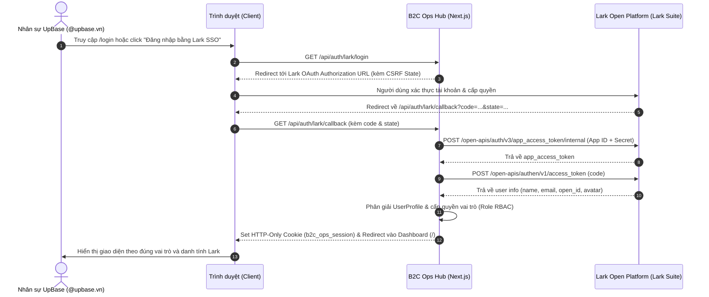

# HƯỚNG DẪN TÍCH HỢP & VẬN HÀNH LARK SSO — B2C OPS HUB

| Thuộc tính | Giá trị |
| --- | --- |
| Mã tài liệu | HUB-TECH-01 |
| Tính năng | Đăng nhập tập trung Lark SSO (OAuth 2.0) |
| Liên quan | OI-005 (Identity Provider dùng chung) |
| Cập nhật | 07/10/2026 |

---

## 1. Luồng Xác thực (OAuth 2.0 Flow)

---

## 2. Trạng thái Kết nối & Cấu hình App trên Lark Developer Console

Thông tin App hiện tại trong `.env` / `.env.local`:
- **App ID:** `cli_aa45bfd4edf85f05` (Đã xác thực kết nối thành công lấy `app_access_token` với `open.larksuite.com`)
- **Production URL:** `https://b2c-theta.vercel.app`
- **Redirect URI Production:** `https://b2c-theta.vercel.app/api/auth/lark/callback`

Để hoàn tất đăng nhập OAuth cho nhân sự UpBase trên Lark Developer Console:

1. **Truy cập trực tiếp trang quản trị App `cli_aa45bfd4edf85f05`:**
   - Mở: `https://open.larksuite.com/app/cli_aa45bfd4edf85f05`
2. **Cấu hình Redirect URL (Bắt buộc để tránh lỗi khi chuyển hướng):**
   - Vào menu bên trái: **Security Settings** (Cài đặt bảo mật) -> mục **Redirect URLs**.
   - Thêm chính xác URL:
     - Production (Vercel): `https://b2c-theta.vercel.app/api/auth/lark/callback`
     - Local: `http://localhost:3000/api/auth/lark/callback`
3. **Bổ sung Scopes quyền truy cập thông tin nhân sự:**
   - Hiện tại App `cli_aa45bfd4edf85f05` đang có `scopes: []` (chưa bật quyền đọc email).
   - Vào **Permissions & Scopes** -> tìm và bật các quyền User Info:
     - `contact:user.base:readonly` (Lấy họ tên, `open_id`, ảnh đại diện).
     - `contact:user.email:readonly` (Lấy địa chỉ email doanh nghiệp `@upbase.vn` để đối chiếu chính xác với danh bạ 1.011 nhân sự).
   - *(Lưu ý: Trong trường hợp `contact:user.email:readonly` chưa được duyệt, hệ thống tự động đối chiếu dự phòng theo Họ tên tiếng Việt trên Lark với danh bạ nhân sự UpBase).*
4. **Phát hành phiên bản (App Version & Release):**
   - Vào **Version Management & Release** -> nhấn **Create a version** (ví dụ `1.0.1`) -> lưu và **Submit for release** để áp dụng Redirect URL và Scopes mới.

---

## 3. Chế độ Kiểm thử Nội bộ (Sandbox)

Tại trang `/login`, bên dưới nút **Đăng nhập bằng Lark (UpBase SSO)**, hệ thống hỗ trợ chọn nhanh tài khoản nhân sự thực tế để kiểm thử phân quyền:
- **Đỗ Văn Giang** — Tổng Giám Đốc (CEO - `ADMIN`)
- **Đặng Thị Yến Nhi** — Giám Đốc Marketing B2C (`MANAGER`)
- **Nguyễn Thị Ngọc Tâm** — Trưởng nhóm Booking (`LEADER` - phụ trách cụm 8 gian hàng)
- **Lê Phương Thảo**, **Lương Thị Như Quỳnh**, **Lê Thanh Hải**... — Chuyên viên thực thi (`BOOKING_MEMBER`)
- Tra cứu trực tiếp theo Mã nhân viên (VD: `HN222`, `HN862`, `HN782`) từ danh bạ 1.011 nhân sự UpBase.
