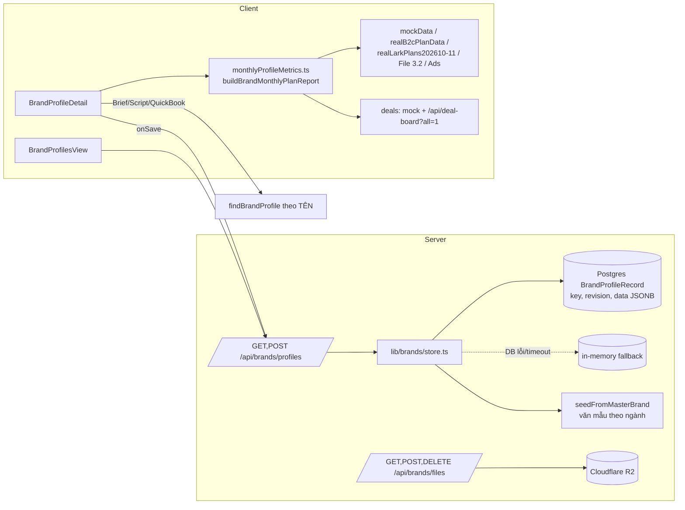
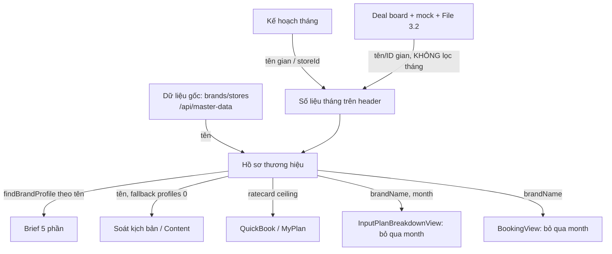

# Audit màn hình Hồ sơ thương hiệu — 29/10/2026

Phạm vi: màn **Hồ sơ thương hiệu** trong `web-admin` (Next.js 16 + React 19, Prisma/Postgres, Cloudflare R2) và các luồng dữ liệu nối vào nó. Đây là audit **chỉ đọc**: không sửa code, không ghi dữ liệu, không đăng nhập vào production.

Mức chắc chắn: **Verified** = đã đọc code hoặc chạy và xác nhận · **Likely** = có bằng chứng gián tiếp · **Unknown** = chưa đủ dữ liệu.

---

## Cập nhật sau quyết định của PO (29/10/2026)

**Quyết định cho 5 câu hỏi mở:**

| Câu hỏi | Quyết định |
|---|---|
| Q1. Chi Net, deal tính theo tháng nào | Theo **tháng của plan** |
| Q2. Nội dung tự sinh | **Ẩn hết** |
| Q3. Tháng không có dữ liệu thật | **Để trống** |
| Q4. Ai sửa Ratecard, Pháp lý | **PIC gian hàng** của nhãn (cùng lãnh đạo) |
| Q5. Đăng nhập chọn vai trò trên production | **Có chủ đích, giữ nguyên**. S-01 không còn là phát hiện |

**Đã sửa:**

- **F-01 — Lưu hồ sơ** (`src/lib/brands/store.ts`):
  - Cache chỉ cập nhật sau khi ghi DB thành công; bỏ cache khi nhận 409.
  - DB lỗi hoặc timeout thì trả **503**, không còn ghi tạm vào RAM rồi báo "Đã lưu".
- **F-02 và F-06 — Nội dung tự sinh:**
  - Hồ sơ khởi tạo chỉ còn dữ liệu có nguồn thật: tên pháp nhân, người liên hệ từ Dữ liệu gốc, link tệp bảng 3.5, quy tắc vận hành mặc định.
  - Khi đọc, hồ sơ đã lưu được gỡ mọi trường còn y nguyên văn mẫu cũ (`stripGeneratedContent`). Phần người dùng đã nhập được giữ lại.
  - Bỏ `enrichExistingProfile`, nên xóa là xóa thật.
  - Các thứ bị ẩn: MST giả "…7919", số văn bản pháp lý giả, ratecard mẫu, SKU và FAQ mẫu, tài liệu `cdn.upbase.vn` giả, dòng lịch sử "v1 · 04/10/2026".
- **F-03 và F-04 — Số liệu tháng** (`src/lib/monthlyProfileMetrics.ts`, đã nằm trong commit `ad478bd`):
  - Deal sinh từ plan tính vào tháng của plan (`campaignCode` dạng `PLAN-YYYYMM`).
  - Bỏ hệ số 0,85 / 0,92 / 1,1 và mã deal giả.
  - Tháng không có dữ liệu thì header hiện "Chưa có dữ liệu".
  - "Vượt hạn mức" không còn bật kèm "Chi ngoài KH".
- **S-03 — Quyền:**
  - Sửa Pháp lý và Ratecard: lãnh đạo và PIC gian hàng (Booking chính, cùng làm, dự phòng đang hiệu lực, Trưởng nhóm, nhận diện theo mã nhân sự qua `isStorePicOfBrand`). Pháp chế và đối tác nhãn vẫn sửa được Pháp lý.
  - Nhân sự nội bộ khác vẫn **xem** được hai mục này.
- **S-05:** bỏ điều kiện upload luôn đúng.

**Đã kiểm thử:**
- Typecheck đạt; 225 test đạt sau khi file hợp đồng đang được sửa song song ổn định lại.
- Có test mới cho: quyền theo PIC gian, gỡ văn mẫu (kể cả khi Postgres sắp lại khóa), deal theo tháng plan, tháng trống, bản bị từ chối không lọt vào cache.

**Còn mở:** S-02 (che MST ở server), F-05 (tên nhân sự viết cứng), F-07 (khớp nhãn), F-08 (nút Plan/Booking bỏ qua tháng), U-01…U-10, hiệu năng.

---

## A. Tóm tắt điều hành

**Màn hình phục vụ việc gì.** Đây là nơi giữ hồ sơ tĩnh của từng nhãn: định vị, pháp nhân, SKU, từ cấm, pháp lý, ratecard, quy tắc duyệt, tài liệu. Cùng màn đó hiển thị số liệu tháng (NMV, Chi Net, Video, deal) gom từ gian hàng, plan và booking. Hồ sơ tĩnh được Brief 5 phần, soát kịch bản, Content và QuickBook dùng lại.

**5 vấn đề quan trọng nhất:**

1. **Lưu có thể mất hoặc ghi đè dữ liệu của người khác** (P0, Verified). `saveProfile` cập nhật cache trước khi ghi DB. Khi DB lỗi hoặc chậm quá 2 giây, hàm vẫn báo "Đã lưu" dù dữ liệu chỉ nằm trong RAM của một instance serverless.
2. **Nội dung chiến lược của phần lớn nhãn là văn mẫu tự sinh nhưng hiện như dữ liệu thật** (P0/P1, Verified). Ví dụ 4PM: Big Idea, Key Message, "4.9/5 sao từ hàng chục nghìn lượt mua", "hàng trăm Dược sĩ, Bác sĩ…" đều sinh từ ngành hàng. Hồ sơ vẫn được tính "Hoàn tất 8/8", và nội dung này đi thẳng vào Brief gửi KOC.
3. **Số liệu header không đáng tin** (P1, Verified):
   - Chi Net cộng mọi deal của gian, không lọc theo tháng.
   - "Vượt hạn mức" bật chỉ vì plan bằng 0.
   - Số đơn là ước tính `GMV / 245.000`.
   - Tháng 08, 09, 11 là số suy diễn (nhân hệ số 0,85 / 0,92 / 1,1).
4. **Nhân sự phụ trách bị gán cứng tên** (P1, Verified). TP B2C, FOC và PIC mặc định là tên viết cứng. Màn này không đọc `storePositions.ts`, trong khi file đó ghi rõ là nguồn duy nhất.
5. **Phân quyền và bảo mật** (P0/P1, Verified):
   - Production cho đăng nhập bằng cách chọn vai trò, không cần mật khẩu.
   - Mọi nhân sự nội bộ sửa được mọi mục, kể cả Ratecard và Pháp lý.
   - API trả đầy đủ mã số thuế cho mọi người xem được hồ sơ.

**Nên redesign hay sửa logic trước?** Sửa **business logic và dữ liệu trước**. Giao diện hiện hợp lý về cấu trúc, nhưng đang trình bày số liệu sai một cách rất tự tin. Redesign lúc này chỉ làm số sai trông đẹp hơn.

**Giới hạn của audit:**
- Không đăng nhập production (cổng chọn vai trò mở công khai, đăng nhập giả CEO là không phù hợp), nên **chưa đo LCP/INP/CLS** và chưa thao tác UI thật.
- Chưa đọc DB production.
- Typecheck đạt; 20/20 test liên quan đạt (`brand-profile`, `permission-guards`, `cross-module-linkage`).

---

## B. Bản đồ hệ thống

### Component tree

```
page.tsx (tab app, state cấp app: stores, monthlyPlans, deals)
└─ BrandProfilesView.tsx            ← danh sách 42 nhãn, giữ selectedMonth, openKey, detailTab
   └─ BrandProfileDetail.tsx (key=brandKey)   ← header, 6 tab, panel phải
      ├─ BrandEditors.tsx           ← Positioning/Entity/WorkflowRules/Ratecard/ContentRules/ItemDialog
      ├─ StandardBriefPreviewModal  ← Brief 5 phần (xuất Markdown)
      ├─ BrandGuidelineExtractModal ← Đọc tài liệu quy chuẩn
      └─ CloudflareR2SetupModal
BrandHubView.tsx → nhúng BrandProfileDetail (embedded) qua useBrandProfiles
```

### Data flow



### API và quyền

| Endpoint | Việc làm | Kiểm tra | Ghi chú |
|---|---|---|---|
| `GET /api/brands/profiles` | Danh sách hồ sơ trong phạm vi | phiên đăng nhập (401), `filterScopedBrands`, `readableProfile` ẩn ratecard/legal | Trả **đủ MST** (`brandAccess.ts:16-23`) |
| `POST /api/brands/profiles` | Lưu 1 section | Origin, body < 400KB, section hợp lệ, `requireBrandScope`, quyền theo mục, `parseSection` cắt độ dài, revision → 409 | Revision chống ghi đè đúng ở DB, nhưng bị cache làm hỏng (F-01) |
| `POST /api/brands/files` | Upload | đuôi tệp, 25MB, phạm vi nhãn | Điều kiện quyền luôn đúng (`files/route.ts:80`); đọc cả body rồi mới kiểm tra size |
| `GET/DELETE /api/brands/files?key=` | Tải/xóa | slug lấy từ key → `requireBrandScope`, chặn `..` | Không có IDOR giữa nhãn (Verified) |

Ma trận quyền theo mục (`domain.ts:82-100`, có bản client là `brandUi.ts:128`):

| Vai trò | Định vị, SKU, Từ cấm, FAQ, Tài liệu | Pháp lý | Ratecard |
|---|---|---|---|
| Nhân sự nội bộ (bất kỳ ai) | ✅ | ✅ | ✅ (comment ghi "chỉ trưởng phòng") |
| Đối tác nhãn (đúng nhãn) | ✅ | ✅ | ❌ |
| Client chưa có `access` | hiện mọi nút Sửa | | |

### Entity

Chỉ có `BrandProfileRecord { key @id, revision, data Json }` (`schema.prisma:8-13`). Không có FK sang gian hàng, plan hay deal. Mọi liên kết giữa các phân hệ đều **so khớp theo tên** qua `brandKey(name)`: slug bỏ dấu, viết thường.

### Dependency giữa phân hệ



Loại quan hệ:
- **Trực tiếp qua API:** Profile ↔ Postgres, File ↔ R2.
- **Nghiệp vụ nhưng không có liên kết kỹ thuật:** Profile ↔ Plan/Deal, chỉ khớp bằng tên.
- **Chưa xác định:** dữ liệu runtime sau khi `/api/master-data` tải lại.

---

## C. Danh mục tính năng

| Tính năng | Vị trí | Nguồn dữ liệu | Quyền | Trạng thái |
|---|---|---|---|---|
| Badge Hoàn tất / Đang chạy / Nháp | Header | `completeness()` 8 mục tĩnh | — | ⚠ Nhãn gây hiểu nhầm: đây là độ đủ hồ sơ, không phải trạng thái vận hành |
| Vượt hạn mức / Chi ngoài KH | Header | `monthlyProfileMetrics` | — | ❌ Bật cùng lúc khi plan = 0 |
| NMV, Chi Net, Video, deal | Header | `buildBrandMonthlyPlanReport` | — | ❌ Khác kỳ, không lọc tháng, có số ước tính |
| Chọn tháng | Header | 4 tháng cố định | — | ⚠ 08, 09, 11 là số suy diễn |
| Trước/sau 1/42 | Header | danh sách đã lọc | — | ⚠ Tab bị reset về Plan & Booking |
| Tải tệp | Header + tab Tài liệu | R2 | DOCUMENTS | ✅ Hoạt động; ⚠ tệp mồ côi nếu bước lưu hồ sơ lỗi |
| Đọc tài liệu quy chuẩn | Header | BrandGuidelineExtractModal | không kiểm tra `can` | Chưa kiểm thử UI |
| Brief 5 phần | Header + tab Định vị | hồ sơ + SKU | — | ✅ Xuất Markdown; ⚠ chở văn mẫu tự sinh |
| Plan (tháng) | Header + panel | `onDrilldownToPlan` | — | ❌ Bỏ qua tháng, mở plan gian đầu tiên |
| Booking (279) | Header | `onDrilldownToBooking` | — | ❌ Booking không lọc tháng → số khác 279 |
| Sửa định vị, pháp nhân… | Tab Định vị | POST profiles | xem bảng quyền | ✅ Có revision/409; ❌ cache, fallback (F-01) |
| Từ cấm, Do/Don't sửa trực tiếp | Tab Từ cấm | POST CONTENT_RULES | CONTENT_RULES | ✅ |
| Lịch sử cập nhật | Panel phải | `profile.history` (≤200) | — | ⚠ Chỉ có tóm tắt, không có giá trị cũ; dòng v1 là seed |
| Hiện/ẩn MST | Pháp nhân | client mask | ENTITY | ❌ Chỉ che ở client |

---

## D. Kết nối liên phân hệ

| Dữ liệu | Nguồn | Nơi dùng | Cơ chế đồng bộ | Rủi ro |
|---|---|---|---|---|
| Hồ sơ thương hiệu | Postgres `BrandProfileRecord` + seed | Brief, Content, Script, QuickBook, MyPlan, MasterDataHub | `useBrandProfiles` shared cache client; cache server 30 giây/instance | Đọc cũ giữa các instance; fallback trong RAM |
| Định vị, chiến lược | Người nhập hoặc **seed văn mẫu** | Brief 5 phần, AI script (`contentContextBuilder`) | Đọc lúc mở | Văn mẫu đi vào brief thật; `enrichExistingProfile` tự điền lại trường người dùng đã xóa |
| Plan tháng | `INITIAL_MONTHLY_PLANS`, `realLarkPlans2026xx` | Header, tab Plan & Booking | State cấp app | 4PM không có plan (grep `realLarkPlans202610.ts` = 0) → mọi cảnh báo bật |
| Booking, deal | mock `INITIAL_DEALS` + `/api/deal-board?all=1` + File 3.2 | Header, tab, nút Booking | State cấp app | Không lọc tháng; deal bị gán cứng `'2026/10'` (`monthlyProfileMetrics.ts:590`) |
| Nhân sự phụ trách | Tên cứng + `store.b2cOwnerName` + `master.accountPic` + `monthlyPlanData` | Panel phải, header | Không | Lệch với Dữ liệu gốc; Account lấy master trước store, hai nguồn mâu thuẫn |
| Sản phẩm, kịch bản | `p.products`; catalog chỉ sau khi lưu | Header SKU, Brief | — | Số SKU có thể khác catalog thật |
| Tài liệu, hợp đồng | R2 + metadata trong JSON | Tab Tài liệu | — | Seed tự thêm lại tài liệu đã xóa; URL công khai bỏ qua kiểm soát quyền |
| KPI, chi phí | Tính ở client | Header, danh sách | WeakMap cache theo tham chiếu | Cache mất mỗi lần deal-board đồng bộ |

**Điểm lỗi lan rộng nhất:** `findBrandProfile` khớp bằng `includes` hai chiều và trả về `profiles[0]` khi không tìm thấy (`ScriptReviewModal.tsx:80-83`, `ContentView.tsx:391`). Soát kịch bản có thể áp **từ cấm của nhãn khác**.

---

## E. UI/UX

| # | Khu vực | Hiện trạng | Tác động | Ưu tiên | Hướng cải tiến |
|---|---|---|---|---|---|
| U-01 | Header | "Hoàn tất" đặt cạnh "Vượt hạn mức" và "Chi ngoài KH" | Người xem hiểu nhãn đang vận hành ổn trong khi cảnh báo đỏ | P2 | Đổi thành "Hồ sơ 8/8", tách khỏi nhóm trạng thái tháng |
| U-02 | Chi Net | `864 tr / 0 đ`, thanh tiến độ đỏ kín (`max = 1`) | Báo động giả | P1 (theo F-03) | Plan = 0 thì hiện "Chưa có plan tháng" kèm liên kết tạo plan |
| U-03 | Video Air | Nhãn "279 deal" đặt trong ô Video | Lẫn deal với video | P3 | Tách deal thành chỉ số riêng hoặc đưa xuống dòng phụ |
| U-04 | Tab Từ cấm & Pháp lý | Số 6 = từ cấm + pháp lý + **FAQ**; header ghi "1 pháp lý · 3 từ cấm" | Hai con số không khớp | P2 | Đếm cùng định nghĩa, hoặc ghi rõ "3 từ cấm · 1 pháp lý · 2 FAQ" |
| U-05 | Điều hướng | Không có URL state; refresh mất nhãn, tháng, tab; nút Plan/Booking không tạo history | Không chia sẻ link được; Back không quay lại | P2 | Đưa `brand`, `month`, `tab` lên query string |
| U-06 | Trước/sau | Remount (`key={open.key}`) làm tab về mặc định | Phải bấm lại tab mỗi nhãn | P2 | Giữ `detailTab` ở cha |
| U-07 | Panel phải | "Không có trưởng nhóm — Trình trực tiếp Trưởng phòng" là suy luận từ cờ của gian | Có thể sai | P2 | Lấy từ Dữ liệu gốc |
| U-08 | Định vị | Không phân biệt nội dung do người nhập với văn mẫu | Người đọc tin là đã được duyệt | P1 | Gắn nhãn "Nội dung gợi ý — chưa xác nhận" |
| U-09 | Mật độ | Header 2 dòng meta cỡ `text-2xs`, nhiều badge | Khó quét ở laptop 1366px | P3 | Cần đo trên trình duyệt thật (chưa làm) |
| U-10 | Form sửa | Có `maxLength`, nhưng chưa thấy cảnh báo khi đóng modal còn thay đổi chưa lưu | Mất nội dung dài khi lỡ bấm Hủy hoặc Esc | P2 | Hỏi lại khi form đã có thay đổi (Likely, cần kiểm `Modal`) |

### E2. Rà từng tab trên trình duyệt (29/10, dev server local, hồ sơ 4PM)

**Cách làm:**
- Rà bằng trình duyệt trong app ở hai khổ màn hình: 1024×768 và laptop 1366×768.
- Dữ liệu là hồ sơ local đã gỡ văn mẫu, nên phần lớn các mục đang ở trạng thái trống.
- Chưa xem được trạng thái đã điền nội dung thật, chưa thử trên mobile, chưa thao tác hết các hộp sửa.

**Lỗi chung của cả màn:**

| ID | Hiện trạng (đã kiểm) | Bằng chứng | Ưu tiên |
|---|---|---|---|
| U-11 | Thanh tab cần 1151px nhưng chỉ có 728px ở khổ 1024 và 1071px ở khổ 1366, nên tab cuối bị khuất. Thanh cuộn bị ẩn, không có mũi tên hay vệt mờ báo còn tab, không điều hướng được bằng phím mũi tên | `TabList`, `ui/index.tsx:131-160` (component dùng chung cả app) | P2 |
| U-12 | Thanh trên: các nút thao tác che mất bộ chọn tháng ở cả 1024 và 1366, chỉ còn đọc được chữ "Thán". Muốn đổi tháng phải dùng nút chọn kỳ trong tab Plan & Booking | Ảnh chụp 1366×768 | P2 |
| U-13 | "1/8 mục" luôn tô màu xanh dù hồ sơ thiếu 7 mục. Nhãn "Đang chạy" gắn cho hồ sơ chưa đủ (xem U-01) | `BrandProfileDetail.tsx` khối Hồ sơ tĩnh (`text-positive` cố định) | P3 |
| U-25 | Mật độ chữ: trong vùng nội dung có 236 nút chữ cỡ 12px và 39 nút cỡ 10px. Tương phản chữ phụ đạt AA (4,98–5,34:1). Có `:focus-visible` toàn cục. App **không có dark mode** nên mục này không áp dụng | Đo bằng `getComputedStyle` | P3 |

**Plan & Booking:**

| ID | Hiện trạng | Ưu tiên |
|---|---|---|
| U-14 | **Lệch số trên cùng một màn.** Nút "Booking (1)", chip tháng "1/0 vid" và dòng gian Shopee "Booked 1 → Air 1" đều báo 1. Khối "Thực tế Deal Booking" lại ghi "0 deal" và nút "Mở Quản lý Booking (0)". Nguyên nhân: `reportBookedCount = max(bookings.length, store.actualAiredVideos, deliveredContents)` | P1 |
| U-15 | Gian Shopee ghi "PIC: Chưa phân công", trong khi header ghi Booking là Lê Phương Thảo (tên gán cứng, xem F-05) | P2 |
| U-16 | Chữ "Theo sàn" hiện ở chỗ mục tiêu NMV khi không có mục tiêu, khó hiểu. Bảng đối soát phải cuộn ngang ở khổ 1024 (cần 872px, có 727px), cột drill-down bị khuất | P3 |

**Định vị & Nhân sự:**

| ID | Hiện trạng | Ưu tiên |
|---|---|---|
| U-17 | Panel phải rộng 320px làm cắt tên người (ví dụ "Quỳnh Như") | P3 |
| U-18 | "Đại diện liên hệ phía nhãn" đang hiện nhân sự UpBase (Lê Phương Thảo), lấy từ `contactPerson` của Dữ liệu gốc. Đây là dữ liệu sai nguồn | P2 |
| — | Trạng thái trống "Chưa có định vị thương hiệu" rõ ràng; nút Thêm nằm ở đầu panel | OK |

**Quy tắc & Phê duyệt:**

| ID | Hiện trạng | Ưu tiên |
|---|---|---|
| U-19 | **Phần lớn nội dung tab vẫn là văn mẫu.** Ví dụ: "Tier A — Nhãn chiến lược" cho nhãn có ngân sách 0; nhóm KOC "Bác sĩ Da liễu, Beauty Reviewer" cho nhãn Tiêu dùng & Bán lẻ; "Nữ ≥ 70%, 18–34"; độc quyền 15 ngày. Riêng "Đầu mối phê duyệt phía nhãn" lại là nhân sự UpBase. Nguồn là `buildDefaultWorkflowRules` (`store.ts`), phần tôi đã giữ lại vì luồng booking đọc chế độ duyệt KOC từ đây. **Cần quyết định có ẩn không** | P1 |
| U-20a | Thẻ "Tier A …" tràn ra ngoài viền card. Dòng "Liên kết điều hành: Xem trong tab Tài liệu & Hợp đồng" dẫn tới một tab đang trống | P3 |

**Sản phẩm & Kịch bản:**

| ID | Hiện trạng | Ưu tiên |
|---|---|---|
| U-20 | **Góc nội dung tự sinh vẫn hiện.** Sản phẩm giữ chỗ "4PM - Sản phẩm chủ lực" kèm 3 góc kịch bản nói về "chất kem", "tình trạng da". Số "12 / 8 / 4 booking đã dùng" (tổng 24) là số giả theo công thức `(3 - idx) * 4`. Header thì ghi 0 SKU, trong khi khối này ghi "Sản phẩm đã có góc tiếp cận 1/1" | P1 |
| U-26 | Khi danh mục trống vẫn hiện 3 bộ lọc. Nhãn "Đã lưu tự động" không rõ đang nói về cái gì. Chữ gợi ý ô tìm kiếm bị cắt. Trạng thái trống của Trần thù lao ghi "Trưởng phòng B2C có thể cấu hình", đã lỗi thời sau quyết định cho PIC gian sửa | P3 |

Nguồn của U-20: `ContentAngleSetupView.tsx:124` (sản phẩm giữ chỗ) và khoảng dòng 170–185 (`generateAiAngleSuggestions`, `usageCount`).

**Từ cấm & Pháp lý:**

| ID | Hiện trạng | Ưu tiên |
|---|---|---|
| U-21 | Tab còn chứa khối "Câu hỏi khó" (FAQ) nhưng tên tab không nhắc tới, nên số đếm trên tab lệch với header (xem U-04) | P2 |
| U-22 | Xóa từ cấm, cụm từ nên dùng hay Do/Don't thì **lưu ngay, không hỏi lại, không hoàn tác được**. Xóa SKU, FAQ, Pháp lý thì có hộp xác nhận | P2 |
| U-27 | Có 3 lối vào để sửa cùng một nhóm dữ liệu: "Sửa toàn bộ quy chuẩn", nút Thêm từng dòng, và "Sửa Hashtag / Giá / CTA" | P3 |

Bằng chứng U-22: `BrandProfileDetail.tsx` khoảng dòng 2113–2121.

**Tài liệu & Hợp đồng:**

| ID | Hiện trạng | Ưu tiên |
|---|---|---|
| U-23 | **Thanh tải tệp vỡ bố cục ở khổ 1024.** Tiêu đề "Tải tài liệu thương hiệu lên hệ thống" bị ép xuống từng chữ và đè lên nhãn "Phân loại khi tải" | P2 |
| U-24 | Tên tab có "Hợp đồng" nhưng tab không có hợp đồng nào. Hợp đồng chỉ mở được từ hộp chi tiết của một booking | P2 |
| U-28 | 7 chip lọc tràn ngang. Nút "Cấu hình Cloudflare R2" hiện cho mọi người, dù server đã chặn người không phải quản trị | P3 |

**Đã sửa bố cục (29/10, kiểm trên trình duyệt ở 1024 và 1366):**
- **Thanh trên:** chỉ giữ "Brief 5 phần", menu "⋯" (gồm Tải tệp, Đọc tài liệu quy chuẩn, Mở kế hoạch) và nút chính "Booking (n)". Bộ chọn tháng chuyển xuống thẻ hồ sơ, nằm ngay trên 4 chỉ số. Sửa U-12.
- **Thẻ hồ sơ:** chia 3 tầng:
  - Định danh, kèm người phụ trách ở bên phải.
  - Tháng số liệu, kèm cảnh báo Vượt ngân sách / Chi ngoài kế hoạch.
  - 4 ô chỉ số chia đều. Mỗi ô có số, mục tiêu, một dòng ý nghĩa, và thanh tiến độ chỉ khi có mục tiêu.
  
  Ô "Hồ sơ thương hiệu" nói rõ còn thiếu mục nào. Bỏ nhãn "Đang chạy / Hoàn tất" dùng sai nghĩa. Sửa U-01 và U-13.
- **Tab:** tên viết hoa kiểu câu và rút gọn (Kế hoạch · Định vị · Quy tắc · Sản phẩm · Quy chuẩn & pháp lý · Tài liệu). Thanh tab vừa khít ở 1024 (728/728px) và 1366. Sửa U-11 cho màn này; component dùng chung chưa đổi. Sửa luôn U-21 và U-24.
- **Số deal:** mọi chỗ đếm cùng một danh sách booking của tháng (`bookings.length`). Sửa U-14.
- **Tab Định vị:** bỏ khoảng 12 hộp có viền và nền màu lồng nhau, thay bằng 5 nhóm có tiêu đề (Thông điệp, Insight, Khách hàng và giọng văn, Câu chuyện và bằng chứng, Đối thủ), ngăn nhau bằng khoảng trắng và một đường kẻ mảnh. Bỏ chỗ lấy Slogan điền vào Big Idea khi trống. Cột phải rộng 340px và chỉ hiện từ khổ 1280px.
- **Tab Quy tắc:** bỏ tiêu đề viết hoa toàn bộ, thẻ Tier không còn tràn viền. Sửa U-20a.
- **Tab Tài liệu:** sửa thanh tải tệp bị vỡ. Sửa U-23.
- **Chip tháng:** tháng không có dữ liệu ghi "Chưa có dữ liệu".

**Chưa kiểm:**
- Trạng thái đã có nội dung thật (cần một nhãn đã nhập liệu thật). Bố cục mới của tab Định vị mới chỉ được kiểm qua typecheck và lint, chưa nhìn trên dữ liệu thật.
- Các hộp sửa (Positioning, Workflow, ContentRules): cảnh báo khi đóng lúc còn thay đổi chưa lưu, thao tác bằng bàn phím.
- Khổ mobile.
- LCP/INP: dev server local đang trả 500 cho `/api/brands/profiles` do module cũ, cần khởi động lại.

Accessibility đã thấy: nút trước/sau có `aria-label`; select tháng có `aria-label`; trường trong editor có `htmlFor`. **Chưa đo** độ tương phản của `text-ink-3` trên cỡ `2xs`. Đó là phần cần chạy axe trên trình duyệt.

---

## F. Hiệu năng

**Đã đo được:** `GET /api/brands/profiles` khi chưa đăng nhập trả 401 trong khoảng 115 ms (production, 1 lần, trình duyệt trong app).

**Bottleneck đã xác nhận trong code:**
- Màn này kéo khoảng **13 MB source dữ liệu tĩnh** vào client. Chuỗi import: `mockData` → `realKocMasterData` 7,8 MB, `importedMasterData` 1,3 MB, `realLarkPlans202610` 1,67 MB, `realLarkPlans202611` 1,49 MB… Một phần là của `page.tsx` dùng chung, không riêng màn này.
- Danh sách tính báo cáo cho cả 42 nhãn mỗi lần đổi tháng, deal hoặc plan (`BrandProfilesView.tsx:163-186`).
- Trang chi tiết tính sổ cái 4 tháng ngay khi mở dù chỉ hiện 1 tháng (`BrandProfileDetail.tsx:366-373`).

**Chưa đo:** LCP, INP, CLS, kích thước chunk sau build, thời gian truy vấn DB. Cần đăng nhập ở môi trường staging hoặc local để đo.

---

## G. Bảo mật và toàn vẹn dữ liệu

| ID | Rủi ro | Bằng chứng | Điều kiện | Khắc phục |
|---|---|---|---|---|
| S-01 | Ai có URL production cũng đăng nhập được bằng vai trò bất kỳ, kể cả CEO, không cần mật khẩu | Ảnh màn `/login` trên b2c-theta.vercel.app; `isSandboxLoginAllowed()` mặc định `true` (`larkAuth.ts:306`) | Biết URL | Đặt `BLOCK_SANDBOX_LOGIN=true` trên production hoặc đảo mặc định. **Cần PO xác nhận** đây có phải giai đoạn UAT có chủ đích |
| S-02 | API trả đủ MST | `brandAccess.ts:16-23` không lọc `entity` | Có quyền xem hồ sơ | Che ở server, thêm endpoint lấy số đầy đủ cho người có quyền ENTITY |
| S-03 | Quyền theo mục không tách được ai | `domain.ts:87-98` | Mọi nhân sự nội bộ | Chốt ma trận quyền với PO rồi sửa một lần (theo nguyên tắc "plan quyền trước") |
| S-04 | URL R2 công khai bỏ qua kiểm soát quyền | `r2.ts:512` | Bucket có `publicUrl` (Unknown) | Luôn phục vụ tệp qua route có kiểm tra quyền |
| S-05 | Điều kiện upload luôn đúng | `files/route.ts:80` | Trong phạm vi nhãn | Bỏ vế `master \|\| current` |
| S-06 | Upload `.svg` và `.zip`, không kiểm tra magic bytes; đọc hết body trước khi kiểm size | `r2.ts:14-19` | — | Kiểm tra `Content-Length` sớm; SVG luôn tải về dạng attachment (đã làm) |
| S-07 | Không có audit log thật: không lưu giá trị cũ, upload/xóa tệp không ghi lại | `domain.ts:364-372` | — | Thêm bảng audit (section, before, after, actor) |
| S-08 | `videoLink` hoặc `publishedVideoUrl` render thành `href` chưa thấy lọc giao thức | `BrandProfileDetail.tsx:814, 2681` | Dữ liệu deal bị nhiễm `javascript:` | Dùng chung bộ lọc `https?://` |

Không thấy `dangerouslySetInnerHTML` trong các component brand. Link trong hồ sơ được lọc ở server và có test.

---

## H. Danh sách phát hiện

| ID | Tiêu đề | Nhóm | Ưu tiên | Chắc chắn |
|---|---|---|---|---|
| F-01 | Lưu hồ sơ: cache bẩn khi 409 và fallback trong RAM báo thành công | Data integrity | **P0** | Verified (code); tác động thực tế Likely |
| F-02 | Văn mẫu tự sinh hiện như chiến lược thật, chứa claim chưa kiểm chứng, đi vào Brief | Data/Business | **P0/P1** | Verified |
| S-01 | Đăng nhập chọn vai trò mở trên production | Security | **P0** (nếu đã có dữ liệu thật) | Verified |
| F-03 | Chi Net, NMV, Video, deal không lọc theo tháng; cảnh báo bật khi plan = 0 | Data/KPI | P1 | Verified |
| F-04 | Tháng 08, 09, 11 là số suy diễn theo hệ số, mã deal giả | Data/KPI | P1 | Verified |
| F-05 | Nhân sự phụ trách gán cứng, không đọc Dữ liệu gốc | Data/Business | P1 | Verified |
| F-06 | `enrichExistingProfile` tự điền lại trường đã xóa và tự thêm lại tài liệu seed | Data integrity | P1 | Verified |
| F-07 | `findBrandProfile` khớp `includes` và fallback `profiles[0]` → áp sai từ cấm | Cross-module | P1 | Verified (code) |
| S-02 | Lộ MST qua API | Security | P1 | Verified |
| S-03 | Ratecard, Pháp lý mở cho mọi nhân sự nội bộ | Permission | P1 (chờ chốt) | Verified |
| F-08 | Nút Plan và Booking bỏ qua tháng | Workflow | P2 | Verified |
| F-09 | Đơn hàng ước tính `gmv / 245.000` hiển thị như số thật | KPI | P2 | Verified |
| F-10 | Dòng "v1 · 04/10/2026 · Nguyễn Đức Mạnh" là seed, không phải thao tác thật | Audit trail | P2 | Verified |
| S-04…S-08 | Xem mục G | Security | P2 | Verified / Unknown |
| U-01…U-10 | Xem mục E | UI/UX | P2–P3 | Verified |
| P-01 | Khoảng 13 MB dữ liệu tĩnh trong bundle; tính sổ cái 4 tháng khi mở | Performance | P2 | Verified (chuỗi import); thời gian tải chưa đo |

### Chi tiết các phát hiện P0/P1

**F-01 — Lưu hồ sơ có thể mất hoặc ghi đè** (`src/lib/brands/store.ts:877-919`)

*Hiện trạng:*
1. `saveProfile` ghi `next` (revision + 1) vào `profilesMemoryCache` **trước** khi chạy `UPDATE … WHERE revision = expected`.
2. Nếu DB trả 409, cache vẫn giữ bản bị từ chối trong 30 giây. Client nhận 409 và gọi `load()`, nhưng lại đọc đúng bản bị từ chối đó với revision bằng revision của người kia. Lần lưu tiếp theo khớp revision và ghi đè thay đổi của người kia.
3. Nếu DB lỗi hoặc quá 2 giây, hàm ghi vào mảng trong RAM và trả thành công. Người dùng thấy "Đã lưu", nhưng instance Vercel khác hoặc lần cold start sau sẽ không có dữ liệu đó. Nếu `UPDATE` thực ra đã commit sau timeout, trạng thái càng không xác định.

*Tái hiện:* hai người cùng mở một nhãn → A lưu → B lưu (nhận 409) → B lưu lại trong vòng 30 giây trên cùng instance → thay đổi của A mất. Chưa chạy thật; cần test tự động.

*Khắc phục:*
- Chỉ cập nhật cache **sau** khi ghi DB thành công.
- Khi DB lỗi thì trả 503 và giữ form mở để người dùng thử lại, không fallback ghi.
- Bỏ cache khi nhận 409.

*Kiểm tra sau khi sửa:* test với Prisma mock cho ba nhánh (409, timeout, thành công).

**F-02 — Văn mẫu thành "chiến lược thật"** (`store.ts:329-646`)

*Hiện trạng:*
- Slogan, Big Idea, Key Message, Brand Says, Consumer Says, nỗi đau, rào cản, giải thưởng, RTB được sinh theo `m.category`.
- Ví dụ 4PM thuộc ngành "Tiêu dùng & Bán lẻ" nhưng nhận Key Message "Chăm da đúng trọng tâm".
- Câu "4.9/5 sao từ hàng chục nghìn lượt mua" và "hàng trăm Dược sĩ, Bác sĩ" là **claim quảng cáo chưa có căn cứ**.
- Hồ sơ vẫn được tính 8/8, có `updatedBy` là Account PIC, và đi vào Brief gửi KOC.

*Tác động:* rủi ro pháp lý về quảng cáo; KOC quay sai thông điệp.

*Khắc phục:*
- Đánh dấu `source: 'SEED'` cho từng trường.
- Không tính trường seed vào độ đầy đủ hồ sơ.
- Brief chặn hoặc cảnh báo khi còn trường seed.
- Gỡ các claim số liệu khỏi seed.

**F-03, F-04 — KPI tháng** (`monthlyProfileMetrics.ts:444, 499-506, 584-594, 645-676, 846`)

*Hiện trạng:*
- Deal app không lọc tháng và bị gán `'2026/10'`.
- `reportSpentNet` lấy `max(...)` của ba nguồn.
- `overbudgetStoresCount` đếm cả gian chi ngoài kế hoạch, nên hai badge luôn đi cùng nhau.
- Các tháng khác tháng 10 được nhân hệ số.

*Khắc phục:*
- Lọc deal theo tháng book hoặc tháng air (cần PO chốt mốc nào).
- Tách hai badge.
- Tháng không có dữ liệu thì hiện "Chưa có dữ liệu", không suy diễn.
- Ghi chú "ước tính" cho số đơn.

**F-05 — Nhân sự** (`BrandProfileDetail.tsx:359, 395-405, 1361`; `monthlyPlanData.ts:828-829`)

Lấy toàn bộ từ `storePositions.ts` / Dữ liệu gốc, khóa theo mã nhân sự, và bỏ các tên viết cứng.

**F-06 — Tự điền lại dữ liệu** (`store.ts:675-740`, gọi ở `:838` mỗi lần đọc)

*Hiện trạng:*
- Người dùng xóa Big Idea → lần đọc sau seed tự điền lại.
- Người dùng xóa tài liệu seed → tài liệu tự quay lại.

*Khắc phục:* chỉ chạy migrate một lần, có cờ đánh dấu, không chạy khi đọc.

**F-07 — Khớp nhãn sai** (`useBrandProfiles.ts:187-198`, `ScriptReviewModal.tsx:80-83`)

Chỉ khớp chính xác theo `brandKey` hoặc `master.id`. Không tìm thấy thì báo "Chưa có hồ sơ", không lấy `profiles[0]`.

---

## I. Roadmap cải tiến

| Giai đoạn | Hạng mục | Giá trị | Effort | Phụ thuộc | Tiêu chí nghiệm thu |
|---|---|---|---|---|---|
| 1 Critical | F-01 lưu an toàn | Không mất dữ liệu | S | — | Test 409, timeout, success đều đạt; timeout trả 503; cache không đổi khi lỗi |
| 1 | S-01 khóa đăng nhập chọn vai trò ở prod | Chặn mạo danh | XS | PO xác nhận | `/login` trên prod không còn khối chọn vai trò; `POST /api/auth/lark/sandbox` trả 403 |
| 1 | F-02 đánh dấu seed, gỡ claim | Brief không nói sai | M | Q2 | Trường seed hiện nhãn "Gợi ý"; 8/8 không tính trường seed; Brief cảnh báo |
| 1 | S-02 che MST ở server | Bảo vệ dữ liệu | S | — | Response GET không có MST đầy đủ khi thiếu quyền ENTITY |
| 2 Reliability | F-03/F-04 KPI theo tháng | Số đúng để ra quyết định | M | Q1, Q3 | Tổng Chi Net của 4PM tháng 10 khớp tổng deal tháng 10 ở màn Booking |
| 2 | F-05 nhân sự từ Dữ liệu gốc | Một nguồn | M | `storePositions.ts` | Không còn tên viết cứng trong `BrandProfileDetail` (grep) |
| 2 | F-06 bỏ enrich lúc đọc | Xóa là xóa thật | S | F-02 | Xóa Big Idea, tải lại vẫn trống |
| 2 | F-07 khớp nhãn chính xác | Không áp sai từ cấm | S | — | Test: kịch bản không chứa tên nhãn → không trả hồ sơ nào |
| 2 | S-03 ma trận quyền | Phân tách trách nhiệm | M | Q4 | Test quyền theo vai trò cho RATECARD/LEGAL |
| 2 | F-08 Plan/Booking giữ tháng | Drill-down đúng | S | — | Mở Booking từ 4PM tháng 10 chỉ hiện deal tháng 10, số khớp header |
| 3 UI/UX | U-01…U-10, URL state | Đọc nhanh, chia sẻ được | M | Giai đoạn 2 | Refresh giữ nhãn/tháng/tab; prev/next giữ tab; badge tách nhóm |
| 4 Perf | Tách dữ liệu tĩnh ra API, tính 1 tháng thay vì 4 | Tải nhanh hơn | L | đo baseline trước | Có số LCP/chunk trước và sau, đo cùng điều kiện |

---

## J. Kế hoạch triển khai theo PR

1. **PR-1 `fix(brand-store): cache sau ghi DB, bỏ fallback ghi RAM`**
   - File: `src/lib/brands/store.ts`.
   - Test mới: `tests/brand-profile.test.ts` mock Prisma cho 409 và timeout.
   - Rollback: revert một commit; không đổi schema.
2. **PR-2 `fix(auth): chặn sandbox login trên production`**
   - File: `larkAuth.ts` (đảo mặc định) hoặc env Vercel.
   - Rollback: đặt lại env.
3. **PR-3 `fix(brand-access): che MST, sửa điều kiện upload`**
   - File: `src/lib/server/brandAccess.ts`, `api/brands/files/route.ts`.
   - Test cho route handler.
4. **PR-4 `feat(brand-profile): đánh dấu nội dung seed`**
   - File: `store.ts`, `domain.ts`, `brandUi.ts` (`completeness`), `BrandProfileDetail.tsx`, `StandardBriefPreviewModal.tsx`.
   - Có migrate một lần thay cho `enrichExistingProfile`.
5. **PR-5 `fix(metrics): KPI theo tháng`**
   - File: `monthlyProfileMetrics.ts`, `BrandProfileDetail.tsx:389-390`.
   - Regression cần chạy lại: danh sách 42 nhãn, Kế hoạch tháng, `cross-module-linkage.test.ts`.
6. **PR-6 `fix(brand-profile): nhân sự từ Dữ liệu gốc`**
   - File: `BrandProfileDetail.tsx`, `storePositions.ts`.
7. **PR-7 `fix(brands): findBrandProfile khớp chính xác`**
   - File: `useBrandProfiles.ts`, `ScriptReviewModal.tsx`, `ContentView.tsx`.
8. **PR-8 `feat(brand-profile): URL state và giữ tab khi prev/next`**
   - File: `BrandProfilesView.tsx`, `page.tsx`.
9. **PR-9 (sau khi có baseline đo) hiệu năng.**

Mỗi PR chạy `npm run typecheck` và `npm test`.

---

## K. Câu hỏi mở cho Product Owner

**Chặn triển khai:**
- **Q1.** Chi Net và deal của một tháng tính theo **tháng book**, **tháng air** hay **tháng của plan**?
- **Q2.** Với 42 nhãn đang có nội dung seed: ẩn hẳn, hay giữ làm "gợi ý" để người phụ trách xác nhận?
- **Q3.** Tháng không có dữ liệu thật (08, 09, 11): hiển thị trống hay giữ ước tính có ghi chú?
- **Q4.** Ai được sửa Ratecard và Pháp lý? Comment trong code ghi "chỉ trưởng phòng", nhưng code và test đang cho mọi nhân sự.
- **Q5.** Cổng đăng nhập chọn vai trò trên production có phải chủ đích của giai đoạn UAT không? Đã có dữ liệu kinh doanh thật trên đó chưa?

**Xử lý sau được:**
- **Q6.** "Hoàn tất" nên nghĩa là hồ sơ đủ 8/8 hay hồ sơ đã được duyệt?
- **Q7.** Có cần lịch sử lưu giá trị cũ (diff) cho từng lần sửa định vị không?
- **Q8.** Chuyên viên điều phối FOC là một người cố định cho toàn phòng hay theo nhãn?

---

## L. Checklist nghiệm thu

**Audit:**
- [x] Đã xác định entry point (`page.tsx` → `BrandProfilesView` → `BrandProfileDetail`) và cấu trúc màn hình
- [x] Đã lập danh mục tính năng kèm trạng thái
- [x] Đã truy vết luồng dữ liệu header, lưu hồ sơ, tệp, nhân sự
- [x] Đã lập bản đồ liên phân hệ
- [x] Đã rà quyền và bảo mật ở mức code và API (không khai thác)
- [x] Đã chạy typecheck và test có sẵn (20/20 đạt)
- [ ] Đo LCP/INP/CLS và thao tác UI thật — **chưa làm**, cần tài khoản ở staging hoặc local
- [ ] Đối soát số liệu với DB production — **chưa làm**, cần quyền đọc

**Sau khi sửa:**
- [ ] Hai người cùng sửa một nhãn: người sau nhận 409 và không ghi đè được
- [ ] DB lỗi: người dùng thấy lỗi, không thấy "Đã lưu"
- [ ] Header 4PM tháng 10 khớp màn Booking lọc 4PM tháng 10
- [ ] Không còn tên nhân sự viết cứng trong component
- [ ] Nội dung seed được đánh dấu và không tính vào 8/8
- [ ] MST không có trong response khi thiếu quyền
- [ ] Refresh giữ nhãn, tháng, tab
