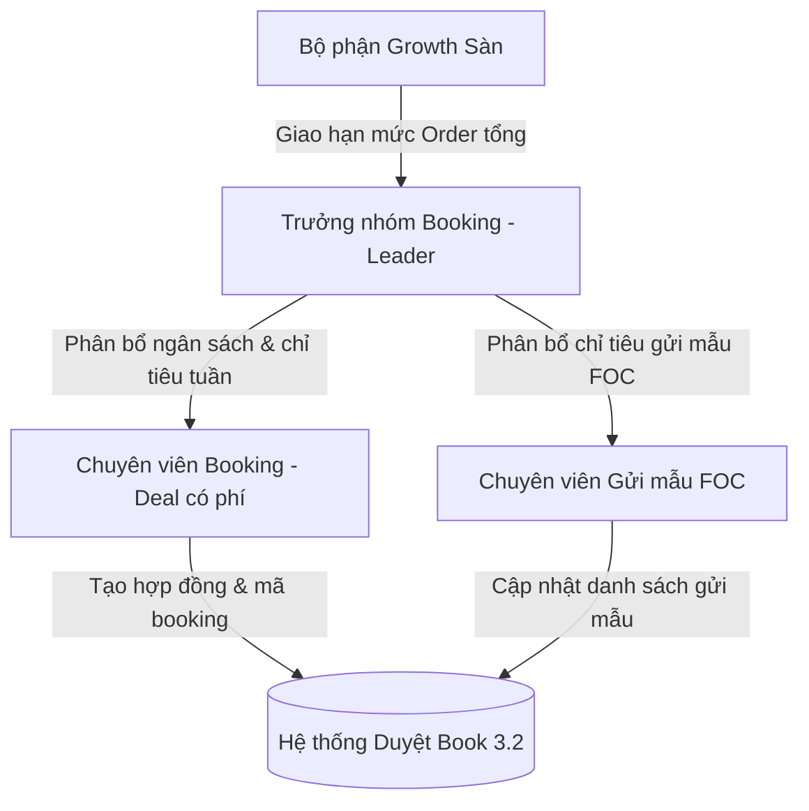
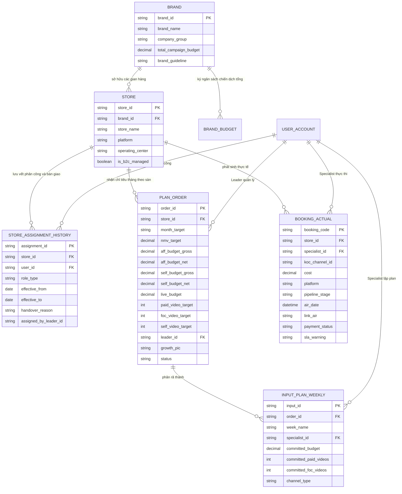

# ĐẶC TẢ YÊU CẦU NGHIỆP VỤ & THIẾT KẾ GIẢI PHÁP HỆ THỐNG
## QUẢN LÝ VÀ ĐỐI SOÁT KẾ HOẠCH BOOKING B2C
*(Tài liệu chuẩn hóa phục vụ xây dựng phần mềm quản trị tập trung)*

---

## 1. BỐI CẢNH & CÁC VẤN ĐỀ VẬN HÀNH THỰC TẾ (PAIN POINTS)

Hiện tại, quy trình quản lý booking của Phòng Marketing B2C đang vận hành dựa trên **3 file Excel độc lập**:
1. **File 4.1 Plan order tổng:** Do bộ phận Tăng trưởng sàn (Growth) lập vào đầu tháng, ghi nhận mục tiêu doanh số (NMV), hạn mức ngân sách Gross/Net, chỉ tiêu số lượng video KOC và phiên livestream.
2. **File 4.1.1 Input plan:** Do các Chuyên viên Booking lập hàng tuần, phân rã chỉ tiêu tháng thành kế hoạch tuần (W1 – W5) theo từng nhóm KOC.
3. **File 3.2 List duyệt book:** Bảng theo dõi thực tế từng booking phát sinh trong tháng từ lúc đề xuất, gửi mẫu, tạm ứng, lên bài (air video) đến khi nghiệm thu thanh toán.

### Các bất cập cốt lõi rút ra từ thực tế vận hành:
* **Nguy cơ bội chi và chi ngoài kế hoạch:** Không có cơ chế kiểm soát trần chi phí tự động. Thực tế tháng 10/2026 đã ghi nhận gian hàng vượt trần ngân sách tới 20.1% (`Mine TikTok` vượt 39.7 triệu) hoặc vượt gần gấp 3 lần (`Bye Bye Blemish` vượt 9.6 triệu); đồng thời có những gian hàng ban đầu giao chi phí 0đ nhưng thực tế đã ký duyệt hàng trăm triệu (`BaBe TikTok` 221 triệu, `Revision TikTok` 74 triệu, `Ekseption TikTok` 59.7 triệu).
* **Lỗi nhập liệu thủ công (Nhầm cột dữ liệu):** Điển hình như trường hợp gian hàng `Lipit TikTok`, Brand đặt hàng 15 video ở cột Self-channel (Cột 107) thay vì cột Affiliate (Cột 27), dẫn đến hệ thống báo động sai lệch rằng nhân sự tự ý tăng ngân sách.
* **Chênh lệch cách hiểu giữa Gross và Net:** Growth và Kế toán theo dõi theo hạn mức Net (sau thuế), trong khi khi làm việc với KOC thường trao đổi theo giá Gross hoặc Net tay, dẫn đến lệch hạch toán nếu không quy đổi chuẩn.
* **Lẫn lộn giữa Video trả phí và Suất gửi mẫu miễn phí (FOC):** Tổng chỉ tiêu video trên bảng tổng thường rất lớn (hơn 7,000 video), nhưng thực chất >80% là các suất gửi mẫu miễn phí (chi phí 0đ). Nếu không bóc tách, báo cáo sẽ gây hiểu lầm nghiêm trọng về khối lượng ngân sách cần giải ngân.
* **Theo dõi nhân sự chưa phân tầng:** Trên file Order chỉ ghi 1 tên Leader, trong khi người trực tiếp chạy kế hoạch và nghiệm thu lại là các Chuyên viên cấp dưới. Khi đối soát 1-1, hệ thống không xác định đúng KPI và trách nhiệm xử lý SLA.

---

## 2. MÔ HÌNH NHÂN SỰ 2 TẦNG (2-TIER TEAM STRUCTURE)

Hệ thống mới cần cấu trúc rõ ràng mô hình tổ chức của Phòng Booking B2C:

### Phân định trách nhiệm:
1. **Cấp 1 - Trưởng nhóm (Leader / Account Owner):**
   * Đứng tên đại diện tiếp nhận hạn mức Order tổng từ Growth trên File 4.1.
   * Chịu trách nhiệm về tiến độ giải ngân chung, tỷ lệ hoàn thành ngân sách và hiệu quả doanh thu (NMV/GMV) của toàn nhóm.
   * Phê duyệt kế hoạch tuần của các chuyên viên trước khi gửi sang Growth.
   * *Danh sách Leader hiện tại:* **Nguyễn Thị Ngọc Tâm, Lương Thị Như Quỳnh, Lê Phương Thảo, Lê Thanh Hải, Hoàng Diệu Thuỳ, Dương Thị Hồng Nhung**.
2. **Cấp 2 - Chuyên viên thực thi (Specialist / Executor):**
   * Trực tiếp lập kế hoạch chi tiết tuần (Input plan): chọn KOC, đàm phán thù lao, xếp lịch lên bài.
   * Trực tiếp tạo mã booking, gửi sản phẩm mẫu, theo dõi tiến độ lên bài, thu thập link và làm thủ tục nghiệm thu thanh toán.
   * Phân tách riêng nhân sự chuyên trách gửi mẫu miễn phí FOC (như `Trần Thị Hảo`) với nhân sự phụ trách deal KOC trả phí.

3. **Bước 0: Quy trình Phân công Gian hàng đầu kỳ (Resource Allocation Gate):**
   * Diễn ra ngay sau khi Growth giao Order tổng (ngày 26–28 hàng tháng) và phải hoàn thành trước khi mở quyền lập Input Plan.
   * Leader chỉ định rõ: Gian hàng nào do Chuyên viên nào phụ trách deal có phí, ai phụ trách gửi mẫu FOC. Khi Leader bấm `[Chốt Phân Công Đầu Kỳ]`, hệ thống mới mở quyền cho Chuyên viên vào tạo bản nháp Input Plan tuần.
4. **Cơ chế Lệnh Bàn Giao Giữa Kỳ có Ngày Hiệu Lực (Mid-Month Handover Protocol):**
   * Giải quyết triệt để rủi ro nhân sự nghỉ việc, nghỉ thai sản, chuyển nhóm hoặc chia tải giữa chừng.
   * Leader tạo `Lệnh bàn giao` chỉ định: Chuyển giao từ Chuyên viên A sang Chuyên viên B, kèm **Ngày hiệu lực chuyển giao**.
   * Hệ thống tự động phân tách:
     * *Phần việc đã hoàn thành/Đã air trước ngày hiệu lực:* Giữ nguyên tên Chuyên viên A để tính đúng KPI/hoa hồng.
     * *Phần việc dở dang (đang gửi hàng, tạm ứng, chờ duyệt):* Chuyển quyền tiếp quản sang Chuyên viên B để tiếp tục theo dõi nghiệm thu.
     * *Kế hoạch các tuần tiếp theo:* Chuyển quyền sửa Input plan sang Chuyên viên B.
   * Toàn bộ lịch sử phân công được lưu tại bảng `STORE_ASSIGNMENT_HISTORY`.

---

## 3. MÔ HÌNH THỰC THỂ DỮ LIỆU (DOMAIN DATA MODEL)

Hệ thống phân cấp quản trị bắt đầu từ **Cấp Thương hiệu (Brand)** $\rightarrow$ **Gian hàng theo sàn (Store / Platform)** $\rightarrow$ **Phân công gian hàng (Store Assignment)** $\rightarrow$ **Kế hoạch tháng (Plan Order)** $\rightarrow$ **Kế hoạch tuần (Input Plan)** $\rightarrow$ **Thực tế thực thi (Actual Booking)**:

---

## 4. QUY TẮC KINH DOANH & CÁC CHỐT CHẶN TỰ ĐỘNG (BUSINESS RULES & VALIDATION GATES)

### Chốt chặn 1: Khóa vượt hạn mức ngân sách (Hard Budget Gate)
* **Quy tắc:** Hệ thống tự động tính lũy kế chi phí đã duyệt của gian hàng trong tháng:
  $$\text{Tổng chi phí đã duyệt (File 3.2)} + \text{Chi phí booking mới} \le \text{Hạn mức Net Kế toán duyệt (File 4.1)}$$
* **Cơ chế xử lý:** Nếu tỷ lệ giải ngân đạt $\ge 100\%$, hệ thống tự động **khóa chức năng phê duyệt booking mới**. Muốn tiếp tục duyệt, PIC phải làm "Phiếu đề xuất bổ sung ngân sách (Top-up)" có xác nhận điện tử của Growth và Trưởng phòng B2C.

### Chốt chặn 2: Kiểm soát chi ngoài kế hoạch (Zero-Budget Gate)
* **Quy tắc:** Các gian hàng có hạn mức chi phí Affiliate trên Order bằng 0 VNĐ (chỉ order gửi mẫu FOC) thì mặc định hệ thống **không cho phép chọn hình thức thanh toán trả phí**.
* **Cơ chế xử lý:** Nếu phát sinh deal lớn đột xuất (như case `BaBe` 221 triệu, `Revision` 74 triệu), phải có luồng phê duyệt ngoại lệ kèm văn bản thống nhất từ Brand trước khi kế toán mở cổng chi.

### Chốt chặn 3: Kiểm soát tính toàn vẹn và chống nhầm cột (Data Integrity Gate)
* **Quy tắc:** 
  * Chi phí Gross và Net phải thỏa mãn công thức thuế chuẩn: $\text{Net} = \frac{\text{Gross}}{1 + \text{Thuế suất}}$.
  * Phân biệt rõ loại hình: Nếu là "Gửi mẫu KOC (FOC)" thì trường chi phí bắt buộc bằng 0đ. Nếu chi phí $> 0$ thì bắt buộc phải gắn mã định danh KOC và hợp đồng thanh toán.
  * Tách biệt rõ ràng các cột chỉ tiêu cho từng kênh: TikTok, Facebook, Threads, Shopee Video, Instagram; nghiêm cấm gộp chung vào 1 cột.

### Chốt chặn 4: Cảnh báo SLA và dòng tiền tạm ứng
* **Quy tắc:**
  * Toàn bộ các booking ở giai đoạn **"Gửi hàng"** hoặc **"Tạm ứng"** được gắn bộ đếm thời gian lùi (định mức tối đa 7 ngày từ khi KOC nhận hàng đến khi lên bài).
  * Trước hạn 2 ngày: Hệ thống gửi thông báo nhắc nhở chuyên viên đôn đốc KOC.
  * Quá hạn: Tự động chuyển trạng thái cảnh báo sang **"Trễ hạn SLA"** và đưa vào danh sách kiểm soát hoàn ứng của Kế toán.

---

## 5. THIẾT KẾ GIẢI PHÁP HỆ THỐNG PHẦN MỀM (TARGET ARCHITECTURE)

Nhằm xóa bỏ hoàn toàn rủi ro thao tác thủ công trên các file Excel rời rạc, hệ thống phần mềm quản trị B2C cần triển khai theo 3 phân hệ chức năng:

1. **Phân hệ Quản lý Kế hoạch & Phân bổ (Planning & Allocation Module):**
   * Cho phép Growth tạo Order tổng trên hệ thống, gắn đúng Leader phụ trách và hạn mức Net.
   * Cho phép Leader phân rã chỉ tiêu cho các Chuyên viên cấp dưới lập kế hoạch tuần trực tiếp trên web form (thay thế File 4.1.1).
2. **Phân hệ Quản lý Thực thi Booking (Booking Execution Module):**
   * Quản lý tập trung toàn bộ vòng đời booking từ lúc tìm kiếm KOC, tạo mã, duyệt chi, gắn link air đến nghiệm thu.
   * Tích hợp kiểm tra trần ngân sách thời gian thực (Real-time Budget Checking).
3. **Bảng điều khiển Đối soát 3 bên Thời gian thực (3-Way Reconciliation Dashboard):**
   * Tự động tổng hợp và hiển thị trực quan 3 dòng dữ liệu: **Hạn mức Order -> Kế hoạch Input -> Thực chi 3.2**.
   * Cảnh báo trực quan bằng màu sắc: Đỏ (Bội chi/Chi ngoài kế hoạch), Vàng (Chậm tiến độ giải ngân < 20% khi đã qua nửa tháng), Xanh (Bám sát tiến độ).
   * Phân quyền xem báo cáo: Theo cấp Leader (Toàn nhóm) và cấp Chuyên viên (Từng cá nhân).

---
*(Tài liệu được cập nhật ngày 13/10/2026 từ dữ liệu đối soát thực tế phòng B2C Upbase)*
