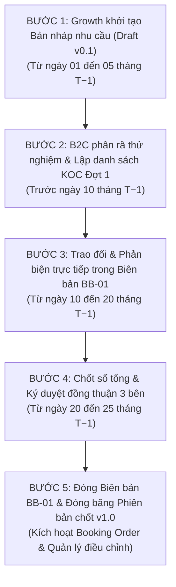

# QUY TRÌNH PHÂN RÃ KẾ HOẠCH MARKETING B2C
## Cơ Chế Phối Hợp 3 Bên (Growth — Marketing B2C — Media) & Quản Trị Phiên Bản Bằng Biên Bản

---

## 1. THÔNG TIN CHUNG

| Thuộc tính | Giá trị |
| :--- | :--- |
| **Mã tài liệu** | `QT-UPB-B2C-PLAN-01` |
| **Tên quy trình** | Quy trình Phân rã Kế hoạch Marketing B2C & Quản lý Phiên bản |
| **Phiên bản** | `v1.0.0` |
| **Ngày ban hành** | 12/10/2026 |
| **Đơn vị chủ quản** | Phòng Marketing B2C & Bộ phận Tăng trưởng Sàn (Growth) |
| **Phạm vi áp dụng** | Toàn bộ các gian hàng E-commerce do Upbase vận hành B2C |

### Lịch sử thay đổi
| Phiên bản | Ngày | Nội dung thay đổi | Người thực hiện |
| :--- | :--- | :--- | :--- |
| **v1.0.0** | 12/10/2026 | Ban hành quy trình chuẩn hóa: Phân rã 4 chiều, cơ chế phối hợp 3 bên (Growth - B2C - Media), gói Ads tổng và quản lý phiên bản bằng Biên bản điện tử. | Ban Vận Hành B2C |

---

## 2. MỤC ĐÍCH

Quy trình phân rã kế hoạch được xây dựng nhằm:

* **Chuẩn hóa hoạt động lập kế hoạch:**
  * Chuyển hóa mục tiêu kinh doanh và hạn mức chi phí do Growth giao thành kế hoạch hành động cụ thể: phòng Marketing B2C chịu trách nhiệm **phân rã chi tiết** phần sản xuất nội dung (Video KOC ngoại sàn, Kênh thương hiệu, Livestream, Đa nền tảng); Media tiếp nhận **một gói Tổng ngân sách Ads duy nhất** gắn liền với gian hàng trong tháng mà không cần phân tách theo từng kênh.
  * Chuẩn hóa việc phân bổ Creator theo đúng Khung Lương (KL1 – KL7 & TAP), gắn liền với việc thu thập mã quảng cáo (Spark Ads code) và quyền dùng hình ảnh để bàn giao cho Media khai thác linh hoạt.

* **Đảm bảo trách nhiệm rõ ràng giữa 3 bên tương tác:**
  * **Growth:** Chịu trách nhiệm bài toán doanh số (NMV), giao trần chi phí sản xuất cho B2C và **giao trọn gói Tổng ngân sách Ads cho Media**, chốt danh mục sản phẩm chủ lực (Hero SKU) và các chương trình ưu đãi của sàn.
  * **Marketing B2C (Booking & Content):** Là đầu mối **trực tiếp phân rã chi tiết** kế hoạch sản xuất: cơ cấu Khung Lương KOC, phân bổ kịch bản theo Trụ cột nội dung, nhịp 3 đợt chạy trong tháng, đàm phán hợp đồng thù lao và cam kết thời hạn bàn giao mã quảng cáo/quyền sử dụng hình ảnh.
  * **Media (Paid Ads):** **Không phải phân tách plan.** Nhận hạn mức Tổng ngân sách Ads từ Growth; đóng vai trò thẩm định tính khả thi của các góc nội dung/chân dung KOC mà B2C đề xuất; cam kết chỉ số hiệu quả chuyển đổi chung (ROAS, CIR) trên toàn bộ gói ngân sách Ads được giao.
  * Ghi nhận rõ ràng bằng chứng xác nhận điện tử của cả 3 đại diện phụ trách trước khi chốt kế hoạch.

* **Kiểm soát rủi ro vận hành & Trần ngân sách:**
  * Kiểm soát trần chi phí tự động theo công thức một nguồn:
    $$\text{Chi phí Booking KOC (chi tiết)} + \text{Chi phí Kênh thương hiệu (chi tiết)} + \text{Tổng ngân sách Ads (gói tổng)} \le \text{Trần ngân sách Growth giao}$$
  * Ngăn chặn rủi ro "lệch pha": B2C đàm phán hợp đồng KOC đúng thời hạn để bàn giao mã Spark Ads kịp thời cho Media; Media chủ động nạp tiền và vít quảng cáo theo nhịp chiến dịch mà không bị vướng mắc thủ tục điều chuyển ngân sách giữa các kênh.

* **Tăng hiệu quả phối hợp liên phòng ban:**
  * Tạo không gian làm việc chung trên bản nháp (Draft) giữa **Growth – Marketing B2C – Media** ngay từ đầu kỳ: Media tư vấn các định dạng/góc kịch bản dễ cắn quảng cáo để B2C đưa vào yêu cầu làm việc với KOC; B2C thông báo khung giá thị trường để Growth và Media ước lượng bài toán P&L.
  * Giảm tải thao tác thừa: loại bỏ hoàn toàn việc bắt buộc Media phải chia nhỏ ngân sách quảng cáo cho từng video/từng kênh khi chưa có dữ liệu chạy thực tế.

* **Đảm bảo tính tuân thủ nội bộ và quản trị phiên bản:**
  * Áp dụng nguyên tắc đóng băng dữ liệu (Freeze Snapshot): khi cả 3 bên cùng bấm xác nhận, hệ thống lưu lại Bản chốt đầu tháng (`v1.0 Baseline`), cố định cả phần phân rã chi tiết của B2C lẫn gói Tổng ngân sách Ads của Media. Nghiêm cấm mọi hành vi tự ý sửa số trực tiếp khi đang chạy chiến dịch.
  * Mọi biến động giữa kỳ (Growth cấp thêm ngân sách Top-up, B2C đổi KOC) đều phải thông qua luồng đề xuất điều chỉnh để lưu thành các phiên bản mới (`v1.1`, `v1.2`), tạo căn cứ minh bạch phục vụ đối soát chi phí và đánh giá hiệu suất nhân sự (P2/P3).

---

## 3. PHẠM VI ÁP DỤNG

* **Đối tượng:** Tất cả các gian hàng E-commerce (TikTok Shop, Shopee, Lazada, Đa sàn) do Upbase quản lý và vận hành marketing.
* **Bộ phận tham gia:**
  1. **Team Growth (Vận hành sàn):** Đầu mối nhận đề bài từ khách hàng/sàn, khởi tạo bản nháp nhu cầu và giao ngân sách trần.
  2. **Team Marketing B2C (Booking & Content):** Đầu mối phân rã kế hoạch nội dung, đàm phán hợp đồng Creator và sản xuất video.
  3. **Team Media (Paid Ads):** Đầu mối thẩm định góc kịch bản và nhận gói Tổng ngân sách Ads để vít quảng cáo.
  4. **Quản lý cấp cao (Trưởng phòng B2C / BOD):** Phê duyệt P&L và điều phối nguồn lực vận hành.
* **Chu kỳ thực hiện:** Hàng tháng (bắt đầu chuẩn bị từ tháng T−1, triển khai trong tháng T, đối soát tại T+1).

---

## 4. ĐỊNH NGHĨA THUẬT NGỮ

* **Bản nháp nhu cầu (Growth Demand Draft):** Bản ghi kế hoạch sơ bộ do Growth tạo trên hệ thống khi chưa chốt số chính thức, làm căn cứ để B2C và Media chuẩn bị nguồn lực.
* **Phân rã kế hoạch (Plan Breakdown):** Hoạt động bóc tách số tổng thành các đầu việc cụ thể theo 4 chiều: Kênh, Khung lương KOC, Nhịp 3 đợt và Nhân sự thực hiện.
* **Khung Lương (KL1 – KL7 & TAP):** Bảng định mức thù lao Creator chuẩn hóa của Upbase, từ nhóm KOC hoa hồng (TAP/FOC), Micro KOC (KL1–KL3), Mid/Macro (KL4–KL5) đến Key Creator/Celeb (KL6–KL7).
* **Gói Tổng Ngân Sách Ads (Lump-sum Ads Budget):** Con số ngân sách quảng cáo trọn gói do Growth giao cho Media trên một gian hàng trong tháng (tương ứng cột `Chi phí Ads` - Cột DH trong file 4.1), không chia nhỏ theo từng kênh hay từng video.
* **Biên Bản Làm Việc Điện Tử (Planning Protocol / Minutes):** Văn bản số ghi nhận toàn bộ bối cảnh, bảng số liệu cam kết, lịch sử trao đổi phản biện và chữ ký xác nhận của các bên.
* **Đóng băng dữ liệu (Freeze Snapshot):** Tiến trình hệ thống khóa toàn bộ quyền sửa đổi của một kế hoạch sau khi các bên đã ký biên bản, lưu thành một bản chụp bất biến mang số hiệu phiên bản (`v1.0`, `v1.1`).

---

## 5. NGUYÊN TẮC CỐT LÕI

1. **Khởi tạo từ bản nháp của Growth:** Quy trình bắt đầu từ một bản nháp do Growth tạo trên hệ thống (không đợi số chốt cứng). B2C và Media cùng làm việc trên bản nháp này để chuẩn bị trước.
2. **Nguyên tắc "Gói tổng Ads":** Media không phải phân tách kế hoạch quảng cáo theo từng video; Media nhận trọn gói hạn mức để linh hoạt vít ads theo hiệu quả thực tế.
3. **Trao đổi đến đâu, lưu biên bản đến đó:** Mọi đề xuất thay đổi số liệu hoặc phản biện giữa 3 bên phải diễn ra bên trong Biên bản làm việc, không chấp nhận thỏa thuận miệng hoặc tin nhắn rời rạc.
4. **Không sửa đè lên phiên bản đã chốt:** Phiên bản đầu tháng (`v1.0`) là căn cứ pháp lý gốc. Khi có phát sinh giữa kỳ, bắt buộc lập Biên bản điều chỉnh để tạo ra phiên bản mới (`v1.1`), bảo lưu đầy đủ lịch sử đối soát.

---

## 6. QUY TRÌNH THỰC HIỆN CHI TIẾT (5 BƯỚC)

### Bước 1: Growth khởi tạo Bản nháp nhu cầu
* **Thời gian:** Ngày 01 – 05 của tháng T−1.
* **Người thực hiện:** Growth PIC / Growth Lead.
* **Thao tác:**
  * Tạo mới kế hoạch trên hệ thống B2C Ops Hub.
  * Nhập các thông số dự kiến: Gian hàng, tháng triển khai T, Trần ngân sách ước tính, Mục tiêu NMV dự phóng, Gói Tổng ngân sách Ads dự kiến cho Media, Danh mục Hero SKU.
  * Trạng thái kế hoạch: `DRAFT_DEMAND` (Phiên bản nháp `v0.1`).

### Bước 2: B2C phân rã thử nghiệm & Chuẩn bị KOC Đợt 1
* **Thời gian:** Ngày 05 – 10 của tháng T−1.
* **Người thực hiện:** Booking PIC và Content PIC.
* **Thao tác:**
  * Dựa trên khung nháp của Growth, B2C ướm phân bổ 4 kênh: Video Affiliate, Kênh thương hiệu, Livestream, Đa sàn.
  * Phân bổ số lượng Creator theo khung lương KL1–KL7 và TAP.
  * Hoàn thành danh sách KOC Đợt 1 (chậm nhất ngày 10/T−1) để kịp gửi hàng mẫu và chuẩn bị kịch bản đón đợt khuyến mãi lớn (Mega Double Day đầu tháng).

### Bước 3: Trao đổi & Phản biện trong Biên bản làm việc (BB-01)
* **Thời gian:** Ngày 10 – 20 của tháng T−1.
* **Người tham gia:** Growth PIC, Booking PIC, Media PIC.
* **Thao tác:**
  * Mọi ý kiến phản biện diễn ra ngay trong mục thảo luận của **Biên bản BB-01**:
    * *Growth:* Cập nhật các thay đổi từ nhãn hàng hoặc chương trình trợ giá của sàn.
    * *Booking B2C:* Báo cáo tình hình đàm phán giá KOC; nếu giá thị trường tăng thì đề xuất điều chỉnh cơ cấu số lượng hoặc xin tăng ngân sách.
    * *Media:* Rà soát các góc kịch bản/chân dung KOC mà B2C đưa ra; tư vấn định dạng dễ cắn quảng cáo; xác nhận tính khả thi của mục tiêu ROAS trên gói ngân sách Ads.

### Bước 4: Chốt số tổng & Ký duyệt đồng thuận 3 bên
* **Thời gian:** Ngày 20 – 25 của tháng T−1.
* **Điều kiện tiên quyết:**
  * $\text{Chi phí Booking} + \text{Chi phí Kênh thương hiệu} + \text{Gói Ads tổng} \le \text{Trần ngân sách Growth giao}$ (Headroom $\ge 0$).
  * Tỷ trọng nhóm KOC lớn ($\ge$ KL4) không vượt quá 45% tổng ngân sách booking.
* **Hành động ký duyệt:**
  1. **Growth PIC:** Bấm `[Xác nhận giao số & gói Ads]`.
  2. **Booking PIC:** Bấm `[Xác nhận cơ cấu phân rã]`.
  3. **Media PIC:** Bấm `[Xác nhận nhận gói Ads & cam kết ROAS]`.
  4. **Trưởng phòng B2C:** Bấm `[Phê duyệt & Đóng biên bản]`.

### Bước 5: Đóng Biên bản BB-01 & Đóng băng Phiên bản chốt v1.0
* **Hành động hệ thống:**
  * Biên bản BB-01 chuyển trạng thái sang `SIGNED_LOCKED`.
  * Toàn bộ dữ liệu số và lịch sử trao đổi được đóng băng thành bản chụp bất biến: **`v1.0 (Bản chốt đầu tháng - Baseline)`**.
  * Chuyển trạng thái kế hoạch sang `IN_EXECUTION` (Chỉ đọc).
  * Tự động sinh mã Booking Order (BO) để nhân sự tiến hành ký hợp đồng và xuất kho gửi mẫu.

---

### QUY TRÌNH XỬ LÝ ĐIỀU CHỈNH GIỮA KỲ (NẾU CÓ PHÁT SINH)

Khi kế hoạch đang chạy ở bản `v1.0`, nếu giữa tháng phát sinh Top-up ngân sách hoặc đổi SKU:
1. **Không sửa đè lên `v1.0`:** Bản `v1.0` giữ nguyên vẹn để làm mốc đối soát gốc.
2. **Growth tạo phiên bản mới & Lập Biên bản điều chỉnh (BB-02):**
   * Growth bấm `[Growth: Tạo Phiên Bản Mới]` $\rightarrow$ Nhập số tổng mới, Gói Ads mới, Target NMV mới và **Lý do điều chỉnh**.
   * Hệ thống tự động mở **Biên bản Điều chỉnh BB-02** gắn liền với bản nháp `v1.1`.
3. **Thảo luận và Ký duyệt lại:**
   * B2C và Media vào biên bản BB-02 xem chênh lệch ($\Delta$ Ngân sách, $\Delta$ Video), điều chỉnh lại chi tiết và ký xác nhận.
   * Khi Trưởng phòng B2C ký duyệt $\rightarrow$ Đóng biên bản BB-02, khóa thành **`v1.1 - Bản chốt điều chỉnh`**.

---

## 7. MA TRẬN PHÂN QUYỀN RACI

| Hoạt động | Growth | Booking B2C | Content B2C | Media (Ads) | Lead B2C | Kế toán |
| :--- | :---: | :---: | :---: | :---: | :---: | :---: |
| 1. Khởi tạo Bản nháp nhu cầu (Draft v0.1) | **R / A** | I | I | I | I | I |
| 2. Phân rã KOC theo KL1–KL7 & Đa sàn | C | **R / A** | C | C | C | I |
| 3. Lập danh sách KOC Đợt 1 (trước ngày 10) | I | **R / A** | C | C | I | I |
| 4. Phân bổ kịch bản Kênh thương hiệu theo SKU | I | C | **R / A** | C | I | I |
| 5. Thẩm định tiềm năng chạy Ads & Cam kết ROAS | I | C | C | **R / A** | I | I |
| 6. Ký xác nhận Đồng thuận Biên bản BB-01 | **R** | **R** | C | **R** | **A** | I |
| 7. Phê duyệt & Đóng băng Phiên bản v1.0 | I | I | I | I | **R / A** | I |
| 8. Đề xuất & Tạo phiên bản điều chỉnh (BB-02) | **R / A** | C | C | C | C | I |
| 9. Nghiệm thu & Đối soát tài chính cuối tháng | C | C | C | C | **R / A** | **R** |

*(Ghi chú: R = Responsible / Người thực hiện; A = Accountable / Người chịu trách nhiệm cuối; C = Consulted / Người được tham vấn; I = Informed / Người nhận thông tin).*

---

## 8. BỘ BIỂU MẪU BIÊN BẢN CHUẨN TRÊN HỆ THỐNG

### 8.1. Mẫu Biên Bản BB-01: Biên Bản Thống Nhất Kế Hoạch Đầu Kỳ
* **Mã biên bản:** `BB-01/MKT-GROWTH/[Năm-Tháng]/[Tên Gian Hàng]`
* **Nội dung cam kết:**
  * Ngân sách sản xuất nội dung B2C (Booking + Kênh thương hiệu).
  * Gói Tổng ngân sách Ads do Media quản lý.
  * Chỉ tiêu NMV và số lượng video cam kết.
* **Bằng chứng xác nhận:** Chữ ký điện tử 4 bên kèm ý kiến cam kết.

### 8.2. Mẫu Biên Bản BB-02: Biên Bản Thỏa Thuận Điều Chỉnh Giữa Kỳ
* **Mã biên bản:** `BB-02/MKT-GROWTH/[Năm-Tháng]/[Tên Gian Hàng]`
* **Căn cứ điều chỉnh:** Lý do bằng văn bản của Growth (Top-up, đổi lịch sale, đổi SKU).
* **Bảng so sánh chênh lệch ($\Delta$):**
  * Ngân sách: Bản cũ $\rightarrow$ Bản mới $\rightarrow$ Chênh lệch ($+/-$).
  * Gói Ads tổng: Bản cũ $\rightarrow$ Bản mới $\rightarrow$ Chênh lệch ($+/-$).
  * GMV mục tiêu: Bản cũ $\rightarrow$ Bản mới $\rightarrow$ Chênh lệch ($+/-$).
* **Bằng chứng xác nhận:** Chữ ký điện tử của 3 bên và phê duyệt của Trưởng phòng B2C.

### 8.3. Mẫu Biên Bản BB-NT: Biên Bản Nghiệm Thu & Đối Soát Cuối Kỳ
* **Thời điểm lập:** Mùng 2 đến ngày làm việc thứ 5 của tháng T+1.
* **Nội dung:** Đối soát Thực tế (Actual) so với Bản chốt đầu tháng (`v1.0`) và các Bản điều chỉnh (`v1.x`), giải trình GAP ngân sách và GAP doanh số để quyết toán P&L và đánh giá KPI P2/P3.

---

## 9. CƠ CHẾ PHÂN TẦNG NHÂN SỰ & CHỐT CHẶN VẬN HÀNH B2C

Dựa trên thực tế đối soát vận hành giữa Plan Order tổng (File 4.1), Input plan (File 4.1.1) và List duyệt book (File 3.2), quy trình vận hành B2C thiết lập các cơ chế sau:

### 9.1. Mô hình nhân sự 2 tầng (2-Tier Team Structure)
* **Cấp 1 - Trưởng nhóm (Leader / Account Owner):** Là người đứng tên đại diện nhận hạn mức Order tổng từ Growth (`Nguyễn Thị Ngọc Tâm`, `Lương Thị Như Quỳnh`, `Lê Phương Thảo`, `Lê Thanh Hải`, `Hoàng Diệu Thuỳ`, `Dương Thị Hồng Nhung`...). Leader chịu trách nhiệm quản lý hạn mức và tiến độ chung của toàn team.
* **Cấp 2 - Chuyên viên thực thi (Specialist / Executor):** Được Leader phân công trực tiếp lập Input plan tuần và ký duyệt/nghiệm thu thực tế trên File 3.2 (`Hoàng Hải Long`, `Trần Thị Hảo`, `Nguyễn Ngọc Linh`, `Phan Diệu Ánh`, `Phạm Thị Thu Hằng`, `Lương Nguyễn Trang Nhung`, `Nguyễn Thị Quỳnh Nhi`...).
* **Phân tách chuyên môn FOC:** Phân công riêng nhân sự chuyên trách gửi sản phẩm mẫu miễn phí (FOC) với số lượng lớn (50 – 200 video, chi phí 0đ) tách biệt hoàn toàn với chuyên viên phụ trách đàm phán hợp đồng KOC trả phí.

### 9.2. Các chốt chặn kiểm soát ngân sách tự động
1. **Khóa vượt trần ngân sách (Hard Budget Gate):** Khi tổng chi phí thực tế duyệt trên File 3.2 chạm trần hạn mức Net được giao trên Order, hệ thống tự động khóa không cho phép duyệt thêm booking mới trừ khi có Phiếu đề xuất bổ sung ngân sách (Top-up) được Growth và Trưởng phòng B2C duyệt.
2. **Kiểm soát chi ngoài kế hoạch (Zero-Budget Gate):** Gian hàng có hạn mức Order bằng 0 VNĐ không được phép phát sinh hợp đồng trả phí nếu không có phê duyệt ngoại lệ bằng văn bản từ Brand/BOD.
3. **Quy chuẩn đối soát Net vs Gross:** Toàn bộ hạn mức Kế toán và Growth duyệt được quản lý theo giá **Net**. Khi deal giá với KOC, chuyên viên phải quy đổi chuẩn thuế suất VAT/TNCN để không làm thâm hụt hạn mức Net của gian hàng.
